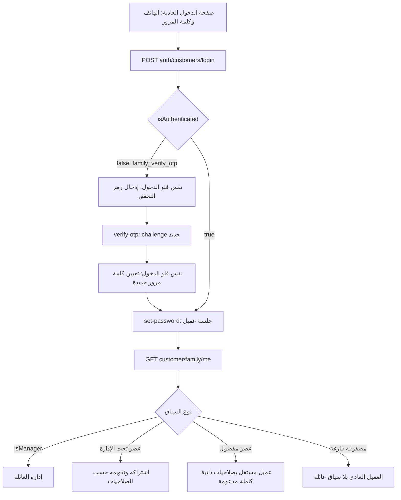

# مراجعة فلو إدارة العائلة المستخدم من الموبايل

تاريخ المراجعة: 15 أكتوبر 2026 — Asia/Riyadh.

هذه مراجعة للكود الفعلي في `F:/MealMate/backend`، على فرع `dev` عند commit `471d1c0` مع تعديلات العائلة المحلية غير المرفوعة. لا توجد نسخة تطبيق Flutter كاملة أو `pubspec.yaml` في المسارات التي تم فحصها؛ ملفات Dart الموجودة أمثلة توثيق، وليست مصدر التطبيق. لذلك لا تمثل هذه المراجعة اختبارًا لشاشات التطبيق المثبتة أو لقاعدة بيانات الإنتاج.

## قرارات المستخدم التي تحكم الفلو

1. نقطة دخول واحدة: صفحة الدخول العادية و`POST /api/v1/auth/customers/login` لكل العملاء، مديرًا أو عضوًا أو عضوًا مفصولًا.
2. إنشاء حساب الدخول وإصدار كلمة سر مؤقتة لا يفصل العضو. المدير يستمر في إدارة الوصول والصلاحيات.
3. فصل الحساب إجراء مستقل. العضو لا يختفي من لوحة المدير؛ يظهر للقراءة فقط، ويحتفظ بالاشتراك والتقويم وأيام الخدمة.
4. القرار المضاف أثناء المراجعة: عند الفصل يحصل العضو تلقائيًا على كل صلاحياته المدعومة على حسابه واشتراكه، ويصبح عميلًا عاديًا. لا تظل صلاحيات المدير القديمة قيدًا على تصرفاته الذاتية. لا يعني ذلك منح الوصول لبيانات أفراد آخرين، أو تنفيذ ميزات غير موجودة.

## ما تم التحقق منه

- فحص controllers وDTOs وhandlers وسياسات الوصول ومسارات أول دخول، والاشتراك والتقويم والعنوان والتجميد والتجديد والفواتير.
- فحص مباشر، دون تسجيل دخول أو تعديل بيانات، لـ`https://api.trymealmate.com/swagger/v1/swagger.json`: مسارات `/family/me` و`family-first-login/verify-otp` و`family-first-login/set-password` معلنة. مسار `/family/members/{memberId}/detach` غير معلن في الـSwagger الذي أُعيد وقت الفحص. لا يثبت فحص Swagger وحده إصدار الباك إند المنشور أو حالة migration في قاعدة بيانات الإنتاج.
- بعد تنفيذ القرار الأخير نجح 118 اختبار وحدة مركزًا، و9 اختبارات API للعائلة، بما فيها كل capabilities الذاتية لعضو detached ذي grants قديمة false، وتبديل لغة أخطاء الفصل `ar → en → ar`. نجح بناء API بصفر أخطاء وتحذيرات، ونجح `git diff --check`.
- في آخر محاولة تحقق سابقة، لم يبدأ اختبار PostgreSQL الجديد بسبب عدم توفر Docker. لا يوجد دليل تنفيذ ناجح للترحيل على PostgreSQL في هذه الجلسة.
- اختبار scanner التعريب الذاتي نجح. الفحص التشخيصي شمل 1170 ملفًا، ووجد صفر اختلافات parity في 57 كتالوجًا؛ لديه نتائج legacy كثيرة في لوحتي الإدارة والمطاعم. لا يختبر Flutter، ولا يثبت سلامة جميع النصوص، ولا يحل محل اختبار تبديل اللغة في التطبيق.

## مسار الدخول الواحد



صفحات رمز التحقق وكلمة المرور خطوات استكمال داخل فلو الدخول، وليست صفحات تسجيل دخول ثانية. لا تعرض اختيار «مدير/عضو» لتحديد سلطة الجلسة؛ السيرفر هو مصدر الهوية. إذا كان الرد pending فلا تخزن `loginChallengeToken` كأنه access token، ولا تفتح شاشات محمية قبل `isAuthenticated: true`. نجاح set-password يعطي جلسة بالفعل، فلا يلزم دخول جديد.

لا تستخدم `roles` أو `permissions` من رد تسجيل الدخول لتحديد صلاحيات الأسرة. الصلاحيات العامة للحساب منفصلة عن `FamilyMemberPermissions` وقرارات `FamilyActionPolicy`.

عند `GET /family/me`:

- `[]` يعني لا توجد سياقات عائلة مرئية وفق الاستعلام، وليس طلب تسجيل دخول مختلف.
- `isManager: true` يعطي سياق المدير؛ `capabilities` فيه فارغة و`memberSubscriptionId` يساوي null في التنفيذ الحالي. اجلب roster/capabilities لكل عضو بدل تفسير الفراغ على أنه منع كل شيء.
- العضو يحصل على هويته وsubscriptionId وقراراته الذاتية. استخدم هذا ID لفتح تقويمه، لا تعتمد على `/subscriptions/current` لاستنتاج الفرد المختار.
- `403` عند access paused/disabled يجب التعامل معه كحالة وصول مستقلة؛ لا تحوله إلى مصفوفة فارغة أو «ليس له اشتراك».

المصدر: [controller الدخول](F:/MealMate/backend/src/MealMate.Api/Controllers/V1/CustomerAuthController.cs:26)، [أول دخول](F:/MealMate/backend/src/MealMate.Application/Features/IdentityAccess/Auth/FamilyMemberFirstLogin.cs:44)، [سياق العضو](F:/MealMate/backend/src/MealMate.Application/Features/FamilyManager/FamilyMemberSessionContext.cs:25).

## فلو المدير: من الإضافة إلى الاشتراك

| المرحلة | API الأساسي | ماذا تعني النتيجة؟ |
|---|---|---|
| تحميل الفلو | `GET /customer/family-subscription-flow/current` و`metadata` | حالة المجموعة والمسودة والدفع؛ ليست جلسة العضو |
| تجهيز المجموعة | `PUT /customer/family-subscription-flow/group` | إعداد المجموعة وفق حالة الفلو |
| فحص الهاتف | `POST /customer/family-subscription-flow/members/lookup` | البحث عن الحساب/تعارض العضوية؛ ليس تصريح الدخول |
| إضافة عضو | `POST /customer/family-subscription-flow/members` | ينشئ العضو ويربط حساب العميل؛ access يبدأ `hasSeparateAccount: false` في الكود الحالي |
| بيانات/تفضيلات/عنوان | `PUT members/{id}`، مسارات allergies/dietary/disliked-ingredients/addresses | إعداد العضو قبل/بعد الشراء وفق القيود؛ paid delivery له مسار منفصل |
| إعداد الخدمة | `PUT members/{id}/plan` و`start-date` | برنامج/باقة/مدة/تصنيف وتاريخ البداية؛ بعض الحالات تقفل بعد وجود الخدمة المدفوعة |
| تحديد من سيُشترَك له | `PUT members/{id}/checkout-selection` | اختيار الدفع مستقل عن وجود العضو في roster |
| الملخص والدفع | `GET summary` و`POST checkout` أو`POST retry-payment` | نجاح إنشاء الدفع ليس تأكيد دفع ولا جاهزية التقويم |
| المتابعة | `GET /customer/family/home` و`members` وdetail | راقب payment/service/fulfillment؛ التقويم قد ينتظر fulfillment |

مسار `POST /customer/family/members` موجود في controller الإدارة لكنه يرفض الإضافة بـ`family.use_checkout_flow`. الموبايل يجب أن يستخدم مسار family-subscription-flow الفعلي.

المصادر: [مسارات الفلو](F:/MealMate/backend/src/MealMate.Api/Controllers/V1/CustomerFamilySubscriptionFlowController.cs:137)، [مسار الإضافة الرافض](F:/MealMate/backend/src/MealMate.Application/Features/FamilyManager/FamilyManagerHandlers.cs:356)، [حالة الوصول عند الإضافة](F:/MealMate/backend/src/MealMate.Application/Features/FamilyCheckout/FamilyDraftHandlers.cs:1036).

## إنشاء دخول العضو مقابل الفصل

إنشاء الدخول أو تجديد كلمة المرور المؤقتة:

```http
PUT /api/v1/customer/family/members/{memberId}/access
```

```json
{ "hasSeparateAccount": true, "generateTemporaryPassword": true }
```

الطلب الصريح لإصدار كلمة مؤقتة قد يعيد ضبط كلمة مرور حساب قائم، ويبطل refresh tokens وlogin challenges، ويضع `requiresPasswordSetup: true`. يجب أن تعبر الشاشة عن هذا الأثر، وألا تستخدمه كـretry تلقائي على كل refresh للشاشة. الحساب القائم يمكن ربط دخوله بدون تغيير كلمة مروره باستخدام التفعيل وحده عندما لا يطلب المدير reset.

`generatedPassword` يعاد مرة واحدة من response الإنشاء/reset، ولا يعيده GET. اعرضه مع الهاتف الصحيح، ثم احذفه من حالة الشاشة ولا تسجله في Dio أو analytics أو crash reports. لا تعِد إرساله إلى السيرفر في أي خطوة سوى password في تسجيل الدخول العادي.

الفصل:

```http
POST /api/v1/customer/family/members/{memberId}/detach
```

الشرط المحلي الحالي: عضو غير مدير، حساب Customer نشط مرتبط، access مفعّل وغير موقوف، password setup مكتمل، ولا عملية دفع/ترقية/تجديد معلقة وفق guard. الفصل idempotent، ويبقي الروابط وأيام الخدمة. `remove: true` إجراء إزالة/تسوية مختلف تمامًا؛ ليس زر الفصل، وقد يخفي العضو ويؤثر ماليًا على الخدمة.

تعطيل access أو pause ليس تجميد الاشتراك. استمرار الخدمة، إمكانية الدخول للحساب، وصلاحية التصرف في الاشتراك ثلاث حالات منفصلة.

المصدر: [access](F:/MealMate/backend/src/MealMate.Application/Features/FamilyManager/FamilyManagerHandlers.cs:399)، [detach](F:/MealMate/backend/src/MealMate.Application/Features/FamilyManager/FamilyManagerHandlers.cs:492).

## جدول الصلاحيات الفعلي

المدير يتصرف في الأعضاء تحت إدارته؛ بعد الفصل يقرأ ولا يكتب. العضو المُدار يحتاج مفاتيح المدير. العضو المفصول وفق القرار الجديد يحصل على كل التصرفات الذاتية المدعومة، وتبقى قيود حالة الاشتراك والأيام والمواعيد والسعة سارية.

| مفتاح الصلاحية | الفعل الحقيقي | endpoint/قيد مهم |
|---|---|---|
| `viewCalendar` | قراءة التقويم/اليوم/قوائم الوجبات | `GET subscriptions/{id}/calendar` و`days/...`؛ يتطلب fulfillment |
| `viewProgram` | `ViewPlan`؛ قراءة بطاقة الاشتراك والخطة | قوائم subscriptions و`{id}/management`؛ اسم الفعل ليس اسم المفتاح |
| `viewInvoices` | قراءة الفواتير المالية المسموح بها | `{id}/invoices`؛ فواتير دفع الأسرة وتخصيص العضو ليست شيئًا واحدًا |
| `selectRestaurant` | اختيار مطعم اليوم | `POST days/{date}/restaurant` |
| `editDailyMeals` | اختيار الوجبات وإتمام الصندوق والاختيار التلقائي اليدوي | `meals/slot` و`complete` و`auto-select`؛ اختيار مطعم جديد أثناء auto-select قد يتطلب `selectRestaurant` أيضًا |
| `confirmMeals` | تأكيد الصندوق | `POST days/{date}/confirm`؛ لا تتجاوز هذه الصلاحية اكتمال الصندوق أو شروط اليوم |
| `editAddress` | تعديل عنوان خدمة الاشتراك | `PUT subscriptions/{id}/delivery-address`؛ `addressId/effectiveFromDate/expectedVersion`، وتُرجع affected/skipped days |
| `changePassword` | تغيير كلمة مرور الحساب العادي | `PUT /customers/me/password`؛ recovery له مسار مختلف |
| `requestFreeze` | طلب تجميد | `POST subscriptions/{id}/freeze-requests`؛ يخضع لسياسة التجميد والاختيارات المقفولة |
| `requestRenewal` | طلب/شراء تجديد | `POST subscriptions/{id}/renewal-requests` ثم family renewal checkout |
| `requestUpgrade` | طلب ودفع ترقية التصنيف المدعومة | `upgrade-options/summary/payment-methods/upgrade-requests` |
| `cancelSubscription` | طلب إلغاء وتسوية | `cancellation-quote/cancellation-requests`؛ locked days والمال المدفوع لها سياسة تسوية |
| `viewFamilyCalendars` | قراءة تقاويم إخوة عبر سياسة sibling read | لا تمنح كتابة؛ تُرفض للعضو المفصول |
| `viewFamilyPlans` | قراءة خطط إخوة | لا تمنح إدارة أو تجديدًا لهم؛ تُرفض للمفصول |
| `viewFamilyInvoices` | قراءة فواتير إخوة حسب الخدمة ومسار التاريخ | لا تمنح فواتير/حقوق مالية خارج سياسة الفواتير؛ تُرفض للمفصول |
| `editMealsAndDays` | غير مدعوم حاليًا عبر family policy | دائمًا `family.action_not_available` |
| `changeProgram` | غير مدعوم حاليًا عبر family policy | دائمًا denied؛ لا تخلطه بإعداد خطة مسودة قبل الدفع |
| `changeDeliveryTime` | غير مدعوم حاليًا عبر family policy | دائمًا denied |
| `unitExchange` | غير مدعوم حاليًا عبر family policy | دائمًا denied |

لا تجعل checkbox غير المدعوم يبدو ميزة تعمل؛ قيمة true المخزنة لا تتجاوز قرار policy. أيضًا `allowed` في capability يجيب عن سلطة المستخدم، ولا يضمن جاهزية أي يوم أو عملية مالية الآن. اجمعه مع حالات الخدمة/actions في بطاقة الاشتراك وحالة اليوم/deadline.

المصادر: [الكتالوج](F:/MealMate/backend/src/MealMate.Application/Features/FamilyManager/FamilyManagerContracts.cs:204)، [السياسة](F:/MealMate/backend/src/MealMate.Application/Features/FamilyManager/FamilyActionPolicy.cs:60)، [التقويم](F:/MealMate/backend/src/MealMate.Application/Features/CustomerCalendar/CustomerCalendarEngine.cs:493)، [عنوان الخدمة](F:/MealMate/backend/src/MealMate.Application/Features/ProgramsSubscriptions/CustomerSubscriptions/FamilySubscriptionDeliveryAmendments.cs:91).

## الفجوات: أسباب وسيناريوهات محددة

التصنيف: P1 يؤثر مباشرة في الوصول/السلطة؛ P2 يكسر الفلو أو يعطي الشاشة عقدًا مضللًا. «مؤكد بالكود» يعني أن التتبع يبين السبب؛ سيناريوهات إعادة الإنتاج أدناه لم تُشغّل كلها على تطبيق أو قاعدة إنتاج. لا تحوّلها إلى ادعاء اختبار runtime ناجح.

### F01 — P1 — إعداد كلمة مرور عالق بعد الإزالة

**السبب:** اكتشاف pending setup وإصدار الجلسة وmiddleware يستخدمون `IgnoreQueryFilters` ويتحققون من `RequiresPasswordSetup` دون استثناء removed/cancelled. لكن استكمال الإعداد يشترط عضوًا غير removed ومجموعة Active. الإزالة لا تمسح العلم، وGET/PUT المدير للعضو removed يرفضه.

**السيناريو:** يصدر المدير كلمة مؤقتة، ثم يزيل العضو قبل إكمالها. الحساب ما زال pending؛ لا يسمح له بجلسة عادية، ولا استكمال onboarding، ولا generic password reset. قد يشمل المنع بقية بيانات الحساب أو اشتراكًا فرديًا يملكه.

**القرار المطلوب:** إجراء recovery حقيقي يفصل حساب العميل عن pending gate التاريخي عند انتهاء العضوية، مع إبطال كلمة المرور المؤقتة والتحقق الصحيح. لا يكفي إخفاء رسالة الخطأ.

المصدر: [pending](F:/MealMate/backend/src/MealMate.Application/Features/IdentityAccess/Auth/FamilyMemberFirstLogin.cs:36)، [شروط الإكمال](F:/MealMate/backend/src/MealMate.Application/Features/IdentityAccess/Auth/FamilyMemberFirstLogin.cs:158)، [middleware](F:/MealMate/backend/src/MealMate.Api/Middleware/FamilyPasswordSetupMiddleware.cs:15)، [recovery](F:/MealMate/backend/src/MealMate.Application/Features/IdentityAccess/Auth/OtpAndPassword.cs:519)، [الإزالة](F:/MealMate/backend/src/MealMate.Application/Features/FamilyManager/FamilyManagerHandlers.cs:409).

### F02 — P1 — الهاتف المعروض يمكن أن يختلف عن هاتف الدخول والتحقق

**السبب:** تعديل بيانات العضو يغير `FamilyMember.PhoneNumber` فقط عبر `ApplyWrite`. provisioning يفضل الحساب المحدد بـ`LinkedCustomerUserId`، والتحقق يرسل إلى `UserAccountDto.PhoneNumber`. response الوصول يفضل هاتف member للعرض إذا كان غير فارغ.

**السيناريو:** عضو مرتبط بحساب هاتفه A؛ يغير المدير هاتف بطاقة العضو إلى B، ثم يصدر كلمة مؤقتة. response يعرض B، لكن كلمة المرور رُبطت بحساب A، والـOTP يستهدف A. لا توجد مزامنة حساب موثقة في هذا المسار.

**القرار المطلوب:** مصدر واحد لهاتف تسجيل الدخول، وفصل تغيير هاتف الحساب والتحقق منه عن تعديل بيانات بطاقة العضو. منع تعديل هاتف بطاقة مرتبطة أو تقديم إجراء phone-change موثوق.

المصدر: [ApplyWrite](F:/MealMate/backend/src/MealMate.Application/Features/FamilyCheckout/FamilyDraftHandlers.cs:1804)، [provisioning](F:/MealMate/backend/src/MealMate.Application/Features/FamilyManager/FamilyManagerHandlers.cs:762)، [الهاتف المعروض](F:/MealMate/backend/src/MealMate.Application/Features/FamilyManager/FamilyManagerHandlers.cs:891)، [وجهة OTP](F:/MealMate/backend/src/MealMate.Application/Features/IdentityAccess/Auth/FamilyMemberFirstLogin.cs:57).

### F03 — P1 — سباق صلاحية طلب التجميد مع الفصل أو سحب الإذن

**السبب:** `SubscriptionFreezeService.RequestFreezeAsync` يفحص `RequestFreeze` قبل إرسال command. الـhandler يأخذ قفل المجموعة ويعيد تحميل الاشتراك لكنه لا يعيد فحص سلطة العميل داخل القفل.

**الترتيب الممكن بالكود:** يفحص طلب المدير ويُسمح → عملية الفصل أو تغيير permissions تأخذ group lock وتحفظ → command التجميد يأخذ القفل ويكمل دون policy recheck. بذلك يمكن أن يُنشأ طلب بدأ قبل الفصل/السحب بعد انتهاء سلطة المدير.

**الإجراء المقترح:** إعادة تحقق customer authorization داخل النطاق المقفول مع الحفاظ على authorization المنفصل لمسار الإدارة. هذه فجوة تتطلب اختبار PostgreSQL متزامن؛ ليست مثبتة بتشغيل سباق في هذه المراجعة.

المصدر: [الفحص الأول](F:/MealMate/backend/src/MealMate.Application/Features/ProgramsSubscriptions/Freeze/SubscriptionFreezeService.cs:86)، [command](F:/MealMate/backend/src/MealMate.Application/Features/ProgramsSubscriptions/SubscriptionOperationsHandlers.cs:81)، [القفل](F:/MealMate/backend/src/MealMate.Application/Features/ProgramsSubscriptions/SubscriptionOperationsHandlers.cs:767).

### F04 — P2 — switcher لا يطابق هوية المستدعي أو حالة الفصل

**السبب:** endpoint manager-only، لكنه يحسب `canEditDailyMeals` من دور العضو المستهدف أو أذونات العضو وإيقافه، لا من سياسة المستدعي الحالي. لا يتضمن DTO حالة detach، ولا تدخل هذه الحالة في الحساب.

**النتيجة:** عضو مفصول لديه EditDailyMeals=true قد يظهر للمدير editable ثم تُرفض عملية المدير. وعضو managed بلا grant قد يظهر غير قابل للتعديل رغم أن المدير يستطيع تعديله.

**الإجراء المقترح:** كل affordance من سياسة المستدعي الحالي وإضافة حالة فصل واضحة. لا يمكن للموبايل الاعتماد على هذا الحقل وحده حتى ذلك الحين.

المصدر: [الحساب](F:/MealMate/backend/src/MealMate.Application/Features/FamilyManager/FamilyManagerHandlers.cs:304)، [DTO](F:/MealMate/backend/src/MealMate.Application/Features/FamilyManager/FamilyManagerContracts.cs:238).

### F05 — P2 — home/lifecycle لا يحملان حالة الفصل أو إعداد كلمة المرور

detail وmembers وaccess وme تحمل حالة detach بأسماء DTO مختلفة. `FamilyHomeMemberDto` لا يحملها. `Lifecycle.AccessStatus` يعيد Enabled/Managed/Paused/Removed فقط، دون Detached أو PasswordSetupRequired.

**النتيجة:** الصفحة الرئيسية لا تستطيع تمييز «دخول مفعّل ويحتاج أول إعداد» من «دخول جاهز»، ولا ضمان قراءة-only للعضو المفصول من payload وحده.

**الإجراء المقترح:** عقد حالة وصول موحد لكل surfaces، أو دمج responses صراحة في العميل بدل الاستنتاج من Enabled.

المصدر: [home DTO](F:/MealMate/backend/src/MealMate.Application/Features/FamilyManager/FamilyManagerContracts.cs:20)، [lifecycle](F:/MealMate/backend/src/MealMate.Application/Features/FamilyManager/FamilyManagerHandlers.cs:943).

### F06 — P2 — تفعيل الدخول لا يمنح الحد الأدنى من القراءة للعضو المُدار

إنشاء/تفعيل access لا يضبط viewCalendar أو viewProgram. صف permissions جديد يبدأ false. لذلك ينجح onboarding، ثم يحصل المستخدم على capabilities كلها denied، وقد لا يحصل على subscriptionId في `/me`.

**القرار المطلوب:** هل مشاهدة الاشتراك والتقويم حق أساسي لكل عضو له دخول؟ إذا نعم، افتراضي صلاحيات أدنى أو preset واضح قبل الإنشاء. القرار الجديد يمنح كل الحقوق عند الفصل فقط؛ لا يجيب تلقائيًا عن managed onboarding.

المصدر: [EnsurePermissions](F:/MealMate/backend/src/MealMate.Application/Features/FamilyManager/FamilyManagerHandlers.cs:720)، [اختيار subscriptionId](F:/MealMate/backend/src/MealMate.Application/Features/FamilyManager/FamilyMemberSessionContext.cs:59).

### F07 — P2 — صلاحية التقويم وحدها قد تجعل قائمة الاشتراكات فارغة

**السيناريو:** managed member لديه ViewCalendar=true وViewProgram=false. `/family/me` يمكنه إعادة ID وتقويمه مسموح؛ لكن `VisibleCustomerSubscriptions` يفحص ViewPlan حصريًا، فيُحذف الاشتراك من current/list/management. وقد توجد write grants دون read grant اللازمة للوصول للشاشة أصلًا.

**الإجراء المقترح:** قواعد prerequisites للصلاحيات، أو بطاقة اشتراك مختصرة لا تكشف الخطة لكنها تسمح بفتح تقويم مصرح به. لا تستخدم «لا يوجد اشتراك» كمرادف «الخطة غير مسموحة».

المصدر: [قوائم الاشتراكات](F:/MealMate/backend/src/MealMate.Application/Features/ProgramsSubscriptions/CustomerSubscriptions/CustomerSubscriptionQueryService.cs:292)، [me](F:/MealMate/backend/src/MealMate.Application/Features/FamilyManager/FamilyMemberSessionContext.cs:59).

### F08 — P2 — PUT للصلاحيات يخلط replacement وpatch

الثمانية القديمة bool غير nullable وتُكتب كلها دون فحص حضور JSON. الحقول الـ11 الجديدة nullable وتُعدل عند إرسالها فقط. `expectedVersion` إلزامي. إرسال `{expectedVersion, viewCalendar:true}` وحده قد يصفّر الثمانية القديمة بدل رفض الطلب الناقص.

**تعاقد الموبايل الحالي:** GET أولًا؛ احتفظ بالثمانية كلها؛ أرسلها كلها مع expectedVersion وما تغير من الـ11. عند 409 أعد القراءة واعرض التعارض؛ لا تعِد إرسال نسخة قديمة آليًا.

**الإجراء المقترح:** PUT كامل مع presence validation أو PATCH موحد؛ أخفِ الحقول غير المدعومة أو وضّح disabled سببها.

المصدر: [الطلب](F:/MealMate/backend/src/MealMate.Application/Features/FamilyManager/FamilyManagerContracts.cs:171)، [الكتابة](F:/MealMate/backend/src/MealMate.Application/Features/FamilyManager/FamilyManagerHandlers.cs:593).

### F09 — P2 — لا يوجد resend خاص لأول دخول الأسرة

مسار أول الدخول يستخدم purpose `FamilyMemberFirstLogin`. `resend-phone-otp` يرسل purpose `VerifyPhone`، لذلك ليس إعادة إرسال صحيحة لرمز first-login. إعادة طلب login تستطيع بدء challenge جديدة وتستهلك التحديات السابقة، لكن ذلك ليس عقد resend مستقلًا.

**الموبايل:** لا تربط زر إعادة إرسال رمز الأسرة بـresend-phone-otp. إلى أن يوجد إجراء واضح، العودة الآمنة لنفس صفحة login وبدء تحدي جديد. بعد verify-otp استبدل token؛ لا تستخدم challenge الخطوة الأولى في set-password.

المصدر: [purpose الأسرة](F:/MealMate/backend/src/MealMate.Application/Features/IdentityAccess/Auth/FamilyMemberFirstLogin.cs:60)، [resend العام](F:/MealMate/backend/src/MealMate.Application/Features/IdentityAccess/Auth/OtpAndPassword.cs:385)، [إبطال التحديات السابقة](F:/MealMate/backend/src/MealMate.Persistence/Identity/AuthLoginChallengeService.cs:34).

### F10 — P2 — إصدار كلمة مؤقتة متاح في Draft لكن أول دخول يشترط Active

manager loader يقبل Draft/CheckoutPending/Active؛ وبالتالي يمكن إصدار كلمة مؤقتة مبكرًا. `FindPendingAccessAsync` يشترط Active. العضو قد يتسلم كلمة صحيحة ثم يُرفض استكمالها قبل شراء/تفعيل المجموعة.

**القرار المطلوب:** هل دخول العضو مسموح قبل اشتراك الأسرة؟ إن كان نعم، يلزم سياق قبل الخدمة لا يعتمد على Active. إن كان لا، تمنع الشاشة الإصدار مبكرًا مع سبب صحيح. لا تُظهر «كلمة المرور خاطئة» لهذه الحالة.

المصدر: [manager group](F:/MealMate/backend/src/MealMate.Application/Features/FamilyManager/FamilyManagerHandlers.cs:670)، [first login](F:/MealMate/backend/src/MealMate.Application/Features/IdentityAccess/Auth/FamilyMemberFirstLogin.cs:158).

### F11 — P2 — pause/disable لا يعنيان منع تسجيل الدخول للحساب كله

بعد اكتمال setup، customer login وIssueSession يفحصان حالة حساب العميل وpending setup، ولا يفرضان HasSeparateAccount/IsPaused على إصدار جلسة جديدة. family policy تمنع بيانات الأسرة؛ عامة profile/preferences/account endpoints لا تتحول إلى family grants.

**القرار المطلوب:** تسمية access بأنه «وصول بيانات العائلة» أو منع الدخول للحساب كله؟ تعطيل account عام له آثار على اشتراكات فردية وبيانات مستقلة. يجب تحديد النطاق؛ النظام الحالي أقرب إلى المنع الخاص ببيانات الأسرة، مع منع أوسع حين يكون إعداد كلمة المرور معلقًا.

المصدر: [customer login](F:/MealMate/backend/src/MealMate.Application/Features/IdentityAccess/Auth/LoginRefreshLogout.cs:309)، [session](F:/MealMate/backend/src/MealMate.Persistence/Identity/AuthSessionService.cs:74)، [family policy](F:/MealMate/backend/src/MealMate.Application/Features/FamilyManager/FamilyActionPolicy.cs:93).

### F12 — P2 — ChangePassword المقيد له recovery غير خاضع لنفس grant بعد الإعداد

التغيير العادي يفحص ChangePassword. generic customer reset يرفض pending setup فقط، ثم يسمح بالـOTP reset بعد الإعداد دون FamilyActionPolicy. هذا قد يكون مطلوبًا كحق استرداد حساب، لكنه ليس تنفيذًا لمنع مطلق لتغيير كلمة المرور بواسطة المدير.

**القرار المقترح:** كلمة مرور المستخدم واستردادها ملكه؛ المدير يدير صلاحيات الأسرة، وليس حق استرداد حسابه. إن تقرر إبقاء ChangePassword مقيدًا للعضو managed، وضح الفرق بين normal change وrecovery. بعد detach القرار الجديد يعطي الحق الذاتي تلقائيًا.

المصدر: [change](F:/MealMate/backend/src/MealMate.Application/Features/IdentityAccess/Customers/CustomerSelfService.cs:538)، [reset](F:/MealMate/backend/src/MealMate.Application/Features/IdentityAccess/Auth/OtpAndPassword.cs:519).

### F13 — P2 — family-scope grants بلا switcher متاح للعضو وقد تغيّر «current»

الـswitcher وroster المتاحان للإدارة manager-only. `/me` يعرض عضو المستخدم فقط. family-scope grants قد تسمح بقراءة بعض اشتراكات الإخوة، لكن DTO بطاقة الاشتراك لا يحتوي MemberId/اسم العضو، واستعلام current يختار حسب حالة/تاريخ الاشتراك دون أولوية لهوية العضو الحالي لغير المدير.

**النتيجة:** لا يوجد عقد واضح لتصفح «فرد آخر مسموح لي قراءته»؛ ومع ViewFamilyPlans قد يصبح current اشتراك أخ بدل اشتراك صاحب الجلسة.

**الإجراء المقترح:** لا تستخدم current لإدارة اختيار الفرد. إما member-scoped discovery يعيد الهوية والـIDs والقدرات المسموح بها، أو إيقاف هذا الجزء من UI إلى حين اكتماله. لا تمنح sibling كتابة.

المصدر: [switcher manager](F:/MealMate/backend/src/MealMate.Application/Features/FamilyManager/FamilyManagerHandlers.cs:261)، [current](F:/MealMate/backend/src/MealMate.Application/Features/ProgramsSubscriptions/CustomerSubscriptions/CustomerSubscriptionQueryService.cs:59)، [DTO](F:/MealMate/backend/src/MealMate.Application/Features/ProgramsSubscriptions/CustomerSubscriptions/CustomerSubscriptionContracts.cs:53).

### F14 — P2 — أخطاء التجديد لا تحافظ على 403/ProblemDetails

service يعيد Forbidden عند رفض RequestRenewal. controller يحول كل خطأ عدا NotFound/Conflict إلى BadRequest مع `{error:code}`. إذن هذا المسار قد يعيد 400 حيث بقية مسارات الأسرة تعيد 403 وProblemDetails مع detail مترجم.

**الإجراء المقترح:** عقد خطأ موحد؛ في الموبايل لا تفترض شكلًا واحدًا حاليًا، واقرأ code أو error semantic، ولا تعرض raw diagnostics.

المصدر: [renewal auth](F:/MealMate/backend/src/MealMate.Application/Features/ProgramsSubscriptions/Renewal/SubscriptionRenewalService.cs:42)، [controller](F:/MealMate/backend/src/MealMate.Api/Controllers/V1/CustomerSubscriptionManagementController.cs:411).

### F15 — P2 — كلمة المرور ذات العرض الواحد لا توفر استعادة response بعد timeout

السيرفر لا يخزن plaintext للاسترجاع، وهذا صحيح. لكن لا يوجد idempotency/result replay لإصدار كلمة مؤقتة. إذا حُفظت العملية وضاع response، GET لا يعيد كلمة المرور. تكرار generateTemporaryPassword يصدر كلمة جديدة ويُلغي السابقة.

**الموبايل:** عطّل الضغط المتكرر؛ لا retry تلقائي متكرر لهذا الفعل. عند timeout اعرض «النتيجة غير مؤكدة» مع خيار إصدار جديد صريح، وحدّث حالة setup؛ لا تدعي فشل العملية ثم تستخدم كلمة قديمة.

المصدر: [provision/reset](F:/MealMate/backend/src/MealMate.Application/Features/FamilyManager/FamilyManagerHandlers.cs:819)، [MapAccess](F:/MealMate/backend/src/MealMate.Application/Features/FamilyManager/FamilyManagerHandlers.cs:883).

## حدود الفصل التي تحتاج قرارًا إضافيًا

- **الحقوق الذاتية:** تم حسمها أثناء المراجعة: تلقائية وكاملة للعمليات المدعومة، لا تتجمد عند grants المدير القديمة. يلزم اختبار التنفيذ الجديد لكل Supported/Unsupported action.
- **الانضمام إلى عائلة أخرى:** العضو المفصول يحتفظ بالعضوية التاريخية والروابط. `IsInAnotherFamilyAsync` وduplicate account linkage لا يستثنيان detached records؛ قد يُرفض انضمامه لعائلة أخرى. الحفاظ على الاشتراك القديم لا يحدد وحده سياسة النقل أو العضويات المتعددة. [المصدر](F:/MealMate/backend/src/MealMate.Application/Features/FamilyCheckout/FamilyDraftHandlers.cs:1740).
- **إعادة الإدارة:** لا يوجد reattach endpoint في controller الحالي. لا ينبغي أن تُعيد toggle الدخول إدارة عضو detached ضمنيًا. إن أردتم رجوع الإدارة، يلزم قبول من صاحب الحساب وسلوك واضح للصلاحيات والخدمة.
- **خصوصية قراءة المدير:** القرار الحالي يسمح calendar/plan/invoices بعد الفصل، وقراءات عنوان/preferences ما زالت متاحة في draft handlers عند allowDetached. يلزم اعتماد بالضبط ما يبقى ظاهرًا؛ «قراءة فقط» ليست تلقائيًا تصريحًا لكل بيانات الحساب الشخصية.
- **الطلبات السابقة للفصل:** تم منع الفصل أثناء دفع/ترقية/renewal payment معلّق. طلبات التجميد غير المالية قد تبقى submitted ثم تعتمد إداريًا لاحقًا. يلزم تعريف أثر detach على intent قديم، بالإضافة إلى إصلاح سباق F03.
- **المجموعة التاريخية:** own policy للعضو ما زالت تمر عبر حالة FamilyGroup؛ حذف/إلغاء المجموعة تاريخيًا يمنع live family access. لا توجد في هذه المراجعة عملية مثبتة تسمح للمدير بإلغاء المجموعة كلها بعد الفصل؛ هذه تبعية نموذج بيانات تحتاج اختبارًا وقاعدة لحماية خدمة detached عند أي تغيير إداري لاحق.
- **المسارات العامة:** صلاحيات الأسرة ليست قائمة بكل ميزات التطبيق: profile، دفتر العناوين، تفضيلات الطعام، ودخول حساب فردي لها مسارات أخرى. EditAddress في هذه المراجعة يحكم عنوان خدمة الاشتراك، وليس كل دفتر عناوين الحساب. يجب أن يطابق وصف الصلاحية ذلك.
- **فروق الأيام/التقويم:** نقل عنوان الاشتراك لا يغير الأيام المقفولة، بل يعيد affected/skipped days. address book edits لا تستبدل paid delivery snapshot تلقائيًا؛ العرض الناجح لعنوان جديد في دفتر الحساب لا يعني تغير توصيل الاشتراك.

## ترتيب العمل المقترح قبل اعتماد الموبايل

1. القرار المحسوم منفذ محليًا ومتحقق بالاختبارات المذكورة: detached own full supported rights، والمدير read-only. يبقى اختبار PostgreSQL وتحديد نشر الترحيل والمسار.
2. F01/F02/F03 قبل اعتبار فلو onboarding والفصل قابلًا للاعتماد: recovery للحساب العالق، هاتف واحد موثوق، authorization تحت قفل التجميد.
3. F04/F05/F06/F07/F08: حالات وأذونات قابلة للعرض وحفظ لا يفقد أذونات سابقة.
4. F09/F10/F14/F15: استكمال/retry/errors وخطوات أول دخول موثقة بعقد واحد.
5. حسم F11/F12 وحدود عضوية الأسرة الجديدة وخصوصية المدير؛ ثم تنفيذ sibling discovery فقط إذا كان مطلوبًا.

## قبول الموبايل المطلوب اختباره

- نفس صفحة login في الحالات الثلاث، دون اختيار دور يعين السلطة.
- pending login بلا access/refresh؛ OTP ثم password ثم /family/me؛ تبديل challenge token في كل خطوة.
- managed member له أقل قراءة، قراءة فقط، كتابة فقط، صلاحيات مالية، أو all-denied؛ لا رسائل «اشتراك غير موجود» خاطئة.
- account له كلمة قائمة ولم يسجل دخولًا، له login سابق، له pending setup، ولا حساب؛ تأكد من الهاتف الحقيقي ومرّة عرض كلمة المرور.
- timeout للإصدار، ضغط متكرر، انتهاء challenge، code خطأ، resend، pause أثناء onboarding، remove أثناء onboarding.
- manager switcher مع managed/paused/detached، ومطابقة الأزرار لما تقبله API.
- تغيير صلاحية أثناء فتح الشاشة؛ 409 version؛ إعادة القراءة دون overwrite صامت.
- detach مرتين؛ إخفاق detach بسبب provider invoice؛ detached self actions جميع المدعوم منها تعمل، ومدير لا يكتب؛ subscription FK/status/day counts ثابتة.
- طلب تجميد متزامن مع detach أو سحب RequestFreeze؛ يحتاج PostgreSQL واختبار ترتيب transactions.
- اسم البرنامج والفرد والفواتير بعد منح family-scope؛ own subscription يبقى الافتراضي الصحيح.
- تقويم غير جاهز بعد الدفع؛ يوم مقفول؛ address amendment مع skipped days؛ تجميد وتاريخ جديد وتجديد مع الاشتراك القادم.
- `ar → en → ar` مع error/dialog مفتوح، وRTL/LTR، وAsia/Kuwait للموعد التشغيلي، وKWD ثلاث منازل.

لا تُعد هذه القائمة اختبارات منفذة. الجزء المنفذ فعليًا مذكور في بداية التقرير؛ يتطلب القبول النهائي مصدر Flutter وبيئة PostgreSQL قابلة للتشغيل، وبيانات اختبار حقيقية داخل بيئة اختبار معزولة.

Mock Data Check:
- No mock business data introduced.
- No fake fallback responses introduced.
- No hardcoded production business values introduced.
- All runtime data comes from real application sources.

