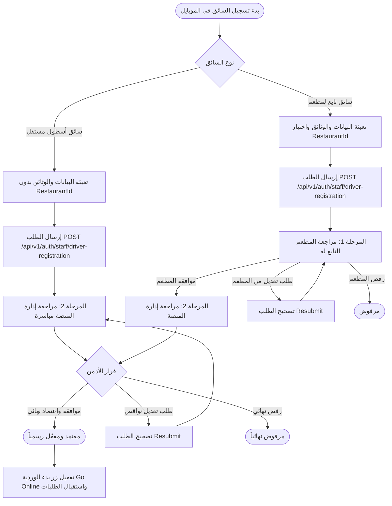

# الدليل الشامل لمطور الموبايل: دورة تسجيل واعتماد وتشغيل السائقين في MealMate
# Mobile Developer Integration Guide: Driver Onboarding, Approval & Operational Flow

> **الجمهور المستهدف:** مطورو تطبيقات الموبايل (Flutter / React Native / Native iOS & Android) وفريق تكامل الـ Backend.  
> **النطاق:** دورة حياة السائق كاملة: التسجيل الذاتي، التحقق من الهوية، تسجيل الدخول لأول مرة، تتبع مراحل التدقيق والموافقة، طلبات التعديل، استقبال الإشعارات (FCM)، وبوابة التشغيل وبدء الوردية.  
> **الإصدار والاعتماد:** سبتمبر 2026 — متوافق كلياً مع .NET 9 API ومطابقة إغلاق الفجوات (N01–N11).

---

## الفهرس (Table of Contents)
1. [المعمارية ونظرة عامة على الفلو (Architecture & Flow Overview)](#1-المعمارية-ونظرة-عامة-على-الفلو)
2. [قواعد العمل الحرجة للموبايل (Critical Mobile Business Rules)](#2-قواعد-العمل-الحرجة-للموبايل)
3. [دليل المسارات وواجهات الـ API (API Endpoints & Contracts)](#3-دليل-المسارات-وواجهات-الـ-api)
   - 3.1. [استعلامات القوائم والإعدادات (Catalog & Lookups)](#31-استعلامات-القوائم-والإعدادات)
   - 3.2. [رفع وثائق ومستندات السائق (Document Upload)](#32-رفع-وثائق-ومستندات-السائق)
   - 3.3. [تقديم طلب التسجيل الذاتي (Self-Registration)](#33-تقديم-طلب-التسجيل-الذاتي)
   - 3.4. [استعلام الهاتف وإعداد الحساب لأول مرة (Phone Lookup & First-Time Setup)](#34-استعلام-الهاتف-وإعداد-الحساب-لأول-مرة)
   - 3.5. [تسجيل الدخول الاعتيادي (Standard Login)](#35-تسجيل-الدخول-الاعتيادي)
   - 3.6. [تتبع حالة الطلب والمراحل (Application Status Tracking)](#36-تتبع-حالة-الطلب-والمراحل)
   - 3.7. [إعادة تقديم الطلب وتصحيح النواقص (Resubmit Application)](#37-إعادة-تقديم-الطلب-وتصحيح-النواقص)
   - 3.8. [الملف الشخصي والحالة التشغيلية (Driver Profile - Screen 09.02)](#38-الملف-الشخصي-والحالة-التشغيلية)
   - 3.9. [تسجيل توكن الإشعارات (FCM Device Token)](#39-تسجيل-توكن-الإشعارات)
   - 3.10. [مركز الإشعارات داخل التطبيق (In-App Notification Center)](#310-مركز-الإشعارات-داخل-التطبيق)
4. [مخطط الحالات والتحويلات (States, Stages & Status Mapping)](#4-مخطط-الحالات-والتحويلات)
5. [الإشعارات اللحظية والروابط العميقة (FCM Push & Deep Linking)](#5-الإشعارات-اللحظية-والروابط-العميقة)
6. [حالات شاشات الموبايل وتجربة المستخدم (UI States & UX Guidelines)](#6-حالات-شاشات-الموبايل-وتجربة-المستخدم)
7. [بوابة الأهلية وبدء الوردية (Operational Eligibility Gate)](#7-بوابة-الأهلية-وبدء-الوردية)
8. [قاموس أكواد الأخطاء وكيفية معالجتها (Error Codes Reference)](#8-قاموس-أكواد-الأخطاء-وكيفية-معالجتها)
9. [نماذج كود مقترحة لـ Flutter (Dart Models & API Snippets)](#9-نماذج-كود-مقترحة-لـ-flutter)

---

## 1. المعمارية ونظرة عامة على الفلو

تتبع منصة MealMate نظام تدقيق واعتماد متعدد المراحل للسائقين، حيث ينقسم السائقون إلى مسارين رئيسيين:



### ملخص الرحلات الثلاث:
1. **سائق أسطول مستقل (MealMate Fleet)**:
   - يسجل بدون `restaurantId` (أو تكون القيمة `null`).
   - يتخطى مرحلة المطعم مباشرة، ويدخل في المرحلة 2 (مراجعة إدارة المنصة).
   - يحصل على موافقة الأدمن ليفعّل حسابه.
2. **سائق يسجل ذاتياً لمطعم (Restaurant Self-Registration)**:
   - يختار المطعم التابع له من القائمة (`restaurantId`).
   - يدخل المرحلة 1 (مراجعة المطعم)؛ إذا وافق المطعم، يُحال للمرحلة 2 (مراجعة الإدارة).
   - لا يصبح نشطاً تشغيلياً إلا بعد موافقة إدارة المنصة النهائية.
3. **سائق منشأ من لوحة المطعم (Restaurant-Created Driver)**:
   - ينشئه المطعم ببياناته ووثائقه؛ يدخل تلقائياً في مرحلة بانتظار الإدارة `PendingAdmin`.
   - يقوم السائق بعمل First-Time Setup بهاتفه لتحديد كلمة مروره.
   - يظل زر الوردية والعمل معطلاً حتى يوافق الأدمن عليه.

---

## 2. قواعد العمل الحرجة للموبايل

> [!IMPORTANT]
> **قواعد صارمة يجب على مبرمج الموبايل الالتزام بها لتفادي ثغرات وفشل الطلبات:**

1. **إعداد الحساب وتعيين كلمة المرور لا يعني الاعتماد التشغيلي**:
   - إتمام `lookup-phone` و`first-time-setup` بنجاح واستلام JWT Token لا يعني أن السائق يستطيع بدء العمل (`Go Online`).
   - حساب السائق يكون بحالة `AccountStatus.Registered` وتكون حالة التحقق `UnderReview` أو `Submitted`.
   - زر الوردية (Online Toggle) **يجب أن يكون معطلاً (Disabled)** في الشاشة الرئيسية مع إظهار بطاقة توضيحية بحالة المراجعة الحالية.
2. **شروط الصلاحية وتفرد البيانات (Validation Guardrails)**:
   - **السن القانوني**: تاريخ الميلاد `dateOfBirthUtc` يجب أن يكون قبل 18 سنة على الأقل من اليوم (العمر $\ge 18$).
   - **التواريخ المستقبلية**: تواريخ انتهاء الهوية المدنية، رخصة القيادة، ودفتر المركبة (`NationalIdExpiryUtc`, `LicenseExpiryUtc`, `VehicleRegistrationExpiryUtc`) يجب أن تكون في المستقبل حصراً.
   - **التفرد**: الرقم المدني ورقم الرخصة ولوحة المركبة فريدة على مستوى المنصة ككل.
3. **حماية تغيير الهاتف أثناء التعديل (Resubmit Phone Safety)**:
   - لا يمكن للسائق تغيير رقم هاتفه إلى رقم مستخدم آخر مسجل أو هاتف طلب تسجيل نشط.
   - تعديل الهاتف يتطلب تأكيداً عبر OTP في التطبيق قبل اعتماده.
4. **تطبيع حالات الـ API (Normalize Strings & Numbers)**:
   - الـ Backend قد يرجع الحالات إما كنصوص (`"Submitted"`, `"Approved"`, `"NeedsChanges"`) أو كأرقام (`2`, `4`, `8`).
   - **يجب** على طبقة البيانات في الموبايل استخدام محول موحد (Normalizer/Mapper) للتعامل مع الحالتين بدقة وتفادي الـ Crashes.
5. **تسجيل توكن الـ Push (FCM Token)**:
   - يجب إرسال توكن الـ FCM فور إرسال الطلب (عبر `registrationId`) حتى وإن لم يسجل السائق دخوله بعد، لضمان وصول إشعارات تغيير الحالة والمراجعة عندما يكون التطبيق مغلقاً.

---

## 3. دليل المسارات وواجهات الـ API

### 3.1. استعلامات القوائم والإعدادات
تستخدم هذه المسارات في شاشات ملء استمارة التسجيل لاختيار المطعم والجنسية ونوع المركبة واللون والموديل.

| المسار | الطريقة | الحماية | الغرض |
|---|---|---|---|
| `/api/v1/auth/staff/driver-registration/restaurants` | `GET` | عام (Anonymous) | جلب قائمة المطاعم النشطة المتاحة للانضمام |
| `/api/v1/auth/staff/driver-registration/nationalities` | `GET` | عام (Anonymous) | جلب قائمة الجنسيات المدعومة |
| `/api/v1/auth/staff/driver-registration/vehicle-types` | `GET` | عام (Anonymous) | جلب أنواع المركبات (سيارة، دراجة، سكوتر...) |
| `/api/v1/auth/staff/driver-registration/vehicle-colors` | `GET` | عام (Anonymous) | جلب قائمة الألوان القياسية للمركبات |
| `/api/v1/auth/staff/driver-registration/vehicle-models` | `GET` | عام (Anonymous) | البحث في موديلات المركبات (`?search=camry&vehicleType=car`) |
| `/api/v1/auth/staff/driver-registration/vehicle-makes` | `GET` | عام (Anonymous) | جلب مصنّعي المركبات (`?vehicleType=car`) |

---

### 3.2. رفع وثائق ومستندات السائق
قبل إرسال استمارة التسجيل أو التعديل، يجب رفع كل ملف والحصول على `storageKey`.

- **Endpoint:** `POST /api/v1/auth/staff/driver-registration/upload`
- **Content-Type:** `multipart/form-data`
- **Max File Size:** `15 MB`
- **Request:**
  - `file`: الملف المرفوع (صورة أو PDF).
- **Response (200 OK):**
```json
{
  "storageKey": "drivers/2026/09/30/a1b2c3d4-national-id.jpg",
  "readUrl": "https://storage.mealmate.com/...",
  "fileName": "national-id.jpg",
  "contentType": "image/jpeg",
  "sizeBytes": 245120,
  "message": "تم رفع الملف بنجاح"
}
```

> [!TIP]
> احتفظ بـ `storageKey` في حالة استمارة التسجيل لكل وثيقة لإرساله في طلب التسجيل النهائي.

---

### 3.3. تقديم طلب التسجيل الذاتي
- **Endpoint:** `POST /api/v1/auth/staff/driver-registration`
- **Content-Type:** `application/json`
- **Auth:** Anonymous

#### جسم الطلب (Request Body):
```json
{
  "restaurantId": "3fa85f64-5717-4562-b3fc-2c963f66afa6", // اختياري: اتركه null إذا كان سائق أسطول مستقل
  "fullNameAr": "أحمد محمد العازمي",
  "fullNameEn": "Ahmad Mohammad Al-Azmi",
  "phone": "+96590001234",
  "email": "ahmad@example.com",
  "nationalId": "295010112345",
  "nationalIdExpiryUtc": "2028-12-31T00:00:00Z", // تاريخ مستقبلي
  "nationality": "Kuwaiti",
  "dateOfBirthUtc": "1998-05-15T00:00:00Z", // العمر >= 18 سنة
  "licenseNumber": "L-98765432",
  "licenseExpiryUtc": "2027-06-30T00:00:00Z", // تاريخ مستقبلي
  "vehiclePlate": "50-12345",
  "vehicleType": "Car",
  "vehicleModel": "Toyota Camry 2022",
  "vehicleYear": 2022,
  "vehicleColor": "White",
  "isVehicleOwned": true,
  "vehicleLicenseExpiryUtc": "2026-12-31T00:00:00Z", // تاريخ مستقبلي
  "contractExpiryUtc": "2027-12-31T00:00:00Z", // إلزامي فقط إذا كان تابعاً لمطعم
  "countryId": "3fa85f64-5717-4562-b3fc-2c963f66afa6",
  "regionId": "3fa85f64-5717-4562-b3fc-2c963f66afa6",
  "preferredLanguage": "ar",
  
  // مفاتيح تخزين الوثائق المرفوعة
  "profileImageStorageKey": "drivers/.../profile.jpg",
  "nationalIdFrontStorageKey": "drivers/.../nid-front.jpg",
  "nationalIdBackStorageKey": "drivers/.../nid-back.jpg",
  "drivingLicenseFrontStorageKey": "drivers/.../license-front.jpg",
  "drivingLicenseBackStorageKey": "drivers/.../license-back.jpg",
  "vehicleRegistrationStorageKey": "drivers/.../vehicle-reg.jpg",
  "vehiclePhotoStorageKey": "drivers/.../vehicle.jpg",
  "contractStorageKey": "drivers/.../contract.pdf" // إلزامي لسائقي المطاعم
}
```

#### الاستجابة الناجحة (200 OK):
```json
{
  "registrationId": "e5b8d4f0-4a8b-4c9f-8e2d-9a1b2c3d4e5f",
  "status": "Submitted", // أو UnderReview
  "restaurantId": "3fa85f64-5717-4562-b3fc-2c963f66afa6",
  "message": "تم تقديم طلب التسجيل بنجاح وهو قيد المراجعة"
}
```

> [!IMPORTANT]
> فور استلام `registrationId`، قم باستدعاء `POST /api/v1/driver/device-token` لإرسال الـ FCM Token وربطه بـ `registrationId` لتلقي الإشعارات اللحظية.

---

### 3.4. استعلام الهاتف وإعداد الحساب لأول مرة
يستخدم هذا الفلو عندما يفتح السائق التطبيق لتسجيل الدخول برقم هاتفه لأول مرة (سواء سجّل ذاتياً أو أنشأه المطعم).

#### الخطوة 1: استعلام الهاتف (Lookup Phone)
- **Endpoint:** `POST /api/v1/auth/drivers/lookup-phone`
- **Request:**
```json
{
  "phone": "+96590001234"
}
```
- **Response (200 OK):**
```json
{
  "needsFirstTimeSetup": true,
  "driverName": null, // محجوب أمنياً لحين إثبات الـ OTP
  "challengeExpiresAtUtc": "2026-09-30T08:45:00Z"
}
```
*يتم تلقائياً إرسال رمز OTP مكون من 6 أرقام عبر SMS.*

#### الخطوة 2: إثبات الرمز وتعيين كلمة المرور (First-Time Setup)
- **Endpoint:** `POST /api/v1/auth/drivers/first-time-setup`
- **Request:**
```json
{
  "phone": "+96590001234",
  "otpCode": "123456",
  "password": "StrongPassword123!"
}
```
- **Response (200 OK):**
```json
{
  "accessToken": "eyJhbGciOi...",
  "refreshToken": "d8f7a6b5...",
  "user": {
    "id": "11111111-2222-3333-4444-555555555555",
    "phoneNumber": "+96590001234",
    "roles": ["Driver"],
    "accountStatus": "Registered" // انتبه: الحساب مسجل ولكنه ليس Active بعد!
  }
}
```

---

### 3.5. تسجيل الدخول الاعتيادي
للسائقين الذين سبق لهم تعيين كلمة المرور:
- **Endpoint:** `POST /api/v1/auth/drivers/login`
- **Request:**
```json
{
  "phone": "+96590001234",
  "password": "StrongPassword123!"
}
```
- **Response:** تعيد جلسة السائق (`accessToken`, `refreshToken`, `user`).

---

### 3.6. تتبع حالة الطلب والمراحل
تُستدعى لمعرفة حالة التدقيق والخط الزمني والملاحظات:
- **Endpoint:** `GET /api/v1/auth/staff/driver-registration/status?phone=+96590001234&registrationId=e5b8...`
- **Auth:** `Bearer <accessToken>`
- **Response (200 OK):**
```json
{
  "id": "e5b8d4f0-4a8b-4c9f-8e2d-9a1b2c3d4e5f",
  "status": "NeedsChanges", // أو "Submitted" أو "Approved" أو "Rejected"
  "reviewStage": 1, // 1 = مرحلة المطعم، 2 = مرحلة الإدارة
  "isIndependentFleet": false,
  "restaurantName": "مطعم برجر هاوس",
  
  // قرارات وملاحظات المراحل
  "restaurantApprovalStatus": "NeedsChanges",
  "restaurantReviewNotes": "الصورة المرفوعة لرخصة القيادة غير واضحة، يرجى رفع صورة بديلة واضحة الوجهين.",
  "restaurantReviewedAtUtc": "2026-09-30T07:15:00Z",
  
  "adminApprovalStatus": "UnderReview",
  "adminReviewNotes": null,
  "reviewedAtUtc": null,
  
  "createdAtUtc": "2026-09-30T06:00:00Z"
}
```

---

### 3.7. إعادة تقديم الطلب وتصحيح النواقص
تُستدعى عندما تكون الحالة `NeedsChanges` (8) أو `ResubmissionRequired` (7):
- **Endpoint:** `POST /api/v1/auth/staff/driver-registration/{id}/resubmit`
- **Auth:** `Bearer <accessToken>`

#### جسم الطلب:
أرسل الحقول والمستندات التي تم تحديثها (لا ترسل طلباً فارغاً دون تغييرات):
```json
{
  "drivingLicenseFrontStorageKey": "drivers/.../new-clear-license-front.jpg",
  "drivingLicenseBackStorageKey": "drivers/.../new-clear-license-back.jpg",
  "licenseExpiry": "2027-06-30T00:00:00Z",
  // أي حقول إضافية تم تصحيحها
  "vehiclePlate": "50-12345"
}
```
- **Response (200 OK):** يعاد وضع الطلب إلى `Submitted` وتُحدّث مرحلة المراجعة تلقائياً.

---

### 3.8. الملف الشخصي والحالة التشغيلية (Driver Profile - Screen 09.02)
- **Endpoint:** `GET /api/v1/driver/profile`
- **Auth:** `Bearer <accessToken>`
- **Headers:** `Accept-Language: ar` (أو `en`)
- **الغرض:** جلب تفاصيل السائق، المركبة، حالة الاعتماد، ملخص الوردية، وتعيين المطعم/الفرع.

---

### 3.9. تسجيل توكن الإشعارات
- **Endpoint:** `POST /api/v1/driver/device-token`
- **Content-Type:** `application/json`
- **Request Body:**
```json
{
  "token": "fcm_token_string_here...",
  "platform": "Android", // أو "iOS"
  "deviceId": "device-uuid-12345",
  "registrationId": "e5b8d4f0-4a8b-4c9f-8e2d-9a1b2c3d4e5f" // اختياري إذا كان السائق لم يسجل الدخول بعد
}
```

---

### 3.10. مركز الإشعارات داخل التطبيق
- **جلب قائمة الإشعارات:** `GET /api/v1/driver/notifications`
- **تحديد إشعار كمقروء:** `PUT /api/v1/driver/notifications/{id}/read`

---

## 4. مخطط الحالات والتحويلات

### قاموس الحالات (`VerificationStatus`):
| القيمة الرقمية | الاسم البرمجي | المعنى في الموبايل | لون الشارة |
|---|---|---|---|
| `1` | `Draft` | مسودة طلب لم يكتمل إرساله | رمادي |
| `2` | `Submitted` | تم إرسال الطلب وجاهز لبدء المراجعة | أزرق |
| `3` | `UnderReview` | الطلب قيد التدقيق حالياً من المراجع | أصفر/برتقالي |
| `4` | `Approved` | معتمد رسمياً ومفعّل (تفتح صلاحية العمل) | أخضر |
| `5` | `Rejected` | مرفوض نهائياً (مع سبب الرفض) | أحمر |
| `6` | `Expired` | منتهي الصلاحية | رمادي غامق |
| `7` | `ResubmissionRequired` | مطلوب إعادة التقديم وتصحيح الوثائق | برتقالي تحذيري |
| `8` | `NeedsChanges` | ملاحظات وتعديلات مطلوبة من السائق | برتقالي تحذيري |

---

## 5. الإشعارات اللحظية والروابط العميقة

### مفاتيح الأحداث (`eventKey`):
1. `driver.registration.submitted`: إشعار تأكيد استلام الطلب.
2. `driver.registration.restaurant_approved`: موافقة المطعم وانتقال الطلب لإدارة المنصة.
3. `driver.registration.changes_requested`: طلب تعديل أو نواقص (يتضمن الملاحظات).
4. `driver.registration.rejected`: رفض الطلب (يتضمن سبب الرفض).
5. `driver.registration.approved`: اعتماد السائق نهائياً (فتح إمكانية بدء الوردية).

### بنية حمولة الـ FCM (Data Payload):
```json
{
  "eventKey": "driver.registration.changes_requested",
  "stage": "1",
  "registrationId": "e5b8d4f0-4a8b-4c9f-8e2d-9a1b2c3d4e5f",
  "status": "NeedsChanges",
  "titleAr": "مطلوب استكمال مستندات طلب التسجيل",
  "titleEn": "Action Required: Registration Documents",
  "bodyAr": "يرجى رفع صورة واضحة لرخصة القيادة لتتمكن من إكمال مراجعة الطلب.",
  "bodyEn": "Please upload a clearer driving license photo to proceed.",
  "deepLink": "mealmate://driver/registration/status?id=e5b8d4f0..."
}
```

### توجيه الروابط العميقة (Deep Link Handling):
- `mealmate://driver/registration/status` $\rightarrow$ توجيه لشاشة تتبع حالة الطلب.
- `mealmate://driver/registration/resubmit` $\rightarrow$ فتح شاشة تعديل النواقص مع تعبئة الحقول القابلة للتصحيح.
- `mealmate://driver/home` $\rightarrow$ الشاشة الرئيسية (تفتح عند وصول إشعار الاعتماد `driver.registration.approved`).

---

## 6. حالات شاشات الموبايل وتجربة المستخدم

```
┌─────────────────────────────────────────────────────────────┐
│ 1. حالة بانتظار المراجعة (Pending / UnderReview)             │
│ ----------------------------------------------------------- │
│  [⏳] طلبك قيد التدقيق حالياً                               │
│  - مرحلة 1: موافقة المطعم (مكتملة ✓)                         │
│  - مرحلة 2: مراجعة إدارة المنصة (جارية...)                  │
│                                                             │
│  زر "Go Online": [ معطّل - بانتظار الاعتماد النهائي ]        │
└─────────────────────────────────────────────────────────────┘

┌─────────────────────────────────────────────────────────────┐
│ 2. حالة طلب التعديل (Needs Changes)                         │
│ ----------------------------------------------------------- │
│  [⚠️] يلزم تصحيح بعض البيانات للاعتماد                       │
│  الملاحظات: "صورة رخصة القيادة منتهية أو غير واضحة"          │
│                                                             │
│  [ زر: تعديل ورفع المستند البديل ]                           │
└─────────────────────────────────────────────────────────────┘

┌─────────────────────────────────────────────────────────────┐
│ 3. حالة الرفض (Rejected)                                    │
│ ----------------------------------------------------------- │
│  [✕] نعتذر، لم يتم قبول طلب انضمامك                          │
│  السبب: "عدم استيفاء السن القانوني أو اشتراطات المركبة"      │
│                                                             │
│  [ زر: التواصل مع الدعم الفني ]                              │
└─────────────────────────────────────────────────────────────┘

┌─────────────────────────────────────────────────────────────┐
│ 4. حالة الاعتماد الكامل (Approved)                          │
│ ----------------------------------------------------------- │
│  [✓] مرحباً بك في MealMate! حسابك نشط وجاهز للعمل          │
│                                                             │
│  زر "Go Online": [ مفعل - متاح لبدء الوردية ] 🟢             │
└─────────────────────────────────────────────────────────────┘
```

---

## 7. بوابة الأهلية وبدء الوردية

> [!CAUTION]
> لا تسمح للتطبيق باستدعاء مسارات بدء الوردية (`/api/v1/driver/shift/start`) أو محاولة استلام طلبات إذا كان السائق غير معتمد نهائياً.

سيعيد الباك إند خطأ `403 Forbidden`:
```json
{
  "type": "https://httpstatuses.com/403",
  "title": "Forbidden",
  "status": 403,
  "detail": "لا يمكن مباشرة العمل لأن حساب السائق غير معتمد نهائيًا من الإدارة."
}
```

---

## 8. قاموس أكواد الأخطاء وكيفية معالجتها

| كود الخطأ | السبب | التوجيه لمطور الموبايل |
|---|---|---|
| `Driver.AgeUnder18` | تاريخ الميلاد أقل من 18 سنة | إظهار خطأ تحقق مباشر: «يجب ألا يقل عمر السائق عن 18 عاماً». |
| `Driver.LicenseExpired` | رخصة القيادة منتهية | منع اختيار تاريخ سابق، والتنبيه بأن الوثيقة يجب أن تكون سارية. |
| `Driver.NationalIdDuplicate` | الرقم المدني مستخدم مسبقاً | إبلاغ السائق بأن هناك حساباً مسجلاً بهذا الرقم وطلب تسجيل الدخول. |
| `Driver.VehiclePlateDuplicate` | لوحة المركبة مسجلة لسائق آخر | التحقق من صحة رقم اللوحة المكتوب. |
| `Driver.PhoneAlreadyExists` | الهاتف مسجل مسبقاً | تحويل السائق لشاشة تسجيل الدخول أو استعادة الحساب. |
| `Driver.FileRequired` | عدم رفع وثيقة إلزامية | إلزام السائق برفع جميع الوثائق المطلوبة قبل تفعيل زر الإرسال. |
| `Resubmit.EmptyChanges` | إرسال تعديل دون تغيير أي حقل | تنبيه السائق بتعديل الحقول المطلوبة أولاً. |
| `Driver.NotApproved` | محاولة بدء الوردية قبل الاعتماد | قفل زر الوردية وعرض بطاقة المراجعة. |

---

## 9. نماذج كود مقترحة لـ Flutter

### 9.1. محول الحالات (Status Normalizer):
```dart
enum DriverVerificationStatus {
  draft,
  submitted,
  underReview,
  approved,
  rejected,
  expired,
  needsChanges,
  unknown,
}

extension VerificationStatusParser on dynamic {
  DriverVerificationStatus toVerificationStatus() {
    if (this == null) return DriverVerificationStatus.unknown;
    
    // إذا كانت القيمة رقماً
    if (this is int) {
      switch (this as int) {
        case 1: return DriverVerificationStatus.draft;
        case 2: return DriverVerificationStatus.submitted;
        case 3: return DriverVerificationStatus.underReview;
        case 4: return DriverVerificationStatus.approved;
        case 5: return DriverVerificationStatus.rejected;
        case 6: return DriverVerificationStatus.expired;
        case 7:
        case 8: return DriverVerificationStatus.needsChanges;
        default: return DriverVerificationStatus.unknown;
      }
    }

    // إذا كانت القيمة نصاً
    final str = this.toString().trim().toLowerCase();
    switch (str) {
      case 'draft': return DriverVerificationStatus.draft;
      case 'submitted': return DriverVerificationStatus.submitted;
      case 'underreview': return DriverVerificationStatus.underReview;
      case 'approved': return DriverVerificationStatus.approved;
      case 'rejected': return DriverVerificationStatus.rejected;
      case 'expired': return DriverVerificationStatus.expired;
      case 'resubmissionrequired':
      case 'needschanges': return DriverVerificationStatus.needsChanges;
      default: return DriverVerificationStatus.unknown;
    }
  }
}
```

### 9.2. كلاس نموذج حالة التسجيل (Registration Status DTO):
```dart
class DriverRegistrationStatusDto {
  final String id;
  final DriverVerificationStatus status;
  final int reviewStage;
  final bool isIndependentFleet;
  final String? restaurantName;
  final DriverVerificationStatus? restaurantApprovalStatus;
  final String? restaurantReviewNotes;
  final DateTime? restaurantReviewedAtUtc;
  final DriverVerificationStatus? adminApprovalStatus;
  final String? adminReviewNotes;
  final DateTime? reviewedAtUtc;
  final DateTime createdAtUtc;

  DriverRegistrationStatusDto({
    required this.id,
    required this.status,
    required this.reviewStage,
    required this.isIndependentFleet,
    this.restaurantName,
    this.restaurantApprovalStatus,
    this.restaurantReviewNotes,
    this.restaurantReviewedAtUtc,
    this.adminApprovalStatus,
    this.adminReviewNotes,
    this.reviewedAtUtc,
    required this.createdAtUtc,
  });

  factory DriverRegistrationStatusDto.fromJson(Map<String, dynamic> json) {
    return DriverRegistrationStatusDto(
      id: json['id'] as String,
      status: json['status'].toVerificationStatus(),
      reviewStage: json['reviewStage'] as int? ?? 1,
      isIndependentFleet: json['isIndependentFleet'] as bool? ?? false,
      restaurantName: json['restaurantName'] as String?,
      restaurantApprovalStatus: json['restaurantApprovalStatus']?.toVerificationStatus(),
      restaurantReviewNotes: json['restaurantReviewNotes'] as String?,
      restaurantReviewedAtUtc: json['restaurantReviewedAtUtc'] != null 
          ? DateTime.parse(json['restaurantReviewedAtUtc'] as String) 
          : null,
      adminApprovalStatus: json['adminApprovalStatus']?.toVerificationStatus(),
      adminReviewNotes: json['adminReviewNotes'] as String?,
      reviewedAtUtc: json['reviewedAtUtc'] != null 
          ? DateTime.parse(json['reviewedAtUtc'] as String) 
          : null,
      createdAtUtc: DateTime.parse(json['createdAtUtc'] as String),
    );
  }

  bool get isFullyApproved => status == DriverVerificationStatus.approved;
  bool get canStartShift => isFullyApproved;
}
```

---

## 10. ملخص ومسؤوليات التسليم لمبرمج الموبايل

1. **التحقق المحلي بالواجهة قبل الإرسال**: تأكد من عدم السماح بتقديم التواريخ المنتهية أو أعمار أقل من 18 سنة لتجنب أخطاء الشبكة.
2. **تسجيل الـ FCM Token مباشرة**: أرسل التوكن فور الحصول على `registrationId`.
3. **تطبيق شاشات الحالات الأربع**: (بانتظار المراجعة، طلب تعديل، مرفوض، معتمد ومفعّل).
4. **تعطيل زر الوردية Go Online**: قفل الوردية تماماً حتى وصول إشعار الاعتماد الرسمي وتأكيد حالة `Approved`.
5. **معالجة الروابط العميقة (Deep Links)** لتوجيه السائق فوراً للطلب عند النقر على إشعار الـ Push.
