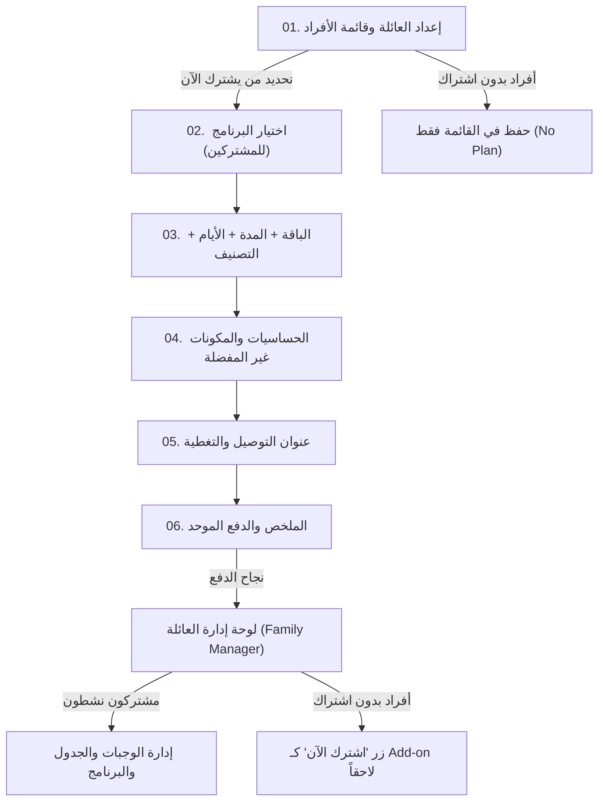

# الدليل الشامل والموحد لاشتراك وإدارة العائلة (MealMate Family Subscription & Management Mobile Master Guide)

وثيقة مرجعية شاملة وموحدة لمطوري تطبيقات الموبايل (Flutter)، تجمع كافة عقود الـ Backend، مواصفات الشاشات الست وتدفق تجربة المستخدم (Figma Flow)، إدارة أفراد العائلة (Roster) والاشتراك الاختياري، نماذج البيانات (Dart Models)، وخدمة الـ Dio API في ملف واحد متكامل.

---

## 📑 فهرس المحتويات
1. [المعايير العامة وهيكل الاتصال (Architecture & Auth)](#1-المعايير-العامة-وهيكل-الاتصال)
2. [المفاهيم الجوهرية (Core Concepts & Roster vs Subscription)](#2-المفاهيم-الجوهرية)
3. [خريطة الشاشات وتدفق المستخدم (Screen by Screen Flow)](#3-خريطة-الشاشات-وتدفق-المستخدم)
   - [الشاشة 1: إعداد العائلة وقائمة الأفراد (Family Setup & Member Selection)](#شاشة-1-إعداد-العائلة-وقائمة-الأفراد)
   - [الشاشة 2: اختيار البرنامج لكل فرد مشترك (Program Selection)](#شاشة-2-اختيار-البرنامج-لكل-فرد-مشترك)
   - [الشاشة 3: الباقة، المدة، أيام الأسبوع والتصنيف (Bundle, Duration, Tier)](#شاشة-3-الباقة-والمدة-وأيام-الأسبوع-والتصنيف)
   - [الشاشة 4: الحساسيات والمكونات غير المفضلة (Allergies & Disliked)](#شاشة-4-الحساسيات-والمكونات-غير-المفضلة)
   - [الشاشة 5: عنوان التوصيل والتغطية (Delivery Address & Coverage)](#شاشة-5-عنوان-التوصيل-والتغطية)
   - [الشاشة 6: الملخص والدفع الموحد (Summary & Checkout)](#شاشة-6-الملخص-والدفع-الموحد)
   - [ما بعد الدفع: لوحة إدارة العائلة (Family Manager Dashboard)](#ما-بعد-الدفع-لوحة-إدارة-العائلة)
4. [دليل الـ APIs الشامل (Endpoints Catalog)](#4-دليل-الـ-apis-الشامل)
5. [القواعد الحسابية والمالية (Pricing & Business Rules)](#5-القواعد-الحسابية-والمالية)
6. [قاموس أكواد الأخطاء الموحدة (Error Codes)](#6-قاموس-أكواد-الأخطاء-الموحدة)
7. [كود Flutter / Dart الجاهز (Dart Models & Dio Service)](#7-كود-flutter--dart-الجاهز)

---

## 1. المعايير العامة وهيكل الاتصال

- **Base URL فلو إعداد واشتراك العائلة:** `/api/v1/customer/family-subscription-flow`
- **Base URL لوحة إدارة العائلة:** `/api/v1/customer/family-manager`
- **المصادقة (Auth):** `Authorization: Bearer <manager_customer_jwt_token>` (فقط العملاء بصلاحية Customer).
- **الترميز والعملة:** JSON `camelCase` · العملة الافتراضية: `KWD` · الدقة الحسابية: 3 منازل عشرية (`0.000 KWD`).
- **التواريخ:** UTC بصيغة ISO-8601 أو `YYYY-MM-DD` لحقول التواريخ المقطوعة `DateOnly`.

---

## 2. المفاهيم الجوهرية

1. **فصل القائمة عن الاشتراك (Roster vs Subscription):**
   - العائلة عبارة عن **قائمة مستمرة (Persistent Roster)**.
   - يمكن للمدير إضافة أفراد للعائلة دون إلزامية شراء اشتراك فوري لهم.
   - الأفراد غير المشتركين يبقون مسجلين في العائلة بحالة **«بدون اشتراك»** (`setupStatus: NotStarted` / `memberSubscriptionId: null`).
2. **سلة الدفع الاختيارية (Selective Cart):**
   - في الشاشة الأولى يحدد المدير مَن يشترك الآن ومَن يُحفظ في القائمة فقط.
   - خطوات اختيار (البرنامج، الباقة، الحساسية، العنوان) تُطلب **فقط** للأفراد المحددين للاشتراك.
   - الأفراد غير المشتركين لا يعطلون جاهزية الدفع (`canCheckout = true`) ولا يظهرون في إجمالي الفاتورة.
3. **الدفع الموحد (Single Manager Invoice):**
   - يدفع المدير فاتورة واحدة تشمل جميع الأفراد المشتركين.
   - فور نجاح الدفع، يُنشئ النظام اشتراكاً مستقلاً وجدولاً لكل فرد مشترك مربوطاً بنفس `familyGroupId`.
4. **البحث برقم الهاتف (Phone-First Lookup):**
   - عند إضافة فرد، إدخال رقم الهاتف أولاً يقوم بالبحث الذكي: إن وُجد حساب عميل مسجل يُملأ اسمه وتفاصيله تلقائياً، وإن لم يُوجد يُنشأ ملف بدون كلمة مرور (لا نطلب كلمة مرور أثناء الإضافة).

---

## 3. خريطة الشاشات وتدفق المستخدم



---

### شاشة 1: إعداد العائلة وقائمة الأفراد

- **الغرض:** تعيين اسم العائلة وإضافة/تعديل الأفراد واختيار مَن سيشترك في هذه العملية.
- **عناصر الشاشة:**
  - حقل إدخال اسم العائلة (`PUT /group`).
  - شريط الأفراد (Avatars) مع زر إضافة فرد جديد `+`.
  - **قائمة الأفراد:** تظهر بطاقة لكل فرد تحتوي على:
    - الاسم وصلة القرابة.
    - مربع اختيار **(Checkbox: اشترك الآن)** أو حالة **(مسجل فقط / بدون اشتراك)**.
  - **نافذة إضافة فرد:**
    - حقل رقم الهاتف أولاً (`POST /members/lookup`) للتحقق من وجود الحساب.
    - الاسم الكامل، صلة القرابة (من قائمة `/relationships`)، الجنس، العمر، المهنة (اختياري).
    - زر «إضافة فرد للقائمة».
  - زر **«التالي: البرنامج»** (ينقل للتطبيق لاختيار باقات الأفراد المحددين فقط).

---

### شاشة 2: اختيار البرنامج لكل فرد مشترك

- **الغرض:** اختيار البرنامج الغذائي المناسب لكل فرد محدد للاشتراك.
- **عناصر الشاشة:**
  - شريط التبديل العلوي بين الأفراد المحددين للاشتراك فقط (Member Strip Chips).
  - بطاقات البرامج المتاحة للعائلة (`GET /family-subscription-flow/programs`).
  - عند النقر على برنامج، يتم حفظه فوراً للفرد الحالي عبر:
    `PUT /family-subscription-flow/members/{memberId}/plan` مع `{ "programId": "..." }`.
  - زر **«التالي: الباقة»** يُفعل عندما يكون لجميع الأفراد المحددين برنامج محدد.

---

### شاشة 3: الباقة والمدة وأيام الأسبوع والتصنيف

- **الغرض:** ضبط تفاصيل خطة الوجبات لكل فرد مشترك.
- **عناصر الشاشة:**
  - نفس شريط الأفراد للتبديل السريع بينهم.
  - **اختيار الباقة:** (مثل: وجبتين + سناك، أو 3 وجبات) من `/programs/{id}/bundles`.
  - **أيام الأسبوع (5 أو 6 أيام):** 5 أيام تعني الجمعة راحة (`includeFriday: false`)، 6 أيام تعني التوصيل يشمل الجمعة (`includeFriday: true`).
  - **المدة:** (26 يوم، 12 يوم، 6 أيام، أو مخصص).
  - **تصنيف المطاعم (Restaurant Tier):** (أساسي / بلاتينيوم / إيليت) أو (Select / Plus / Max).
  - كل اختيار يُحفظ جزئياً ومباشرة عبر `PUT /members/{id}/plan`.

---

### شاشة 4: الحساسيات والمكونات غير المفضلة

- **الغرض:** جمع بيانات الحساسية لكل فرد مشترك لضمان سلامة الوجبات.
- **عناصر الشاشة:**
  - شريط الأفراد المحددين.
  - خيارات الحساسية (حساسية مكسرات، غلوتين، لاكتوز...) مع خيار واضح **«لا يوجد حساسية»** (`{ "code": "NONE" }`).
  - البحث عن المكونات غير المفضلة وإضافتها (اختياري).
  - **شرط الحفظ الإلزامي:** يجب حفظ الحساسيات عبر `PUT /members/{id}/allergies` لكل فرد محدد قبل الدفع (لا يمكن التخطي بدون تأكيد الحساسية أو NONE).

---

### شاشة 5: عنوان التوصيل والتغطية

- **الغرض:** تعيين موقع توصيل خاص لكل فرد أو استخدام أحد عناوين المدير.
- **عناصر الشاشة:**
  - اختيار العنوان من عناوين العميل المسجلة أو إضافة عنوان جديد عبر الخريطة (`POST /members/{id}/addresses`).
  - فحص تغطية المطاعم للعنوان لضمان وجود مطابخ تغطي المنطقة.

---

### شاشة 6: الملخص والدفع الموحد

- **الغرض:** مراجعة تفاصيل المشتركين والتسعير وإتمام الدفع بفاتورة واحدة.
- **عناصر الشاشة:**
  - جدول تفصيلي بالأفراد المشتركين، البرنامج، الباقة، وسعر كل فرد.
  - توضيح **خصم باقة العائلة** ونسبته والمبلغ المخصوم.
  - المبلغ الإجمالي النهائي المطلوب دفعه (`finalPrice`).
  - قائمة بوابات الدفع (K-Net / بطاقة ائتمانية / Apple Pay).
  - زر **«تأكيد ودفع الفاتورة»** (`POST /checkout`) الذي يفتح بوابة MyFatoorah.
  - الأفراد غير المشتركين يظهرون في أسفل الشاشة أو يتم استثناؤهم تماماً من احتساب الفاتورة.

---

### ما بعد الدفع: لوحة إدارة العائلة

- استدعاء `GET /api/v1/customer/family-manager/home` و `GET /api/v1/customer/family-manager/members`.
- يظهر كل أفراد العائلة:
  - المشتركون: يظهر شريط الأيام المتبقية، جدول الوجبات اليومية، وإمكانية تعديل البرنامج أو الوجبات.
  - غير المشتركين: يظهر شارة **«بدون اشتراك»** مع زر واضح **«اشترك الآن»** لبدء فلو اشتراك منفصل له.

---

## 4. دليل الـ APIs الشامل

### 1) بيانات الإعداد والصلات وباقات الحجم
`GET /api/v1/customer/family-subscription-flow/metadata`
```json
{
  "relationships": [
    { "code": "spouse", "labelAr": "زوج / زوجة", "labelEn": "Spouse", "forDependents": true },
    { "code": "son", "labelAr": "ابن", "labelEn": "Son", "forDependents": true },
    { "code": "daughter", "labelAr": "ابنة", "labelEn": "Daughter", "forDependents": true },
    { "code": "father", "labelAr": "أب", "labelEn": "Father", "forDependents": true },
    { "code": "mother", "labelAr": "أم", "labelEn": "Mother", "forDependents": true },
    { "code": "other", "labelAr": "آخر", "labelEn": "Other", "forDependents": true }
  ],
  "packages": [
    { "id": "uuid", "nameAr": "عائلة صغيرة", "nameEn": "Small Family", "minMembers": 2, "maxMembers": 3, "discountPercent": 0.10 },
    { "id": "uuid", "nameAr": "عائلة متوسطة", "nameEn": "Medium Family", "minMembers": 4, "maxMembers": 6, "discountPercent": 0.15 }
  ],
  "maxMembers": 10,
  "discountPercent": 0.10,
  "minMembersForDiscount": 2
}
```

---

### 2) جلب حالة العائلة الحالية والمسودة
`GET /api/v1/customer/family-subscription-flow/current`
```json
{
  "familyGroupId": "9a6e1122-3344-5566-7788-99aabbccdde0",
  "name": "عائلة الهاجري",
  "status": "Draft",
  "currentStep": 1,
  "canCheckout": false,
  "members": [
    {
      "memberId": "11111111-2222-3333-4444-555555555555",
      "role": "Manager",
      "displayName": "سالم الهاجري",
      "relationshipCode": "self",
      "gender": "Male",
      "ageYears": 35,
      "phoneNumber": "+96550000001",
      "setupStatus": "Ready",
      "programId": "8a112233-0000-0000-0000-000000000001",
      "bundleId": "8b112233-0000-0000-0000-000000000001",
      "selectedTier": "Platinum",
      "durationDays": 26,
      "includeFriday": false,
      "deliveryAddressId": "addr-guid-1",
      "memberSubscriptionId": null
    },
    {
      "memberId": "22222222-3333-4444-5555-666666666666",
      "role": "Member",
      "displayName": "فهد سالم",
      "relationshipCode": "son",
      "gender": "Male",
      "ageYears": 10,
      "phoneNumber": "+96550000002",
      "setupStatus": "NotStarted",
      "programId": null,
      "bundleId": null,
      "selectedTier": null,
      "durationDays": null,
      "includeFriday": false,
      "deliveryAddressId": null,
      "memberSubscriptionId": null
    }
  ]
}
```

---

### 3) البحث عن فرد برقم الهاتف
`POST /api/v1/customer/family-subscription-flow/members/lookup`
- **Request Body:**
```json
{
  "phone": "+96550000002"
}
```
- **Response (Found):**
```json
{
  "found": true,
  "displayName": "فهد سالم",
  "ageYears": 10,
  "gender": "Male"
}
```
- **Response (Not Found):**
```json
{
  "found": false
}
```

---

### 4) إضافة فرد جديد للقائمة
`POST /api/v1/customer/family-subscription-flow/members`
- **Request Body:**
```json
{
  "phone": "+96550000002",
  "displayName": "فهد سالم",
  "relationshipCode": "son",
  "gender": 1,
  "ageYears": 10,
  "occupation": "طالب",
  "nutritionalGoalCode": "balanced",
  "activityLevel": 2
}
```
*(ملاحظة: Gender: 1=Male, 2=Female · ActivityLevel: 1=Sedentary, 2=Moderate, 3=Active)*

---

### 5) حفظ / تعديل خطة الفرد (Partial PUT)
`PUT /api/v1/customer/family-subscription-flow/members/{memberId}/plan`
- يقبل الحقول بشكل اختياري ويقوم بعمل Server Merge فوري.
```json
{
  "programId": "8a112233-0000-0000-0000-000000000001",
  "bundleId": "8b112233-0000-0000-0000-000000000001",
  "tier": 2,
  "durationDays": 26,
  "includeFriday": false,
  "startDate": "2026-09-20"
}
```

---

### 6) حفظ حساسيات الفرد
`PUT /api/v1/customer/family-subscription-flow/members/{memberId}/allergies`
```json
{
  "allergies": [
    { "code": "NONE" }
  ]
}
```
أو حساسية محددة:
```json
{
  "allergies": [
    { "code": "NUTS" },
    { "code": "GLUTEN" }
  ]
}
```

---

### 7) ملخص الفاتورة قبل الدفع
`GET /api/v1/customer/family-subscription-flow/summary`
```json
{
  "familyGroupId": "9a6e1122-3344-5566-7788-99aabbccdde0",
  "name": "عائلة الهاجري",
  "subtotal": 200.000,
  "familyDiscountPercent": 0.10,
  "familyDiscountAmount": 20.000,
  "finalPrice": 180.000,
  "currencyCode": "KWD",
  "canCheckout": true,
  "blockReason": null,
  "newMembersCount": 1,
  "newMembersSubtotal": 200.000,
  "overview": [
    {
      "memberId": "11111111-2222-3333-4444-555555555555",
      "displayName": "سالم الهاجري",
      "role": "Manager",
      "isReady": true,
      "mealsPerDay": 3
    }
  ]
}
```

---

### 8) بدء عملية الدفع (Checkout)
`POST /api/v1/customer/family-subscription-flow/checkout`
- **Request Body:**
```json
{
  "callbackUrl": "mealmate://payment/callback",
  "errorUrl": "mealmate://payment/error",
  "paymentMethodId": 1,
  "correlationId": "client-uuid-v4"
}
```
- **Response:**
```json
{
  "familyGroupId": "9a6e1122-3344-5566-7788-99aabbccdde0",
  "paymentAnchorSubscriptionId": "sub-guid-1",
  "paymentUrl": "https://api.myfatoorah.com/v2/PayInvoice?...",
  "holdExpiresAtUtc": "2026-09-14T20:30:00Z",
  "finalPrice": 180.000
}
```

---

## 5. القواعد الحسابية والمالية

1. **احتساب الأعضاء القابلين للدفع (Payable Members):**
   - العضو يعتبر قابلاً للدفع فقط إذا كان لديه خطة كاملة (`programId` + `bundleId` + `tier` + `durationDays`).
   - الأعضاء في القائمة بدون خطة يتم تجاهلهم تلقائياً من تسعير الفاتورة.
2. **احتساب الخصم:**
   - `subtotal = مجموع أسعار الأعضاء المحددين للدفع`.
   - نسبة الخصم `discountPercent` تُحدد بناءً على عدد المشتركين الفعليين في الفاتورة (أو المشتركين النشطين + الجدد عند الترقية).
   - `finalPrice = subtotal - (subtotal * discountPercent)`.
3. **التحقق من الجاهزية (`canCheckout`):**
   - يتطلب فقط أن يكون لدى كل فرد **محدد للاشتراك** خطة كاملة، عنوان توصيل فعال، وحساسيات محفوظة.

---

## 6. قاموس أكواد الأخطاء الموحدة

| الكود (Error Code) | المعنى باللغة العربية | التوجيه في الموبايل |
|---|---|---|
| `family.not_found` | لم يتم العثور على مجموعة العائلة | إعادة توجيه لشاشة إنشاء العائلة |
| `family.phone_required` | رقم الهاتف مطلوب للإضافة والبحث | التحقق من صحة حقل الهاتف |
| `family.already_in_family` | هذا الرقم مسجل مسبقاً في عائلة أخرى | إظهار تنبيه للمستخدم بأن الفرد مرتبط بعائلة أخرى |
| `family.member_incomplete` | لم يتم تحديد خطة لأي فرد في السلة | تنبيه بتحديد خطة لفرد واحد على الأقل |
| `family.allergies_required` | يجب حفظ الحساسيات لكل فرد مشترك | توجيه المستخدم لإكمال شاشة الحساسيات |
| `family.max_members` | تجاوز الحد الأقصى المسموح لأفراد العائلة | إظهار رسالة بالحد الأقصى المتاح |

---

## 7. كود Flutter / Dart الجاهز

### 1) نماذج البيانات (Dart Models)

```dart
// family_subscription_models.dart

class FamilyMemberDto {
  final String memberId;
  final String role; // Manager | Member
  final String displayName;
  final String relationshipCode;
  final String gender;
  final int ageYears;
  final String? phoneNumber;
  final String setupStatus; // NotStarted | InProgress | Ready
  final String? programId;
  final String? bundleId;
  final String? selectedTier;
  final int? durationDays;
  final bool includeFriday;
  final String? deliveryAddressId;
  final String? memberSubscriptionId;

  FamilyMemberDto({
    required this.memberId,
    required this.role,
    required this.displayName,
    required this.relationshipCode,
    required this.gender,
    required this.ageYears,
    this.phoneNumber,
    required this.setupStatus,
    this.programId,
    this.bundleId,
    this.selectedTier,
    this.durationDays,
    this.includeFriday = false,
    this.deliveryAddressId,
    this.memberSubscriptionId,
  });

  bool get isManager => role.toLowerCase() == 'manager';
  bool get hasActiveSubscription => memberSubscriptionId != null;
  bool get isReadyForCheckout => setupStatus == 'Ready';

  factory FamilyMemberDto.fromJson(Map<String, dynamic> json) {
    return FamilyMemberDto(
      memberId: json['memberId'] ?? '',
      role: json['role'] ?? 'Member',
      displayName: json['displayName'] ?? '',
      relationshipCode: json['relationshipCode'] ?? '',
      gender: json['gender'] ?? 'Male',
      ageYears: json['ageYears'] ?? 0,
      phoneNumber: json['phoneNumber'],
      setupStatus: json['setupStatus'] ?? 'NotStarted',
      programId: json['programId'],
      bundleId: json['bundleId'],
      selectedTier: json['selectedTier'],
      durationDays: json['durationDays'],
      includeFriday: json['includeFriday'] ?? false,
      deliveryAddressId: json['deliveryAddressId'],
      memberSubscriptionId: json['memberSubscriptionId'],
    );
  }
}

class FamilyGroupScreenDto {
  final String familyGroupId;
  final String name;
  final String status;
  final int currentStep;
  final bool canCheckout;
  final List<FamilyMemberDto> members;

  FamilyGroupScreenDto({
    required this.familyGroupId,
    required this.name,
    required this.status,
    required this.currentStep,
    required this.canCheckout,
    required this.members,
  });

  factory FamilyGroupScreenDto.fromJson(Map<String, dynamic> json) {
    return FamilyGroupScreenDto(
      familyGroupId: json['familyGroupId'] ?? '',
      name: json['name'] ?? '',
      status: json['status'] ?? 'Draft',
      currentStep: json['currentStep'] ?? 1,
      canCheckout: json['canCheckout'] ?? false,
      members: (json['members'] as List<dynamic>?)
              ?.map((e) => FamilyMemberDto.fromJson(e))
              .toList() ??
          [],
    );
  }
}

class FamilySummaryDto {
  final String familyGroupId;
  final String name;
  final double subtotal;
  final double familyDiscountPercent;
  final double familyDiscountAmount;
  final double finalPrice;
  final String currencyCode;
  final bool canCheckout;
  final String? blockReason;
  final int newMembersCount;
  final double newMembersSubtotal;

  FamilySummaryDto({
    required this.familyGroupId,
    required this.name,
    required this.subtotal,
    required this.familyDiscountPercent,
    required this.familyDiscountAmount,
    required this.finalPrice,
    required this.currencyCode,
    required this.canCheckout,
    this.blockReason,
    required this.newMembersCount,
    required this.newMembersSubtotal,
  });

  factory FamilySummaryDto.fromJson(Map<String, dynamic> json) {
    return FamilySummaryDto(
      familyGroupId: json['familyGroupId'] ?? '',
      name: json['name'] ?? '',
      subtotal: (json['subtotal'] as num?)?.toDouble() ?? 0.0,
      familyDiscountPercent: (json['familyDiscountPercent'] as num?)?.toDouble() ?? 0.0,
      familyDiscountAmount: (json['familyDiscountAmount'] as num?)?.toDouble() ?? 0.0,
      finalPrice: (json['finalPrice'] as num?)?.toDouble() ?? 0.0,
      currencyCode: json['currencyCode'] ?? 'KWD',
      canCheckout: json['canCheckout'] ?? false,
      blockReason: json['blockReason'],
      newMembersCount: json['newMembersCount'] ?? 0,
      newMembersSubtotal: (json['newMembersSubtotal'] as num?)?.toDouble() ?? 0.0,
    );
  }
}
```

---

### 2) خدمة الـ Dio API (Flutter Service)

```dart
// family_subscription_api_service.dart

import 'package:dio/dio.dart';
import 'family_subscription_models.dart';

class FamilySubscriptionApiService {
  final Dio _dio;

  FamilySubscriptionApiService(this._dio);

  /// 1. جلب بيانات العائلة والمسودة الحالية
  Future<FamilyGroupScreenDto> getCurrentGroup() async {
    final response = await _dio.get('/api/v1/customer/family-subscription-flow/current');
    return FamilyGroupScreenDto.fromJson(response.data);
  }

  /// 2. البحث عن فرد برقم الهاتف
  Future<Map<String, dynamic>> lookupMemberByPhone(String phone) async {
    final response = await _dio.post(
      '/api/v1/customer/family-subscription-flow/members/lookup',
      data: {'phone': phone},
    );
    return response.data;
  }

  /// 3. إضافة فرد جديد إلى قائمة العائلة
  Future<FamilyGroupScreenDto> addMember({
    required String displayName,
    required String relationshipCode,
    required int gender,
    required int ageYears,
    String? phone,
    String? occupation,
  }) async {
    final response = await _dio.post(
      '/api/v1/customer/family-subscription-flow/members',
      data: {
        'displayName': displayName,
        'relationshipCode': relationshipCode,
        'gender': gender,
        'ageYears': ageYears,
        if (phone != null) 'phone': phone,
        if (occupation != null) 'occupation': occupation,
        'nutritionalGoalCode': 'balanced',
        'activityLevel': 2,
      },
    );
    return FamilyGroupScreenDto.fromJson(response.data);
  }

  /// 4. تحديث خطة الفرد (Partial PUT)
  Future<FamilyGroupScreenDto> setMemberPlan({
    required String memberId,
    String? programId,
    String? bundleId,
    int? tier,
    int? durationDays,
    bool? includeFriday,
    String? startDate,
  }) async {
    final response = await _dio.put(
      '/api/v1/customer/family-subscription-flow/members/$memberId/plan',
      data: {
        if (programId != null) 'programId': programId,
        if (bundleId != null) 'bundleId': bundleId,
        if (tier != null) 'tier': tier,
        if (durationDays != null) 'durationDays': durationDays,
        if (includeFriday != null) 'includeFriday': includeFriday,
        if (startDate != null) 'startDate': startDate,
      },
    );
    return FamilyGroupScreenDto.fromJson(response.data);
  }

  /// 5. حفظ حساسيات الفرد
  Future<void> saveMemberAllergies({
    required String memberId,
    required List<String> allergyCodes,
  }) async {
    await _dio.put(
      '/api/v1/customer/family-subscription-flow/members/$memberId/allergies',
      data: {
        'allergies': allergyCodes.map((c) => {'code': c}).toList(),
      },
    );
  }

  /// 6. جلب ملخص الدفع والتسعير
  Future<FamilySummaryDto> getSummary() async {
    final response = await _dio.get('/api/v1/customer/family-subscription-flow/summary');
    return FamilySummaryDto.fromJson(response.data);
  }

  /// 7. بدء الدفع بفاتورة موحدة
  Future<Map<String, dynamic>> checkout({
    required String callbackUrl,
    required String errorUrl,
    int paymentMethodId = 1,
    String? correlationId,
  }) async {
    final response = await _dio.post(
      '/api/v1/customer/family-subscription-flow/checkout',
      data: {
        'callbackUrl': callbackUrl,
        'errorUrl': errorUrl,
        'paymentMethodId': paymentMethodId,
        'correlationId': correlationId,
      },
    );
    return response.data;
  }
}
```
