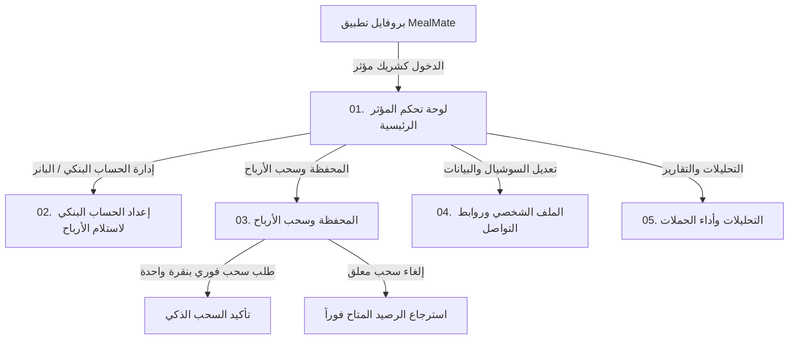

# الدليل الشامل والموحد لبوابة المؤثرين والمسوقين بالعمولة (MealMate Influencer Portal Master Guide)

وثيقة مرجعية شاملة وموحدة تجمع كافة عقود الـ Backend، مواصفات شاشات الموبايل (Flutter)، السياسات المالية المصرفية، نماذج البيانات (Dart Models)، وخدمة الـ Dio API في ملف واحد متكامل.

---

## 📑 فهرس المحتويات
1. [المعايير العامة وهيكل الاتصال (Architecture & Auth)](#1-المعايير-العامة-وهيكل-الاتصال)
2. [خريطة الشاشات وتدفق المستخدم (Screen Flow)](#2-خريطة-الشاشات-وتدفق-المستخدم)
3. [دليل الـ APIs الشامل (Endpoints Catalog)](#3-دليل-الـ-apis-الشامل)
   - `GET /api/v1/influencer-partner/banks`
   - `GET /api/v1/influencer-partner/me`
   - `PUT /api/v1/influencer-partner/me/social-links`
   - `GET /api/v1/influencer-partner/me/home`
   - `GET /api/v1/influencer-partner/me/links`
   - `GET /api/v1/influencer-partner/me/activities`
   - `GET /api/v1/influencer-partner/me/wallet`
   - `GET /api/v1/influencer-partner/me/bank-account`
   - `PUT /api/v1/influencer-partner/me/bank-account`
   - `DELETE /api/v1/influencer-partner/me/bank-account`
   - `POST /api/v1/influencer-partner/me/withdrawals`
   - `GET /api/v1/influencer-partner/me/withdrawals`
   - `GET /api/v1/influencer-partner/me/withdrawals/{id}`
   - `POST /api/v1/influencer-partner/me/withdrawals/{id}/cancel`
   - `GET /api/v1/influencer-partner/me/analytics`
4. [مواصفات الشاشات الخمس التفصيلية (Screen by Screen Specs)](#4-مواصفات-الشاشات-الخمس-التفصيلية)
   - [الشاشة 1: لوحة التحكم الرئيسية (Dashboard)](#شاشة-1-لوحة-التحكم-الرئيسية)
   - [الشاشة 2: إعداد الحساب البنكي (Bank Account Setup)](#شاشة-2-إعداد-الحساب-البنكي)
   - [الشاشة 3: المحفظة وسحب الأرباح (Wallet & Withdrawals)](#شاشة-3-المحفظة-وسحب-الأرباح)
   - [الشاشة 4: الملف الشخصي وروابط التواصل (Profile & Social)](#شاشة-4-الملف-الشخصي-وروابط-التواصل)
   - [الشاشة 5: التحليلات والأداء (Analytics & Campaigns)](#شاشة-5-التحليلات-وأداء-الحملات)
5. [القواعد والسياسات المالية (Business & Banking Rules)](#5-القواعد-والسياسات-المالية)
6. [الترقيم والبحث والأخطاء الموحدة (Pagination & Error Handling)](#6-الترقيم-والبحث-والأخطاء-الموحدة)
7. [كود Flutter / Dart الجاهز (Production Models & Dio Service)](#7-كود-flutter--dart-الجاهز)

---

## 1. المعايير العامة وهيكل الاتصال

- **Base URL:** `/api/v1/influencer-partner`
- **المصادقة (Auth):** `Authorization: Bearer <customer_jwt_token>` (نفس توكن العميل المسجل كمؤثر).
- **الترميز والعملة:** JSON camelCase · العملة الافتراضية: `KWD` (ترسل الـ API حقل `currencyCode` دائماً).
- **الدقة الحسابية:** 3 منازل عشرية للمبالغ (`0.000 KWD`).
- **التواريخ:** UTC بصيغة ISO-8601 (`2026-09-14T15:30:00Z`).

---

## 2. خريطة الشاشات وتدفق المستخدم



---

## 3. دليل الـ APIs الشامل

### 1) قائمة البنوك المعتمدة
`GET /api/v1/influencer-partner/banks`
```json
[
  { "id": "nbk", "code": "NBK", "nameAr": "بنك الكويت الوطني", "nameEn": "National Bank of Kuwait", "isActive": true },
  { "id": "boubyan", "code": "BOUBYAN", "nameAr": "بنك بوبيان", "nameEn": "Boubyan Bank", "isActive": true },
  { "id": "kfh", "code": "KFH", "nameAr": "بيت التمويل الكويتي", "nameEn": "Kuwait Finance House", "isActive": true },
  { "id": "gulf", "code": "GBK", "nameAr": "بنك الخليج", "nameEn": "Gulf Bank", "isActive": true },
  { "id": "burgan", "code": "BURGAN", "nameAr": "بنك برقان", "nameEn": "Burgan Bank", "isActive": true },
  { "id": "warba", "code": "WARBA", "nameAr": "بنك وربة", "nameEn": "Warba Bank", "isActive": true },
  { "id": "cbk", "code": "CBK", "nameAr": "البنك التجاري الكويتي", "nameEn": "Commercial Bank of Kuwait", "isActive": true },
  { "id": "abk", "code": "ABK", "nameAr": "البنك الأهلي الكويتي", "nameEn": "Al Ahli Bank of Kuwait", "isActive": true },
  { "id": "kib", "code": "KIB", "nameAr": "بنك الكويت الدولي", "nameEn": "Kuwait International Bank", "isActive": true }
]
```

---

### 2) الملف الشخصي الكامل
`GET /api/v1/influencer-partner/me`
```json
{
  "influencerProfileId": "7c8e6a12-88f2-4933-912b-31405b0d0100",
  "displayName": "فهد المطوع - فتنس",
  "influencerCode": "FAHAD10",
  "commissionRate": 10.00,
  "isActive": true,
  "status": "Active",
  "avatarUrl": null,
  "hasCompletedSocialOnboarding": true,
  "partnerTermsUrl": "https://mealmate.app/terms/influencer-partner-program",
  "bankInfo": {
    "bankName": "National Bank of Kuwait",
    "accountHolderName": "Fahad Al-Mutawa",
    "iban": "KW82 •••• •••• 9012",
    "maskedIban": "KW82 •••• •••• 9012",
    "isConfigured": true
  },
  "socialLinks": {
    "tiktok": "fahad_fitness",
    "instagram": "fahad.meals",
    "whatsapp": "+96550000001",
    "telegram": "fahad_deals",
    "youtube": "c/FahadFitnessKW",
    "snapchat": "fahad_snap"
  }
}
```

---

### 3) تحديث قنوات التواصل الاجتماعي
`PUT /api/v1/influencer-partner/me/social-links`
- **Request Body:**
```json
{
  "tiktok": "@fahad_fitness",
  "instagram": "https://instagram.com/fahad.meals",
  "whatsapp": "50000001",
  "telegram": "@fahad_deals",
  "youtube": "c/FahadFitnessKW",
  "snapchat": "fahad_snap"
}
```
- **Response 200 OK:**
```json
{
  "socialLinks": {
    "tiktok": "fahad_fitness",
    "instagram": "fahad.meals",
    "whatsapp": "+96550000001",
    "telegram": "fahad_deals",
    "youtube": "c/FahadFitnessKW",
    "snapchat": "fahad_snap"
  },
  "hasCompletedSocialOnboarding": true
}
```

---

### 4) لوحة التحكم الرئيسية
`GET /api/v1/influencer-partner/me/home`
```json
{
  "totalCommissions": { "amount": 480.000, "currency": "KWD" },
  "thisWeekCommissionsDiff": { "amount": 45.000, "currency": "KWD" },
  "kpis": {
    "registeredCustomers": 48,
    "registeredCustomersDiff": 2,
    "completedSubscriptions": 48,
    "completedSubscriptionsDiff": 1,
    "linkClicks": 1250,
    "linkClicksDiff": 5,
    "conversionRate": 3.84,
    "conversionRateDiff": 1.2
  },
  "influencerCode": "FAHAD10",
  "avatarUrl": null,
  "currencyCode": "KWD",
  "referralLink": "https://mealmate.com/ref/FAHAD10",
  "qrCodeData": "https://mealmate.com/ref/FAHAD10",
  "bankInfo": {
    "bankName": "National Bank of Kuwait",
    "accountHolderName": "Fahad Al-Mutawa",
    "maskedIban": "KW82 •••• •••• 9012",
    "isConfigured": true
  },
  "wallet": {
    "availableBalance": { "amount": 145.500, "currency": "KWD" },
    "pendingBalance": { "amount": 35.000, "currency": "KWD" },
    "lifetimeEarnings": { "amount": 480.000, "currency": "KWD" },
    "thisMonthEarned": { "amount": 45.000, "currency": "KWD" },
    "thisMonthWithdrawn": { "amount": 100.000, "currency": "KWD" },
    "currencyCode": "KWD",
    "hasActiveWithdrawalRequest": false,
    "withdrawalPolicy": {
      "minimumAmount": 10.000,
      "maximumAmount": 145.500,
      "currencyCode": "KWD",
      "canWithdraw": true,
      "disabledReason": null
    }
  },
  "recentActivities": [
    {
      "activityId": "e1f13579-2468-4a0b-9cde-f01234567890",
      "activityCode": "subscription_purchased",
      "referenceId": "9b1deb4d-3b7d-4bad-9bdd-2b0d7b3dcb6d",
      "commissionAmount": { "amount": 12.500, "currency": "KWD" },
      "occurredAtUtc": "2026-09-14T14:20:00Z"
    }
  ]
}
```

---

### 5) روابط الإحالة والـ QR Code
`GET /api/v1/influencer-partner/me/links`
```json
{
  "influencerCode": "FAHAD10",
  "referralLink": "https://mealmate.com/ref/FAHAD10",
  "qrCodeData": "https://mealmate.com/ref/FAHAD10",
  "quickStats": {
    "linkClicks": 1250,
    "affiliatedOrders": 48,
    "conversionRate": 3.84
  }
}
```

---

### 6) سجل الأنشطة الكامل مع الترقيم
`GET /api/v1/influencer-partner/me/activities?page=1&pageSize=20`
```json
{
  "items": [
    {
      "activityId": "e1f13579-2468-4a0b-9cde-f01234567890",
      "activityCode": "subscription_purchased",
      "referenceId": "9b1deb4d-3b7d-4bad-9bdd-2b0d7b3dcb6d",
      "commissionAmount": { "amount": 12.500, "currency": "KWD" },
      "occurredAtUtc": "2026-09-14T14:20:00Z"
    }
  ],
  "page": 1,
  "pageSize": 20,
  "totalCount": 48,
  "totalPages": 3,
  "hasPreviousPage": false,
  "hasNextPage": true
}
```

---

### 7) المحفظة وسياسة السحب
`GET /api/v1/influencer-partner/me/wallet`
```json
{
  "availableBalance": { "amount": 240.000, "currency": "KWD" },
  "pendingBalance": { "amount": 45.000, "currency": "KWD" },
  "lifetimeEarnings": { "amount": 850.000, "currency": "KWD" },
  "thisMonthEarned": { "amount": 65.000, "currency": "KWD" },
  "thisMonthWithdrawn": { "amount": 100.000, "currency": "KWD" },
  "currencyCode": "KWD",
  "hasActiveWithdrawalRequest": false,
  "withdrawalPolicy": {
    "minimumAmount": 10.000,
    "maximumAmount": 240.000,
    "currencyCode": "KWD",
    "canWithdraw": true,
    "disabledReason": null
  },
  "bankInfo": {
    "bankName": "National Bank of Kuwait",
    "accountHolderName": "Fahad Al-Mutawa",
    "iban": "KW82 •••• •••• 9012",
    "maskedIban": "KW82 •••• •••• 9012",
    "isConfigured": true
  },
  "recentTransactions": []
}
```

---

### 8) جلب الحساب البنكي
`GET /api/v1/influencer-partner/me/bank-account`
```json
{
  "bankName": "National Bank of Kuwait",
  "accountHolderName": "Fahad Al-Mutawa",
  "iban": "KW82NBOK0000123456789012",
  "maskedIban": "KW82 •••• •••• 9012",
  "isConfigured": true
}
```

---

### 9) إضافة / تحديث الحساب البنكي
`PUT /api/v1/influencer-partner/me/bank-account`
- **Request Body:**
```json
{
  "bankName": "National Bank of Kuwait",
  "accountHolderName": "Fahad Al-Mutawa",
  "iban": "KW82NBOK0000123456789012"
}
```

---

### 10) حذف الحساب البنكي
`DELETE /api/v1/influencer-partner/me/bank-account`
- **Response 200 OK:** `{ "isSuccess": true }`

---

### 11) تقديم طلب سحب أرباح (Smart Payout)
`POST /api/v1/influencer-partner/me/withdrawals`
- **الحالة 1 (سحب فوري بالاعتماد على البنك المحفوظ):**
```json
{
  "amount": 100.000,
  "withdrawalMethod": "BankTransfer",
  "saveAsDefaultBank": false,
  "correlationId": "c3e981e4-42f8-48dc-8bc0-cf77d337d402"
}
```
- **الحالة 2 (سحب ببيانات بنك مخصصة وحفظها كافتراضية):**
```json
{
  "amount": 100.000,
  "withdrawalMethod": "BankTransfer",
  "bankName": "Boubyan Bank",
  "accountHolderName": "Fahad Al-Mutawa",
  "iban": "KW45BOUB0000123456789099",
  "saveAsDefaultBank": true,
  "correlationId": "d4f092f5-53e9-49ed-9cd1-df88e448e513"
}
```

---

### 12) سجل طلبات السحب مع الترقيم والفلترة
`GET /api/v1/influencer-partner/me/withdrawals?status=Completed&page=1&pageSize=20`
```json
{
  "items": [
    {
      "withdrawalId": "f47ac10b-58cc-4372-a567-0e02b2c3d479",
      "referenceNumber": "WD-2026-09-10-0008",
      "amount": { "amount": 100.000, "currency": "KWD" },
      "transferFee": { "amount": 0.000, "currency": "KWD" },
      "netAmount": { "amount": 100.000, "currency": "KWD" },
      "status": "Completed",
      "method": "BankTransfer",
      "currencyCode": "KWD",
      "bankDetails": {
        "accountHolderName": "Fahad Al-Mutawa",
        "bankName": "National Bank of Kuwait",
        "maskedIban": "KW82 •••• •••• 9012",
        "isConfigured": true
      },
      "requestedAtUtc": "2026-09-10T10:00:00Z",
      "reviewedAtUtc": "2026-09-11T12:30:00Z",
      "completedAtUtc": "2026-09-11T12:30:00Z",
      "rejectionReason": null
    }
  ],
  "page": 1,
  "pageSize": 20,
  "totalCount": 1,
  "totalPages": 1,
  "hasPreviousPage": false,
  "hasNextPage": false
}
```

---

### 13) تفاصيل طلب سحب محدد
`GET /api/v1/influencer-partner/me/withdrawals/{id}`

---

### 14) إلغاء طلب سحب قيد المراجعة
`POST /api/v1/influencer-partner/me/withdrawals/{id}/cancel`
- **Response 200 OK:**
```json
{
  "withdrawalId": "f47ac10b-58cc-4372-a567-0e02b2c3d479",
  "status": "Cancelled",
  "rejectionReason": "Cancelled by influencer"
}
```

---

### 15) تحليلات الأداء والمقارنات
`GET /api/v1/influencer-partner/me/analytics?period=30d`
```json
{
  "period": "30d",
  "currencyCode": "KWD",
  "granularity": "day",
  "totalEarnings": { "amount": 432.000, "currency": "KWD" },
  "comparison": {
    "clicksChangePercentage": 8.2,
    "ordersChangePercentage": 5.1,
    "netCommissionChangePercentage": 12.5
  },
  "earningsChart": [
    { "dateUtc": "2026-08-16T00:00:00Z", "amount": 0.000, "clicks": 0, "orders": 0 },
    { "dateUtc": "2026-08-17T00:00:00Z", "amount": 12.000, "clicks": 45, "orders": 2 },
    { "dateUtc": "2026-08-18T00:00:00Z", "amount": 18.000, "clicks": 60, "orders": 3 },
    { "dateUtc": "2026-08-19T00:00:00Z", "amount": 0.000, "clicks": 10, "orders": 0 }
  ],
  "earningsBars": [
    {
      "periodIndex": 1,
      "periodStartUtc": "2026-08-17T00:00:00Z",
      "periodEndUtc": "2026-08-24T00:00:00Z",
      "amount": 86.400,
      "subscriptionsCount": 14
    }
  ],
  "overviewKpis": {
    "registeredCustomers": 72,
    "registeredCustomersDiff": 2,
    "completedSubscriptions": 72,
    "completedSubscriptionsDiff": 1,
    "linkClicks": 1850,
    "linkClicksDiff": 5,
    "conversionRate": 3.89,
    "conversionRateDiff": 1.2
  },
  "topPackages": [
    {
      "programId": "1a2b3c4d-5e6f-7a8b-9c0d-1e2f3a4b5c6d",
      "bundleId": "e1f13579-2468-4a0b-9cde-f01234567890",
      "nameAr": "باقة خسارة الوزن دايت 28 يوم",
      "nameEn": "Weight Loss Diet 28 Days",
      "totalRevenue": 2280.000,
      "orderCount": 38,
      "totalCommission": 228.000
    }
  ]
}
```

---

## 4. مواصفات الشاشات الخمس التفصيلية

### شاشة 1: لوحة التحكم الرئيسية
- **المكونات:**
  - هيدر ترحيبي مع بادج العمولة والأفاتار.
  - كروت الرصيد المتاح والأرباح التاريخية ومعدل التحويل.
  - كود الخصم مع زر النسخ ومشاركة الرابط ورمز QR.
  - بانر تحذيري ذكي عند عدم إضافة بنك مع زر الانتقال الفوري.
  - قائمة الأنشطة الأخيرة وزر `عرض الكل` المرتبط بـ `GET /activities`.

### شاشة 2: إعداد الحساب البنكي
- **المكونات:**
  - قائمة البنوك المعتمدة المنسدلة من `GET /banks`.
  - حقل اسم المستفيد المطابق للهوية.
  - حقل الآيبان مع تنسيق تلقائي كل 4 خانات وتكبير الحروف وتحقق فوري (15-34 خانة).
  - كارت بنكي فاخر يعرض الآيبان المقنع `KW82 •••• •••• 9012`.
  - زر تعديل وزر حذف مع نافذة تأكيد.

### شاشة 3: المحفظة وسحب الأرباح
- **المكونات:**
  - رصيد متاح ومعلق وإجمالي أرباح.
  - زر السحب يرتبط بـ `withdrawalPolicy.canWithdraw`. في حال التعطيل يظهر نص `disabledReason`.
  - شيت السحب الفوري (1-Tap Smart Payout) ببيانات البنك المحفوظ أو إدخال بنك جديد.
  - سجل السحوبات المرقّم (Pagination) مع فلاتر الحالة وزر `إلغاء الطلب` للسحوبات المعلقة.

### شاشة 4: الملف الشخصي وروابط التواصل
- **المكونات:**
  - بيانات المؤثر، الكود، ونسبة العمولة وحالة الحساب الصريحة (`status`).
  - حقول قنوات التواصل (TikTok, Instagram, WhatsApp E.164, Snapchat, YouTube, Telegram) مع التنظيف التلقائي.
  - زر شروط وأحكام برنامج الشركاء `partnerTermsUrl`.

### شاشة 5: التحليلات وأداء الحملات
- **المكونات:**
  - شريط الفترات الزمنية (`7d`, `30d`, `90d`, `all`).
  - كروت ملخص الأداء مع نسب المقارنة المئوية `comparison`.
  - رسم بياني خطي تصاعدي مع ملء أيام الفراغ بأصفار.
  - قائمة الباقات الأكثر مبيعاً مع `programId` و `bundleId`.

---

## 5. القواعد والسياسات المالية

1. **الحد الأدنى للسحب:** ديناميكي من السيرفر `withdrawalPolicy.minimumAmount` (حالياً `10.000 KWD`).
2. **خصم الرصيد:** يُخصم المبلغ من `availableBalance` فور إرسال الطلب، وإذا رُفض أو أُلغي يُعاد فوراً للرصيد المتاح.
3. **منع تعدد الطلبات المعلقة:** لا يمكن تقديم طلب سحب جديد طالما وُجد طلب بحالة `Requested` أو `UnderReview` أو `Approved`.
4. **حماية الآيبان:** لا تعرض الـ API رقم الآيبان كاملاً للمستخدم في الواجهات العامة، بل بصيغة `KW82 •••• •••• 9012`.
5. **لقطة السحب المصرفية (Snapshot):** تعديل الحساب البنكي في البروفايل لا يؤثر على السحوبات السابقة أو الجارية لحفظ سجل الحوالات.

---

## 6. الترقيم والبحث والأخطاء الموحدة

### نموذج الخطأ القياسي:
```json
{
  "errorCode": "influencer.invalid_iban",
  "message": "Invalid IBAN format",
  "fieldErrors": {
    "iban": ["Length must be between 15 and 34 characters"]
  },
  "traceId": "00-..."
}
```

### جدول أكواد الأخطاء:
- `influencer.profile_not_found` (404)
- `influencer.bank_account_required` (400)
- `influencer.invalid_iban` (400)
- `influencer.bank_name_required` (400)
- `influencer.account_holder_required` (400)
- `influencer.withdrawal_below_minimum` (400)
- `influencer.insufficient_available_balance` (400)
- `influencer.active_withdrawal_exists` (409)
- `influencer.cannot_cancel_withdrawal` (400)
- `influencer.account_suspended` (403)

---

## 7. كود Flutter / Dart الجاهز

### 1) ملف النماذج: `lib/features/influencer/models/influencer_models.dart`
> متوفر ومحدث في: [`docs/mobile/influencer_bank_account_models.dart`](file:///f:/MealMate/backend/docs/mobile/influencer_bank_account_models.dart)

### 2) ملف خدمة الـ API: `lib/features/influencer/services/influencer_api_service.dart`
> متوفر ومحدث بـ 15 دالة في: [`docs/mobile/influencer_api_service.dart`](file:///f:/MealMate/backend/docs/mobile/influencer_api_service.dart)
