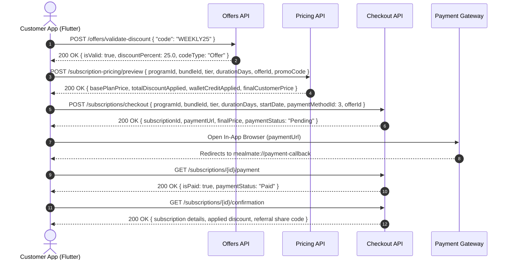

# دليل التكامل الشامل للموبايل: نظام العروض والترويج والمحافظ والإحالات
## Offers & Promotions Mobile Master Integration Guide (Authoritative Spec v2.0)

**تاريخ التوثيق:** 19 أكتوبر 2026  
**الإصدار:** 2.0 (نهائي، معتمد ومطابق للـ Backend بنسبة 100% وبدون أي بدائل أو احتمالات مفتوحة)  
**الجمهور المستهدف:** مطورو تطبيقات الموبايل (Flutter / Mobile Developers)  
**النطاق الوظيفي:** شاشات تدفق العروض، والرموز الترويجية، ومعاينة التسعير، والدفع الآلي، وإدارة المحافظ والإحالات (Figma Flow 12.01 – 12.10).

---

## 1. الإجابات الحاسمة على التساؤلات الثمانية (Core Clarifications)

> [!IMPORTANT]
> هذا القسم يقدم إجابات قطعية ونهائية على النقاط الـ 8 التي تمثل عصب الربط التقني بين تطبيق الموبايل والـ Backend:

### 1. المسارات النهائية المعتمدة (Definitive Endpoints)
- **التحقق من كود الخصم / العرض / الإحالة:**
  - **المسار الرسمي المعتمد والمخصص للموبايل:**  
    `POST /api/v1/customer/offers/validate-discount`
  - *(ملاحظة توافقية: المسار `/api/v1/promo_referral_discount_codes/validate` متطابق داخلياً ويعمل كـ Alias).*
  - **دور الـ Pricing API:** مسار التسعير ليس للتحقق السريع من الكود فقط؛ بل يُستخدم عند الانتقال لمرحلة حساب فاتورة الاشتراك التفصيلية (`/preview`).
- **مسار المحفظة:**
  - **المسار المعتمد والوحيد للاستخدام بالموبايل هو المفرد (Singular):**  
    `GET /api/v1/customer/wallet`
  - **مسار كشف الحركات:**  
    `GET /api/v1/customer/wallet/transactions?walletType=promotional&page=1&pageSize=20`
  - *(المسار الجمع `/wallets` هو مجرد مسار إضافي للتوافق الخلفي ولا يجب اعتماده في كود الموبايل الجديد).*

---

### 2. طريقة اختيار العرض عند التسعير ومقارنة الخصومات (Offer Selection & Stacking)
- **كيف يرسل الموبايل `offerId` إذا اختار العميل عرضاً بدون كود؟**
  يُرسل في الـ Request Body عبر المسار المباشر:  
  `POST /api/v1/customer/subscription-pricing/preview`  
  كالتالي:
  ```json
  {
    "programId": "11111111-2222-3333-4444-555555555555",
    "bundleId": "b1c2d3e4-f5a6-7890-1234-567890abcdef",
    "tier": 1,
    "durationDays": 20,
    "offerId": "e4f8d9b0-1234-4567-89ab-cdef01234567",
    "promoCode": null,
    "includeFriday": false
  }
  ```
  *(يمكن أيضاً إرساله كـ Query Parameter عبر `GET /api/v1/customer/subscription-pricing/preview?offerId=...`).*

- **كيف يقارن الـ Backend بين العرض المختار والكوبون ويطبق الأكبر؟**
  1. يقوم المحرك بفحص العرض `Offer` أولاً وتحديد قيمته الصافية بالدينار (`CampaignDiscountApplied`).
  2. إذا كان العرض يمنع التجميع (`allowPromoCodeStacking: false` - وهي الحالة الافتراضية):
     - يقوم المحرك بحساب قيمة خصم الكوبون أو كود الإحالة (`PromoCodeDiscountApplied`).
     - **المقارنة والتطبيق التلقائي:**
       - إذا كان `خصم الكوبون > خصم العرض`: يتم تطبيق خصم الكوبون بالكامل، وإلغاء خصم العرض (`CampaignDiscountApplied = 0.000`).
       - إذا كان `خصم العرض >= خصم الكوبون`: يتم تطبيق خصم العرض بالكامل، وتصفير خصم الكوبون (`PromoCodeDiscountApplied = 0.000`).
     - يستفيد العميل دائماً من **أعلى خصم مالي ممكن** دون الحاجة لإظهار خطأ في الواجهة!
  3. إذا كان العرض يسمح بالتجميع (`allowPromoCodeStacking: true`):
     - يجمع المحرك كلا الخصمين معاً بحيث لا يتجاوز مجموعهما إجمالي سعر السلة.

---

### 3. إنشاء الاشتراك والدفع (Subscription Creation & Checkout Lifecycle)
- **هل يحتاج الموبايل لإنشاء الاشتراك قبل طلب الدفع؟**  
  **لا قطعيّاً!** لا يقوم الموبايل بإنشاء اشتراك مسبقاً في مسار منفصل.
- **الطلب الموحد لإنشاء الاشتراك وبدء الدفع الذري (Atomic Checkout):**  
  يتم إنشاء سجل الاشتراك وحجز المقاعد والسعة وربط العروض والمحفظة وتهيئة جلسة بوابة الدفع بطلب واحد هو:  
  `POST /api/v1/customer/subscriptions/checkout`
  - **بيانات الطلب المرسلة:**
    ```json
    {
      "programId": "11111111-2222-3333-4444-555555555555",
      "bundleId": "b1c2d3e4-f5a6-7890-1234-567890abcdef",
      "tier": 1,
      "durationDays": 20,
      "startDate": "2026-11-01",
      "includeFriday": false,
      "paymentMethodId": 3,
      "promoCode": "WEEKLY25",
      "offerId": "e4f8d9b0-1234-4567-89ab-cdef01234567",
      "callbackUrl": "mealmate://payment-callback",
      "errorUrl": "mealmate://payment-error",
      "idempotencyKey": "9b1deb4d-3b7d-4bad-9bdd-2b0d7b3dcb6d"
    }
    ```
  - **الاستجابة:**
    ```json
    {
      "subscriptionId": "98765432-abcd-ef01-2345-6789abcdef01",
      "paymentUrl": "https://payzah.com/checkout/pay?session=...",
      "holdExpiresAtUtc": "2026-10-19T06:45:00Z",
      "finalPrice": 45.000,
      "paymentStatus": "Pending"
    }
    ```
  - **خطوات الموبايل بعد ذلك:**
    1. يفتح الموبايل الرابط `paymentUrl` داخل In-App WebView.
    2. عند إعادة التوجيه للـ `callbackUrl`، يستعلم الموبايل عن حالة الدفع عبر:  
       `GET /api/v1/customer/subscriptions/{subscriptionId}/payment`
    3. إذا كانت `isPaid == true`، يسترجع الموبايل تفاصيل الإيصال وعقد الاشتراك عبر:  
       `GET /api/v1/customer/subscriptions/{subscriptionId}/confirmation`

---

### 4. عقد الدفع والمحفظة (Payment Methods & Wallet Auto-Spend)
- **قيم `paymentMethodId` المسموحة:**
  - `1`: **KNET** (بطاقات كي نت المحلية).
  - `2`: **CreditCard** (فيزا / ماستركارد).
  - `3`: **Payzah Hosted Aggregator** (البوابة الشاملة الافتراضية).
  - `4`: **ApplePay** (أبل باي المباشر عبر البوابة).
- **ماذا يحدث إذا غطت المحفظة والخصومات كامل المبلغ (100%)؟**  
  - بوابات الدفع الإلكتروني (Payzah / KNET) ترفض فتح أي جلسة دفع بمبلغ `0.000 KWD`.
  - إذا أدت الخصومات ورصيد المحفظة إلى جعل السعر النهائي صفر أو سالب، يرفض الـ Backend العملية بكود HTTP 400 ورسالة:  
    `checkout.coupon_full_discount_unsupported`  
    *"The applied discounts (including wallet credit) reduce the price to zero; no settlement path exists."*
  - **الحل:** يجب أن يتبقى مبلغ سداد فعلي لبوابة الدفع (حد أدنى 0.100 د.ك / 100 فلس) لضمان اعتماد التوثيق البنكي للاشتراك.
- **هل `autoSpendWallet` يصرف من الترويجية فقط أم النقدية؟**  
  - يتم الصرف التلقائي **حصراً وفقط من المحفظة الترويجية (`CustomerPromotionalWallet`)**.
  - **المحفظة النقدية (`CashWallet`):** مستثناة تماماً من الصرف التلقائي في الاشتراكات وتُخصص فقط لعمليات الاسترداد المالي الحقيقي لتجنب أي تعقيدات محاسبية أو تداخل في دورات الإلغاء.

---

### 5. حالات الخطأ وبنية الاستجابة (Error Handling & HTTP Status Codes)
جميع أخطاء الـ API تعود ببنية موحدة:
```json
{
  "code": "error_code_string",
  "message": "English error explanation",
  "errors": []
}
```

#### جدول حالات الخطأ التفصيلي:
| الحالة | HTTP Code | الكود الداخلي (`code`) | الرسالة بالعربية (`messageAr`) | الرسالة بالإنجليزية (`messageEn`) |
| :--- | :---: | :--- | :--- | :--- |
| **كود غير موجود** | `400` | `not_found` | كود الخصم غير موجود | This coupon code does not exist |
| **كود غير نشط** | `400` | `inactive` | كود الخصم غير مُفعّل حالياً | This coupon code is not active |
| **لم يبدأ بعد** | `400` | `not_started` | لم يبدأ تاريخ صلاحية كود الخصم بعد | This coupon code is not valid yet |
| **عرض / كود منتهي** | `400` | `expired` | انتهت صلاحية كود الخصم | This coupon code has expired |
| **استنفاد الاستخدام** | `400` | `usage_exhausted` | تم استنفاد عدد مرات استخدام كود الخصم | This coupon code has reached its usage limit |
| **غير مؤهل للباقة** | `400` | `ineligible` | كود الخصم غير مؤهل لهذا الاشتراك | This coupon code is not eligible for this subscription |
| **إحالة ذاتية** | `400` | `self_referral` | لا يمكنك استخدام كود الإحالة الخاص بك | You cannot use your own referral code |
| **إحالة مسبقة** | `400` | `already_attributed` | لقد استخدمت كود إحالة من قبل | You have already used a referral code |
| **سعر مصفّر بالكامل** | `400` | `checkout.coupon_full_discount_unsupported` | الخصومات المطبقة تخفض السعر للصفر ولا يوجد مسار تسوية | Applied discounts reduce the price to zero |
| **سعة المطاعم غير متاحة**| `400` | `checkout.capacity_unavailable` | لا توجد سعة يومية متاحة لدى المطاعم المحددة | Capacity unavailable for requested dates |
| **عرض غير متاح** | `404` | `offers.customer.unavailable` | العرض المطلوب غير متاح أو تم إيقافه | Requested offer is unavailable |
| **نفاد رصيد المحفظة** | `200` | *(لا يوجد خطأ)* | تخصم المنظومة الرصيد المتوفر فقط، ويُسدد الباقي عبر البوابة دون فشل |

---

### 6. قواعد الإحالة ورصيد المحفظة (Referral Rewards & Wallet Rules)
- **متى تُضاف مكافأة المُحيل؟**  
  تُضاف المكافأة لحظة اعتماد دفع أول اشتراك للشخص المُحال (`MarkSubscriptionPaidAsync`). يتم قيد حركة رصيد دائنة فورية من نوع `WalletTransactionType.Credit` في محفظة المُحيل الترويجية.
- **هل للمكافأة صلاحية أو حدود استخدام؟**  
  - كود الإحالة يمتلك حداً أقصى لعدد الأشخاص (`MaxUses` كـ 100 شخص مثلاً).
  - رصيد المحفظة الترويجية الناتج عن الإحالة رصيد دائم ويظهر مباشرة في `promotionalBalanceKwd`.
- **هل يتجمع خصم المُحال مع عرض آخر؟**  
  **لا؛** خصم المُحال يعتبر بمثابة كود خصم ترويجي ويحتل حقل `PromoCodeDiscountKwd`. إذا اختار العميل عرضاً غير قابل للتراكم، يتم تطبيق الخصم الأكبر فقط تلقائياً.

---

### 7. تفاصيل العرض والشروط والأحكام (Offer Details & Terms)
- **المسار الرسمي لتفاصيل العرض الكاملة:**  
  `GET /api/v1/customer/offers/{id}`
- **أين توجد الشروط والأحكام (`termsAndConditions`)؟**  
  حقول `termsAndConditionsAr` و `termsAndConditionsEn` موجودة داخل كائن `OfferDto` الذي يُرجع في جميع استعلامات العروض:
  1. `GET /api/v1/customer/offers/{id}` (تفاصيل عرض مفرد).
  2. `GET /api/v1/customer/offers/available` (قائمة العروض المتاحة).
  3. `GET /api/v1/customer/offers/hub` (مركز العروض الشامل مع ساعة السيرفر).
  4. `GET /api/v1/customer/offers/{offerId}/eligible-restaurants` (المطاعم المؤهلة للعرض).

---

### 8. عقد تقويم العروض (Offer Calendar Contract)
- **ماذا يحدث لو أُضيف نفس التذكير مرتين لنفس اليوم؟**  
  العملية **Idempotent بنسبة 100%**. إذا وُجد تذكير سابق نشط، يُعيد السيرفر نفس المعرف السابق بـ `200 OK` دون تكرار أي سجلات في قاعدة البيانات.
- **ماذا لو كان تاريخ التذكير بعد انتهاء العرض؟**  
  استعلام التقويم `GET /api/v1/customer/offers/calendar` يقوم بفلترة تلقائية:
  1. لا يعرض سوى التواريخ التي تبدأ من اليوم فصاعداً (`scheduledDate >= todayUtc`).
  2. يستثني تلقائياً أي عرض انتهت مدته الزمنية (`EndsAtUtc < now`) أو تغيرت حالته عن `OfferStatus.Active`.
- **قيم Enum لحالة التذكير (`CustomerOfferCalendarEntryStatus`):**
  - `1`: **Active** (تذكير نشط قيد الانتظار).
  - `2`: **Completed** (تم الاستفادة من العرض والاشتراك في هذا اليوم).

---

## 2. جدول المسارات البرمجية المعتمدة (Complete Endpoints Matrix)

| الوظيفة | المسار الدقيق (Endpoint) | الطريقة (Method) | المصادقة (Auth) |
| :--- | :--- | :---: | :---: |
| **استعراض قائمة العروض** | `/api/v1/customer/offers/available` | `GET` | متاح للجميع |
| **مركز العروض وساعة السيرفر** | `/api/v1/customer/offers/hub` | `GET` | متاح للجميع |
| **تفاصيل عرض محدد** | `/api/v1/customer/offers/{id}` | `GET` | تتطلب عميل |
| **المطاعم المؤهلة لعرض** | `/api/v1/customer/offers/{offerId}/eligible-restaurants` | `GET` | تتطلب عميل |
| **حفظ عرض في المفضلة** | `/api/v1/customer/offers/{offerId}/save` | `POST` | تتطلب عميل |
| **إلغاء حفظ العرض** | `/api/v1/customer/offers/{offerId}/save` | `DELETE` | تتطلب عميل |
| **العروض المحفوظة** | `/api/v1/customer/offers/saved` | `GET` | تتطلب عميل |
| **إضافة تذكير بالتقويم** | `/api/v1/customer/offers/{offerId}/calendar` | `POST` | تتطلب عميل |
| **حذف تذكير من التقويم** | `/api/v1/customer/offers/{offerId}/calendar/{date}` | `DELETE` | تتطلب عميل |
| **استعراض تقويم العروض** | `/api/v1/customer/offers/calendar` | `GET` | تتطلب عميل |
| **التحقق من كود الخصم / الإحالة** | `/api/v1/customer/offers/validate-discount` | `POST` | متاح للجميع |
| **معاينة السعر والخصومات** | `/api/v1/customer/subscription-pricing/preview` | `POST` | متاح للجميع |
| **إنشاء الاشتراك وبدء الدفع** | `/api/v1/customer/subscriptions/checkout` | `POST` | تتطلب عميل |
| **الاستعلام عن حالة الدفع** | `/api/v1/customer/subscriptions/{id}/payment` | `GET` | تتطلب عميل |
| **تفاصيل تأكيد الاشتراك** | `/api/v1/customer/subscriptions/{id}/confirmation` | `GET` | تتطلب عميل |
| **رصيد المحافظ** | `/api/v1/customer/wallet` | `GET` | تتطلب عميل |
| **كشف حركات المحفظة** | `/api/v1/customer/wallet/transactions` | `GET` | تتطلب عميل |
| **ملخص الإحالات والأرباح** | `/api/v1/customer/referrals/summary` | `GET` | تتطلب عميل |

---

## 3. تفاصيل الـ Payloads للتدفق الأساسي (Core Flow Payloads)

### التدفق: اختيار عرض ← معاينة السعر ← بدء الدفع ← التحقق من السداد



---

### أ. التحقق السريع من كود الخصم (Validate Discount Code)
- **المسار:** `POST /api/v1/customer/offers/validate-discount`
- **Request Body:**
```json
{
  "code": "WEEKLY25",
  "programId": "11111111-2222-3333-4444-555555555555",
  "bundleId": "b1c2d3e4-f5a6-7890-1234-567890abcdef"
}
```
- **Response (200 OK - صالح):**
```json
{
  "isValid": true,
  "code": "WEEKLY25",
  "codeType": "Offer",
  "calculatedDiscountKwd": 0.0,
  "failureReason": null,
  "discountPercent": 25.0,
  "eligibilityCode": "rule_only_amount_set_at_quote",
  "failureMessageAr": "تم تطبيق الكوبون بنجاح",
  "failureMessageEn": "Coupon applied successfully"
}
```

---

### ب. معاينة السعر والخصم والمحفظة (Price & Discounts Preview)
- **المسار:** `POST /api/v1/customer/subscription-pricing/preview`
- **Request Body:**
```json
{
  "programId": "11111111-2222-3333-4444-555555555555",
  "bundleId": "b1c2d3e4-f5a6-7890-1234-567890abcdef",
  "tier": 1,
  "durationDays": 20,
  "offerId": "e4f8d9b0-1234-4567-89ab-cdef01234567",
  "promoCode": null,
  "includeFriday": false,
  "fridayDays": 0
}
```
- **Response (200 OK):**
```json
{
  "basePlanPrice": 60.000,
  "fridayAddonPrice": 0.000,
  "grossAmount": 60.000,
  "campaignDiscountApplied": 15.000,
  "promoCodeDiscountApplied": 0.000,
  "totalDiscountApplied": 15.000,
  "vatAmount": 0.000,
  "walletCreditApplied": 5.000,
  "finalCustomerPrice": 40.000,
  "currencyCode": "KWD",
  "serviceDatesCount": 20,
  "fridayCount": 0
}
```

---

### جـ. بدء الدفع وإنشاء الاشتراك (Start Checkout)
- **المسار:** `POST /api/v1/customer/subscriptions/checkout`
- **Request Body:**
```json
{
  "programId": "11111111-2222-3333-4444-555555555555",
  "bundleId": "b1c2d3e4-f5a6-7890-1234-567890abcdef",
  "tier": 1,
  "durationDays": 20,
  "startDate": "2026-11-01",
  "includeFriday": false,
  "paymentMethodId": 3,
  "offerId": "e4f8d9b0-1234-4567-89ab-cdef01234567",
  "promoCode": null,
  "callbackUrl": "mealmate://payment-callback",
  "errorUrl": "mealmate://payment-error",
  "idempotencyKey": "a8f3b2c1-d4e5-6789-0123-456789abcdef"
}
```
- **Response (200 OK):**
```json
{
  "subscriptionId": "98765432-abcd-ef01-2345-6789abcdef01",
  "paymentUrl": "https://payzah.com/hosted/checkout/session_998877",
  "holdExpiresAtUtc": "2026-10-19T06:45:00Z",
  "finalPrice": 40.000,
  "paymentStatus": "Pending"
}
```

---

### د. الاستعلام عن حالة الدفع بعد عودة المتصفح
- **المسار:** `GET /api/v1/customer/subscriptions/{subscriptionId}/payment`
- **Response (200 OK):**
```json
{
  "subscriptionId": "98765432-abcd-ef01-2345-6789abcdef01",
  "paymentStatus": "Paid",
  "isPaid": true,
  "isFailed": false,
  "amount": 40.000,
  "currencyCode": "KWD"
}
```

---

## 4. نماذج فلاتر الكاملة والمطابقة 100% (Ready-to-Use Dart Models)

انسخ هذه النماذج مباشرة في مجلد `lib/models/offers/`:

```dart
// lib/models/offers/offer_model.dart
class OfferModel {
  final String id;
  final String nameAr;
  final String nameEn;
  final String? descriptionAr;
  final String? descriptionEn;
  final String? bannerImageUrl;
  final int discountType; // 1 = Percentage, 2 = FixedAmount
  final double? discountRate;
  final double? discountAmountKwd;
  final String? promoCode;
  final String? termsAndConditionsAr;
  final String? termsAndConditionsEn;
  final DateTime startsAtUtc;
  final DateTime endsAtUtc;
  final int? remainingSpots;
  final bool allowPromoCodeStacking;
  final bool isAvailable;
  final bool isSaved;
  final List<String>? eligibleProgramIds;
  final List<String>? eligibleBundleIds;
  final List<String>? eligibleRestaurantIds;

  OfferModel({
    required this.id,
    required this.nameAr,
    required this.nameEn,
    this.descriptionAr,
    this.descriptionEn,
    this.bannerImageUrl,
    required this.discountType,
    this.discountRate,
    this.discountAmountKwd,
    this.promoCode,
    this.termsAndConditionsAr,
    this.termsAndConditionsEn,
    required this.startsAtUtc,
    required this.endsAtUtc,
    this.remainingSpots,
    this.allowPromoCodeStacking = false,
    this.isAvailable = true,
    this.isSaved = false,
    this.eligibleProgramIds,
    this.eligibleBundleIds,
    this.eligibleRestaurantIds,
  });

  factory OfferModel.fromJson(Map<String, dynamic> json) {
    return OfferModel(
      id: json['id'] as String,
      nameAr: json['nameAr'] ?? '',
      nameEn: json['nameEn'] ?? '',
      descriptionAr: json['descriptionAr'],
      descriptionEn: json['descriptionEn'],
      bannerImageUrl: json['bannerImageUrl'],
      discountType: json['discountType'] is int ? json['discountType'] : 1,
      discountRate: (json['discountRate'] as num?)?.toDouble(),
      discountAmountKwd: (json['discountAmountKwd'] as num?)?.toDouble(),
      promoCode: json['promoCode'],
      termsAndConditionsAr: json['termsAndConditionsAr'],
      termsAndConditionsEn: json['termsAndConditionsEn'],
      startsAtUtc: DateTime.parse(json['startsAtUtc']),
      endsAtUtc: DateTime.parse(json['endsAtUtc']),
      remainingSpots: json['remainingSpots'] as int?,
      allowPromoCodeStacking: json['allowPromoCodeStacking'] ?? false,
      isAvailable: json['isAvailable'] ?? true,
      isSaved: json['isSaved'] ?? false,
      eligibleProgramIds: (json['eligibleProgramIds'] as List?)?.cast<String>(),
      eligibleBundleIds: (json['eligibleBundleIds'] as List?)?.cast<String>(),
      eligibleRestaurantIds: (json['eligibleRestaurantIds'] as List?)?.cast<String>(),
    );
  }
}

// lib/models/offers/discount_validation_model.dart
class DiscountValidationResult {
  final bool isValid;
  final String code;
  final String codeType; // "Offer" | "PromoCode" | "ReferralCode"
  final double calculatedDiscountKwd;
  final double? discountPercent;
  final String? eligibilityCode;
  final String? failureMessageAr;
  final String? failureMessageEn;

  DiscountValidationResult({
    required this.isValid,
    required this.code,
    required this.codeType,
    required this.calculatedDiscountKwd,
    this.discountPercent,
    this.eligibilityCode,
    this.failureMessageAr,
    this.failureMessageEn,
  });

  factory DiscountValidationResult.fromJson(Map<String, dynamic> json) {
    return DiscountValidationResult(
      isValid: json['isValid'] ?? false,
      code: json['code'] ?? '',
      codeType: json['codeType'] ?? 'Unknown',
      calculatedDiscountKwd: (json['calculatedDiscountKwd'] as num?)?.toDouble() ?? 0.0,
      discountPercent: (json['discountPercent'] as num?)?.toDouble(),
      eligibilityCode: json['eligibilityCode'],
      failureMessageAr: json['failureMessageAr'],
      failureMessageEn: json['failureMessageEn'],
    );
  }
}

// lib/models/offers/pricing_preview_model.dart
class PricingPreviewResult {
  final double basePlanPrice;
  final double fridayAddonPrice;
  final double grossAmount;
  final double campaignDiscountApplied;
  final double promoCodeDiscountApplied;
  final double totalDiscountApplied;
  final double walletCreditApplied;
  final double finalCustomerPrice;
  final String currencyCode;

  PricingPreviewResult({
    required this.basePlanPrice,
    required this.fridayAddonPrice,
    required this.grossAmount,
    required this.campaignDiscountApplied,
    required this.promoCodeDiscountApplied,
    required this.totalDiscountApplied,
    required this.walletCreditApplied,
    required this.finalCustomerPrice,
    required this.currencyCode,
  });

  factory PricingPreviewResult.fromJson(Map<String, dynamic> json) {
    return PricingPreviewResult(
      basePlanPrice: (json['basePlanPrice'] as num?)?.toDouble() ?? 0.0,
      fridayAddonPrice: (json['fridayAddonPrice'] as num?)?.toDouble() ?? 0.0,
      grossAmount: (json['grossAmount'] as num?)?.toDouble() ?? 0.0,
      campaignDiscountApplied: (json['campaignDiscountApplied'] as num?)?.toDouble() ?? 0.0,
      promoCodeDiscountApplied: (json['promoCodeDiscountApplied'] as num?)?.toDouble() ?? 0.0,
      totalDiscountApplied: (json['totalDiscountApplied'] as num?)?.toDouble() ?? 0.0,
      walletCreditApplied: (json['walletCreditApplied'] as num?)?.toDouble() ?? 0.0,
      finalCustomerPrice: (json['finalCustomerPrice'] as num?)?.toDouble() ?? 0.0,
      currencyCode: json['currencyCode'] ?? 'KWD',
    );
  }
}

// lib/models/offers/checkout_started_model.dart
class CheckoutStartedResult {
  final String subscriptionId;
  final String paymentUrl;
  final DateTime holdExpiresAtUtc;
  final double finalPrice;
  final String? paymentStatus;

  CheckoutStartedResult({
    required this.subscriptionId,
    required this.paymentUrl,
    required this.holdExpiresAtUtc,
    required this.finalPrice,
    this.paymentStatus,
  });

  factory CheckoutStartedResult.fromJson(Map<String, dynamic> json) {
    return CheckoutStartedResult(
      subscriptionId: json['subscriptionId'] as String,
      paymentUrl: json['paymentUrl'] as String,
      holdExpiresAtUtc: DateTime.parse(json['holdExpiresAtUtc']),
      finalPrice: (json['finalPrice'] as num?)?.toDouble() ?? 0.0,
      paymentStatus: json['paymentStatus'],
    );
  }
}

// lib/models/offers/customer_wallet_model.dart
class CustomerWalletSummary {
  final double cashBalanceKwd;
  final double promotionalBalanceKwd;
  final double totalAvailableBalanceKwd;
  final String currencyCode;
  final DateTime? updatedAtUtc;

  CustomerWalletSummary({
    required this.cashBalanceKwd,
    required this.promotionalBalanceKwd,
    required this.totalAvailableBalanceKwd,
    required this.currencyCode,
    this.updatedAtUtc,
  });

  factory CustomerWalletSummary.fromJson(Map<String, dynamic> json) {
    return CustomerWalletSummary(
      cashBalanceKwd: (json['cashBalanceKwd'] as num?)?.toDouble() ?? 0.0,
      promotionalBalanceKwd: (json['promotionalBalanceKwd'] as num?)?.toDouble() ?? 0.0,
      totalAvailableBalanceKwd: (json['totalAvailableBalanceKwd'] as num?)?.toDouble() ?? 0.0,
      currencyCode: json['currencyCode'] ?? 'KWD',
      updatedAtUtc: json['updatedAtUtc'] != null ? DateTime.parse(json['updatedAtUtc']) : null,
    );
  }
}
```

---

## 5. فحص سياسة الصفرية للبيانات الوهمية (Zero Mock Data Confirmation)

```text
Mock Data Check:
- No mock business data introduced.
- No fake fallback responses introduced.
- No hardcoded production business values introduced.
- All runtime data comes from real application sources.
```
