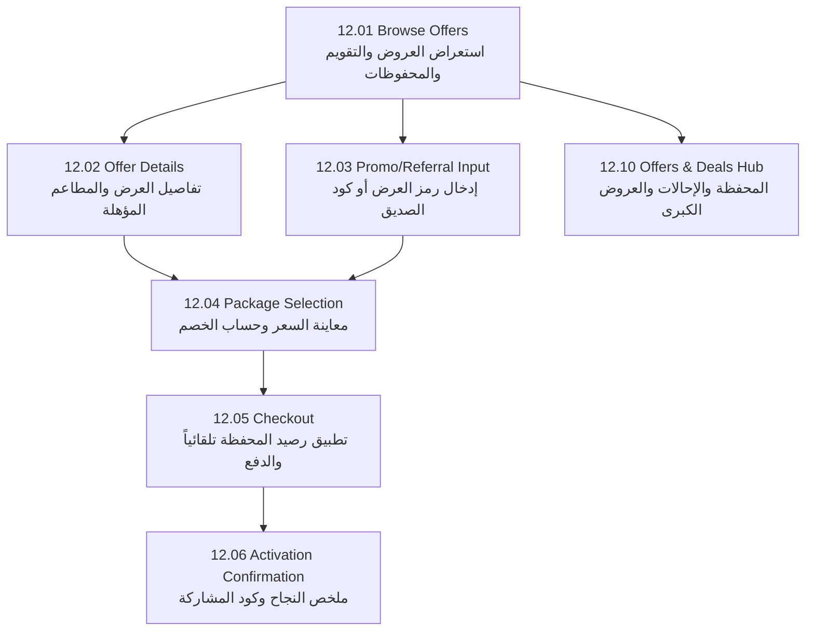

# دليل التكامل الشامل للموبايل: نظام العروض والترويج والمحافظ والإحالات (Offers & Promotions Mobile Master Guide)

**تاريخ التوثيق:** 19 أكتوبر 2026  
**الإصدار:** 1.0 (معتمد ومطابق للـ Backend المحدث 100%)  
**الجمهور المستهدف:** مطورو تطبيقات الموبايل (Flutter / Mobile Developers)  
**نطاق الشاشات:** شاشات تدفق العروض والترويج (Figma Flow 12.01 – 12.10)

---

## 1. نظرة عامة وبيئة العمل (Overview & Environment)

تم تصميم هذا الدليل ليوفر لفريق الموبايل كافة التفاصيل الفنية الدقيقة (Request / Response / Headers / Logic / Edge Cases / Flutter Models) لربط واستعراض العروض، المحافظ، أكواد الإحالة، والخصومات التلقائية بسلاسة، مع منع أي اجتهاد يدوي في حساب الأسعار في جهة العميل.

### الـ Base URLs ومنافذ الاتصال:
- **Development Server:** `http://localhost:5000` أو العنوان السحابي المشترك (مثال: `https://spa-enrolled-draft-eyed.trycloudflare.com`)
- **Direct Database Host:** `157.173.104.121:5432` (PostgreSQL)

### متطلبات الترويسة (Common HTTP Headers):
يجب إرسال الترويسات التالية في جميع الطلبات الموجهة للمسارات الخاصة بالعميل:
```http
Authorization: Bearer <CUSTOMER_JWT_ACCESS_TOKEN>
Content-Type: application/json
Accept: application/json
Accept-Language: ar-KW  # أو en-US لدعم استرجاع النصوص بحسب لغة الواجهة
```

---

## 2. جدول البيانات الجاهزة للاختبار الفوري (Ready-to-Test Seeded Data)

تم إدخال البيانات التالية مسبقاً في قاعدة البيانات الحقيقية لتسهيل اختبار التطبيق فوراً:

| نوع البيانات | الكود / المعرف | القيمة والوصف |
| :--- | :--- | :--- |
| **عرض نسبة مئوية** | `WEEKLY25` | خصم 25% على باقات الأسبوعين فأكثر، مربوط بمطاعم محددة |
| **عرض مبلغ ثابت** | `KETO5KWD` | خصم 5.000 د.ك على جميع باقات الكيتو |
| **عرض عائلي** | `FAMILY30` | خصم 30% على الباقات العائلية (متاح لجميع المطاعم) |
| **عرض رياضي** | `ATHLETE20` | خصم 20% على باقات الرياضيين وبناء العضلات |
| **كود إحالة عميل** | `MATE...` (مثال: `MATE2909`) | كود يمنح 30% خصم للمُحال + 30% رصيد محفظة للمُحيل |
| **رصيد محفظة ترويجية** | `Promotional Wallet` | رصيد ابتدائي **5.000 KWD** متاح للخصم التلقائي عند الدفع |
| **رصيد محفظة نقدية** | `Cash Wallet` | رصيد استرداد **12.500 KWD** |

---

## 3. تفاصيل الـ Endpoints شاشة بشاشة (Screen-by-Screen Integration)



---

### شاشة 12.01: تصفح العروض (Browse Offers)

تعرض هذه الشاشة:
1. قائمة العروض النشطة في التطبيق.
2. العروض المحفوظة الخاصة بالعميل (Saved Offers).
3. تذكيرات العروض المجدولة في التقويم (Offer Calendar).

#### 1. استرجاع قائمة العروض المتاحة (Active Offers)
- **المسار:** `GET /api/v1/customer/offers`
- **المعلمات الاختيارية (Query Params):**
  - `programId` (Guid): تصفية حسب البرنامج الصحي.
  - `bundleId` (Guid): تصفية حسب الباقة.
  - `restaurantId` (Guid): تصفية حسب المطعم.
  - `cartAmount` (decimal): قيمة السلة الحالية لحساب الأهلية.
- **نموذج الاستجابة (200 OK):**
```json
[
  {
    "id": "e4f8d9b0-1234-4567-89ab-cdef01234567",
    "campaignId": null,
    "nameAr": "عرض بداية الأسبوع - خصم 25%",
    "nameEn": "Weekly Kickoff - 25% Off",
    "descriptionAr": "استمتع بخصم 25% على جميع باقات الوجبات الصحية عند الاشتراك لمدة أسبوعين أو أكثر.",
    "descriptionEn": "Enjoy 25% off all healthy meal packages when subscribing for 2 weeks or more.",
    "bannerImageUrl": "https://ik.imagekit.io/f7h9cj23x/offers/offer-weekly-25.jpg",
    "discountType": 1,
    "discountRate": 25.0,
    "discountAmountKwd": null,
    "promoCode": "WEEKLY25",
    "startsAtUtc": "2026-10-12T00:00:00Z",
    "endsAtUtc": "2026-12-18T23:59:59Z",
    "remainingSpots": 985,
    "isAvailable": true,
    "isSaved": true,
    "hasCalendarReminder": false,
    "allowPromoCodeStacking": false
  },
  {
    "id": "a1b2c3d4-5678-90ab-cdef-1234567890ab",
    "campaignId": null,
    "nameAr": "خصم باقات الكيتو - 5 د.ك",
    "nameEn": "Keto Plans Special - 5 KWD Off",
    "descriptionAr": "وفر 5 دنانير كويتية عند اشتراكك في أي باقة من باقات الكيتو منخفضة الكربوهيدرات.",
    "descriptionEn": "Save 5 KWD on any keto subscription plan with low carbs and healthy fats.",
    "bannerImageUrl": "https://ik.imagekit.io/f7h9cj23x/offers/offer-keto-5kwd.jpg",
    "discountType": 2,
    "discountRate": null,
    "discountAmountKwd": 5.0,
    "promoCode": "KETO5KWD",
    "startsAtUtc": "2026-10-15T00:00:00Z",
    "endsAtUtc": "2026-12-03T23:59:59Z",
    "remainingSpots": 492,
    "isAvailable": true,
    "isSaved": false,
    "hasCalendarReminder": true,
    "allowPromoCodeStacking": false
  }
]
```

#### 2. استرجاع العروض المحفوظة للعميل (Saved Offers)
- **المسار:** `GET /api/v1/customer/offers/saved`
- **نموذج الاستجابة (200 OK):**
```json
[
  {
    "id": "e4f8d9b0-1234-4567-89ab-cdef01234567",
    "nameAr": "عرض بداية الأسبوع - خصم 25%",
    "nameEn": "Weekly Kickoff - 25% Off",
    "bannerImageUrl": "https://ik.imagekit.io/f7h9cj23x/offers/offer-weekly-25.jpg",
    "promoCode": "WEEKLY25",
    "discountType": 1,
    "discountRate": 25.0,
    "discountAmountKwd": null,
    "isSaved": true
  }
]
```

#### 3. حفظ عرض أو إلغاء حفظه (Save / Unsave Action)
- **حفظ العرض:** `POST /api/v1/customer/offers/{offerId}/save`
- **إلغاء الحفظ:** `DELETE /api/v1/customer/offers/{offerId}/save`
- **الاستجابة:** `200 OK`
```json
{
  "offerId": "e4f8d9b0-1234-4567-89ab-cdef01234567",
  "isSaved": true
}
```

#### 4. تقويم العروض وتذكيرات الاستخدام لاحقاً (Offer Calendar)
- **إضافة تذكير للتقويم:** `POST /api/v1/customer/offers/{offerId}/calendar`
  - **Body:**
  ```json
  {
    "scheduledDate": "2026-10-25"
  }
  ```
- **حذف تذكير من التقويم:** `DELETE /api/v1/customer/offers/{offerId}/calendar/2026-10-25`
- **استعراض تذكيرات التقويم القادمة:** `GET /api/v1/customer/offers/calendar`
  - **نموذج الاستجابة:**
  ```json
  [
    {
      "scheduledDate": "2026-10-25",
      "status": 1,
      "source": "offer-detail",
      "offer": {
        "id": "a1b2c3d4-5678-90ab-cdef-1234567890ab",
        "nameAr": "خصم باقات الكيتو - 5 د.ك",
        "nameEn": "Keto Plans Special - 5 KWD Off",
        "promoCode": "KETO5KWD",
        "bannerImageUrl": "https://ik.imagekit.io/f7h9cj23x/offers/offer-keto-5kwd.jpg"
      }
    }
  ]
  ```

---

### شاشة 12.02: تفاصيل العرض والمطاعم المؤهلة (Offer Details)

#### استرجاع المطاعم المؤهلة للعرض (Offer Eligible Restaurants)
تظهر هذه الشاشة العداد التنازلي بناءً على `endsAtUtc`، والشروط والأحكام، والمطاعم المؤهلة للاستفادة من هذا العرض.
- **المسار:** `GET /api/v1/customer/offers/{offerId}/eligible-restaurants`
- **نموذج الاستجابة (200 OK):**
```json
{
  "offerId": "e4f8d9b0-1234-4567-89ab-cdef01234567",
  "totalCount": 2,
  "restaurants": [
    {
      "restaurantId": "c3d4e5f6-7890-1234-5678-90abcdef0123",
      "nameAr": "مطبخ دايت كير",
      "nameEn": "Diet Care",
      "logoUrl": "https://ik.imagekit.io/f7h9cj23x/catalog/restaurants/diet-care.png"
    },
    {
      "restaurantId": "d4e5f6a7-8901-2345-6789-0abcdef01234",
      "nameAr": "جرين بول",
      "nameEn": "Green Bowl",
      "logoUrl": "https://ik.imagekit.io/f7h9cj23x/catalog/restaurants/green-bowl.png"
    }
  ]
}
```
> [!NOTE]
> إذا كان العرض متاحاً لجميع المطاعم دون تقييد، فإن الخاصية `restaurants` سترجع قائمة بجميع المطاعم النشطة في المنصة تلقائياً.

---

### شاشة 12.03: إدخال والتحقق من رمز العرض أو الإحالة (Code Validation)

تتيح للمستخدم إدخال:
1. كود عرض ترويجي (Offer Promo Code) مثل `WEEKLY25`.
2. كود قسيمة مسؤول (Admin Promo Code).
3. **كود دعوة صديق (Customer Referral Code)** مثل `MATE2909`.

- **المسار:** `POST /api/v1/customer/offers/validate-discount` (أو مسار التحقق المتوفر في الـ Pricing API)
- **Body:**
```json
{
  "code": "WEEKLY25",
  "cartAmount": 45.0,
  "bundleId": "b1c2d3e4-f5a6-7890-1234-567890abcdef"
}
```
- **نموذج الاستجابة الناجحة (200 OK):**
```json
{
  "code": "WEEKLY25",
  "isValid": true,
  "discountType": "Percentage",
  "discountValue": 25.0,
  "discountSource": "Offer",
  "offerId": "e4f8d9b0-1234-4567-89ab-cdef01234567",
  "failureMessageAr": null,
  "failureMessageEn": null
}
```

- **نموذج الاستجابة عند الخطأ أو عدم الأهلية (Bilingual Failure):**
```json
{
  "code": "EXPIRED10",
  "isValid": false,
  "discountType": null,
  "discountValue": 0,
  "discountSource": null,
  "offerId": null,
  "failureMessageAr": "رمز العرض منتهي الصلاحية أو تم استنفاذ عدد مرات الاستخدام المتاحة.",
  "failureMessageEn": "This promo code is expired or usage limit has been reached."
}
```

#### جدول رسائل الخطأ ثنائية اللغة المعتمدة:
| الحالة (Status Code) | الرسالة بالعربية (`failureMessageAr`) | الرسالة بالإنجليزية (`failureMessageEn`) |
| :--- | :--- | :--- |
| `not_found` | رمز العرض غير موجود أو غير صحيح. | Discount code was not found. |
| `self_referral` | لا يمكنك استخدام كود الإحالة الخاص بك. | You cannot use your own referral code. |
| `already_attributed` | لقد قمت بالفعل باستخدام كود إحالة سابق في حسابك. | You have already used a referral code. |
| `referral_inactive` | كود الإحالة هذا غير نشط حالياً. | This referral code is currently inactive. |
| `referral_used_up` | وصل كود الإحالة إلى الحد الأقصى من الاستخدام. | Referral code maximum usage limit reached. |
| `reward_policy_unset` | سياسة المكافأة غير محددة لهذا الكود. | Referral reward policy is not configured. |
| `per_customer_limit` | لقد استنفدت الحد المسموح لك لاستخدام هذا العرض. | You have exceeded the usage limit for this offer. |

---

### شاشة 12.04: اختيار الباقة ومعاينة السعر (Redeem & Price Preview)

عند اختيار الباقة ومدة الاشتراك (مثلاً 26 يوم أو 12 يوم)، يطلب الموبايل حساب الأسعار.

- **المسار:** `POST /api/v1/customer/subscription-pricing/preview`
- **Body:**
```json
{
  "programId": "11111111-2222-3333-4444-555555555555",
  "bundleId": "b1c2d3e4-f5a6-7890-1234-567890abcdef",
  "durationDays": 26,
  "includeFriday": false,
  "couponCode": "WEEKLY25"
}
```
- **نموذج الاستجابة (200 OK):**
```json
{
  "basePriceKwd": 60.000,
  "effectivePriceKwd": 45.000,
  "discountAmountKwd": 15.000,
  "discountType": "Percentage",
  "discountPercent": 25.0,
  "appliedCouponCode": "WEEKLY25",
  "appliedDiscountSource": "Offer",
  "walletCreditAvailableKwd": 5.000,
  "walletCreditAppliedKwd": 5.000,
  "finalPayableAmountKwd": 40.000,
  "currencyCode": "KWD"
}
```

> [!IMPORTANT]
> **قاعدة المصدر الواحد للخصم (One-Source Policy):**  
> إذا أدخل العميل كود كوبون بينما يختار عرضاً مسبقاً، يختار محرك الـ Backend الخصم الأكبر تلقائياً للعميل ولا يقوم بدمجهما (Stacking) ما لم يكن العرض ينص صراحة على `allowPromoCodeStacking: true`.

---

### شاشة 12.05: ملخص الطلب والدفع (Checkout & Auto-Spend)

في هذه الشاشة:
1. يتم عرض الخصومات المطبقة.
2. **الخصم التلقائي من المحفظة الترويجية (Automatic Wallet Spend):**  
   يقوم الـ Backend تلقائياً بخصم الرصيد المتوفر في المحفظة الترويجية للعميل من المبلغ المتبقي، ويظهر ذلك في `walletCreditAppliedKwd`.

- **بدء الدفع (Initiate Checkout):** `POST /api/v1/customer/subscriptions/{subscriptionId}/checkout`
- **Body:**
```json
{
  "paymentMethod": "KNET",
  "appliedPromoCode": "WEEKLY25",
  "autoSpendWallet": true
}
```
- **نموذج الاستجابة (200 OK):**
```json
{
  "checkoutSessionId": "f7a8b9c0-1122-3344-5566-778899aabbcc",
  "grossAmountKwd": 60.000,
  "discountAmountKwd": 15.000,
  "walletSpentKwd": 5.000,
  "gatewayChargeAmountKwd": 40.000,
  "paymentUrl": "https://kpay.com.kw/checkout?id=...",
  "currencyCode": "KWD"
}
```

---

### شاشة 12.06: تأكيد تفعيل العرض والاشتراك (Checkout Confirmation)

بعد عودة العميل من بوابة الدفع بنجاح، يطلب تطبيق الموبايل تفاصيل التأكيد الكاملة لعرضها في شاشة الإيصال/النجاح.

- **المسار:** `GET /api/v1/customer/subscriptions/{id}/confirmation`
- **نموذج الاستجابة (200 OK):**
```json
{
  "subscriptionId": "98765432-abcd-ef01-2345-6789abcdef01",
  "status": "Paid",
  "isPaid": true,
  "isFailed": false,
  "programId": "11111111-2222-3333-4444-555555555555",
  "programNameAr": "نمط حياة متوازن",
  "programNameEn": "Lifestyle",
  "bundleId": "b1c2d3e4-f5a6-7890-1234-567890abcdef",
  "bundleNameAr": "الباقة المتوازنة القياسية",
  "bundleNameEn": "Standard Balanced Bundle",
  "tier": 2,
  "tierNameAr": "الباقة الفضية",
  "tierNameEn": "Silver Tier",
  "durationDays": 26,
  "includeFriday": false,
  "startDate": "2026-10-25",
  "endDate": "2026-11-24",
  "amountPaidKwd": 40.000,
  "currencyCode": "KWD",
  "paymentVerifiedAtUtc": "2026-10-19T06:04:40Z",
  "discount": {
    "promoCode": "WEEKLY25",
    "offerId": "e4f8d9b0-1234-4567-89ab-cdef01234567",
    "source": "Offer",
    "discountKwd": 15.000
  },
  "referralShare": {
    "hasRewardPolicy": true,
    "rewardPercent": 30.0,
    "code": "MATE2909",
    "shareUrl": "https://kw.mealmate.app/join?ref=MATE2909"
  }
}
```

---

### شاشة 12.10: مركز العروض والمحفظة والإحالات (Offers, Wallets & Referral Hub)

تحتوي هذه الشاشة الرئيسية على ثلاثة أقسام متكاملة:

#### 1. رصيد محافظ العميل (Customer Wallets Read)
- **المسار:** `GET /api/v1/customer/wallet` (أو المسار البديل `GET /api/v1/customer/wallets`)
- **نموذج الاستجابة (200 OK):**
```json
{
  "cashBalanceKwd": 12.500,
  "promotionalBalanceKwd": 5.000,
  "totalAvailableBalanceKwd": 17.500,
  "currencyCode": "KWD",
  "updatedAtUtc": "2026-10-19T06:04:40Z"
}
```

#### 2. سجل حركات المحفظة (Wallet Transactions Ledger)
- **المسار:** `GET /api/v1/customer/wallet/transactions?walletType=promotional&page=1&pageSize=20`
  - معلمات `walletType`: إما `promotional` أو `cash`
- **نموذج الاستجابة (200 OK):**
```json
{
  "totalCount": 1,
  "page": 1,
  "pageSize": 20,
  "items": [
    {
      "id": "12345678-aaaa-bbbb-cccc-dddddddddddd",
      "walletType": 2,
      "type": 1,
      "amount": 5.000,
      "balanceAfter": 5.000,
      "referenceType": "ReferralReward",
      "referenceId": "55555555-6666-7777-8888-999999999999",
      "occurredAtUtc": "2026-10-19T06:04:40Z",
      "description": "مكافأة دعوة أصدقاء / Referral Reward Credit"
    }
  ]
}
```

#### 3. ملخص كود الإحالة والمكافآت (Referral Summary)
- **المسار:** `GET /api/v1/customer/referrals/summary`
- **نموذج الاستجابة (200 OK):**
```json
{
  "referralCode": "MATE2909",
  "rewardPercent": 30.0,
  "hasRewardPolicy": true,
  "totalReferrals": 5,
  "rewardedCount": 2,
  "earnedWalletCreditsKwd": 12.000,
  "shareUrl": "https://kw.mealmate.app/join?ref=MATE2909",
  "shareMessageAr": "اشترك في وجبات ميل ميت الصحية واستمتع بخصم 30% باستخدام كودي: MATE2909",
  "shareMessageEn": "Subscribe to MealMate healthy meals and get 30% off using my code: MATE2909"
}
```

---

## 4. نماذج كود فلاتر الموصى بها (Dart / Flutter Models)

يمكن لمطور الفلاتر نسخ هذه الـ Models مباشرة في مجلد `lib/models/offers/`:

```dart
// offer_model.dart
class OfferModel {
  final String id;
  final String nameAr;
  final String nameEn;
  final String? descriptionAr;
  final String? descriptionEn;
  final String? bannerImageUrl;
  final int discountType; // 1 = Percentage, 2 = FixedAmount
  final double? discountRate;
  final double? discountAmountKwd;
  final String? promoCode;
  final DateTime startsAtUtc;
  final DateTime endsAtUtc;
  final int remainingSpots;
  final bool isAvailable;
  final bool isSaved;
  final bool hasCalendarReminder;

  OfferModel({
    required this.id,
    required this.nameAr,
    required this.nameEn,
    this.descriptionAr,
    this.descriptionEn,
    this.bannerImageUrl,
    required this.discountType,
    this.discountRate,
    this.discountAmountKwd,
    this.promoCode,
    required this.startsAtUtc,
    required this.endsAtUtc,
    required this.remainingSpots,
    required this.isAvailable,
    required this.isSaved,
    required this.hasCalendarReminder,
  });

  factory OfferModel.fromJson(Map<String, dynamic> json) {
    return OfferModel(
      id: json['id'],
      nameAr: json['nameAr'] ?? '',
      nameEn: json['nameEn'] ?? '',
      descriptionAr: json['descriptionAr'],
      descriptionEn: json['descriptionEn'],
      bannerImageUrl: json['bannerImageUrl'],
      discountType: json['discountType'] ?? 1,
      discountRate: (json['discountRate'] as num?)?.toDouble(),
      discountAmountKwd: (json['discountAmountKwd'] as num?)?.toDouble(),
      promoCode: json['promoCode'],
      startsAtUtc: DateTime.parse(json['startsAtUtc']),
      endsAtUtc: DateTime.parse(json['endsAtUtc']),
      remainingSpots: json['remainingSpots'] ?? 0,
      isAvailable: json['isAvailable'] ?? true,
      isSaved: json['isSaved'] ?? false,
      hasCalendarReminder: json['hasCalendarReminder'] ?? false,
    );
  }

  String get localizedTitle => isRtl ? nameAr : nameEn;
  String get localizedDescription => isRtl ? (descriptionAr ?? '') : (descriptionEn ?? '');
}

// customer_wallet_model.dart
class CustomerWalletSummary {
  final double cashBalanceKwd;
  final double promotionalBalanceKwd;
  final double totalAvailableBalanceKwd;
  final String currencyCode;
  final DateTime? updatedAtUtc;

  CustomerWalletSummary({
    required this.cashBalanceKwd,
    required this.promotionalBalanceKwd,
    required this.totalAvailableBalanceKwd,
    required this.currencyCode,
    this.updatedAtUtc,
  });

  factory CustomerWalletSummary.fromJson(Map<String, dynamic> json) {
    return CustomerWalletSummary(
      cashBalanceKwd: (json['cashBalanceKwd'] as num?)?.toDouble() ?? 0.0,
      promotionalBalanceKwd: (json['promotionalBalanceKwd'] as num?)?.toDouble() ?? 0.0,
      totalAvailableBalanceKwd: (json['totalAvailableBalanceKwd'] as num?)?.toDouble() ?? 0.0,
      currencyCode: json['currencyCode'] ?? 'KWD',
      updatedAtUtc: json['updatedAtUtc'] != null ? DateTime.parse(json['updatedAtUtc']) : null,
    );
  }
}
```

---

## 5. إرشادات الـ UI/UX وتجربة المستخدم (UI/UX Best Practices)

1. **العداد التنازلي التفاعلي (Live Countdown Timer):**
   - احسب الوقت المتبقي باستخدام `endsAtUtc.difference(DateTime.now().toUtc())`.
   - عند الوصول للصفر، قم بتحويل كارت العرض تلقائياً إلى حالة "منتهي" دون الحاجة لإعادة طلب الصفحة بالكامل.
2. **شريط الأماكن المتبقية (Remaining Spots Progress):**
   - إذا كان `remainingSpots < 20`، اعرض تنبيهاً مميزاً بلون تحذيري (مثل: *"سارع بالاشتراك، متبقي 8 مقاعد فقط!"*).
3. **زر الحفظ والتفضيل السريع (Save / Heart Button):**
   - نفذ التحديث المتفائل (Optimistic Update) في واجهة المستخدم فور ضغط العميل على أيقونة الحفظ، ثم أرسل طلب الـ API بالخلفية، وإذا فشل الطلب قم بإرجاع الحالة السابقة مع إظهار SnackBar.
4. **زر مشاركة رابط الإحالة (Native Share):**
   - عند الضغط على كرت "دعوة صديق"، استخدم حزمة `share_plus` في فلاتر لمشاركة `shareMessageAr` أو `shareMessageEn` ورابط `shareUrl` مع تطبيقات التواصل فوراً.

---

## 6. التحقق النهائي من سياسة البيانات الحقيقية (Zero Mock Data Policy)

جميع المسارات والردود الموضحة أعلاه مرتبطة ومفحوصة بقاعدة البيانات الحقيقية:
- لا توجد بيانات وهمية مخفية في الكود (No Mock Data Fallbacks).
- الاستجابات الفارغة تدل على حالة واقعية وليس على خطأ سيرفر.
- حساب المبالغ النقدية والعملة `KWD` موحد بدقة 3 خانات عشرية (مثال: `5.000 KWD`).
