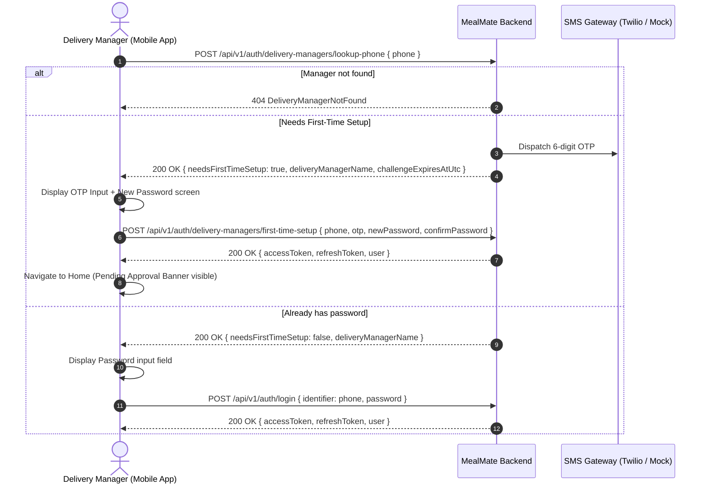

# Delivery Manager Mobile: First-Time Phone Lookup & Account Setup Guide

> **Target Audience:** Mobile Flutter Developers & Backend Integrators  
> **Feature:** Restaurant Delivery Manager (مسؤول التوصيل) Onboarding & Mobile Authentication Flow  
> **Updated:** 2026-09-05  

---

## 1. Flow Overview

The **Delivery Manager (مسؤول التوصيل)** is the restaurant staff member responsible for grouping meal boxes, planning routes, and distributing delivery orders to drivers.

When a restaurant registers a new Delivery Manager via the Restaurant Dashboard:
1. The restaurant supplies:
   - Full Name (الاسم الكامل)
   - Mobile Phone Number (رقم الموبايل)
   - Email Address (البريد الإلكتروني)
   - Responsible Coverage Area (المنطقة المسؤولة: تغطية المطعم كلها / محافظة معينة / منطقة محددة)
   - National ID number + Expiry date + Front & Back photos (الهوية الوطنية وتاريخ الانتهاء وصورة وش وضهر)
   - Employment Contract + Expiry date + Document photo (عقد العمل بالمطعم وتاريخ الانتهاء والوثيقة)
2. The account is created in **Pending Approval** state (`Registered` in Identity, `Submitted` in Registrations).
3. The Delivery Manager **does not** receive a temporary password.
4. Instead, the Delivery Manager opens the mobile app, enters their **phone number**, receives an SMS OTP, verifies the OTP, and sets their own password.
5. Upon setting the password, the Delivery Manager is **immediately logged in** (receives JWT `accessToken` & `refreshToken`).
6. In the mobile app:
   - If the account is in `PendingApproval` / `Registered` state:
     - The app displays a top banner stating that the platform administration is reviewing documents.
     - Trip creation / driver order distribution features remain locked until approval.
     - Profile, coverage area, and restaurant details are visible.
   - Once the Platform Admin approves the registration:
     - Account transitions to `Active`.
     - The delivery manager gains full access to distribute orders and assign drivers.

---

## 2. API Endpoints

| Method | Endpoint | Auth | Purpose |
|---|---|---|---|
| `POST` | `/api/v1/auth/delivery-managers/lookup-phone` | Anonymous | Check phone number & dispatch OTP if first-time setup is required |
| `POST` | `/api/v1/auth/delivery-managers/first-time-setup` | Anonymous | Verify OTP, set password, & issue JWT session |
| `POST` | `/api/v1/auth/login` | Anonymous | Standard login for delivery managers who have already set their password |
| `GET` | `/api/v1/auth/me` | Bearer JWT | Fetch current user identity, roles, restaurantId, and status |

---

## 3. Sequence Diagram



---

## 4. API Specifications

### 4.1 Lookup Phone & Trigger OTP

#### Request
`POST /api/v1/auth/delivery-managers/lookup-phone`
```json
{
  "phone": "+96551234567"
}
```
*Note: The phone number can be provided with or without country code. The backend normalizes numbers automatically.*

#### Response (First-Time User — OTP Dispatched)
`200 OK`
```json
{
  "needsFirstTimeSetup": true,
  "deliveryManagerName": "عبد الله أحمد الصباح",
  "phone": "+96551234567",
  "challengeExpiresAtUtc": "2026-09-05T14:15:00Z"
}
```
> In local development/mock environment, the OTP matches the configured test code `123456`.

#### Response (Existing User — Already Set Password)
`200 OK`
```json
{
  "needsFirstTimeSetup": false,
  "deliveryManagerName": "عبد الله أحمد الصباح",
  "phone": "+96551234567",
  "challengeExpiresAtUtc": null
}
```
*Action in App: Show password input field and call `/api/v1/auth/login`.*

#### Error Responses
- `404 Not Found`:
```json
{
  "type": "https://tools.ietf.org/html/rfc7231#section-6.5.4",
  "title": "Not Found",
  "status": 404,
  "detail": "No delivery manager found with this phone number."
}
```

---

### 4.2 First-Time Setup (Verify OTP & Set Password)

#### Request
`POST /api/v1/auth/delivery-managers/first-time-setup`
```json
{
  "phone": "+96551234567",
  "otp": "123456",
  "newPassword": "Password123!",
  "confirmPassword": "Password123!"
}
```

#### Response (Success — Authenticated Session Issued)
`200 OK`
```json
{
  "accessToken": "eyJhbGciOiJIUzI1NiIsInR5cCI6IkpXVCJ9...",
  "refreshToken": "d8f3b2a1...",
  "expiresAtUtc": "2026-09-05T15:15:00Z",
  "user": {
    "id": "8f3b97b0-7a56-42d4-a78b-03487f918e21",
    "email": "dispatch@restaurant.kw",
    "phone": "+96551234567",
    "fullName": "عبد الله أحمد الصباح",
    "userType": 5,
    "status": 1,
    "restaurantId": "5e174ef4-1234-4567-89ab-cdef01234567",
    "roles": ["DeliveryManager"]
  }
}
```

#### Error Responses
- `400 Bad Request` (Invalid or expired OTP):
```json
{
  "title": "Validation Failed",
  "status": 400,
  "detail": "Invalid or expired verification code."
}
```
- `400 Bad Request` (Password mismatch or weak):
```json
{
  "title": "Validation Failed",
  "status": 400,
  "detail": "Password does not meet complexity requirements."
}
```

---

### 4.3 Subsequent Logins (Standard Password Login)

For managers who already completed first-time setup:

#### Request
`POST /api/v1/auth/login`
```json
{
  "identifier": "+96551234567",
  "password": "Password123!"
}
```

#### Response
`200 OK`
Returns the same session payload containing `accessToken`, `refreshToken`, and `user`.

---

## 5. Mobile App State Handling

### Account Status Representation
| Status Value | Name | Mobile App Experience |
|---|---|---|
| `1` | `Registered` / `PendingApproval` | **Logged In**; displays top informational banner: *"حسابك قيد مراجعة وتدقيق المستندات من قِبل إدارة المنصة. سيتم إشعارك فور اعتماد الحساب."* Distribution/trip actions are locked. |
| `2` | `Active` | **Fully Enabled**; full access to box grouping, trip creation, and driver assignment. |
| `3` | `Suspended` | Access blocked; message directing user to restaurant administrator. |

### Recommended Flutter Storage Keys
- `auth_token`: String (JWT accessToken)
- `refresh_token`: String (JWT refreshToken)
- `account_status`: int (1 = Pending, 2 = Active)
- `restaurant_id`: String (Restaurant GUID)
- `coverage_scope`: String (All / Governorate / Area name)
