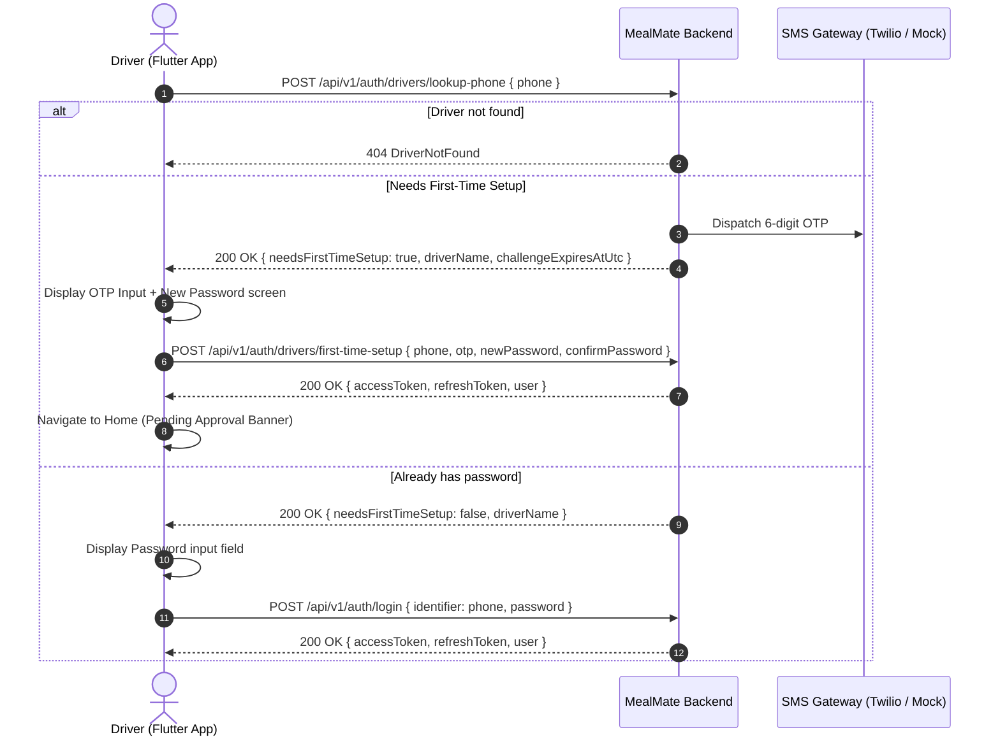

# Driver Mobile: First-Time Phone Lookup & Account Setup Guide

> **Target Audience:** Mobile Flutter Developers & Backend Integrators  
> **Feature:** Restaurant Driver Onboarding & Unified Mobile Login Flow  
> **Updated:** 2026-09-05  

---

## 1. Flow Overview

When a restaurant registers a new driver via the Restaurant Dashboard:
1. The driver account is created in `PendingApproval` state, with 6 mandatory documents and all vehicle details.
2. The driver **does not** receive a temporary password.
3. Instead, the driver opens the mobile app, enters their **phone number only**, receives an SMS OTP, verifies the OTP, and sets their own password.
4. Upon setting the password, the driver is **immediately logged in** (receives JWT `accessToken` & `refreshToken`).
5. In the mobile app, the driver sees their account in **Pending Approval** state:
   - "Go Online" toggle / Delivery requests are locked.
   - A persistent informational banner explains that the platform admin is reviewing their documents.
   - Profile & assigned restaurant details are visible.
6. Once the Platform Admin reviews and approves the registration, the driver account transitions to `Active`, and they can immediately go online and accept delivery orders.

---

## 2. API Endpoints

| Method | Endpoint | Auth | Purpose |
|---|---|---|---|
| `POST` | `/api/v1/auth/drivers/lookup-phone` | Anonymous | Check phone number & dispatch OTP if first-time |
| `POST` | `/api/v1/auth/drivers/first-time-setup` | Anonymous | Verify OTP, set password, & issue JWT session |
| `POST` | `/api/v1/auth/login` | Anonymous | Standard login for drivers who already set their password |
| `GET` | `/api/v1/drivers/me/profile` | Driver JWT | Fetch driver profile, vehicle details, & approval status |

---

## 3. Step-by-Step Mobile Implementation



---

## 4. API Specifications

### 4.1 Lookup Phone & Trigger OTP

#### Request
`POST /api/v1/auth/drivers/lookup-phone`
```json
{
  "phone": "+96550000000"
}
```
*Note: The phone number can be passed with or without country code. The backend standardizes Kuwaiti (+965) and international numbers.*

#### Response (First-Time User — OTP Dispatched)
`200 OK`
```json
{
  "needsFirstTimeSetup": true,
  "driverName": "أحمد محمود العتيبي",
  "phone": "+96550000000",
  "challengeExpiresAtUtc": "2026-09-05T13:10:00Z"
}
```
> In local development/mock environment, the OTP is printed to the server console or matches the configured test code `123456`.

#### Response (Existing User — Already Set Password)
`200 OK`
```json
{
  "needsFirstTimeSetup": false,
  "driverName": "أحمد محمود العتيبي",
  "phone": "+96550000000",
  "challengeExpiresAtUtc": null
}
```
*Action in App: Show password input field and call `/api/v1/auth/login`.*

#### Error Responses
- `400 Bad Request`:
  ```json
  {
    "type": "https://tools.ietf.org/html/rfc9110#section-15.5.1",
    "title": "Bad Request",
    "status": 400,
    "detail": "رقم الهاتف غير صالح"
  }
  ```
- `404 Not Found`:
  ```json
  {
    "type": "https://tools.ietf.org/html/rfc9110#section-15.5.5",
    "title": "Not Found",
    "status": 404,
    "detail": "لم يتم العثور على حساب سائق مسجل بهذا الرقم. يرجى مراجعة المطعم التابع له."
  }
  ```

---

### 4.2 First-Time Setup (Verify OTP & Set Password)

#### Request
`POST /api/v1/auth/drivers/first-time-setup`
```json
{
  "phone": "+96550000000",
  "otp": "123456",
  "newPassword": "SecurePassword123!",
  "confirmPassword": "SecurePassword123!"
}
```

#### Response (`200 OK`)
Returns standard `LoginResultDto`:
```json
{
  "session": {
    "accessToken": "eyJhbGciOiJIUzI1NiIsInR5cCI6IkpXVCJ9...",
    "refreshToken": "dGhpcy1pcy1hLXJlZnJlc2gtdG9rZW4...",
    "expiresAt": "2026-09-05T14:00:00Z",
    "mustEnrollTotp": false,
    "mustEnrollMfa": false,
    "user": {
      "id": "c1f7281c-8e4d-4e92-938a-0248a8a64931",
      "email": "driver_c1f7281c@mealmate.local",
      "fullName": "أحمد محمود العتيبي",
      "role": "Driver",
      "roles": ["Driver"],
      "accountStatus": "PendingApproval",
      "isEmailConfirmed": true,
      "isPhoneNumberConfirmed": true
    }
  },
  "totpEnrollment": null
}
```

#### Error Codes
| Status | Code / Detail | Reason |
|---|---|---|
| `400` | `InvalidOtp` | الكود المدخل غير صحيح أو انتهت صلاحيته |
| `400` | `PasswordsDoNotMatch` | كلمة المرور وتأكيد كلمة المرور غير متطابقين |
| `400` | `PasswordTooWeak` | يجب ألا تقل كلمة المرور عن 8 خانات وتحتوي على أحرف وأرقام |
| `400` | `PasswordAlreadySet` | تم تعيين كلمة المرور مسبقاً لهذا الحساب. يرجى تسجيل الدخول مباشرة |
| `404` | `DriverNotFound` | لم يتم العثور على السائق |

---

## 5. Driver Mobile UI Guidelines

### 5.1 Smart Login Screen
1. **Single Entry Point**:
   - Provide a clean phone number input field with country code picker (+965 Kuwait default).
   - "Continue" button calls `/api/v1/auth/drivers/lookup-phone`.
2. **Dynamic Step**:
   - If `needsFirstTimeSetup == true`:
     - Show: "مرحباً أحمد، مرحباً بك في ميل ميت! يرجى إدخال رمز التحقق المرسل لهاتفك وتعيين كلمة مرورك الأولى".
     - 6-digit PIN input + New Password + Confirm Password fields.
     - Resend OTP countdown (60s).
   - If `needsFirstTimeSetup == false`:
     - Show: "أهلاً بك مجدداً أحمد".
     - Single Password field + "Login" button.

### 5.2 Pending Approval State in App
When `user.accountStatus == "PendingApproval"`:
1. **Top Notice Card / Banner**:
   ```
   ┌────────────────────────────────────────────────────────────┐
   │ ⏳ طلبك قيد المراجعة من الإدارة                            │
   │ يجري حالياً مراجعة رخصتك ومستنداتك من قبل إدارة المنصة.    │
   │ ستصلك إشعار فوري عند اعتماد الحساب لبدء استلام الطلبات.    │
   └────────────────────────────────────────────────────────────┘
   ```
2. **Order Tabs**:
   - Status toggle ("Online / متصل") disabled with tooltip: *"يجب اعتماد الحساب أولاً للبدء"*.
3. **Profile View**:
   - Allows driver to review their registered data:
     - Name: أحمد محمود العتيبي
     - National ID: 295010112345
     - Vehicle: تويوتا كورولا 2023 (رقم اللوحة: 4-58291)
     - Assigned Restaurant: مطعم برجر فاكتوري
     - Attached Documents status badges.
