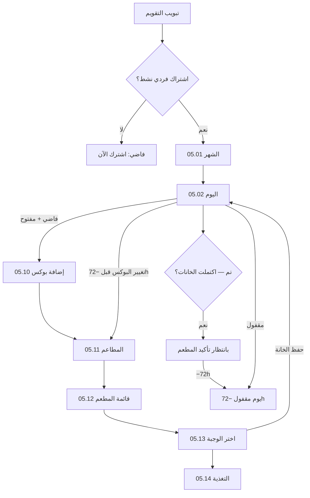

# تطبيق العميل (Flutter) — عقد تقويم الاشتراك الفردي

> **الجمهور:** فريق الموبايل. يُنفَّذ كما هو دون تخمين من الـ Backend.  
> **المنصة:** Flutter · عربي أولاً · RTL.  
> **Figma:** `05 - Meals & Calendar` (05.01 … 05.14). الشكل يبقى، السلوك أدناه.  
> **بعد:** نجاح دفع الاشتراك الفردي (`00_mobile_subscription_app.md`).  
> **خارج الملف:** العائلة، تتبع المندوب، المحفظة، الولاء.

التطبيق العميل غير موجود في هذا الريبو. هذا الملف عقد الشاشات + التنقّل + قواعد الاختيار.

---

## 1. قواعد مقفولة

- التقويم يظهر بعد **اشتراك فردي مدفوع** فقط. لا مبدّل أفراد.
- العميل من التقويم يعمل **إضافة بوكس** ليوم توصيل مفتوح.
- يدخل قائمة المطاعم ويختار المطعم اللي يريده **طول ما هو جوه الحدود** (تصنيف، منطقة، Busy، حد التكرار، حساسية).
- يوم التوصيل = **بوكس واحد** من **مطعم واحد**. تغيير المطعم يمسح الوجبات المختارة لليوم.
- عدد الوجبات المطلوب = خانات باقة الاشتراك. مثال: باقة 3 وجبات → العميل يختار **3 وجبات** بالضبط (حسب `breakfastCount` / `lunchCount` / `dinnerCount` / `snackCount`).
- الوجبات المتاحة للمطعم في ذلك اليوم = وجبات **دورة المنيو المعتمدة** لهذا البرنامج والخانة. العميل يختار من المتاح، لا يركّب من خارج الدورة.
- بعد اكتمال العدد يضغط **تم**. اليوم يدخل **بانتظار تأكيد المطعم**.
- التعديل مسموح **قبل −72 ساعة**. لو العميل **عدّى −72h من غير تم**: النظام يختار **البوكس كامل** تلقائياً مع احترام **الحساسية والتفضيلات**، ثم يُقفل ويُرسل للمطعم.
- حد تكرار المطعم: الحد الأدنى **3** ثابت. الأدمن يغيّر **السقف فقط**.
- الحساسية لا تُتجاوز أبداً (يدوي أو تلقائي). التفضيلات الغذائية وعدم الإعجاب تُحترم في الاختيار التلقائي قدر الإمكان.
- كل شاشة: Loading / Empty / Error / Offline / Retry.

### سياق اليوم (يُمرَّر بين الشاشات)

| الحقل | المعنى |
|--------|--------|
| `subscriptionId` | الاشتراك الفردي النشط |
| `deliveryDate` | يوم التوصيل `YYYY-MM-DD` |
| `restaurantId` | بعد اختيار المطعم |
| `openSlot` | الخانة الجاري ملؤها (`breakfast` / `lunch` / `dinner` / `snack`) |
| `programId` / `bundleId` | من الاشتراك، لا من الواجهة |

---

## 2. خريطة الشاشات



---

## 3. الشاشات بالتفصيل

### 3.1 تبويب التقويم + الحالة الفارغة

- **Figma:** «لا توجد وجبات حالياً».
- **من غير اشتراك فردي نشط:** زر `اشترك الآن`.
- **مع اشتراك وأيام فاضية:** الزر `إضافة بوكس` → أول يوم توصيل مفتوح.

### 3.2 الشهر — 05.01

- عنوان: `تقويم الوجبات`.
- أيام التوصيل فقط حسب المدة وخيار الجمعة.
- تحت الشبكة: كروت وجبات البوكس إن اكتمل، أو كارت `+` / `إضافة بوكس`.
- عدّاد على اليوم الناقص: `1 / 3 وجبات` حسب الباقة.

### 3.3 اليوم — 05.02 / 05.03

- شريط تواريخ لأيام التوصيل.
- **يوم فاضي ومفتوح:** كارت `إضافة بوكس`.
- **يوم قيد التجهيز:** كروت الخانات المملوءة + خانات فاضية `+` + شريط `تم` معطّل حتى اكتمال العدد.
- **يوم مكتمل (تم):** كروت الوجبات الثلاث (أو عدد الباقة) + حالة `بانتظار تأكيد المطعم`. قبل −72h يظهر `تعديل البوكس`.
- **يوم مقفول:** قراءة فقط + عدّاد القفل.

### 3.4 05.10 — إضافة بوكس

- يبدأ تجهيز بوكس اليوم.
- الخطوة التالية: 05.11 اختيار مطعم.
- لا يُحفظ البوكس على السيرفر كمكتمل قبل **تم**.

### 3.5 05.11 — المطاعم

العميل يختار أي مطعم يريده **داخل الحدود**. تظهر فقط المطاعم التي:

1. في نطاق العنوان والتصنيف الهرمي.
2. لديها دورة منيو معتمدة وجاهزة للبرنامج/الباقة في تاريخ التوصيل.
3. ليست Busy (إلا تجاوز الكوتا عند انشغال الكل).
4. لم تبلغ حد التكرار طالما يوجد بديل.
5. لديها وجبات آمنة للحساسية تغطي خانات الباقة.

الصف: اسم، تقييم، صورة، Busy، `مستخدم X من Limit`، سبب التعطيل إن وُجد.

اختيار مطعم مختلف في نفس اليوم يصفّر الوجبات المختارة لهذا اليوم.

### 3.6 05.12 — قائمة المطعم

- بانر المطعم + الباقة: «باقة 3 وجبات — اختر 3».
- الوجبات مجمّعة حسب الخانة الناقصة أولاً. الخانات المكتملة تُعلَّم.
- الضغط على وجبة يفتح 05.13.

### 3.7 05.13 / 05.14 — اختيار الوجبة

- تفاصيل + مكونات + حساسية + ماكروز.
- 05.14 sheet للتغذية.
- الزر: `إضافة لهذه الخانة` (أو `استبدال`) إن كانت الوجبة تناسب الخانة المفتوحة وآمنة.
- الرجوع لشاشة اليوم. شريط أسفل: `2 / 3` + زر `تم`.

### 3.8 تم

- `تم` يتفعّل فقط لما عدد الوجبات المختارة = عدد خانات الباقة، وكل خانة فيها وجبة من النوع المطلوب.
- الضغط يحفظ البوكس (Idempotency-Key) ويحوّل اليوم إلى **بانتظار تأكيد المطعم**.
- ناقص خانة → `تم` معطّل + رسالة «اختر 3 وجبات لإكمال البوكس».

---

## 4. حالات اليوم

| الحالة | بعد ماذا | شاشة اليوم |
|--------|-----------|-------------|
| فاضي | لا بوكس | `إضافة بوكس` |
| قيد التجهيز | مطعم اختير وجبات ناقصة | عدّاد الخانات + `تم` معطّل |
| بانتظار تأكيد المطعم | العميل ضغط تم | شارة انتظار + تعديل قبل −72h |
| اختيار تلقائي | −72h من غير تم | بوكس كامل + شارة تلقائي — لا تعديل |
| مقفل 72 ساعة | −72h بعد تم أو بعد التلقائي | أُرسل للمطعم — لا تعديل |
| بانتظار التأكيد التشغيلي | المطعم لم يؤكّد بعد الاستلام | قراءة + مهلة 24h |
| قيد التحضير | −24h | قراءة |
| مجمّد | تجميد | لا اختيار |
| تم التسليم | تسليم | تقييم |

بعد **تم** الواجهة تعرض انتظار تأكيد المطعم. الإرسال الفعلي للمطعم يبقى عند **−72h** حسب التشغيل، ثم مهلة تأكيد 24 ساعة.

---

## 5. الاختيار التلقائي (−72h من غير تم)

لو العميل ما ضغطش **تم** قبل −72 ساعة (يوم فاضي أو بوكس ناقص)، النظام **ما يسيبش خانة فاضية**. يختار **بوكس كامل** بعدد وجبات الباقة ويرسله للمطعم.

ترتيب القيود (إلزامي بهذا الترتيب):

1. **الحساسية:** لا تُتجاوز. أي وجبة/مطعم فيه مكوّن حساسية مسجَّل يُستبعد. لو مفيش بديل آمن يُصعَّد للأدمن — لا يُرسل بوكس فيه حساسية.
2. **التفضيلات الغذائية** (كيتو/نباتي/… المحفوظة): الوجبات لازم تطابق النظام الغذائي قدر الإمكان من دورة المنيو.
3. **عدم الإعجاب:** يُستبعد إن وُجد بديل، ولا يُكسر من أجل الحساسية.
4. **حد تكرار المطعم:** نفس `limit` اليدوي. مطعم وصل `usedCount >= limit` لا يُختار تلقائياً طالما يوجد مطعم بديل داخل الحدود.
5. ثم باقي التشغيل: منطقة، تصنيف، طاقة/Busy.

بعد اختيار مطعم آمن:

- تُملأ **كل** خانات الباقة (مثال: 3/3) من وجبات الدورة المعتمدة لذلك التاريخ.
- بوكس ناقص من العميل (مثلاً 1/3) لا يُرسل. إما يُكمَّل لنفس المطعم إن كان ما زال صالحاً وآمناً، وإلا يُستبدل **بوكس كامل** جديد.
- اليوم يظهر مكتملاً مع شارة `اختيار تلقائي`.
- إشعار للعميل بالمطعم والوجبات. لا تعديل بعد القفل.

Fallback: لو تعذّر بوكس كامل آمن من مطعم واحد، يُجرَّب المطعم التالي ضمن الحدود. لا يُرسل بوكس ناقص.

---

## 6. حد التكرار

```
limit = clamp(computed, 3, adminCeiling)
```

- `3` ثابت. `adminCeiling` من الأدمن فقط.
- يُطبَّق على الاختيار **اليدوي والتلقائي** بنفس الحساب (`usedCount` يشمل الأيام المكتملة + قيد الانتظار في نفس الاشتراك).
- المطعم الذي بلغ الحد يُقفل في 05.11 وفي محرّك التلقائي طالما توجد بدائل.
- التجاوز فقط عند Busy لكل البدائل أو بعد شكوى محقّة — حتى التلقائي لا يكسر الحد قبل استنفاد البدائل.

---

## 7. لا تفعل

- لا تبوكس جاهز من المطعم من غير ما العميل يختار الوجبات.
- لا تسمح بعدد وجبات أكبر أو أصغر من الباقة.
- لا تخلط مطعمين في نفس يوم التوصيل.
- لا ترسل بوكس ناقص عند −72h. التلقائي يختار بوكس **كامل** فقط.
- لا تختر وجبة فيها حساسية حتى لو مفيش بديل — صعّد للأدمن.
- لا تكسر حد تكرار المطعم في التلقائي وفي اليدوي طالما يوجد بديل.
- لا تستخدم مهلة 48 ساعة. القفل **72 ساعة**.
- لا تفتح تقويم العائلة من هذا العقد.

---

## 8. APIs (مسارات الـ Backend)

Base: `/api/v1/customer/subscriptions/{subscriptionId}`

| الغرض | Method | المسار |
|--------|--------|--------|
| شهر/أيام التقويم | GET | `/calendar` |
| مطاعم اليوم داخل الحدود | GET | `/days/{date}/restaurants` |
| قائمة المطعم حسب الخانة | GET | `/days/{date}/restaurants/{restaurantId}/meals?slot=` |
| اختيار مطعم (يمسح وجبات اليوم) | POST | `/days/{date}/restaurant` |
| حفظ وجبة خانة (مسودة قبل تم) | POST | `/days/{date}/meals/slot` |
| تم — إكمال البوكس | POST | `/days/{date}/complete` + header `Idempotency-Key` |
| اختيار تلقائي لبوكس كامل | POST | `/days/{date}/auto-select` |

أخطاء ProblemDetails: `calendar.selection_locked`, `calendar.restaurant_not_in_pool`, `calendar.quota_exhausted`, `calendar.box_incomplete`, `calendar.allergy_conflict`, `calendar.no_safe_box`, `calendar.individual_only`.

