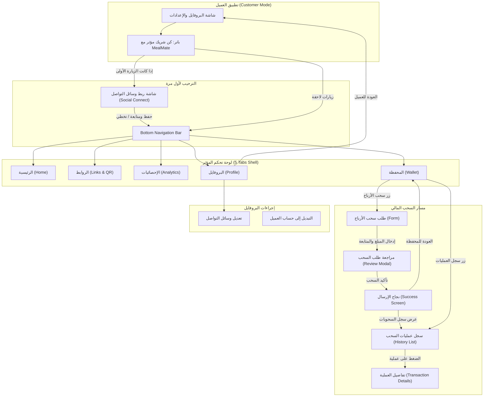

# نظام المؤثرين والشراكة التسويقية (Influencer / Partner Subsystem)
## التوثيق الشامل للشاشات، دورة الحياة، والمنطق المالي المحكم

> **تاريخ الإصدار:** 2026-09-09  
> **الجمهور المستهدف:** فريق الموبايل (Flutter)، فريق الباكيند (.NET Core)، فريق لوحة التحكم (Admin Dashboard).  
> **الهدف:** توثيق معماري وميداني كامل للشاشات، تدفق التنقل (Navigation Flow)، حالات البيانات، القواعد المالية المقاومة للاحتيال بنسبة 100%، وعقود الـ APIs.

---

## 1. الفلسفة المعمارية والقواعد المالية (Financial & Architectural Core)

### 1.1 الهوية المزدوجة (Dual-Mode Single Identity)
- المؤثر هو في الأصل **عميل عادي مسجل برقم هاتف** يمتلك حساباً في MealMate (يمكنه طلب الوجبات، إدارة اشتراكاته، وتعديل عناوينه).
- الترقية تتم حصرياً عبر **لوحة تحكم الإدارة (Admin Dashboard)** بإدخال رقم هاتف العميل، وتعيين كود المؤثر (Promo Code)، ونسبة عمولته (`DefaultCommissionRate`).
- بمجرد الترقية، يُرجع الباكيند في استجابة بيانات المستخدم الحقل:  
  `"isInfluencer": true` و `"influencerProfileId": "GUID"`.
- في تطبيق الموبايل (Customer Mode): يظهر بانر ترويجي خاص داخل شاشة البروفايل/الإعدادات:  
  *"كن شريك مؤثر مع MealMate — الدخول لحساب مؤثر"*.
- عند الضغط عليه، ينتقل التطبيق فوراً إلى **وضع المؤثر (Influencer Mode)** الذي يحتوي على شريط تنقل سفلي مستقل بـ 5 تبويبات.
- يمكن للمؤثر في أي لحظة من تبويب "البروفايل" الضغط على **"التبديل إلى حساب العميل"** للعودة الفورية لتطبيق طلب الوجبات العادي دون الحاجة لتسجيل الخروج.

---

### 1.2 الدرع المالي الحصين لمنع أي خسارة للمنصة (Zero-Loss Financial Engine)
لمنع أي ثغرة مالية ناتجة عن إلغاء العميل لاشتراكه بعد احتساب عمولة المؤثر، يعتمد النظام القواعد الصارمة التالية:

1. **الاستحقاق المشروط ببدء الوجبات (Delivery-Based Maturity):**
   - عند إتمام العميل للاشتراك باستخدام كود المؤثر، تُسجل العمولة فوراً في حساب المؤثر تحت تصنيف **"أرباح معلقة" (Pending Earnings)**.
   - تظهر للمؤثر في الشاشة ليرى نشاط كوده، لكنها **غير قابلة للسحب**.
   - تنتقل العمولة آلياً إلى **"الرصيد المتاح للسحب" (Available Balance)** فقط بعد **تسليم أول وجبة بنجاح للعميل** (أو بعد مرور أول 48 ساعة من تاريخ بدء الخطة).
   - **السبب:** بعد تسليم أول وجبة، يسقط قانونياً حق العميل في استرداد كامل المبلغ لأن عملية الإنتاج والطهي بدأت فعلياً.

2. **قاعدة استرداد الاشتراكات المخفضة (Promo Refund Policy):**
   - إذا طلب العميل إلغاء اشتراكه قبل بدء الوجبات، يتم إلغاء العملية واسترداد المبلغ المتبقي **كرصيد محفظة داخلية (In-App Wallet Credit)** لاستخدامه في وجبات أخرى، ولا يخرج كاش من حساب البنك للمنصة.
   - في نفس اللحظة، يتم إلغاء العمولة المعلقة (`Pending`) من حساب المؤثر تلقائياً.

3. **حساب الأيام المستهلكة بالسعر الكامل (Non-discounted Pro-rata):**
   - في حال إلغاء العميل لاشتراكه بعد بدء الوجبات بظرف استثنائي، يُحسب ثمن الأيام التي تناول فيها الوجبات **بالسعر اليومي القياسي بدون خصم** وتُخصم رسوم إدارية، وبالتالي تكلفة الوجبات وأرباح المنصة مصونة بالكامل.

4. **الاستقطاع العكسي (Clawback / Negative Balance):**
   - إذا تم رد مبلغ اشتراك استثنائياً وكانت العمولة قد سُحبت بالفعل للبنك، يسجل الباكيند **رصيداً سالباً** على محفظة المؤثر ويتم استقطاعه آلياً من الاشتراكات القادمة قبل السماح بأي سحب جديد.

---

### 1.3 ضوابط السحب البنكي (Withdrawal Guardrails)
- **الحد الأدنى للسحب:** محدد برمجياً (مثلاً `10 د.ك`)؛ لا يمكن إرسال طلب سحب بمبلغ يقل عن هذا الحد.
- **طلب واحد معلق فقط (Single Active Request):** لا يمكن للمؤثر فتح طلب سحب جديد إذا كان لديه طلب سابق بحالة **"قيد المراجعة"** أو **"جاري التحويل"**؛ لمنع تشتت الأرصدة والسحب المزدوج.
- **حجز الرصيد الفوري (Instant Balance Reservation):** بمجرد إرسال طلب السحب، يُخصم المبلغ فوراً من "الرصيد المتاح" ويوضع في خانة "قيد المعالجة" حتى لا يتكرر طلبه.
- **مراجعة بشرية من الإدارة (Admin Review & Approval):** لا يوجد تحويل بنكي فوري أوتوماتيكي؛ بل يمر الطلب على لوحة تحكم الإدارة للمراجعة وتأكيد التحويل البنكي ثم تغييره إلى "مكتملة" أو "مرفوضة" (مع ذكر سبب الرفض وإعادة الرصيد للمحفظة فوراً).
- **الحفظ التلقائي للبيانات البنكية:** يحفظ النظام اسم المستفيد، اسم البنك، ورقم الآيبان في بروفايل المؤثر، لتعبئتها مسبقاً (Prefilled) في كل عملية سحب قادمة.

---

## 2. مخطط خريطة الشاشات والتنقل (Navigation Flow Diagram)



---

## 3. التوثيق التفصيلي لكل شاشة (Screen-by-Screen Specifications)

---

### الشاشة 0: نقطة الانطلاق — بانر المؤثر في بروفايل العميل
* **المسار:** `Customer Profile Screen (30 - Profile / Overview)`
* **شرط الظهور:** تظهر البطاقة فقط إذا كان المستخدم لديه `isInfluencer == true` في بيانات حسابه.
* **عناصر الواجهة:**
  - بطاقة عريضة مميزة بتدرج أخضر مع رسم توضيحي لأيقونات تسويقية وهاتف.
  - العنوان: *"كن شريك مؤثر مع MealMate"*.
  - الوصف: *"انضم إلينا لكسب العمولات ومشاركة أسلوب حياتك الصحي"*.
  - زر الإجراء (CTA): *"الدخول لحساب مؤثر"*.
* **السلوك البرمجي:**
  - عند النقر، يفحص التطبيق متغير محلي (أو من الباكيند) `hasCompletedSocialOnboarding`.
  - إذا كان `false`: يتم التوجيه إلى شاشة `Social Connect`.
  - إذا كان `true`: يتم التوجيه مباشرة إلى `Influencer Dashboard Shell` (تبويب الرئيسية).

---

### الشاشة 1: ربط وسائل التواصل (Influencer Social Connect)
* **المسار:** `InfluencerSocialConnectScreen`
* **عناصر الواجهة (مطابقة للصورة 2):**
  - **العنوان الرئيسي:** *"إضافة وسائل التواصل"*.
  - **الوصف:** *"أضف حساباتك على وسائل التواصل لبدء الشراكة وكسب عمولات أكثر"*.
  - **القنوات الست:**
    1. **تيك توك (TikTok):** أيقونة تيك توك، نص توضيحي *"أضف حسابك على تيك توك"*، زر *"إضافة"* أو *"تعديل"* وحقل إدخال الرابط/اليوزر.
    2. **إنستغرام (Instagram):** أيقونة إنستغرام، نص توضيحي، زر إضافة.
    3. **واتساب (WhatsApp):** أيقونة واتساب، نص توضيحي *"أضف رقم واتساب للأعمال"*.
    4. **تيليجرام (Telegram):** أيقونة تيليجرام.
    5. **يوتيوب (YouTube):** أيقونة يوتيوب.
    6. **سناب شات (Snapchat):** أيقونة سناب شات.
  - **صندوق الأمان:** أيقونة درع خضراء + *"نحافظ على خصوصية بياناتك — تُستخدم بياناتك فقط لتحسين فرص الشراكة والتواصل مع العلامات التجارية"*.
  - **أزرار التحكم:**
    - زر أساسي ممتلئ أخضر: *"حفظ ومتابعة"* (Save & Continue).
    - زر نصي سفلي: *"تخطي الآن"* (Skip for now).
* **السلوك البرمجي:**
  - الضغط على "تخطي الآن" أو "حفظ ومتابعة" يضع علامة `hasCompletedSocialOnboarding = true` وينقل المستخدم إلى لوحة التحكم الرئيسية.
  - تبقى هذه الشاشة قابلة لإعادة الفتح والتعديل في أي وقت عبر تبويب "البروفايل".

---

### الشاشة 2: تبويب الرئيسية (Home Tab)
* **المسار:** `InfluencerHomeScreen (iPhone 13 & 14 - 34)`
* **عناصر الواجهة:**
  - **الهيدر العلوي:** أيقونة التنبيهات (مع شارة بالعدد إن وُجد)، شعار MealMate، صورة المؤثر مع التحية: *"مرحباً، [اسم المؤثر]"* وتحتها صفة *"Influencer Partner"*.
  - **بطاقة إجمالي العمولات (Hero Banner):**
    - خلفية خضراء داكنة مميزة برسم ثلاثي الأبعاد للمحفظة والنقود.
    - المبلغ: `845 KWD` (إجمالي العمولات المحققة).
    - شارة ديناميكية: `+55 KWD هذا الأسبوع`.
    - زر جانبي: *"عرض التفاصيل >"* (ينقل لتبويب المحفظة).
  - **شبكة المؤشرات الأربعة (KPIs Grid - 2x2):**
    1. **العملاء المسجلون:** العدد (مثلاً `230`) + مؤشر المقارنة (`+12 هذا الأسبوع`).
    2. **الاشتراكات المكتملة:** العدد (مثلاً `81`) + مؤشر المقارنة (`+5 هذا الأسبوع`).
    3. **النقرات على الرابط:** العدد (مثلاً `520`) + مؤشر المقارنة (`+35 هذا الأسبوع`).
    4. **معدل التحويل:** النسبة (مثلاً `35%`) + مؤشر المقارنة (`+2.5% هذا الأسبوع`).
  - **بطاقة كود الخصم السريع:**
    - عنوان: *"كود الخصم الخاص بك"*.
    - الكود بخط كبير وواضح داخل صندوق مميز: `AMMAR20` مع زر نسخ بنقرة واحدة.
    - زر مشاركة عريض: *"شارك كودك واحصل على عمولات أكثر"*.
  - **قائمة أحدث النشاطات (Recent Activity Feed):**
    - قائمة بآخر الاشتراكات الناتجة عن المؤثر:
      - *"المستخدم محمد اشترك في باقة شهرية"* — عمولة: `+15 KWD` (خضراء).
      - *"المستخدم علي اشترك في باقة أسبوعية"* — عمولة: `+5 KWD`.
    - رابط: *"عرض الكل >"* ينقل للمحفظة.

---

### الشاشة 3: تبويب الروابط (Links Tab)
* **المسار:** `InfluencerLinksScreen (iPhone 13 & 14 - 36)`
* **عناصر الواجهة:**
  - **بانر تشجيعي:** *"كل ما تشارك أكثر تكسب أكثر! شارك رابطك مع متابعيك واحصل على عمولات من كل طلب"*.
  - **بطاقة كود الخصم ورمز الـ QR:**
    - عرض كود الخصم: `Mealmate20`.
    - رمز **QR Code** تم توليده ديناميكياً ليحمل رابط الإحالة.
    - زر *"نسخ الكود"* وزر *"مشاركة / مسح الكود"*.
  - **بطاقة رابط الإحالة (Referral Deep Link):**
    - الرابط: `https://mealmate.com/ref/Mealmate20`.
    - زر *"نسخ الرابط"* (يُظهر SnackBar: تم نسخ الرابط بنجاح).
  - **أزرار المشاركة السريعة عبر المنصات (One-Tap Social Share):**
    - أيقونات دائرية: (واتساب، إنستغرام، تيليجرام، تيك توك، المزيد...).
    - عند النقر على واتساب مثلاً: يُفتح تطبيق واتساب مع رسالة جاهزة منسقة:  
      *"اشترك الآن في MealMate لوجبات صحية ولذيذة، واستخدم كود الخصم الخاص بي [Mealmate20] للحصول على خصم خاص: https://mealmate.com/ref/Mealmate20"*.
  - **بطاقة كفاءة المشاركة (Performance Snippet):**
    - النقرات على الرابط: `520`.
    - الطلبات التابعة: `68`.
    - معدل التحويل: `35%`.

---

### الشاشة 4: تبويب الإحصائيات (Analytics Tab)
* **المسار:** `InfluencerAnalyticsScreen (iPhone 13 & 14 - 35)`
* **عناصر الواجهة:**
  - **شريط الفلاتر الزمنية:** أزرار اختيار سريعة: `7 أيام` | `30 يوم` (محدد افتراضياً) | `90 يوم` | `6 أشهر` | `سنة`.
  - **الرسم البياني الأول (Line Chart):**
    - منحنى نمو الأرباح الإجمالية خلال الفترة المحددة، مع عرض القيمة الإجمالية (مثلاً `845 KWD`).
  - **بطاقات النظرة العامة بالأرقام:**
    - العملاء المسجلون (`230`).
    - الاشتراكات/الطلبات (`68`).
    - النقرات على الرابط (`520`).
    - معدل التحويل (`35%`).
  - **الرسم البياني الثاني (Bar Chart - تطور الأرباح):**
    - أعمدة بيانية توضح الأرباح المقسمة على الفترات (مثلاً أسبوعياً أو شهرياً).
  - **قائمة أفضل الباقات مبيعاً (Top Selling Packages):**
    - قائمة مرتبة تنازلياً بأكثر الباقات التي يشتريها جمهور هذا المؤثر:
      - المركز 1: *"باقة دايت متكامل"* — إجمالي الإيراد: `245 KWD` — عدد المبيعات: `124 طلب`.
      - زر *"عرض الكل >"*.

---

### الشاشة 5: تبويب المحفظة (Wallet Tab)
* **المسار:** `InfluencerWalletScreen (iPhone 13 & 14 - 44)`
* **عناصر الواجهة:**
  - **بطاقة الرصيد الكبرى (Hero Card):**
    - تصميم بطاقة ائتمانية خضراء أنيقة مع شعار MealMate وأيقونة المحفظة.
    - **الرصيد المتاح للسحب (Available Balance):** بخط عريض جداً: `845 د.ك`.
    - **إجمالي الأرباح الكلية (Lifetime Earnings):** `إجمالي الأرباح: 1,245 د.ك`.
    - **أرباح معلقة (قيد التأكيد لحين بدء الوجبات):** عرض قيمة الاشتراكات التي لم تبدأ وجباتها بعد لحماية المنصة.
  - **أزرار الإجراءات السريعة (Quick Actions):**
    - زر *"سحب الأرباح"* (أيقونة سحب خضراء).
    - زر *"سجل العمليات"* (أيقونة سجل خضراء).
  - **ملخص الشهر الحالي (This Month Summary):**
    - صندوق مقسوم نصفين:
      - تم كسبه هذا الشهر: `845 KWD` (سهم أخضر صاعد).
      - تم سحبه هذا الشهر: `400 KWD` (سهم أزرق نازل).
  - **قائمة أحدث المعاملات (Recent Transactions):**
    - عرض آخر المعاملات المالية:
      - عمولة إحالة: `+15 KWD` (مع التاريخ ورقم الاشتراك).
      - طلب سحب بنكي: `-400 KWD` (مع الحالة).
    - زر *"عرض الكل"*.

---

### الشاشة 6: طلب سحب الأرباح (Withdrawal Form Screen)
* **المسار:** `WithdrawalRequestScreen (iPhone 13 & 14 - 41)`
* **عناصر الواجهة:**
  - زر رجوع علوي.
  - بطاقة الرصيد المتاح للسحب حالياً: `845 KWD`.
  - **اختيار طريقة السحب:**
    - خيار 1 (تحويل بنكي - Bank Transfer): [محدد افتراضياً] أيقونة بنك، مع علامة تحديد خضراء.
    - خيار 2 (محفظة إلكترونية - E-Wallet): أيقونة محفظة.
  - **حقول بيانات التحويل البنكي:**
    - اسم صاحب الحساب (Account Holder Name) — يُملأ مسبقاً إذا كان مسجلاً.
    - رقم الآيبان (IBAN) — حقل نصي مع زر مسح/كاميرا إن وُجد، وفحص لصيغة الآيبان (مثلاً IBAN كويتي يبدأ بـ KW).
    - اسم البنك (Bank Name) — قائمة منسدلة (Dropdown) تضم البنوك المعتمدة (بنك الكويت الوطني NBK، بيت التمويل الكويتي KFH، بنك بوبيان، بنك الخليج، بنك برقان، بنك وربة، بنك تجاري...).
    - **مبلغ السحب (Amount to Withdraw):**
      - حقل إدخال رقمي مع وحدة العملة `KWD`.
      - تنبيه بالحد الأدنى: *"الحد الأدنى للسحب هو 10 د.ك"*.
      - زر سريع: *"سحب كامل الرصيد المتاح"*.
  - **ملاحظة إرشادية:** أيقونة معلومات خضراء: *"سيتم تحويل المبلغ إلى حسابك البنكي بعد مراجعة العملية واعتمادها خلال 1 إلى 3 أيام عمل"*.
  - **زر الإجراء الأساسي:** *"طلب سحب الأرباح"* (يتم تعطيله إذا كان المبلغ أقل من الحد الأدنى أو أكبر من الرصيد المتاح أو إذا كان هناك طلب سابق قيد المراجعة).

---

### الشاشة 7: مراجعة طلب السحب (Withdrawal Review Screen / Modal)
* **المسار:** `WithdrawalReviewScreen (iPhone 13 & 14 - 45)`
* **عناصر الواجهة:**
  - بطاقة توضيحية للرصيد المتاح.
  - **بيانات التحويل:**
    - طريقة السحب: تحويل بنكي.
    - البنك: مثلاً *بنك الكويت الوطني*.
    - اسم صاحب الحساب: *محمد أحمد عبد العزيز*.
    - رقم الحساب / الآيبان مقنّع: `KW82 NBOK **** **** **** 5678 9010`.
  - **ملخص المبلغ (Financial Breakdown):**
    - المبلغ المطلوب سحبه: `845.000 KWD`.
    - رسوم التحويل: `0.000 KWD` (مجاناً).
    - المبلغ النهائي المستلم: `845.000 KWD` (بخط عريض ولون أخضر).
  - **تنبيه معلومات هامة:** *"سيتم إيداع المبلغ بالكامل في حسابك البنكي. قد تستغرق المعاملة من 1 إلى 3 أيام عمل حسب البنك"*.
  - **الأزرار:**
    - زر عريض ممتلئ أخضر: *"تأكيد طلب السحب"* (أيقونة قفل للأمان).
    - زر نصي أبيض بحواف رمادية: *"رجوع"*.

---

### الشاشة 8: تم إرسال طلب السحب بنجاح (Withdrawal Success Screen)
* **المسار:** `WithdrawalSuccessScreen (iPhone 13 & 14 - 42)`
* **عناصر الواجهة:**
  - رسم توضيحي احتفالي (محفظة ونقود ثلاثية الأبعاد تنبثق منها أوراق مالية).
  - العنوان: *"تم استلام طلب السحب بنجاح!"*.
  - الوصف: *"سيتم مراجعة طلبك وتحويل المبلغ إلى حسابك في خلال المدة المتوقعة"*.
  - **بطاقة تفاصيل العملية:**
    - المبلغ المسحوب: `845 KWD` بجانبها شارة صفراء: `● قيد المراجعة`.
    - رقم العملية: `WD-2024-05-18-0001`.
    - تاريخ الطلب: `18 مايو 2024، 09:41 ص`.
    - طريقة السحب: `تحويل بنكي`.
    - الحساب المستلم: شعار البنك واسم البنك ورقم الآيبان.
  - **صندوق المدة المتوقعة:** أيقونة معلومات خضراء + *"من 1 إلى 3 أيام عمل من تاريخ اعتماد طلبك"*.
  - **الأزرار:**
    - زر أساسي أخضر: *"الذهاب إلى المحفظة"*.
    - زر ثانوي أبيض بإطار أخضر: *"عرض سجل السحوبات"*.

---

### الشاشة 9: سجل عمليات السحب (Withdrawal History Screen)
* **المسار:** `WithdrawalHistoryScreen (iPhone 13 & 14 - 43)`
* **عناصر الواجهة:**
  - زر رجوع علوي + العنوان: *"سجل عمليات السحب"*.
  - **شريط فلاتر الحالات (Filter Tabs):**
    1. **الكل (All)** [نشط افتراضياً].
    2. **قيد المراجعة (Under Review / Pending)** — شارة بلون برتقالي/أصفر.
    3. **جاري التحويل (Processing / In-Transfer)** — شارة بلون أزرق.
    4. **مكتملة (Completed)** — شارة بلون أخضر.
    5. **مرفوضة (Rejected)** — شارة بلون أحمر.
  - **بطاقتان إحصائيتان في الأعلى:**
    - **إجمالي السحوبات:** `3.340 KWD` (أيقونة محفظة خضراء).
    - **عدد العمليات:** `8` عمليات سحب.
  - **قائمة بطاقات السحوبات السابقة:**
    - كل بطاقة تعرض:
      - التاريخ والوقت (مثلاً: `18 مايو 2024، 09:41 ص`).
      - كود العملية (مثلاً: `WD-2024-05-18-0001`).
      - طريقة السحب (تحويل بنكي / محفظة إلكترونية).
      - المبلغ بخط واضح (مثلاً: `845 KWD`).
      - شارة الحالة الملونة (قيد المراجعة / جاري التحويل / مكتملة / مرفوضة).
      - سهم صغير `<` للدخول إلى التفاصيل.
  - **تذييل الصفحة:** ملاحظة توضيحية: *"قد يستغرق تحويل المبلغ من 1 إلى 3 أيام عمل حسب البنك أو طريقة السحب"*.

---

### الشاشة 10: تفاصيل عملية السحب (Withdrawal Details Screen)
* **المسار:** `WithdrawalDetailsScreen (iPhone 13 & 14 - 40)`
* **عناصر الواجهة:**
  - زر رجوع علوي + العنوان: *"تفاصيل عملية السحب"*.
  - **بطاقة الرأس العلوية:**
    - أيقونة الساعة وشارة الحالة: `● قيد المراجعة` (أو مكتملة / جاري التحويل / مرفوضة).
    - المبلغ المسحوب بخط عريض كبير: `845 KWD`.
    - رسالة إرشادية ديناميكية:  
      - لو قيد المراجعة: *"سيتم مراجعة طلبك وتحويل المبلغ إلى حسابك داخل المدة المتوقعة"*.  
      - لو مكتملة: *"تم تحويل المبلغ بنجاح إلى حسابك البنكي المعتمد"*.  
      - لو مرفوضة: *"تم رفض الطلب: [سبب الرفض المسجل من الإدارة] وتمت إعادة المبلغ لمحفظتك"*.
  - **مجموعة معلومات العملية:**
    - رقم العملية: `WD-2024-05-18-0001`.
    - تاريخ ووقت الطلب: `18 مايو 2024، 09:41 ص`.
    - طريقة السحب: `تحويل بنكي`.
  - **مجموعة معلومات الاستلام:**
    - البنك: شعار واسم البنك (بنك الكويت الوطني).
    - اسم صاحب الحساب: *أحمد محمد السالم*.
    - رقم الحساب / الآيبان: `KW81 NBOK 0000 1234 5678 9010`.
  - **مجموعة تفاصيل المبلغ:**
    - المبلغ المسحوب: `845 KWD`.
    - رسوم التحويل: `0 KWD`.
    - المبلغ الذي سيتم تحويله: `845 KWD`.
  - **صندوق المدة المتوقعة:** *"من 1 إلى 3 أيام عمل من تاريخ اعتماد طلبك"*.
  - **الزر السفلي:** *"عودة إلى المحفظة"*.

---

### الشاشة 11: تبويب البروفايل الخاص بالمؤثر (Influencer Profile Tab)
* **المسار:** `InfluencerProfileScreen`
* **عناصر الواجهة:**
  - **بطاقة الحساب العلوية:** صورة المؤثر، اسمه، رقم هاتفه، كود الخصم المعتمد، نسبة العمولة (`%10` مثلاً).
  - **قائمة الخيارات والإعدادات:**
    1. **الحساب البنكي المعتمد:** عرض البنك ورقم الآيبان مع إمكانية تعديله وتحديثه.
    2. **وسائل التواصل الاجتماعي:** فتح شاشة `Influencer Social Connect` لتعديل روابط تيك توك وإنستغرام وغيرها.
    3. **الشروط والأحكام وسياسة العمولات:** شاشة نصية تشرح قواعد الاحتساب والتسليم وعدم الاسترداد.
    4. **زر التبديل المميز (Switch Mode CTA):**  
       زر بارز بتصميم مميز: **"التبديل إلى حساب العميل" (Switch to Customer Mode)**.  
       عند النقر عليه، يعود التطبيق فوراً إلى الشاشات الرئيسية للعميل العادي (تصفح الوجبات، الاشتراكات، السلة).
    5. **تسجيل الخروج:** لتسجيل الخروج الكامل من التطبيق.

---

## 4. عقود الـ APIs ونماذج البيانات (Backend Endpoints & DTOs)

Base URL:
```text
/api/v1/influencer-partner
```

### 4.1 بيانات المؤثر والملف الشخصي
```http
GET /api/v1/influencer-partner/me
```
**Response (200 OK):**
```json
{
  "influencerProfileId": "b18b4592-3580-4963-8a30-0bb54cb43210",
  "displayName": "محمد أحمد",
  "influencerCode": "Mealmate20",
  "commissionRate": 10.0,
  "isActive": true,
  "bankInfo": {
    "accountHolderName": "محمد أحمد عبد العزيز",
    "bankName": "National Bank of Kuwait (NBK)",
    "iban": "KW81NBOK0000123456789010"
  },
  "socialLinks": {
    "tiktok": "https://tiktok.com/@mohamed",
    "instagram": "https://instagram.com/mohamed",
    "whatsapp": "+96598765432",
    "telegram": "https://t.me/mohamed",
    "youtube": null,
    "snapchat": "mohamed_snap"
  },
  "hasCompletedSocialOnboarding": true
}
```

---

### 4.2 تحديث وسائل التواصل
```http
PUT /api/v1/influencer-partner/me/social-links
```
**Request:**
```json
{
  "tiktok": "https://tiktok.com/@mohamed",
  "instagram": "https://instagram.com/mohamed",
  "whatsapp": "+96598765432",
  "telegram": "https://t.me/mohamed",
  "youtube": "",
  "snapchat": "mohamed_snap"
}
```

---

### 4.3 بيانات لوحة التحكم الرئيسية (Home Tab)
```http
GET /api/v1/influencer-partner/me/home
```
**Response (200 OK):**
```json
{
  "totalCommissions": { "amount": 845.0, "currency": "KWD" },
  "thisWeekCommissionsDiff": { "amount": 55.0, "currency": "KWD" },
  "kpis": {
    "registeredCustomers": 230,
    "registeredCustomersThisWeekDiff": 12,
    "completedSubscriptions": 81,
    "completedSubscriptionsThisWeekDiff": 5,
    "linkClicks": 520,
    "linkClicksThisWeekDiff": 35,
    "conversionRate": 35.0,
    "conversionRateThisWeekDiff": 2.5
  },
  "influencerCode": "Mealmate20",
  "recentActivities": [
    {
      "id": "act-1",
      "customerNameMasked": "المستخدم محمد",
      "actionDescription": "اشترك في باقة دايت متكامل (شهرية)",
      "commissionAmount": { "amount": 15.0, "currency": "KWD" },
      "occurredAtUtc": "2026-09-08T14:30:00Z"
    }
  ]
}
```

---

### 4.4 بيانات الروابط والمشاركة (Links Tab)
```http
GET /api/v1/influencer-partner/me/links
```
**Response (200 OK):**
```json
{
  "influencerCode": "Mealmate20",
  "referralLink": "https://mealmate.com/ref/Mealmate20",
  "qrCodeData": "https://mealmate.com/ref/Mealmate20",
  "quickStats": {
    "linkClicks": 520,
    "affiliatedOrders": 68,
    "conversionRate": 35.0
  }
}
```
> **ملاحظة للموبايل:** نصوص رسائل المشاركة (WhatsApp / Telegram) يتم بناؤها برمجياً داخل تطبيق Flutter باستخدام قوالب الترجمة المعتمدة في التطبيق (`app_ar.arb` / `app_en.arb`) وتضمين الـ `influencerCode` و `referralLink` بدون أي نصوص ثابتة مسبقة من الباكيند.


---

### 4.5 بيانات المحفظة والسحب (Wallet Tab)
```http
GET /api/v1/influencer-partner/me/wallet
```
**Response (200 OK):**
```json
{
  "availableBalance": { "amount": 845.0, "currency": "KWD" },
  "pendingBalance": { "amount": 120.0, "currency": "KWD" },
  "lifetimeEarnings": { "amount": 1245.0, "currency": "KWD" },
  "thisMonthEarned": { "amount": 845.0, "currency": "KWD" },
  "thisMonthWithdrawn": { "amount": 400.0, "currency": "KWD" },
  "hasActiveWithdrawalRequest": false,
  "minimumWithdrawalAmount": 10.0,
  "recentTransactions": [
    {
      "transactionId": "TX-1001",
      "type": "CommissionEarned", // CommissionEarned | Withdrawal | Reversal
      "title": "عمولة إحالة — باقة شهرية",
      "amount": 15.0,
      "currency": "KWD",
      "isPositive": true,
      "status": "Available", // Available | PendingMaturity
      "createdAtUtc": "2026-09-08T14:30:00Z"
    },
    {
      "transactionId": "TX-1002",
      "type": "Withdrawal",
      "title": "سحب أرباح لحساب بنكي",
      "amount": 400.0,
      "currency": "KWD",
      "isPositive": false,
      "status": "Completed",
      "createdAtUtc": "2026-09-01T10:15:00Z"
    }
  ]
}
```

---

### 4.6 إرسال طلب سحب جديد (Submit Withdrawal)
```http
POST /api/v1/influencer-partner/me/withdrawals
```
**Request:**
```json
{
  "amount": 845.0,
  "withdrawalMethod": "BankTransfer", // BankTransfer | EWallet
  "bankName": "National Bank of Kuwait (NBK)",
  "accountHolderName": "محمد أحمد عبد العزيز",
  "iban": "KW81NBOK0000123456789010",
  "saveAsDefaultBank": true
}
```
**Validation & Errors:**
- `400 Bad Request` — `influencer.withdrawal_below_minimum` (المبلغ أقل من الحد الأدنى 10 د.ك).
- `400 Bad Request` — `influencer.insufficient_available_balance` (المبلغ المطلوب أكبر من المتاح).
- `409 Conflict` — `influencer.active_withdrawal_exists` (يوجد طلب سابق قيد المراجعة لم يُبت فيه).

**Response (201 Created):**
```json
{
  "withdrawalId": "a37e8912-9c10-41bf-a841-320cf9173928",
  "referenceNumber": "WD-2024-05-18-0001",
  "amount": { "amount": 845.0, "currency": "KWD" },
  "transferFee": { "amount": 0.0, "currency": "KWD" },
  "netAmount": { "amount": 845.0, "currency": "KWD" },
  "status": "Requested",
  "method": "BankTransfer",
  "bankDetails": {
    "accountHolderName": "أحمد محمد السالم",
    "bankName": "بنك الكويت الوطني",
    "iban": "KW81NBOK0000123456789010"
  },
  "requestedAtUtc": "2026-09-09T18:30:00Z",
  "reviewedAtUtc": null,
  "completedAtUtc": null,
  "rejectionReason": null,
  "estimatedMinBusinessDays": 1,
  "estimatedMaxBusinessDays": 3
}
```

---

### 4.7 قائمة وتفاصيل السحوبات
```http
GET /api/v1/influencer-partner/me/withdrawals?status=All // All | Requested | UnderReview | Approved | Paid | Rejected | Cancelled
```
```http
GET /api/v1/influencer-partner/me/withdrawals/{withdrawalId}
```
**Response (200 OK):**
```json
{
  "withdrawalId": "a37e8912-9c10-41bf-a841-320cf9173928",
  "referenceNumber": "WD-2024-05-18-0001",
  "amount": { "amount": 845.0, "currency": "KWD" },
  "transferFee": { "amount": 0.0, "currency": "KWD" },
  "netAmount": { "amount": 845.0, "currency": "KWD" },
  "status": "Requested",
  "method": "BankTransfer",
  "bankDetails": {
    "accountHolderName": "أحمد محمد السالم",
    "bankName": "بنك الكويت الوطني",
    "iban": "KW81NBOK0000123456789010"
  },
  "requestedAtUtc": "2026-05-18T09:41:00Z",
  "reviewedAtUtc": null,
  "completedAtUtc": null,
  "rejectionReason": null,
  "estimatedMinBusinessDays": 1,
  "estimatedMaxBusinessDays": 3
}
```
> **قاعدة تعريب الواجهات (Zero Hardcoded Backend Localization):** الباكيند يرجع كود الحالة `status` كـ Machine Code خام (مثل `"Requested"` أو `"Paid"`) وعدد أيام العمل التقديرية كأرقام (`estimatedMinBusinessDays: 1`, `estimatedMaxBusinessDays: 3`). يقوم تطبيق الموبايل بتعريب الحالة والنصوص ديناميكياً بحسب لغة واجهة المستخدم المحددة في الهاتف.

---

## 5. الحالات الاستثنائية والـ Edge Cases

| الحالة | السلوك المتوقع من التطبيق والباكيند |
|---|---|
| **محاولة سحب ورصيده أقل من 10 د.ك** | زر السحب معطل في الواجهة، ويظهر تلميح *"الحد الأدنى للسحب هو 10 د.ك"*، وفي حال التجاوز يرفض الباكيند بـ 400. |
| **محاولة سحب ولديه طلب معلق سابق** | يظهر بانر أصفر في شاشة السحب: *"لديك طلب سحب برقم (WD-XXXX) قيد المراجعة حالياً، يمكنك إرسال طلب جديد بعد انتهاء مراجعته"* مع زر ينقله لسجل السحوبات. |
| **إلغاء عميل لاشتراكه قبل بدء الوجبات** | تُحذف العمولة المعلقة فوراً من حساب المؤثر، وتُرد قيمة الاشتراك للعميل كرصيد محفظة داخلية فقط؛ لا تتأثر أموال المنصة. |
| **إلغاء عميل لاشتراكه بعد استلام وجبات** | يُحاسب العميل على الأيام السابقة بالسعر الأصلي اليومي الكامل بدون خصم + رسوم إلغاء، وتُحسب عمولة المؤثر فقط على الجزء الصافي أو يتم تسوية الفرق آلياً. |
| **رفض طلب السحب من الإدارة** | ينتقل الطلب لحالة "مرفوضة"، ويُعاد المبلغ المحجوز فوراً إلى "الرصيد المتاح"، ويظهر سبب الرفض في تفاصيل العملية للمؤثر لتعديل بياناته (مثلاً خطأ في رقم الآيبان). |
| **تغيير الحساب البنكي** | يتاح للمؤثر تغيير بيانات البنك من شاشة البروفايل أو أثناء طلب السحب مع خيار *"حفظ كحساب افتراضي"*. |

---

## 6. جاهزية التطبيق والتسليم
- تم إعداد وتوثيق كامل الشاشات الإحدى عشرة لفرق **Flutter** و **.NET** و **Admin Web**.
- التصميم يلبي المعايير العالمية لشركات الاشتراكات مع إحكام الإغلاق المالي لضمان عدم تعرض المنصة لأي خسارة.
