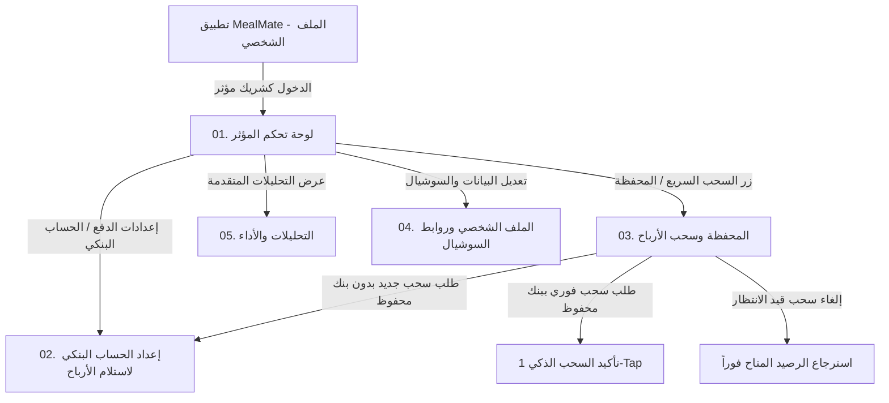

# بوابة المؤثرين (Influencer Portal) — عقد شاشات الموبايل

دليل هندسي وتوثيق شامل لكل شاشات بوابة المؤثرين والمسوقين بالعمولة (Affiliate & Influencers) في تطبيق MealMate على Flutter / Mobile.

**Base URL:** `/api/v1/influencer-partner`  
**Auth:** `Authorization: Bearer <customer_jwt_token>`  
**Encoding:** JSON camelCase · العملة: `KWD` (افتراضي بجميع الاستجابات المالية) · الاتجاه: RTL عربي + LTR إنجليزي

---

## 📱 جدول الشاشات والملفات المرجعية

| # | الشاشة | الهدف والوظيفة | ملف الشرح والمواصفات |
|---|--------|----------------|----------------------|
| 1 | **لوحة التحكم الرئيسية** | عرض الإحصائيات السريعة، رابط الإحالة، كود الخصم، كود QR التفاعلي، والنشاط الأخير | [01-influencer-dashboard.md](./01-influencer-dashboard.md) |
| 2 | **إعداد الحساب البنكي** | إدارة الحساب البنكي لاستلام الأرباح (IBAN)، التحقق الذاتي، التعديل والحذف الآمن، والعرض المقنع (Masked) وقائمة البنوك المعتمدة | [02-bank-account-setup.md](./02-bank-account-setup.md) |
| 3 | **المحفظة وسحب الأرباح** | رصيد الأرباح المتاح والمعلق، سياسة السحب الديناميكية (`withdrawalPolicy`)، طلب سحب فوري بالاعتماد على الحساب المحفوظ (Smart Withdrawal)، إلغاء السحب المعلق، وسجل التحويلات المرقّم | [03-withdrawals-and-wallet.md](./03-withdrawals-and-wallet.md) |
| 4 | **الملف الشخصي وروابط السوشيال** | ضبط قنوات التواصل (TikTok, Instagram, Snapchat..)، نسبة العمولة، شروط الشراكة (`partnerTermsUrl`)، وتفعيل الحساب | [04-social-links-and-profile.md](./04-social-links-and-profile.md) |
| 5 | **التحليلات والأداء** | رسوم بيانية ومؤشرات أداء الاشتراكات والطلبات حسب الفترات الزمنية (`7d` / `30d` / `90d` / `all`) مع بيانات المقارنة المئوية | [05-campaigns-and-analytics.md](./05-campaigns-and-analytics.md) |

---

## 🛠️ تدفق تجربة المستخدم (User Navigation Flow)



---

## 🔐 القواعد العامة والمعايير الفنية (Global Business Rules)

1. **حقول العملة والـ Avatar الموحدة (Shared Fields):**
   - ترسل الـ API حقل `"currencyCode": "KWD"` مع جميع الاستجابات المالية (Home, Wallet, Withdrawals, Analytics) لتجنب أي قيم ثابتة Hardcoded في كود التطبيق.
   - يعيد البروفايل ولوحة التحكم حقل `avatarUrl` (يكون `null` إذا لم ترفع صورة).
2. **سياسة السحب الديناميكية (Dynamic Withdrawal Policy):**
   - تعيد استجابة المحفظة كائن `withdrawalPolicy` يحتوي على:
     `minimumAmount: 10.000`، `maximumAmount: availableBalance`، `currencyCode: "KWD"`، `canWithdraw: true/false`، و `disabledReason` (`PendingWithdrawalExists` / `NoBankAccountConfigured` / `InsufficientBalance`).
   - يقوم الموبايل بتمكين أو تعطيل زر السحب وعرض السبب استناداً لهذا الكائن دون افتراضات محلية.
3. **أمان البيانات المصرفية (Bank Account Privacy):**
   - الـ API تعيد رقم الآيبان بصيغة مقنعة فقط `maskedIban: "KW82 •••• •••• 9012"`.
   - تعديل أو حذف الحساب البنكي من الملف الشخصي **لا يؤثر** على طلبات السحب الجارية والمعلقة (تحتفظ كل عملية بسجل البنك الذي أُنشئت به).
4. **منع تكرار طلبات السحب (Idempotency & CorrelationId):**
   - يمكن للموبايل إرسال `correlationId` (UUID) في طلب السحب لمنع تكرار العملية عند انقطاع الاتصال وإعادة المحاولة.
5. **الترقيم والتصفح (Pagination Schema):**
   - جميع القوائم الكبيرة (السحوبات والأنشطة) تعتمد الشكل القياسي:
     ```json
     {
       "items": [...],
       "page": 1,
       "pageSize": 20,
       "totalCount": 42,
       "totalPages": 3,
       "hasPreviousPage": false,
       "hasNextPage": true
     }
     ```
6. **دقة الأرقام والتواريخ:**
   - المبالغ المالية: 3 خانات عشرية (مثال: `120.500`).
   - التواريخ: ISO-8601 UTC (مثال: `2026-09-14T15:30:00Z`).

---

## 🗂️ جداول الرموز والحالات (Enums & Constants)

### حالات حساب المؤثر (`InfluencerStatus`):
| الحالة | الوصف | سلوك الواجهة |
|--------|-------|--------------|
| `Pending` | الحساب قيد المراجعة والاعتماد | إظهار بانر "حسابك قيد التفعيل من الإدارة" مع تعطيل السحب |
| `Active` | الحساب نشط ومعتمد | إتاحة كافة العمليات وروابط الإحالة والسحب |
| `Suspended` | الحساب موقوف مؤقتاً | إظهار رسالة إيقاف ومراجعة الدعم الفني |
| `Rejected` | طلب الانضمام مرفوض | إظهار سبب الرفض وإمكانية إعادة التقديم |

### حالات طلب السحب (`WithdrawalStatus`):
| الحالة في الـ API | الاسم الظاهر في الموبايل | اللون المقترح | الوصف |
|-------------------|--------------------------|---------------|-------|
| `Requested` / `Pending` | قيد المراجعة | برتقالي (`#F59E0B`) | تم تقديم الطلب وبانتظار موافقة الإدارة (يمكن للمؤثر إلغاؤه) |
| `UnderReview` / `Approved` | تمت الموافقة | أزرق (`#3B82F6`) | تمت الموافقة وجاري إعداد التحويل المصرفي |
| `Completed` / `Paid` | تم التحويل بنجاح | أخضر (`#10B981`) | تم إرسال المبلغ وصدور رقم الحوالة المرجعي |
| `Rejected` | مرفوض | أحمر (`#EF4444`) | تم الرفض وتوضيح السبب مع إعادة المبلغ للرصيد المتاح |
| `Cancelled` | ملغي | رمادي (`#6B7280`) | تم إلغاء الطلب من قبل المؤثر واسترجاع الرصيد المتاح |

---

## ⚠️ نموذج الخطأ الموحد (Unified Error Response Contract)

في حال حدوث أي خطأ، تُرجع الـ API استجابة موحدة بصيغة:
```json
{
  "errorCode": "influencers.invalid_iban",
  "message": "Invalid IBAN format",
  "fieldErrors": {
    "iban": ["IBAN length must be between 15 and 34 alphanumeric characters"]
  },
  "traceId": "00-4bf92f3577b34da6a3ce929d0e0e4736-00"
}
```

### جدول أكواد الأخطاء الشائعة:
| كود الخطأ في الـ Backend | HTTP Status | رسالة الواجهة المقترحة (عربي) |
|--------------------------|-------------|-------------------------------|
| `influencer.profile_not_found` | 404 | حساب المؤثر غير موجود أو غير مفعل |
| `influencer.bank_account_required` | 400 | يرجى إضافة حساب بنكي أولاً لتتمكن من استلام الأرباح |
| `influencer.invalid_iban` | 400 | صيغة الآيبان غير صحيحة، تأكد من كتابة الرمز البنكي بدقة |
| `influencer.bank_name_required` | 400 | يرجى تحديد أو كتابة اسم البنك |
| `influencer.account_holder_required` | 400 | يرجى كتابة اسم صاحب الحساب كما هو مسجل بالبنك |
| `influencer.withdrawal_below_minimum` | 400 | الحد الأدنى لطلب السحب هو 10 د.ك |
| `influencer.insufficient_available_balance` | 400 | رصيدك المتاح لا يكفي لإتمام عملية السحب |
| `influencer.active_withdrawal_exists` | 409 | يوجد طلب سحب قيد المراجعة بالفعل |
| `influencer.cannot_cancel_withdrawal` | 400 | لا يمكن إلغاء الطلب بعد اعتماده أو تحويله |
| `influencer.account_suspended` | 403 | حساب المؤثر موقوف حالياً |

---

## 📦 ملفات كود الموبايل الجاهزة (Flutter / Dart)
- [نماذج Dart / Flutter للـ DTOs](../influencer_bank_account_models.dart)
- [خدمة الـ Dio API المتكاملة](../influencer_api_service.dart)
