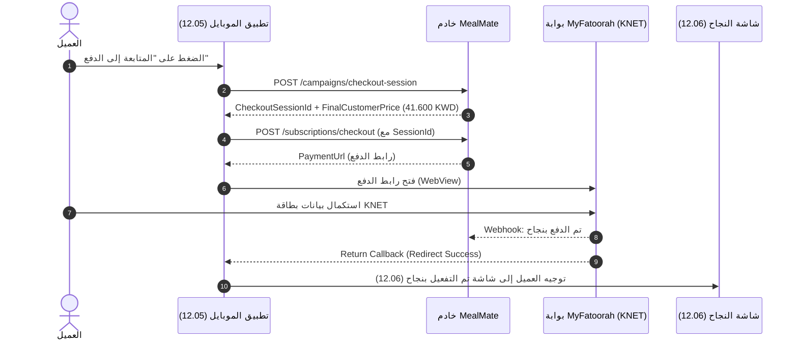

> Payment integration updated 2026-10-06: use the [Payzah contract](<F:/MealMate/backend/docs/mobile/payzah-payments.md>). Any old-provider payment endpoints, method IDs, credential/webhook fields or refund instructions below are superseded; they are retained only as historical context for this mixed guide.

# شاشة 12.05 — تأكيد العرض المطبق وملخص الدفع (Offers / Promo Applied - Checkout Confirmation)

**السابق:** [اختيار الباقة (12.04)](./04-redeem-and-select-package.md) · **التالي:** [تأكيد التفعيل وجدول الوجبات (12.06)](./06-activation-success.md)

---

## 1. هدف الشاشة

تأكيد تطبيق كود الخصم أو العرض الترويجي للعميل بشكل مرئي واضح ومطمئن، واستعراض ملخص الفاتورة النهائي (السعر الأصلي، قيمة الخصم المستقطعة، السعر النهائي الواجب دفعه بالدينار الكويتي)، وإطلاق جلسة الدفع الإلكتروني (KNET / Apple Pay / Visa) عبر بوابة الدفع.

---

## 2. عناصر الشاشة في التصميم

1. **شارة التأكيد والنجاح العلوية (Applied Promo Banner)**:
   - علامة الصح الخضراء `(✓)` مع خلفية دائرية مضيئة.
   - عنوان بارز: `تم تفعيل العرض!`.
   - كود العرض المطبق كـ Badge أخضر: `كود العرض المطبق: SAVE20`.
   - النص التوضيحي: `تم تطبيق خصم 20% على الباقة الشهرية وسيتم تطبيق الخصم على إجمالي السعر قبل إتمام الدفع`.
2. **كارت ملخص الطلب (Order Summary Card)**:
   - نوع الباقة: `باقة شهرية` (أو 13 يوماً / 6 أيام).
   - عدد الوجبات: `4 وجبات يومياً`.
   - **السعر الأصلي**: `52.000 KWD`.
   - **الخصم (20%)**: `-10.400 KWD` (بلون أخضر مميز).
   - خط فاصل أنيق.
   - **الإجمالي بعد الخصم**: `41.600 KWD` (بخط عريض وواضح).
3. **خيارات وشارات الأمان (Payment Badges)**:
   - أيقونة `🔒 دفع آمن ومشفر 100%`.
   - طرق الدفع المدعومة: `كي نت (KNET)`، `أبل باي (Apple Pay)`، `بطاقات ائتمانية`، `محفظة التطبيق`.
4. **أزرار التحكم والإجراءات (Actions / CTA)**:
   - زر رئيسي أخضر عريض: `المتابعة إلى الدفع`.
   - زر نصي أسفل الزر الرئيسي: `🔄 تغيير الباقة` (يعيد العميل فوراً إلى شاشة `12.04`).

---

## 3. الـ APIs المطلوبة

### 1) إنشاء جلسة دفع العرض والحملة (Create Checkout Session)

عند ضغط العميل على `المتابعة إلى الدفع`:

```http
POST /api/v1/customer/campaigns/checkout-session
Authorization: Bearer {Customer_JWT_Token}
Content-Type: application/json
```

#### Request Body:
```json
{
  "idempotencyKey": "chk_sess_9a8b7c6d-e5f6-4a1b-8c2d-3e4f5a6b7c8d",
  "campaignId": "9b12a345-c123-4567-8901-abcdef123456",
  "bundleId": "a1b2c3d4-e5f6-7890-1234-567890abcdef",
  "customerId": "3fa85f64-5717-4562-b3fc-2c963f66afa6",
  "durationDays": 26,
  "requestedServiceDates": [
    "2026-10-01",
    "2026-10-02",
    "2026-10-03"
  ],
  "deliveryGovernorate": "العاصمة"
}
```

#### Response Body (200 OK):
```json
{
  "sessionId": "e7b91234-5678-4321-9876-fedcba654321",
  "campaignId": "9b12a345-c123-4567-8901-abcdef123456",
  "bundleId": "a1b2c3d4-e5f6-7890-1234-567890abcdef",
  "customerId": "3fa85f64-5717-4562-b3fc-2c963f66afa6",
  "durationDays": 26,
  "finalCustomerPrice": 41.600,
  "currency": "KWD",
  "expiresAtUtc": "2026-09-17T12:30:00Z",
  "status": "PendingPayment",
  "allocations": [
    {
      "serviceDate": "2026-10-01",
      "restaurantId": "8f14b2a3-9876-4abc-def0-1234567890ab",
      "units": 4
    }
  ]
}
```

---

### 2) بدء الدفع الإلكتروني (Initiate Payment / MyFatoorah)

```http
POST /api/v1/customer/subscriptions/checkout
Authorization: Bearer {Customer_JWT_Token}
Content-Type: application/json
```

#### Request Body:
```json
{
  "programId": "c4d15678-e123-4567-8901-123456789abc",
  "bundleId": "a1b2c3d4-e5f6-7890-1234-567890abcdef",
  "durationDays": 26,
  "paymentMethod": "KNet",
  "offerId": "7b85f264-b040-4591-a1b7-a36f90382345",
  "promoCode": "SAVE20",
  "checkoutSessionId": "e7b91234-5678-4321-9876-fedcba654321"
}
```

#### Response Body (200 OK):
```json
{
  "subscriptionId": "8a7c6b5d-4e3f-2a1b-9c8d-7e6f5a4b3c2d",
  "paymentUrl": "https://portal.myfatoorah.com/KWT/PayInvoice/Checkout?invoiceKey=12345678",
  "invoiceId": "12345678",
  "finalAmountKwd": 41.600
}
```

> **ملاحظة الدفع:** يقوم تطبيق الموبايل بفتح `paymentUrl` داخل WebView مخصص أو SFSafariViewController / ChromeCustomTabs. وعند نجاح المعاملة (الرجوع إلى صفحة النجاح)، يتم توجيه العميل فوراً إلى شاشة `12.06`.

---

## 4. نموذج البيانات في Flutter (Dart Model)

```dart
class AppliedOfferSummary {
  final String offerCode;
  final String discountHeadline;
  final String packageName;
  final int mealsPerDay;
  final int durationDays;
  final double originalPriceKwd;
  final double discountAmountKwd;
  final double finalPriceKwd;

  const AppliedOfferSummary({
    required this.offerCode,
    required this.discountHeadline,
    required this.packageName,
    required this.mealsPerDay,
    required this.durationDays,
    required this.originalPriceKwd,
    required this.discountAmountKwd,
    required this.finalPriceKwd,
  });
}
```

---

## 5. سيناريو المعالجة الكامل (Payment Flow)



---

## 6. التعامل مع الحالات الاستثنائية (Edge Cases)

| الحالة | الاستجابة في التطبيق |
| :--- | :--- |
| **فشل أو إلغاء الدفع في البوابة** | العودة إلى شاشة `12.05` مع رسالة تنبيه: `لم تكتمل عملية الدفع، يمكنك المحاولة مرة أخرى دون فقدان خصم العرض`. |
| **انتهاء مدة صلاحية الجلسة (`Session Expired`)** | إشعار العميل: `انتهت صلاحية جلسة الحجز، جاري تحديث الأسعار`، ثم إعادة طلب `POST /checkout-session`. |
| **نفاد المقاعد أثناء الدفع (`Quota Exceeded`)** | إظهار رسالة لطيفة: `عذراً، اكتملت الحصة المخصصة لهذا العرض قبل لحظات` واقتراح عروض نشطة أخرى. |
