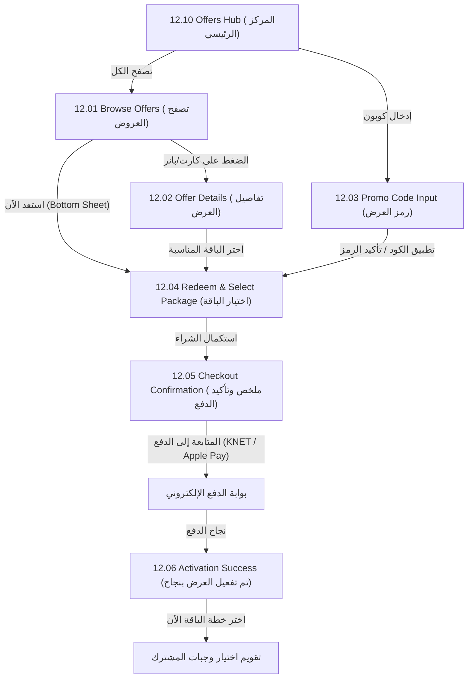

# الدليل الشامل لربط شاشات العروض في الموبايل — MealMate Offers & Promotions Mobile Guide

هذا المجلد يحتوي على **ملف توثيق تقني مستقل لكل شاشة (Screen-by-Screen)** من شاشات العروض السبع الظاهرة في تصاميم التطبيق (Figma Flow 12).
تم تصميم هذا الدليل ليمكن مطور الفلاتر (Flutter / Mobile Developer) من ربط واجهات العروض مع الـ Backend بدقة متناهية ودون أي لبس.

---

## فهرس الشاشات وملفات التوثيق

| رقم الشاشة | اسم الشاشة في التصميم | الملف التوثيقي | المسار والهدف |
| :---: | :--- | :--- | :--- |
| **12.01** | **Offers / Browse** | [`01-browse-offers.md`](./01-browse-offers.md) | استعراض قائمة العروض والفلترة وشيت المعاينة السفلية |
| **12.02** | **Offers / Offer Details** | [`02-offer-details.md`](./02-offer-details.md) | تفاصيل العرض، العداد التنازلي، الشروط، وكود الخصم |
| **12.03** | **Offers / Promo Code Input** | [`03-promo-code-input.md`](./03-promo-code-input.md) | إدخال كود الخصم، التحقق اللحظي، واختيار كوبون جاهز |
| **12.04** | **Offers / Redeem & Select Package** | [`04-redeem-and-select-package.md`](./04-redeem-and-select-package.md) | اختيار الباقة (شهر/نصف/أسبوع) وحساب الأسعار بعد الخصم |
| **12.05** | **Offers / Promo Applied - Checkout** | [`05-promo-applied-checkout.md`](./05-promo-applied-checkout.md) | تأكيد العرض المطبق وملخص الطلب وبدء الدفع |
| **12.06** | **Offers / Activation Success** | [`06-activation-success.md`](./06-activation-success.md) | نجاح التفعيل والانتقال لاختيار الوجبات والجدول |
| **12.10** | **Offers / Referral & Deals Hub** | [`07-offers-hub-and-referral.md`](./07-offers-hub-and-referral.md) | المركز الرئيسي للعروض الكبرى وبرنامج دعوة الأصدقاء |

---

## مخطط تدفق التنقل في التطبيق (User Navigation Flow)

---

## القواعد الأساسية لربط الموبايل (Core Mobile Rules)

1. **الأسعار والخصومات مصدرها السيرفر حصراً**:
   - لا تقم أبداً بحساب الخصم أو السعر النهائي يدوياً في كود دارت/فلاتر وتمريره للدفع.
   - السيرفر هو من يحسب `FinalCustomerPrice` و `CampaignDiscountApplied` عبر `PreviewCustomerPricingQuery`.
2. **منع الازدواجية والتجميع (Anti-Stacking Policy)**:
   - العروض تأتي بحقل `allowPromoCodeStacking: false` افتراضياً. عند تطبيق عرض حملة، يتم تعطيل حقل الكوبون الإضافي تلقائياً وإخطار المستخدم بأن العرض لا يقبل الدمج مع أكواد أخرى.
3. **العداد التنازلي والمقاعد المتبقية (FOMO Elements)**:
   - كل عرض يعيد `endsAtUtc` و `remainingSpots`. استخدمهما لتشغيل عداد تنازلي نشط وعرض عدد المقاعد المتبقية لتحفيز العميل على الاشتراك.
4. **تأكيد الاسترداد المالي**:
   - الاسترداد الفعلي للعرض لا يستهلك حصة العميل إلا بعد إتمام عملية الدفع بنجاح عبر بوابات الدفع (KNET / Apple Pay) لضمان عدم ضياع العرض على العميل في حال تعثر الدفع.
