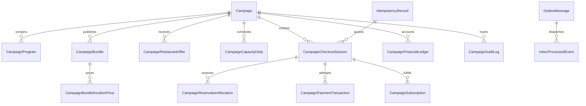

# Campaign Management System v2.0 (Collaborative Discounting) Production Implementation Plan

> **Target Audience & Execution Directive:** Staff-level .NET/PostgreSQL engineer & autonomous implementation subagents.
> **Required Execution Sub-Skill:** Use `superpowers:subagent-driven-development` (or `superpowers:executing-plans`) to implement task-by-task.
> **Implementation Mandate:** Strict TDD (write failing test first, verify failure, write minimal code, verify pass, commit). No shortcuts, no placeholder code, no fake in-memory tests for PostgreSQL concurrency and transaction guarantees.

---

## 1. Goal
Build and integrate the production-grade Collaborative Discounting Campaign Management System v2.0 for MealMate. The system enables MealMate and participating restaurants to jointly sponsor subscription discounts with mathematical rigor, immutable financial snapshots, deterministic daily capacity reservation with multi-restaurant diversification, race-condition safety on PostgreSQL, append-only financial event ledgers, and zero overselling.

---

## 2. Architecture Overview
- **Bounded Context:** `MealMate.Domain.CollaborativeCampaigns` with dedicated vertical slices in `MealMate.Application.Features.CollaborativeCampaigns` adhering to Clean Architecture.
- **Persistence & Isolation:** PostgreSQL via EF Core with 19 dedicated relational tables, strict `CHECK` constraints, composite unique indexes, row-level locks (`SELECT ... FOR UPDATE`), and deterministic locking sequences.
- **Time Abstraction:** .NET 8 `TimeProvider` injected everywhere for deterministic testing of TTL, expiration, scheduling, and cutoffs.
- **Idempotency & Concurrency:** Dedicated `IdempotencyRecord` table with unique constraint on `(Scope, Key)`, payload SHA-256 hash validation, and `CampaignPaymentTransaction` with unique gateway transaction protection.
- **Asynchronous Infrastructure:** Transactional Outbox pattern paired with idempotent consumer / Inbox (`InboxProcessedEvent`) pattern guaranteeing *at-least-once delivery* and *effectively-once business effects*.
- **Background Workers:** Dedicated workers for periodic reservation cleanup, crash reconciliation (`CampaignCheckoutReconciliationWorker`), and campaign lifecycle state transitions.
- **Frontend Architecture:** Angular 17+ standalone components, signals, role-based UI guards, and reactive forms across `admin-dashboard` and `restaurant-dashboard`.

---

## 3. Frozen Architectural Decisions (Final Consistency Patch)

### Decision 1: Unified Reference Pricing & Additive Contributions
The campaign discount is applied directly and exclusively to the unified `ReferenceCustomerPrice`. The formula is:
$$\text{CustomerDiscountAmount} = \text{ReferenceCustomerPrice} \times \text{HeadlineDiscountPct}$$
$$\text{CampaignCustomerPrice} = \text{ReferenceCustomerPrice} - \text{CustomerDiscountAmount}$$
The headline discount is strictly the mathematical sum of the restaurant contribution and platform contribution:
$$\text{HeadlineDiscountPct} = \text{RestaurantContributionPct} + \text{PlatformContributionPct}$$
$$\text{RestaurantContributionFunded} = \text{ReferenceCustomerPrice} \times \text{RestaurantContributionPct}$$
$$\text{PlatformContributionFunded} = \text{ReferenceCustomerPrice} \times \text{PlatformContributionPct}$$

### Decision 2: Resolved Financial Ledger Accounting Model (Zero Double-Counting)
To eliminate accounting ambiguity and double-counting:
1. **Real Financial Flows Only:** `CampaignFinancialLedger` records actual monetary movements and liabilities:
   - `CustomerPayment` (cash collected from customer)
   - `RestaurantSettlement` (net payable liability owed to restaurant)
   - `PaymentProcessingFee` (gateway cost)
   - `CustomerRefund` (cash returned to customer)
   - `RestaurantSettlementReversal` (deduction from restaurant payable)
   - `PaymentFeeReversal` (gateway fee refund if applicable)
   - `ManualFinancialAdjustment` (strictly authorized manual journal adjustments)
2. **Economic Decompositions:**
   - On the customer side: $\text{RestaurantContributionFunded} = \text{ReferenceCustomerPrice} \times \text{RestaurantContributionPct}$.
   - On the restaurant side: $\text{RestaurantDiscountConcession} = \text{RestaurantBasePrice} \times \text{RestaurantContributionPct}$.
   - $\text{GrossRestaurantSettlement} = \text{RestaurantBasePrice} - \text{RestaurantDiscountConcession}$.
   - $\text{CommissionAmount} = \text{GrossRestaurantSettlement} \times \text{EffectiveCommissionRate}$.
   - $\text{RestaurantNetPayout} = \text{GrossRestaurantSettlement} - \text{CommissionAmount}$.
3. **Accounting Identity Invariant:**
   $$\text{PlatformGrossRetention} = \text{CustomerCollectedAmount} - \text{RestaurantNetPayout}$$
   $$\text{PlatformNetProfit} = \text{PlatformGrossRetention} - \text{PaymentProcessingCost} - \text{OtherVariableCosts}$$
   $$\text{MarginPct} = \frac{\text{PlatformNetProfit}}{\text{CustomerCollectedAmount}} \times 100\%$$
   The analytical difference $\text{WholesalePricingSpread} = \text{ReferenceCustomerPrice} - \text{RestaurantBasePrice}$ is an **analytical and reporting metric only**. It is NEVER posted as an extra additive cash/revenue entry in the ledger. The ledger entries for a completed purchase reconcile exactly to $\text{CustomerCollectedAmount} - \text{RestaurantNetPayout} - \text{ExternalCosts} = \text{PlatformNetProfit}$.

### Decision 3: Duration-Aware Reference Customer Pricing
Reference customer pricing is duration-aware. A campaign bundle does not hard-code a single 26-day price. Instead:
- The system models `CampaignBundleDurationPrice` mapping `(CampaignBundleId, DurationDays) \rightarrow ReferenceCustomerPrice`.
- Allowed durations are defined within campaign bounds (`MinSubscriptionDays` to `MaxSubscriptionDays`, e.g. 14, 20, 26, 30 days).
- When a customer requests a quote or checks out, `PriceQuoteSnapshot` captures the selected `DurationDays`, the exact corresponding `ReferenceCustomerPrice`, its `ReferencePriceSource`, and `ReferencePriceVersion`.

### Decision 4: Extended Capacity Calendar Horizon
Subscriptions purchased on the final sales day of a campaign run for their full multi-day duration. Therefore:
- The capacity calendar horizon spans from $\text{CustomerSalesStartsAtUtc}$ through:
  $$\text{CapacityHorizonEnd} = \text{ServiceDateGenerator.GetLastPossibleServiceDate}(\text{CustomerSalesEndsAtUtc}, \text{MaxSubscriptionDurationDays}, \text{ServiceCalendarPolicy}) + 1\text{ Day Buffer}$$
- In MealMate, subscription service days follow the calendar delivery schedule (e.g. customer delivery days / non-delivery days policy). The horizon generator pre-allocates daily capacity rows covering every valid service date up to this calculated limit.
- Standard subscription orders cannot consume campaign capacity, and campaign orders cannot consume regular capacity.

### Decision 5: Frozen Rounding Policy per Campaign Version
To ensure historical reproducibility of financial amounts:
- Every campaign and price snapshot explicitly stores:
  - `CurrencyPrecision` (e.g. 3 for KWD)
  - `RoundingMode` (strictly frozen as `MidpointRounding.AwayFromZero`)
  - `RoundingPolicyVersion` (integer version tag)
- No intermediate rounding occurs during calculations; rounding is applied strictly at externally committed monetary boundaries using the frozen snapshot policy.

### Decision 6: Explicit Payment Transaction Entity & Idempotency Persistence
- **HTTP / Application Idempotency:** Dedicated database table `idempotency_records` stores:
  - `Id`, `Scope` (`CheckoutSession`, `PaymentCallback`, `Refund`, `CapacityResponse`), `Key`, `RequestHash` (SHA-256 of canonical JSON payload), `ResponseJson`, `StatusCode`, `ResourceUri`, `CreatedAtUtc`, `ExpiresAtUtc`.
  - Unique constraint on `(Scope, Key)`.
  - Same Key + Same RequestHash $\rightarrow$ Return cached response.
  - Same Key + Different RequestHash $\rightarrow$ Reject with `IdempotencyConflict` (HTTP 409).
- **Payment Provider Financial Identity:** Dedicated entity `CampaignPaymentTransaction` stores:
  - `Id`, `CheckoutSessionId`, `CampaignId`, `PaymentProvider`, `ProviderTransactionId`, `ProviderPaymentReference`, `Amount`, `Currency`, `Status`, `InitiatedAtUtc`, `CompletedAtUtc`, `FailedAtUtc`, `RefundedAtUtc`, `ProcessingLeaseExpiresAtUtc`.
  - Unique constraint on `(PaymentProvider, ProviderTransactionId)`.
  - Unique constraint on `CheckoutSessionId` for successful payment transactions.

### Decision 7: Durable Payment Lease Semantics
- **No Database Row Locks during Gateway Calls:** A database transaction or row lock is NEVER held during external payment gateway HTTP calls.
- **Logical Lease:** When payment begins, `CheckoutSession` transitions `Pending` $\rightarrow$ `PaymentPending`, and `CampaignPaymentTransaction` is marked `Processing` with a durable `ProcessingLeaseExpiresAtUtc` (default 5 minutes).
- **Expiration Safety:** The expiration worker can expire a `PaymentPending` session ONLY IF:
  `CheckoutSession.ExpiresAtUtc < TimeProvider.UtcNow` AND `ProcessingLeaseExpiresAtUtc < TimeProvider.UtcNow` AND no `Succeeded` payment transaction exists.

### Decision 8: Terminal PaymentFailed & Immediate Resource Release
In v2.0, `PaymentFailed` is **terminal for that CheckoutSession**:
- When payment reaches a definitive failed state, the session transitions to `PaymentFailed` and atomically and idempotently releases the `ReservedSubscriberSlot` and all `Reserved Daily Capacity`.
- A customer wanting to retry must create a NEW checkout session, acquiring fresh capacity and quotes deterministically.

### Decision 9: Canonical Campaign Lifecycle & Terminal Stopped State
1. **Canonical Date Names:**
   - `RestaurantJoinStartsAtUtc` / `RestaurantJoinEndsAtUtc`
   - `CustomerSalesStartsAtUtc` / `CustomerSalesEndsAtUtc`
2. **States:** `Draft`, `OpenForJoining`, `JoiningClosed`, `UnderReview`, `NeedsChanges`, `Scheduled`, `Active`, `Stopped`, `Ended`, `Cancelled`.
3. **Transitions:**
   - `Active` $\rightarrow$ `Stopped`: Manual administrative halt of new sales.
   - `Active` $\rightarrow$ `Ended`: Automatic when `TimeProvider.UtcNow >= CustomerSalesEndsAtUtc`.
   - `Stopped` $\rightarrow$ `Ended`: Automatic when `TimeProvider.UtcNow >= CustomerSalesEndsAtUtc`.
   - `Stopped` is **terminal for new checkouts in v2.0** (no `Stopped` $\rightarrow$ `Active`).
   - `Active` cannot become `Cancelled` (use `Stopped`).
4. **Customer Protection:** Existing active subscriptions continue fulfillment after `Stopped` and after `Ended` under their frozen terms. Full post-fulfillment operational completion is tracked as `Fulfilled` in reporting.

### Decision 10: At-Least-Once Delivery, Effectively-Once Business Effects
The Transactional Outbox provides *at-least-once delivery*. To guarantee *effectively-once business effects*:
- Outbox consumers are backed by an `inbox_processed_events` table tracking `(ConsumerName, EventId, ProcessedAtUtc)`.
- If an outbox handler crashes after executing an external side-effect (e.g. sending an email or push notification) but before marking the outbox message as processed, the inbox record prevents duplicate side-effects upon re-delivery.

### Decision 11: Dedicated Checkout Reconciliation Worker
A background worker `CampaignCheckoutReconciliationWorker` runs periodically:
- Recovers sessions stuck in `Paid`, `Committing`, or `RefundPending` after server crashes.
- For ambiguous payment states, queries gateway status:
  - Local `PaymentPending` + Gateway `Succeeded` $\rightarrow$ completes purchase.
  - Local `Processing` + Gateway `Failed` $\rightarrow$ releases reservations, marks `PaymentFailed`.
  - Local `Paid` + Core subscription missing $\rightarrow$ completes subscription, commits capacity, posts ledger.
  - Local `RefundPending` + Gateway `Refunded` $\rightarrow$ posts ledger reversal, marks refunded.
- Converges safely without duplicate subscriptions, duplicate ledger postings, or duplicate capacity commits.

### Decision 12: Single-Journal Purchase Posting & Refund Flow
- Every completed purchase produces exactly one `JournalId` linking all entries in `CampaignFinancialLedger`.
- Customer cancellation creates a gateway refund transaction in `RefundPending`. Only upon gateway confirmation (`Refunded`) are final reversal ledger entries posted referencing the original `JournalId`.

---

## 4. Critical Domain Invariants
1. $\text{HeadlineDiscountPct} = \text{RestaurantContributionPct} + \text{PlatformContributionPct} \pm 0.0001$.
2. $0.000 \le \text{RestaurantContributionPct} \le \text{HeadlineDiscountPct} \le 1.000$.
3. $\text{CampaignCustomerPrice} \ge 0.000$.
4. $\text{RestaurantNetPayout} \ge 0.000$ (negative net settlements are strictly prohibited).
5. For all service dates up to the capacity horizon: $\text{TotalCapacity} \ge \text{ReservedCapacity} + \text{CommittedCapacity}$.
6. $\text{MaxSubscribers} \ge \text{ReservedSubscriberSlots} + \text{CommittedSubscriberSlots}$.
7. No capacity reservation can partially succeed: if even 1 day out of the requested subscription duration fails, the entire transaction rolls back.
8. Each checkout session can complete at most once (strict idempotency via `idempotency_records` and `UNIQUE(CheckoutSessionId)` on `CampaignSubscription`).
9. Each payment provider transaction ID can affect campaign subscriptions at most once (`UNIQUE(PaymentProvider, ProviderTransactionId)`).
10. `CampaignFinancialLedger` is strictly append-only. No updates or deletions are allowed.
11. Historical snapshots are read-only, permanent, and versioned.
12. Launch snapshots must match current `CampaignVersion`, `OffersVersion`, `PricingVersion`, `CapacityVersion`, and `RoundingPolicyVersion`.
13. $\text{CustomerSalesStartsAtUtc} < \text{CustomerSalesEndsAtUtc}$.
14. $\text{RestaurantJoinEndsAtUtc} < \text{CustomerSalesStartsAtUtc}$.
15. Posted ledger entries must balance: $\text{CustomerCollectedAmount} - \text{RestaurantNetPayout} - \text{ExternalCosts} = \text{PlatformNetProfit}$.

---

## 5. Updated Data Model (19 Persisted Entities / Relational Tables)



### Complete Persisted Entity List:
1. `Campaign`: Core entity, lifecycle states, dates, discount percentages, subscriber cap counters (`MaxSubscribers`, `ReservedSubscriberSlots`, `CommittedSubscriberSlots`), audit timestamps, and concurrency version token.
2. `CampaignProgram`: Maps campaign to underlying marketing programs.
3. `CampaignBundle`: Links campaign to meal bundles.
4. `CampaignBundleDurationPrice`: Explicit duration pricing mapping `(CampaignBundleId, DurationDays, ReferenceCustomerPrice, Currency, Source, Version, CapturedAtUtc)`.
5. `CampaignRestaurantOffer`: Restaurant participation, status (`Invited`, `Accepted`, `Declined`, `Withdrawn`, `Locked`), `DedicatedDailyCapacity`, `PreApprovedHeadroom`, and embedded `OfferSnapshotJson`.
6. `CampaignCapacityDaily`: Calendar ledger storing `(CampaignId, BundleId, ServiceDate, RestaurantId, TotalCapacity, ReservedCapacity, CommittedCapacity)` spanning the extended horizon.
7. `CampaignCheckoutSession`: Manages checkout transaction lifecycle (`Pending`, `PaymentPending`, `Paid`, `Committing`, `Completed`, `PaymentFailed`, `Expired`, `RefundPending`, `Refunded`), customer ID, TTL, and quote reference.
8. `CampaignReservationAllocation`: Individual daily allocations belonging to a checkout session: `(SessionId, ServiceDate, RestaurantId, BundleId, Units)`.
9. `CampaignPaymentTransaction`: Payment provider transaction ledger `(Id, CheckoutSessionId, PaymentProvider, ProviderTransactionId, Amount, Status, ProcessingLeaseExpiresAtUtc)`.
10. `CampaignPriceQuote`: Stores locked quote terms, calculation inputs, duration days, discount amounts, and expiration timestamp.
11. `CampaignTierSnapshot`: Snapshot of participating restaurants, rankings, and diversification scores used for fulfillment.
12. `CampaignProfitabilitySnapshot`: Frozen inputs and outputs of profitability evaluations (`ExpectedMargin`, `WorstCaseMargin`, `OverrideReason`, `ApproverId`).
13. `CampaignSubscription`: Linkage record tying MealMate core `SubscriptionId` to `(CampaignId, CampaignVersion, PriceSnapshotId, OfferSnapshotId, CheckoutSessionId)`.
14. `CampaignFinancialLedger`: Append-only monetary events (`CustomerPayment`, `RestaurantSettlement`, `PaymentProcessingFee`, `CustomerRefund`, `RestaurantSettlementReversal`, `PaymentFeeReversal`, `ManualFinancialAdjustment`) linked by `JournalId`.
15. `CampaignAuditLog`: Immutable audit trail with before/after state diffs, actor ID, action type, and mandatory override reasons.
16. `CampaignCapacityChangeRequest`: Post-launch workflow for capacity expansion requests requiring restaurant confirmation.
17. `IdempotencyRecord`: Server-side idempotency storage `(Id, Scope, Key, RequestHash, ResponseJson, StatusCode, ResourceUri, CreatedAtUtc, ExpiresAtUtc)`.
18. `OutboxMessage`: Transactional outbox messages for reliable event dispatch `(Id, EventType, PayloadJson, CreatedAtUtc, ProcessedAtUtc, RetryCount, LastError)`.
19. `InboxProcessedEvent`: Consumer deduplication table `(Id, ConsumerName, EventId, ProcessedAtUtc)`.

---

## 6. Lifecycle State Machines

### 6.1 Campaign State Machine
- `Draft` $\rightarrow$ `OpenForJoining` $\rightarrow$ `JoiningClosed` $\rightarrow$ `UnderReview` $\rightarrow$ `Scheduled` $\rightarrow$ `Active` $\rightarrow$ `Stopped` / `Ended`.
- `UnderReview` $\rightarrow$ `NeedsChanges` $\rightarrow$ `UnderReview`.
- `Draft` / `OpenForJoining` / `Scheduled` $\rightarrow$ `Cancelled` (with audit justification).
- `Active` cannot be Cancelled; must use `Stopped`.
- `Stopped` is strictly terminal for new sales in v2.0; reaches `Ended` when `CustomerSalesEndsAtUtc` is reached.

### 6.2 Checkout Session State Machine
- `Pending`: Initial session with reserved slot, daily capacity, and 15-minute TTL.
- `PaymentPending`: Customer redirected to gateway; protected by logical `ProcessingLeaseExpiresAtUtc`.
- `Paid`: Gateway confirmed payment success; transitions to `Committing`.
- `Committing`: Creating core subscription, committing capacity, posting financial journal.
- `Completed`: Purchase fulfilled; confirmation emitted.
- `PaymentFailed`: Gateway failed; immediate terminal release of reserved capacity and slot.
- `Expired`: 15-min TTL exceeded with no active lease/payment; reservations released.
- `RefundPending`: Late payment arrived after expiration but capacity was unavailable; auto-refund initiated.
- `Refunded`: Refund confirmed by gateway; logged to ledger and audit.

---

## 7. Deterministic Lock Ordering & Concurrency Architecture

To guarantee deadlock-free execution in PostgreSQL:
1. **Checkout Creation Flow:**
   - Step 1: Check `IdempotencyRecord` for `(Scope, Key)`.
   - Step 2: Lock `Campaign` row for subscriber slot:
     ```sql
     SELECT id, reserved_subscriber_slots, committed_subscriber_slots, max_subscribers 
     FROM campaigns 
     WHERE id = @CampaignId 
     FOR UPDATE;
     ```
   - Step 3: Lock required `CampaignCapacityDaily` rows in strictly sorted composite key order:
     ```sql
     SELECT id, total_capacity, reserved_capacity, committed_capacity 
     FROM campaign_capacity_daily 
     WHERE campaign_id = @CampaignId 
       AND bundle_id = @BundleId 
       AND (service_date, restaurant_id) IN (...)
     ORDER BY campaign_id, bundle_id, service_date, restaurant_id 
     FOR UPDATE;
     ```
   - Step 4: Insert `CampaignCheckoutSession`, allocations, and `IdempotencyRecord`.
2. **Payment Callback Flow:**
   - Step 1: Lock `CampaignPaymentTransaction` on `(PaymentProvider, ProviderTransactionId)`.
   - Step 2: Lock `CampaignCheckoutSession` row `FOR UPDATE`.
   - Step 3: If committing, lock `Campaign` then sorted `CampaignCapacityDaily` rows to convert `Reserved` $\rightarrow$ `Committed`.
3. **Retry Policy:** Polly retry policy on PostgreSQL errors `40P01` (deadlock) and `40001` (serialization failure) with exponential backoff and jitter (3 retries, 50ms - 200ms).

---

## 8. Material Change & Snapshot Invalidation Matrix

| Material Change Parameter | Version Incremented | Snapshots Invalidated | Restaurant Re-Consent Required? | Finance Re-Review Required? | Launch Blocked? |
| :--- | :--- | :--- | :--- | :--- | :--- |
| **HeadlineDiscountPct** | `CampaignVersion` | Tier, Profitability | **Yes** (resets accepted offers) | **Yes** | **Yes** |
| **RestaurantContributionPct** | `CampaignVersion` | Tier, Profitability | **Yes** (resets accepted offers) | **Yes** | **Yes** |
| **PlatformContributionPct** | `CampaignVersion` | Profitability | No | **Yes** | **Yes** |
| **ReferenceCustomerPrice** | `PricingVersion` | Tier, Profitability | **Yes** (settlement changes) | **Yes** | **Yes** |
| **Duration Price (New/Modified)**| `PricingVersion` | Tier, Profitability | **Yes** (for affected bundle) | **Yes** | **Yes** |
| **RestaurantBasePrice** | `OffersVersion` | Profitability | **Yes** | **Yes** | **Yes** |
| **Commission Rate** | `OffersVersion` | Profitability | **Yes** | **Yes** | **Yes** |
| **Restaurant Offer Accepted** | `OffersVersion` | Tier, Profitability | No | **Yes** | No |
| **Restaurant Offer Withdrawn**| `OffersVersion` | Tier, Profitability | No | **Yes** | **Yes** (if bundle coverage drops) |
| **Dedicated Daily Capacity** | `CapacityVersion` | Profitability | No (if within headroom) | **Yes** (if below coverage) | **Yes** |
| **Subscriber Cap Increase** | `CampaignVersion` | Profitability | No (unless capacity short) | **Yes** | No |
| **Rounding Mode / Policy** | `RoundingPolicyVersion`| Pricing, Profitability| No | **Yes** | **Yes** |

---

## 9. Task-by-Task Implementation Phases (11 Phases, 58 Tasks)

### Phase 1: Domain & Frozen Financial Semantics

#### Task 1: Campaign Lifecycle Domain Entity & State Machine Transitions
- **Goal:** Implement the 10-state Campaign lifecycle with strict domain guards, transition rules, and validation errors.
- **Dependencies:** None.
- **Files to Create:**
  - `src/MealMate.Domain/CollaborativeCampaigns/Campaign.cs`
  - `src/MealMate.Domain/CollaborativeCampaigns/Enums/CampaignStatus.cs`
  - `src/MealMate.Domain/CollaborativeCampaigns/Events/CampaignStatusChangedDomainEvent.cs`
  - `src/MealMate.Domain/CollaborativeCampaigns/Exceptions/InvalidCampaignStateTransitionException.cs`
- **Files to Modify:** None.
- **Database Changes:** None.
- **Interfaces / Contracts:**
  - `Result CanTransitionTo(CampaignStatus targetStatus)`
  - `void TransitionTo(CampaignStatus targetStatus, string actorId, string reason)`
- **Domain Invariants:** `Stopped` is terminal for new sales in v2.0; cannot transition directly from `Draft` to `Active`; `Active` cannot transition to `Cancelled`.
- **Error Cases:** Transitioning from `Draft` to `Scheduled` throws `InvalidCampaignStateTransitionException`.
- **Tests to Write FIRST:** `tests/MealMate.UnitTests/CollaborativeCampaigns/CampaignLifecycleTests.cs`
- **Test Command:** `dotnet test tests/MealMate.UnitTests --filter "FullyQualifiedName~CampaignLifecycleTests"`
- **Expected Failing State:** Compilation failure (types not declared).
- **Implementation Steps:** Create enum, domain events, entity transition methods, and validation guards.
- **Expected Passing State:** All transition permutation unit tests pass.
- **Commit Scope:** `feat(campaigns): implement campaign domain entity and state machine transitions`
- **Rollback Note:** Pure domain code, no migration rollback required.

#### Task 2: Value Objects for Additive Discount Contributions & Currency Precision
- **Goal:** Implement domain value objects for discount percentages with sum invariant and 3-decimal KWD support.
- **Dependencies:** Task 1.
- **Files to Create:**
  - `src/MealMate.Domain/CollaborativeCampaigns/ValueObjects/CampaignDiscountSplit.cs`
- **Files to Modify:** `src/MealMate.Domain/ValueObjects/Percentage.cs`
- **Database Changes:** None.
- **Interfaces / Contracts:**
  - `static Result<CampaignDiscountSplit> Create(Percentage headline, Percentage restaurant, Percentage platform)`
- **Domain Invariants:** $\text{headline} == \text{restaurant} + \text{platform} \pm 0.0001$; each percentage between $0.000$ and $1.000$.
- **Error Cases:** `Create(0.30m, 0.20m, 0.05m)` fails with `DiscountContributionMismatchException`.
- **Tests to Write FIRST:** `tests/MealMate.UnitTests/CollaborativeCampaigns/CampaignDiscountSplitTests.cs`
- **Test Command:** `dotnet test tests/MealMate.UnitTests --filter "FullyQualifiedName~CampaignDiscountSplitTests"`
- **Expected Failing State:** Compilation failure.
- **Implementation Steps:** Implement `CampaignDiscountSplit` value object with invariant validation.
- **Expected Passing State:** Tests pass.
- **Commit Scope:** `feat(campaigns): implement additive discount split value object`
- **Rollback Note:** Pure domain code.

#### Task 3: Duration-Aware Reference Customer Price Value Object & Entities
- **Goal:** Implement `CampaignBundleDurationPrice` entity supporting 14, 20, 26, 30-day prices with frozen source tags.
- **Dependencies:** Task 2.
- **Files to Create:**
  - `src/MealMate.Domain/CollaborativeCampaigns/CampaignBundleDurationPrice.cs`
  - `src/MealMate.Domain/CollaborativeCampaigns/ValueObjects/ReferencePriceSnapshot.cs`
- **Files to Modify:** None.
- **Database Changes:** None.
- **Interfaces / Contracts:**
  - `ReferencePriceSnapshot CaptureDurationPrice(int durationDays, Money price, string source, int version)`
- **Domain Invariants:** Duration days must be positive; price must be positive; version must be $\ge 1$.
- **Error Cases:** Invalid duration (e.g. -5 days) throws `ArgumentOutOfRangeException`.
- **Tests to Write FIRST:** `tests/MealMate.UnitTests/CollaborativeCampaigns/CampaignBundleDurationPriceTests.cs`
- **Test Command:** `dotnet test tests/MealMate.UnitTests --filter "FullyQualifiedName~CampaignBundleDurationPriceTests"`
- **Expected Failing State:** Compilation failure.
- **Implementation Steps:** Build entity and snapshot value object with immutability.
- **Expected Passing State:** Tests pass.
- **Commit Scope:** `feat(campaigns): implement duration-aware reference customer price entity`
- **Rollback Note:** Pure domain code.

#### Task 4: Unified Reference Pricing Calculator
- **Goal:** Implement `CampaignPricingCalculator` calculating customer discount, platform funding, and restaurant funding from reference price.
- **Dependencies:** Task 3.
- **Files to Create:**
  - `src/MealMate.Domain/CollaborativeCampaigns/Services/CampaignPricingCalculator.cs`
  - `src/MealMate.Domain/CollaborativeCampaigns/ValueObjects/PriceQuoteSnapshot.cs`
- **Files to Modify:** None.
- **Database Changes:** None.
- **Interfaces / Contracts:**
  - `PriceQuoteSnapshot CalculateCustomerQuote(Money referencePrice, CampaignDiscountSplit split, int durationDays, RoundingPolicySnapshot roundingPolicy)`
- **Domain Invariants:** Customer price $\ge 0$; taxes and delivery fees strictly $0.000$; precision is 3 decimal places.
- **Error Cases:** Negative reference price throws `ArgumentOutOfRangeException`.
- **Tests to Write FIRST:** `tests/MealMate.UnitTests/CollaborativeCampaigns/CampaignPricingCalculatorTests.cs`
- **Test Command:** `dotnet test tests/MealMate.UnitTests --filter "FullyQualifiedName~CampaignPricingCalculatorTests"`
- **Expected Failing State:** Compilation failure.
- **Implementation Steps:** Implement calculator applying formulas with frozen rounding policy.
- **Expected Passing State:** Tests pass.
- **Commit Scope:** `feat(campaigns): implement unified reference pricing calculator`
- **Rollback Note:** Pure domain code.

#### Task 5: Decoupled Restaurant Settlement Calculator & Accounting Bridge
- **Goal:** Implement `RestaurantSettlementCalculator` computing gross settlement, concession, commission, and net payout based on `RestaurantBasePrice`.
- **Dependencies:** Task 4.
- **Files to Create:**
  - `src/MealMate.Domain/CollaborativeCampaigns/Services/RestaurantSettlementCalculator.cs`
  - `src/MealMate.Domain/CollaborativeCampaigns/ValueObjects/RestaurantSettlementSnapshot.cs`
- **Files to Modify:** None.
- **Database Changes:** None.
- **Interfaces / Contracts:**
  - `RestaurantSettlementSnapshot CalculateSettlement(Money restaurantBasePrice, Percentage restaurantContributionPct, Percentage commissionRate, RoundingPolicySnapshot roundingPolicy)`
  - `Money CalculatePlatformWholesaleSpread(Money referenceCustomerPrice, Money restaurantBasePrice)`
- **Domain Invariants:** $\text{NetPayout} \ge 0.000$; wholesale spread is an analytical metric only and never alters ledger cash balance.
- **Error Cases:** Negative net payout throws `InvalidSettlementException`.
- **Tests to Write FIRST:** `tests/MealMate.UnitTests/CollaborativeCampaigns/RestaurantSettlementCalculatorTests.cs` (cover scenarios: base == reference, base < reference, base > reference, commission > 0).
- **Test Command:** `dotnet test tests/MealMate.UnitTests --filter "FullyQualifiedName~RestaurantSettlementCalculatorTests"`
- **Expected Failing State:** Compilation failure.
- **Implementation Steps:** Implement calculator and snapshot generation.
- **Expected Passing State:** Tests pass.
- **Commit Scope:** `feat(campaigns): implement decoupled restaurant settlement calculator and accounting bridge`
- **Rollback Note:** Pure domain code.

#### Task 6: Frozen Rounding Policy Value Object
- **Goal:** Model immutable `RoundingPolicySnapshot` capturing `CurrencyPrecision`, `MidpointRounding.AwayFromZero`, and version number.
- **Dependencies:** Task 5.
- **Files to Create:**
  - `src/MealMate.Domain/CollaborativeCampaigns/ValueObjects/RoundingPolicySnapshot.cs`
- **Files to Modify:** None.
- **Database Changes:** None.
- **Interfaces / Contracts:**
  - `static RoundingPolicySnapshot DefaultKwdPolicy(int version = 1)`
  - `decimal Round(decimal value)`
- **Domain Invariants:** Precision is 3 for KWD; rounding mode is strictly `AwayFromZero`.
- **Error Cases:** Unsupported rounding mode throws `NotSupportedException`.
- **Tests to Write FIRST:** `tests/MealMate.UnitTests/CollaborativeCampaigns/RoundingPolicySnapshotTests.cs`
- **Test Command:** `dotnet test tests/MealMate.UnitTests --filter "FullyQualifiedName~RoundingPolicySnapshotTests"`
- **Expected Failing State:** Compilation failure.
- **Implementation Steps:** Implement value object and rounding method.
- **Expected Passing State:** Tests pass.
- **Commit Scope:** `feat(campaigns): implement frozen rounding policy value object`
- **Rollback Note:** Pure domain code.

---

### Phase 2: Persistence Foundation & Database Schema

#### Task 7: EF Core Entity Configurations & Precision Mapping
- **Goal:** Map all campaign domain entities in EF Core with precision `(18, 3)` for KWD, composite foreign keys, and JSON value conversions.
- **Dependencies:** Tasks 1-6.
- **Files to Create:**
  - `src/MealMate.Persistence/Configurations/CollaborativeCampaigns/CampaignConfiguration.cs`
  - `src/MealMate.Persistence/Configurations/CollaborativeCampaigns/CampaignBundleConfiguration.cs`
  - `src/MealMate.Persistence/Configurations/CollaborativeCampaigns/CampaignBundleDurationPriceConfiguration.cs`
  - `src/MealMate.Persistence/Configurations/CollaborativeCampaigns/CampaignRestaurantOfferConfiguration.cs`
  - `src/MealMate.Persistence/Configurations/CollaborativeCampaigns/CampaignCapacityDailyConfiguration.cs`
  - `src/MealMate.Persistence/Configurations/CollaborativeCampaigns/CampaignCheckoutSessionConfiguration.cs`
  - `src/MealMate.Persistence/Configurations/CollaborativeCampaigns/CampaignReservationAllocationConfiguration.cs`
  - `src/MealMate.Persistence/Configurations/CollaborativeCampaigns/CampaignPriceQuoteConfiguration.cs`
- **Files to Modify:**
  - `src/MealMate.Persistence/AppDbContext.cs`
- **Database Changes:** Entity mapping configurations.
- **Domain Invariants:** Cascade delete restricted on historical bundles, offers, and allocations.
- **Tests to Write FIRST:** `tests/MealMate.UnitTests/CollaborativeCampaigns/CampaignModelBuilderTests.cs`
- **Test Command:** `dotnet test tests/MealMate.UnitTests --filter "FullyQualifiedName~CampaignModelBuilderTests"`
- **Expected Failing State:** Build failure.
- **Implementation Steps:** Create EF Core `IEntityTypeConfiguration` classes and register in `AppDbContext`.
- **Expected Passing State:** Tests pass.
- **Commit Scope:** `feat(campaigns): add ef core entity configurations for collaborative campaigns`
- **Rollback Note:** Code changes only.

#### Task 8: Explicit Payment Transaction Entity & Idempotency Persistence Configuration
- **Goal:** Configure `CampaignPaymentTransaction` and `IdempotencyRecord` in EF Core with unique constraints.
- **Dependencies:** Task 7.
- **Files to Create:**
  - `src/MealMate.Domain/CollaborativeCampaigns/CampaignPaymentTransaction.cs`
  - `src/MealMate.Domain/Common/IdempotencyRecord.cs`
  - `src/MealMate.Persistence/Configurations/CollaborativeCampaigns/CampaignPaymentTransactionConfiguration.cs`
  - `src/MealMate.Persistence/Configurations/Common/IdempotencyRecordConfiguration.cs`
- **Database Changes:** Table definitions for `campaign_payment_transactions` and `idempotency_records`.
- **Domain Invariants:** `UNIQUE (PaymentProvider, ProviderTransactionId)`; `UNIQUE (Scope, Key)`.
- **Tests to Write FIRST:** `tests/MealMate.UnitTests/CollaborativeCampaigns/PaymentAndIdempotencyPersistenceTests.cs`
- **Test Command:** `dotnet test tests/MealMate.UnitTests --filter "FullyQualifiedName~PaymentAndIdempotencyPersistenceTests"`
- **Expected Failing State:** Compilation failure.
- **Implementation Steps:** Implement entity classes and EF configurations.
- **Expected Passing State:** Tests pass.
- **Commit Scope:** `feat(campaigns): configure payment transaction and idempotency persistence`
- **Rollback Note:** Code changes only.

#### Task 9: PostgreSQL Database Migration `AddCollaborativeCampaignsV2`
- **Goal:** Generate and execute EF Core migration `AddCollaborativeCampaignsV2` covering all 19 relational tables.
- **Dependencies:** Task 8.
- **Files to Create:**
  - `src/MealMate.Persistence/Migrations/YYYYMMDDHHMMSS_AddCollaborativeCampaignsV2.cs`
- **Database Changes:** Creates 19 tables with indexes and check constraints.
- **Domain Invariants:** PostgreSQL constraints match domain invariant formulas.
- **Tests to Write FIRST:** `tests/MealMate.IntegrationTests/CollaborativeCampaigns/MigrationVerificationTests.cs`
- **Test Command:** `dotnet test tests/MealMate.IntegrationTests --filter "FullyQualifiedName~MigrationVerificationTests"`
- **Expected Failing State:** Migration not applied.
- **Implementation Steps:** Run `dotnet ef migrations add AddCollaborativeCampaignsV2 -p src/MealMate.Persistence -s src/MealMate.Api`.
- **Expected Passing State:** Migration executes cleanly against PostgreSQL container.
- **Commit Scope:** `feat(campaigns): generate AddCollaborativeCampaignsV2 ef migration`
- **Rollback Note:** Migration down method drops created tables cleanly.

#### Task 10: Check Constraints & Partial Indexes Verification
- **Goal:** Verify PostgreSQL schema constraints prevent negative capacity, negative prices, and invalid state data.
- **Dependencies:** Task 9.
- **Files to Create:**
  - `tests/MealMate.IntegrationTests/CollaborativeCampaigns/CampaignSchemaConstraintTests.cs`
- **Test Command:** `dotnet test tests/MealMate.IntegrationTests --filter "FullyQualifiedName~CampaignSchemaConstraintTests"`
- **Expected Passing State:** Violating SQL statements fail with PostgreSQL constraint errors.
- **Commit Scope:** `test(campaigns): verify postgresql check constraints and schema validation`
- **Rollback Note:** Test code only.

#### Task 11: Append-Only Campaign Financial Ledger Entity & Configuration
- **Goal:** Model and configure the immutable `CampaignFinancialLedger` with `JournalId`, entry types, and reversal references.
- **Dependencies:** Task 9.
- **Files to Create:**
  - `src/MealMate.Domain/CollaborativeCampaigns/CampaignFinancialLedger.cs`
  - `src/MealMate.Domain/CollaborativeCampaigns/Enums/FinancialLedgerEntryType.cs`
  - `src/MealMate.Persistence/Configurations/CollaborativeCampaigns/CampaignFinancialLedgerConfiguration.cs`
- **Domain Invariants:** Strictly append-only; zero updates or deletes allowed; repository exposes `AddAsync` only.
- **Tests to Write FIRST:** `tests/MealMate.UnitTests/CollaborativeCampaigns/CampaignFinancialLedgerTests.cs`
- **Test Command:** `dotnet test tests/MealMate.UnitTests --filter "FullyQualifiedName~CampaignFinancialLedgerTests"`
- **Expected Passing State:** Tests pass.
- **Commit Scope:** `feat(campaigns): configure append-only campaign financial ledger entity`
- **Rollback Note:** Code changes only.

#### Task 12: Immutable Campaign Audit Log Persistence
- **Goal:** Implement `CampaignAuditLog` persistence capturing entity diffs, actor IDs, and mandatory reasons.
- **Dependencies:** Task 9.
- **Files to Create:**
  - `src/MealMate.Domain/CollaborativeCampaigns/CampaignAuditLog.cs`
  - `src/MealMate.Persistence/Configurations/CollaborativeCampaigns/CampaignAuditLogConfiguration.cs`
- **Domain Invariants:** Append-only; mandatory reason string for financial overrides and cancellations.
- **Tests to Write FIRST:** `tests/MealMate.UnitTests/CollaborativeCampaigns/CampaignAuditLogTests.cs`
- **Test Command:** `dotnet test tests/MealMate.UnitTests --filter "FullyQualifiedName~CampaignAuditLogTests"`
- **Expected Passing State:** Tests pass.
- **Commit Scope:** `feat(campaigns): configure campaign audit log persistence`
- **Rollback Note:** Code changes only.

---

### Phase 3: Campaign Setup & Restaurant Participation

#### Task 13: Create & Update Campaign Draft Command Handlers
- **Goal:** CQRS command to initialize a campaign in `Draft` status with validation of dates, currency, duration range, and discount percentages.
- **Dependencies:** Tasks 1-12.
- **Files to Create:**
  - `src/MealMate.Application/Features/CollaborativeCampaigns/Commands/CreateCampaignDraftCommand.cs`
  - `src/MealMate.Application/Features/CollaborativeCampaigns/Commands/UpdateCampaignDraftCommand.cs`
  - `src/MealMate.Application/Features/CollaborativeCampaigns/DTOs/CampaignDraftDto.cs`
- **Tests to Write FIRST:** `tests/MealMate.UnitTests/CollaborativeCampaigns/CreateCampaignDraftCommandTests.cs`
- **Test Command:** `dotnet test tests/MealMate.UnitTests --filter "FullyQualifiedName~CreateCampaignDraftCommandTests"`
- **Expected Passing State:** Commands create and update draft campaigns with valid invariants.
- **Commit Scope:** `feat(campaigns): implement create and update campaign draft commands`
- **Rollback Note:** Application code only.

#### Task 14: Campaign State Transition Command with Permission & Audit Enforcement
- **Goal:** Execute state transitions (`OpenForJoining`, `CloseJoining`, `Schedule`, `Stop`, `Cancel`) with role authorization and audit logging.
- **Dependencies:** Task 13.
- **Files to Create:**
  - `src/MealMate.Application/Features/CollaborativeCampaigns/Commands/TransitionCampaignStatusCommand.cs`
- **Domain Invariants:** Enforces that `Stopped` cannot be transitioned back to `Active` (terminal for new sales); `Active` cannot be Cancelled.
- **Tests to Write FIRST:** `tests/MealMate.UnitTests/CollaborativeCampaigns/TransitionCampaignStatusCommandTests.cs`
- **Test Command:** `dotnet test tests/MealMate.UnitTests --filter "FullyQualifiedName~TransitionCampaignStatusCommandTests"`
- **Expected Passing State:** Tests pass.
- **Commit Scope:** `feat(campaigns): implement transition campaign status command with audit trail`
- **Rollback Note:** Application code only.

#### Task 15: Restaurant Invitation & Participation Workflow
- **Goal:** Enable admins to invite restaurants and allow restaurants to review terms, choose bundles, and accept or decline.
- **Dependencies:** Task 14.
- **Files to Create:**
  - `src/MealMate.Application/Features/CollaborativeCampaigns/Commands/InviteRestaurantsToCampaignCommand.cs`
  - `src/MealMate.Application/Features/CollaborativeCampaigns/Commands/SubmitRestaurantOfferCommand.cs`
  - `src/MealMate.Application/Features/CollaborativeCampaigns/Commands/DeclineCampaignInvitationCommand.cs`
  - `src/MealMate.Application/Features/CollaborativeCampaigns/Commands/WithdrawRestaurantOfferCommand.cs`
- **Domain Invariants:** Withdrawal allowed only prior to `JoiningClosed`.
- **Tests to Write FIRST:** `tests/MealMate.UnitTests/CollaborativeCampaigns/RestaurantParticipationWorkflowTests.cs`
- **Test Command:** `dotnet test tests/MealMate.UnitTests --filter "FullyQualifiedName~RestaurantParticipationWorkflowTests"`
- **Expected Passing State:** Tests pass.
- **Commit Scope:** `feat(campaigns): implement restaurant campaign invitation and response workflow`
- **Rollback Note:** Application code only.

#### Task 16: Immutable Offer Snapshot Generation on Joining Closure
- **Goal:** When an admin transitions the campaign to `JoiningClosed`, freeze all accepted restaurant offers into immutable `OfferSnapshot` records.
- **Dependencies:** Task 15.
- **Files to Create:**
  - `src/MealMate.Application/Features/CollaborativeCampaigns/Commands/CloseCampaignJoiningCommand.cs`
- **Domain Invariants:** Subsequent modifications to regular restaurant menus cannot alter `OfferSnapshot`.
- **Tests to Write FIRST:** `tests/MealMate.UnitTests/CollaborativeCampaigns/CloseCampaignJoiningCommandTests.cs`
- **Test Command:** `dotnet test tests/MealMate.UnitTests --filter "FullyQualifiedName~CloseCampaignJoiningCommandTests"`
- **Expected Passing State:** Tests pass.
- **Commit Scope:** `feat(campaigns): freeze immutable offer snapshots upon closing joining`
- **Rollback Note:** Application code only.

#### Task 17: Restaurant Dashboard Invitation & Offer Submission UI
- **Goal:** Build Angular UI in `restaurant-dashboard` showing invited campaigns, duration-based reference prices, gross settlement, net payout, and dedicated capacity inputs.
- **Dependencies:** Task 16.
- **Files to Create:**
  - `frontend/restaurant-dashboard/src/app/features/campaigns/pages/invitations-page.component.ts`
  - `frontend/restaurant-dashboard/src/app/features/campaigns/components/offer-terms-modal.component.ts`
  - `frontend/restaurant-dashboard/src/app/features/campaigns/services/restaurant-campaigns-api.service.ts`
- **Tests to Write FIRST:** `frontend/restaurant-dashboard/src/app/features/campaigns/pages/invitations-page.component.spec.ts`
- **Test Command:** `npm test -- --include=**/*invitations-page*.spec.ts`
- **Expected Passing State:** Angular component tests pass.
- **Commit Scope:** `feat(restaurant-ui): implement campaign invitation review and offer submission screens`
- **Rollback Note:** Frontend code only.

---

### Phase 4: Financial Review, Pricing & Profitability Guards

#### Task 18: Campaign Tier & Ranking Snapshot Engine
- **Goal:** Build `CampaignTierService` to capture restaurant rankings, score diversification, and generate `CampaignTierSnapshot` (explicitly documented as NOT determining customer price).
- **Dependencies:** Tasks 1-17.
- **Files to Create:**
  - `src/MealMate.Application/Features/CollaborativeCampaigns/Services/CampaignTierService.cs`
  - `src/MealMate.Domain/CollaborativeCampaigns/CampaignTierSnapshot.cs`
- **Domain Invariants:** Tier snapshot does not alter customer price; used strictly for fulfillment ranking and profitability. Deterministic tie-breaker rules applied.
- **Tests to Write FIRST:** `tests/MealMate.UnitTests/CollaborativeCampaigns/CampaignTierServiceTests.cs`
- **Test Command:** `dotnet test tests/MealMate.UnitTests --filter "FullyQualifiedName~CampaignTierServiceTests"`
- **Expected Passing State:** Tests pass.
- **Commit Scope:** `feat(campaigns): implement campaign tier snapshot engine for fulfillment ranking`
- **Rollback Note:** Application code only.

#### Task 19: Mathematical Profitability Evaluator
- **Goal:** Implement `CampaignProfitabilityEvaluator` calculating `ExpectedMarginPct` and `WorstCaseMarginPct` across duration packages.
- **Dependencies:** Task 18.
- **Files to Create:**
  - `src/MealMate.Application/Features/CollaborativeCampaigns/Services/CampaignProfitabilityEvaluator.cs`
  - `src/MealMate.Domain/CollaborativeCampaigns/CampaignProfitabilitySnapshot.cs`
- **Domain Invariants:** Margin evaluated against worst-case allocation; flags `Safe`, `Warning`, or `Blocked`.
- **Tests to Write FIRST:** `tests/MealMate.UnitTests/CollaborativeCampaigns/CampaignProfitabilityEvaluatorTests.cs`
- **Test Command:** `dotnet test tests/MealMate.UnitTests --filter "FullyQualifiedName~CampaignProfitabilityEvaluatorTests"`
- **Expected Passing State:** Tests pass.
- **Commit Scope:** `feat(campaigns): implement mathematical profitability evaluator with worst-case analysis`
- **Rollback Note:** Application code only.

#### Task 20: Financial Override Command with Mandatory Justification
- **Goal:** CQRS command allowing authorized finance approvers to override a `Blocked` profitability evaluation with mandatory reason logging.
- **Dependencies:** Task 19.
- **Files to Create:**
  - `src/MealMate.Application/Features/CollaborativeCampaigns/Commands/OverrideCampaignProfitabilityCommand.cs`
- **Domain Invariants:** Requires `FinanceApprover` or `SuperAdmin` role; logs actor ID, timestamp, and justification note to `CampaignAuditLog`.
- **Tests to Write FIRST:** `tests/MealMate.UnitTests/CollaborativeCampaigns/OverrideCampaignProfitabilityTests.cs`
- **Test Command:** `dotnet test tests/MealMate.UnitTests --filter "FullyQualifiedName~OverrideCampaignProfitabilityTests"`
- **Expected Passing State:** Tests pass.
- **Commit Scope:** `feat(campaigns): implement profitability override command with audit logging`
- **Rollback Note:** Application code only.

#### Task 21: Snapshot Staleness & Invalidation Detector
- **Goal:** Invalidate existing `TierSnapshot` and `ProfitabilitySnapshot` whenever material campaign parameters or participating offers change prior to launch.
- **Dependencies:** Task 20.
- **Files to Create:**
  - `src/MealMate.Application/Features/CollaborativeCampaigns/Services/CampaignSnapshotFreshnessValidator.cs`
- **Domain Invariants:** `Scheduled` or `Active` campaign cannot have snapshots whose version is older than current `CampaignVersion`, `OffersVersion`, `PricingVersion`, or `CapacityVersion`.
- **Tests to Write FIRST:** `tests/MealMate.UnitTests/CollaborativeCampaigns/SnapshotFreshnessValidatorTests.cs`
- **Test Command:** `dotnet test tests/MealMate.UnitTests --filter "FullyQualifiedName~SnapshotFreshnessValidatorTests"`
- **Expected Passing State:** Tests pass.
- **Commit Scope:** `feat(campaigns): implement snapshot freshness and invalidation validator`
- **Rollback Note:** Application code only.

#### Task 22: Comprehensive Launch Guard Evaluator
- **Goal:** Implement `CampaignLaunchGuardEvaluator` verifying all pre-launch criteria before allowing transition to `Scheduled` or `Active`.
- **Dependencies:** Task 21.
- **Files to Create:**
  - `src/MealMate.Application/Features/CollaborativeCampaigns/Services/CampaignLaunchGuardEvaluator.cs`
  - `src/MealMate.Application/Features/CollaborativeCampaigns/DTOs/LaunchGuardChecklistDto.cs`
- **Domain Invariants:** Rejects launch if any bundle has 0 accepted offers, if capacity coverage < target, or if worst-case margin < 0 without override.
- **Tests to Write FIRST:** `tests/MealMate.UnitTests/CollaborativeCampaigns/CampaignLaunchGuardEvaluatorTests.cs`
- **Test Command:** `dotnet test tests/MealMate.UnitTests --filter "FullyQualifiedName~CampaignLaunchGuardEvaluatorTests"`
- **Expected Passing State:** Tests pass.
- **Commit Scope:** `feat(campaigns): implement comprehensive campaign launch guard evaluator`
- **Rollback Note:** Application code only.

---

### Phase 5: Capacity Ledger, Horizon & Concurrency Locks

#### Task 23: Extended Daily Capacity Calendar Ledger Initialization
- **Goal:** Initialize `CampaignCapacityDaily` calendar rows spanning from `CustomerSalesStartsAtUtc` through `ServiceDateGenerator.GetLastPossibleServiceDate(...) + 1`.
- **Dependencies:** Tasks 1-22.
- **Files to Create:**
  - `src/MealMate.Application/Features/CollaborativeCampaigns/Services/CampaignCapacityCalendarInitializer.cs`
- **Domain Invariants:** Pre-allocates all service dates up to the extended horizon.
- **Tests to Write FIRST:** `tests/MealMate.UnitTests/CollaborativeCampaigns/CampaignCapacityCalendarInitializerTests.cs`
- **Test Command:** `dotnet test tests/MealMate.UnitTests --filter "FullyQualifiedName~CampaignCapacityCalendarInitializerTests"`
- **Expected Passing State:** Tests pass.
- **Commit Scope:** `feat(campaigns): initialize extended campaign daily capacity calendar ledger`
- **Rollback Note:** Application code only.

#### Task 24: Campaign Fulfillment Allocator with Restaurant Diversification
- **Goal:** Build `CampaignFulfillmentAllocator` to assign service dates deterministically to participating restaurants based on diversification rules and daily availability.
- **Dependencies:** Task 23.
- **Files to Create:**
  - `src/MealMate.Application/Features/CollaborativeCampaigns/Services/CampaignFulfillmentAllocator.cs`
  - `src/MealMate.Domain/CollaborativeCampaigns/ValueObjects/FulfillmentAllocationResult.cs`
- **Domain Invariants:** Deterministic allocation: identical inputs yield identical date-restaurant mappings.
- **Tests to Write FIRST:** `tests/MealMate.UnitTests/CollaborativeCampaigns/CampaignFulfillmentAllocatorTests.cs`
- **Test Command:** `dotnet test tests/MealMate.UnitTests --filter "FullyQualifiedName~CampaignFulfillmentAllocatorTests"`
- **Expected Passing State:** Tests pass.
- **Commit Scope:** `feat(campaigns): implement fulfillment allocator with restaurant diversification`
- **Rollback Note:** Application code only.

#### Task 25: Subscriber Slot Counter & Reservation Logic
- **Goal:** Maintain atomic subscriber cap counters (`ReservedSubscriberSlots`, `CommittedSubscriberSlots`) on `Campaign`.
- **Dependencies:** Task 24.
- **Files to Create:**
  - `src/MealMate.Domain/CollaborativeCampaigns/Services/CampaignSubscriberCapManager.cs`
- **Domain Invariants:** $\text{AvailableSlots} = \text{MaxSubscribers} - \text{Reserved} - \text{Committed}$; cannot reserve when $\text{AvailableSlots} \le 0$.
- **Tests to Write FIRST:** `tests/MealMate.UnitTests/CollaborativeCampaigns/SubscriberCapManagerTests.cs`
- **Test Command:** `dotnet test tests/MealMate.UnitTests --filter "FullyQualifiedName~SubscriberCapManagerTests"`
- **Expected Passing State:** Tests pass.
- **Commit Scope:** `feat(campaigns): implement atomic subscriber slot reservation logic`
- **Rollback Note:** Application code only.

#### Task 26: Atomic Checkout Reservation Service with Deterministic Ordering
- **Goal:** Coordinate atomic reservation of: 1 subscriber slot + daily capacity across allocated restaurants + price quote snapshot within a single transaction.
- **Dependencies:** Task 25.
- **Files to Create:**
  - `src/MealMate.Application/Features/CollaborativeCampaigns/Services/CampaignReservationCoordinator.cs`
- **Domain Invariants:** Locks rows in strict deterministic order; rolls back if any day or slot is unavailable.
- **Tests to Write FIRST:** `tests/MealMate.UnitTests/CollaborativeCampaigns/CampaignReservationCoordinatorTests.cs`
- **Test Command:** `dotnet test tests/MealMate.UnitTests --filter "FullyQualifiedName~CampaignReservationCoordinatorTests"`
- **Expected Passing State:** Tests pass.
- **Commit Scope:** `feat(campaigns): implement atomic checkout reservation coordinator`
- **Rollback Note:** Application code only.

#### Task 27: PostgreSQL Row Lock Repository & Transient Fault Retry Policies
- **Goal:** Implement EF Core repository executing `SELECT ... FOR UPDATE` in deterministic order with Polly retries for PostgreSQL deadlocks (`40P01`) and serialization failures (`40001`).
- **Dependencies:** Task 26.
- **Files to Create:**
  - `src/MealMate.Persistence/Repositories/CollaborativeCampaigns/CampaignCapacityLockRepository.cs`
  - `src/MealMate.Persistence/Common/PostgresLockRetryPolicy.cs`
- **Tests to Write FIRST:** `tests/MealMate.IntegrationTests/CollaborativeCampaigns/CampaignCapacityLockRepositoryTests.cs`
- **Test Command:** `dotnet test tests/MealMate.IntegrationTests --filter "FullyQualifiedName~CampaignCapacityLockRepositoryTests"`
- **Expected Passing State:** Integration tests against Testcontainers PostgreSQL pass.
- **Commit Scope:** `feat(campaigns): implement deterministic postgresql row locks and deadlock retries`
- **Rollback Note:** Persistence code only.

#### Task 28: Background Worker for Reservation Expiration Cleanup
- **Goal:** Background job scanning for expired `Pending` and eligible `PaymentPending` checkout sessions and releasing subscriber slots and capacity idempotently.
- **Dependencies:** Task 27.
- **Files to Create:**
  - `src/MealMate.Worker/Jobs/CampaignReservationExpirationWorker.cs`
- **Domain Invariants:** Uses injected `TimeProvider`; idempotent; does NOT expire sessions in `Paid` or `Committing` states; does NOT expire `PaymentPending` if an active payment lease exists.
- **Tests to Write FIRST:** `tests/MealMate.UnitTests/CollaborativeCampaigns/CampaignReservationExpirationWorkerTests.cs`
- **Test Command:** `dotnet test tests/MealMate.UnitTests --filter "FullyQualifiedName~CampaignReservationExpirationWorkerTests"`
- **Expected Passing State:** Tests pass.
- **Commit Scope:** `feat(campaigns): implement background worker for expired reservation cleanup`
- **Rollback Note:** Worker code only.

---

### Phase 6: Checkout Sessions, State Machine & Idempotency

#### Task 29: Customer Campaign Eligibility Engine
- **Goal:** Validate eligibility rules (Audience: All/New/Existing, optional geographic zones, min/max subscription duration, and active campaign status).
- **Dependencies:** Tasks 1-28.
- **Files to Create:**
  - `src/MealMate.Application/Features/CollaborativeCampaigns/Services/CampaignEligibilityEngine.cs`
- **Domain Invariants:** Revalidated transactionally upon checkout session creation.
- **Tests to Write FIRST:** `tests/MealMate.UnitTests/CollaborativeCampaigns/CampaignEligibilityEngineTests.cs`
- **Test Command:** `dotnet test tests/MealMate.UnitTests --filter "FullyQualifiedName~CampaignEligibilityEngineTests"`
- **Expected Passing State:** Tests pass.
- **Commit Scope:** `feat(campaigns): implement customer eligibility engine`
- **Rollback Note:** Application code only.

#### Task 30: Customer Price Preview API (Non-Reserving)
- **Goal:** Provide non-binding customer price quotes showing original reference price for duration, campaign discount, final price, and estimated daily allocation preview without creating locks or reservations.
- **Dependencies:** Task 29.
- **Files to Create:**
  - `src/MealMate.Application/Features/CollaborativeCampaigns/Queries/GetCampaignPricePreviewQuery.cs`
  - `src/MealMate.Application/Features/CollaborativeCampaigns/DTOs/CampaignPricePreviewDto.cs`
- **Domain Invariants:** Non-reserving; response explicitly flags `is_estimated_allocation = true`.
- **Tests to Write FIRST:** `tests/MealMate.UnitTests/CollaborativeCampaigns/GetCampaignPricePreviewQueryTests.cs`
- **Test Command:** `dotnet test tests/MealMate.UnitTests --filter "FullyQualifiedName~GetCampaignPricePreviewQueryTests"`
- **Expected Passing State:** Tests pass.
- **Commit Scope:** `feat(campaigns): implement non-reserving customer price preview query`
- **Rollback Note:** Application code only.

#### Task 31: Create Checkout Session Command with Server-Side Idempotency
- **Goal:** Handle `POST /campaigns/{id}/checkout-sessions` using `Idempotency-Key` and `RequestHash` to reserve slots, allocate daily capacity, lock price quote, and return 15-minute TTL session.
- **Dependencies:** Task 30.
- **Files to Create:**
  - `src/MealMate.Application/Features/CollaborativeCampaigns/Commands/CreateCampaignCheckoutSessionCommand.cs`
  - `src/MealMate.Application/Features/CollaborativeCampaigns/DTOs/CheckoutSessionResponseDto.cs`
- **Domain Invariants:** Same key + same hash $\rightarrow$ cached response; same key + different hash $\rightarrow$ HTTP 409 `IdempotencyConflict`.
- **Tests to Write FIRST:** `tests/MealMate.UnitTests/CollaborativeCampaigns/CreateCampaignCheckoutSessionTests.cs`
- **Test Command:** `dotnet test tests/MealMate.UnitTests --filter "FullyQualifiedName~CreateCampaignCheckoutSessionTests"`
- **Expected Passing State:** Tests pass.
- **Commit Scope:** `feat(campaigns): implement create checkout session command with idempotency`
- **Rollback Note:** Application code only.

#### Task 32: Checkout Session State Machine & Payment Transaction Tracking
- **Goal:** Implement lifecycle transitions for `CampaignCheckoutSession` and create `CampaignPaymentTransaction` with logical lease.
- **Dependencies:** Task 31.
- **Files to Create:**
  - `src/MealMate.Domain/CollaborativeCampaigns/CampaignCheckoutSession.cs`
  - `src/MealMate.Domain/CollaborativeCampaigns/Enums/CheckoutSessionStatus.cs`
- **Domain Invariants:** `PaymentFailed` immediately and idempotently releases reserved slot and capacity.
- **Tests to Write FIRST:** `tests/MealMate.UnitTests/CollaborativeCampaigns/CheckoutSessionStateMachineTests.cs`
- **Test Command:** `dotnet test tests/MealMate.UnitTests --filter "FullyQualifiedName~CheckoutSessionStateMachineTests"`
- **Expected Passing State:** Tests pass.
- **Commit Scope:** `feat(campaigns): implement checkout session state machine and payment lease tracking`
- **Rollback Note:** Domain code only.

#### Task 33: Payment Gateway Webhook Handler & Callback Idempotency
- **Goal:** Process payment provider callbacks (MyFatoorah/KNET) idempotently, updating `CampaignPaymentTransaction` and triggering session completion.
- **Dependencies:** Task 32.
- **Files to Create:**
  - `src/MealMate.Application/Features/CollaborativeCampaigns/Commands/ProcessPaymentCallbackCommand.cs`
- **Domain Invariants:** `UNIQUE (PaymentProvider, ProviderTransactionId)` prevents duplicate gateway transaction commits.
- **Tests to Write FIRST:** `tests/MealMate.UnitTests/CollaborativeCampaigns/ProcessPaymentCallbackCommandTests.cs`
- **Test Command:** `dotnet test tests/MealMate.UnitTests --filter "FullyQualifiedName~ProcessPaymentCallbackCommandTests"`
- **Expected Passing State:** Tests pass.
- **Commit Scope:** `feat(campaigns): implement idempotent payment callback handler`
- **Rollback Note:** Application code only.

#### Task 34: Expired Checkout Late-Payment Reacquisition & Auto-Refund Workflow
- **Goal:** Handle edge case where payment callback arrives after 15-minute TTL: attempt atomic reacquisition of slots/capacity; if unavailable, issue automated full refund.
- **Dependencies:** Task 33.
- **Files to Create:**
  - `src/MealMate.Application/Features/CollaborativeCampaigns/Services/LatePaymentResolutionService.cs`
- **Domain Invariants:** Customer is never left in charged-but-unfulfilled state without an immediate full refund and logged audit event.
- **Tests to Write FIRST:** `tests/MealMate.UnitTests/CollaborativeCampaigns/LatePaymentResolutionServiceTests.cs`
- **Test Command:** `dotnet test tests/MealMate.UnitTests --filter "FullyQualifiedName~LatePaymentResolutionServiceTests"`
- **Expected Passing State:** Tests pass.
- **Commit Scope:** `feat(campaigns): implement late payment reacquisition and auto-refund workflow`
- **Rollback Note:** Application code only.

#### Task 35: Purchase Completion & Core Subscription Linkage
- **Goal:** Atomically convert reserved capacity $\rightarrow$ committed capacity, create core `Subscription`, and persist `CampaignSubscription` linkage.
- **Dependencies:** Task 34.
- **Files to Create:**
  - `src/MealMate.Application/Features/CollaborativeCampaigns/Commands/CompleteCampaignPurchaseCommand.cs`
  - `src/MealMate.Domain/CollaborativeCampaigns/CampaignSubscription.cs`
- **Domain Invariants:** `UNIQUE (CheckoutSessionId)` on `CampaignSubscription` guarantees exactly one subscription per checkout session.
- **Tests to Write FIRST:** `tests/MealMate.UnitTests/CollaborativeCampaigns/CompleteCampaignPurchaseCommandTests.cs`
- **Test Command:** `dotnet test tests/MealMate.UnitTests --filter "FullyQualifiedName~CompleteCampaignPurchaseCommandTests"`
- **Expected Passing State:** Tests pass.
- **Commit Scope:** `feat(campaigns): implement purchase completion and core subscription linkage`
- **Rollback Note:** Application code only.

#### Task 36: Financial Ledger Posting on Successful Purchase
- **Goal:** Post balanced financial entries (`CustomerPayment`, `RestaurantSettlement`, `PaymentProcessingFee`) to `CampaignFinancialLedger` under a single `JournalId`.
- **Dependencies:** Task 35.
- **Files to Create:**
  - `src/MealMate.Application/Features/CollaborativeCampaigns/Services/CampaignLedgerPostingService.cs`
- **Domain Invariants:** Entries balance: $\text{CustomerCollectedAmount} - \text{RestaurantNetPayout} - \text{ExternalCosts} = \text{PlatformNetProfit}$. Wholesale spread is NOT posted as an additive cash entry.
- **Tests to Write FIRST:** `tests/MealMate.UnitTests/CollaborativeCampaigns/CampaignLedgerPostingServiceTests.cs`
- **Test Command:** `dotnet test tests/MealMate.UnitTests --filter "FullyQualifiedName~CampaignLedgerPostingServiceTests"`
- **Expected Passing State:** Tests pass.
- **Commit Scope:** `feat(campaigns): implement financial ledger posting on purchase completion`
- **Rollback Note:** Application code only.

---

### Phase 7: Operations, Cancellations & Lifecycle Automation

#### Task 37: Dedicated Campaign Checkout Reconciliation Worker
- **Goal:** Background worker `CampaignCheckoutReconciliationWorker` recovering sessions stuck in `Paid`, `Committing`, or `RefundPending` after server crashes.
- **Dependencies:** Tasks 1-36.
- **Files to Create:**
  - `src/MealMate.Worker/Jobs/CampaignCheckoutReconciliationWorker.cs`
- **Domain Invariants:** Converges safely without duplicate subscriptions, duplicate ledger postings, or duplicate capacity commits. Queries gateway status for ambiguous sessions.
- **Tests to Write FIRST:** `tests/MealMate.UnitTests/CollaborativeCampaigns/CampaignCheckoutReconciliationWorkerTests.cs`
- **Test Command:** `dotnet test tests/MealMate.UnitTests --filter "FullyQualifiedName~CampaignCheckoutReconciliationWorkerTests"`
- **Expected Passing State:** Tests pass.
- **Commit Scope:** `feat(worker): implement campaign checkout reconciliation worker`
- **Rollback Note:** Worker code only.

#### Task 38: Post-Launch Capacity Change Request Workflow
- **Goal:** Support administrative requests for capacity increases, generating pending requests and updating capacity only upon explicit restaurant consent.
- **Dependencies:** Task 37.
- **Files to Create:**
  - `src/MealMate.Application/Features/CollaborativeCampaigns/Commands/RequestCapacityChangeCommand.cs`
  - `src/MealMate.Application/Features/CollaborativeCampaigns/Commands/RespondToCapacityChangeCommand.cs`
  - `src/MealMate.Domain/CollaborativeCampaigns/CampaignCapacityChangeRequest.cs`
- **Domain Invariants:** Zero overbooking: admin cannot force capacity beyond restaurant consent unless pre-approved headroom was defined.
- **Tests to Write FIRST:** `tests/MealMate.UnitTests/CollaborativeCampaigns/CapacityChangeRequestWorkflowTests.cs`
- **Test Command:** `dotnet test tests/MealMate.UnitTests --filter "FullyQualifiedName~CapacityChangeRequestWorkflowTests"`
- **Expected Passing State:** Tests pass.
- **Commit Scope:** `feat(campaigns): implement capacity change request workflow with restaurant consent`
- **Rollback Note:** Application code only.

#### Task 39: Capacity Reduction Safety Guard
- **Goal:** Validate that requested capacity reductions obey $\text{NewTotalCapacity} \ge \text{ReservedCapacity} + \text{CommittedCapacity}$ for every affected service date.
- **Dependencies:** Task 38.
- **Files to Create:**
  - `src/MealMate.Application/Features/CollaborativeCampaigns/Commands/ReduceCampaignCapacityCommand.cs`
- **Domain Invariants:** Fails with `CapacityReductionUnderflowException` if new total would cause overselling.
- **Tests to Write FIRST:** `tests/MealMate.UnitTests/CollaborativeCampaigns/ReduceCampaignCapacityCommandTests.cs`
- **Test Command:** `dotnet test tests/MealMate.UnitTests --filter "FullyQualifiedName~ReduceCampaignCapacityCommandTests"`
- **Expected Passing State:** Tests pass.
- **Commit Scope:** `feat(campaigns): implement capacity reduction safety guard`
- **Rollback Note:** Application code only.

#### Task 40: Customer Subscription Cancellation & Refund Reversal
- **Goal:** Process customer cancellations using locked `PriceSnapshot`, releasing eligible future capacity and writing reversal entries to `CampaignFinancialLedger`.
- **Dependencies:** Task 39.
- **Files to Create:**
  - `src/MealMate.Application/Features/CollaborativeCampaigns/Commands/CancelCampaignSubscriptionCommand.cs`
- **Domain Invariants:** Never modifies historical ledger rows; writes new append-only reversal entries referencing original `JournalId`.
- **Tests to Write FIRST:** `tests/MealMate.UnitTests/CollaborativeCampaigns/CancelCampaignSubscriptionCommandTests.cs`
- **Test Command:** `dotnet test tests/MealMate.UnitTests --filter "FullyQualifiedName~CancelCampaignSubscriptionCommandTests"`
- **Expected Passing State:** Tests pass.
- **Commit Scope:** `feat(campaigns): implement subscription cancellation and refund reversal`
- **Rollback Note:** Application code only.

#### Task 41: Operational Fulfillment Cutoff Policy Enforcement
- **Goal:** Implement `FulfillmentCutoffPolicy` determining which service dates are eligible for capacity release upon cancellation.
- **Dependencies:** Task 40.
- **Files to Create:**
  - `src/MealMate.Application/Features/CollaborativeCampaigns/Services/FulfillmentCutoffPolicy.cs`
- **Domain Invariants:** Service dates past the daily kitchen prep cutoff remain committed; only future un-prepped dates release capacity.
- **Tests to Write FIRST:** `tests/MealMate.UnitTests/CollaborativeCampaigns/FulfillmentCutoffPolicyTests.cs`
- **Test Command:** `dotnet test tests/MealMate.UnitTests --filter "FullyQualifiedName~FulfillmentCutoffPolicyTests"`
- **Expected Passing State:** Tests pass.
- **Commit Scope:** `feat(campaigns): implement fulfillment cutoff policy for capacity release`
- **Rollback Note:** Application code only.

#### Task 42: Campaign Stop & End Operations with Customer Protection
- **Goal:** Commands to stop or end campaigns, immediately rejecting new checkouts while preserving existing subscriptions.
- **Dependencies:** Task 41.
- **Files to Create:**
  - `src/MealMate.Application/Features/CollaborativeCampaigns/Commands/StopCampaignCommand.cs`
  - `src/MealMate.Application/Features/CollaborativeCampaigns/Commands/EndCampaignCommand.cs`
- **Domain Invariants:** `Stopped` is terminal for new sales in v2.0; existing subscriptions continue to completion under frozen terms.
- **Tests to Write FIRST:** `tests/MealMate.UnitTests/CollaborativeCampaigns/StopAndEndCampaignCommandTests.cs`
- **Test Command:** `dotnet test tests/MealMate.UnitTests --filter "FullyQualifiedName~StopAndEndCampaignCommandTests"`
- **Expected Passing State:** Tests pass.
- **Commit Scope:** `feat(campaigns): implement stop and end commands with customer protection`
- **Rollback Note:** Application code only.

#### Task 43: Campaign Lifecycle Scheduler Background Job
- **Goal:** Periodic background job transitioning `Scheduled` $\rightarrow$ `Active` at `CustomerSalesStartsAtUtc`, and `Active`/`Stopped` $\rightarrow$ `Ended` at `CustomerSalesEndsAtUtc`.
- **Dependencies:** Task 42.
- **Files to Create:**
  - `src/MealMate.Worker/Jobs/CampaignLifecycleSchedulerJob.cs`
- **Domain Invariants:** Idempotent; reconciliation-capable after server downtime using `TimeProvider`.
- **Tests to Write FIRST:** `tests/MealMate.UnitTests/CollaborativeCampaigns/CampaignLifecycleSchedulerJobTests.cs`
- **Test Command:** `dotnet test tests/MealMate.UnitTests --filter "FullyQualifiedName~CampaignLifecycleSchedulerJobTests"`
- **Expected Passing State:** Tests pass.
- **Commit Scope:** `feat(campaigns): implement campaign lifecycle scheduler background job`
- **Rollback Note:** Worker code only.

---

### Phase 8: Asynchronous Infrastructure & Transactional Outbox

#### Task 44: Transactional Outbox Message & Inbox Processed Event Persistence
- **Goal:** Persist domain events as `OutboxMessage` records within the originating transaction, paired with `InboxProcessedEvent` for consumer deduplication.
- **Dependencies:** Tasks 1-43.
- **Files to Create:**
  - `src/MealMate.Domain/Common/OutboxMessage.cs`
  - `src/MealMate.Domain/Common/InboxProcessedEvent.cs`
  - `src/MealMate.Persistence/Configurations/Common/OutboxMessageConfiguration.cs`
  - `src/MealMate.Persistence/Configurations/Common/InboxProcessedEventConfiguration.cs`
- **Domain Invariants:** Guarantees at-least-once outbox dispatch; `UNIQUE (ConsumerName, EventId)` guarantees effectively-once execution.
- **Tests to Write FIRST:** `tests/MealMate.UnitTests/CollaborativeCampaigns/OutboxPersistenceTests.cs`
- **Test Command:** `dotnet test tests/MealMate.UnitTests --filter "FullyQualifiedName~OutboxPersistenceTests"`
- **Expected Passing State:** Tests pass.
- **Commit Scope:** `feat(outbox): implement transactional outbox and inbox deduplication persistence`
- **Rollback Note:** Code changes only.

#### Task 45: Outbox Dispatcher Worker with Exponential Retries & Dead-Lettering
- **Goal:** Background worker polling unprocessed outbox messages, dispatching them to event handlers with exponential backoff, dead-lettering, and effectively-once execution.
- **Dependencies:** Task 44.
- **Files to Create:**
  - `src/MealMate.Worker/Jobs/OutboxDispatcherJob.cs`
- **Domain Invariants:** Notification delivery failures do not roll back the original business transaction.
- **Tests to Write FIRST:** `tests/MealMate.UnitTests/CollaborativeCampaigns/OutboxDispatcherJobTests.cs`
- **Test Command:** `dotnet test tests/MealMate.UnitTests --filter "FullyQualifiedName~OutboxDispatcherJobTests"`
- **Expected Passing State:** Tests pass.
- **Commit Scope:** `feat(outbox): implement outbox dispatcher worker with retries and dead-lettering`
- **Rollback Note:** Worker code only.

#### Task 46: Campaign Notification Handlers
- **Goal:** Asynchronous notification consumers for campaign invitations, capacity change alerts, and launch notices across Email/SMS/Push.
- **Dependencies:** Task 45.
- **Files to Create:**
  - `src/MealMate.Application/Features/CollaborativeCampaigns/EventHandlers/CampaignNotificationEventHandlers.cs`
- **Domain Invariants:** Consumers check `InboxProcessedEvent` before executing side-effects.
- **Tests to Write FIRST:** `tests/MealMate.UnitTests/CollaborativeCampaigns/CampaignNotificationEventHandlersTests.cs`
- **Test Command:** `dotnet test tests/MealMate.UnitTests --filter "FullyQualifiedName~CampaignNotificationEventHandlersTests"`
- **Expected Passing State:** Tests pass.
- **Commit Scope:** `feat(campaigns): implement campaign notification event handlers`
- **Rollback Note:** Application code only.

---

### Phase 9: API Contracts & Frontend Dashboard Surfaces

#### Task 47: Standardized REST API Controllers & Error Problem Details
- **Goal:** Implement controllers for Admin, Restaurant, Customer, and Internal webhooks mapping standardized domain errors to RFC 7807 Problem Details.
- **Dependencies:** Tasks 1-46.
- **Files to Create:**
  - `src/MealMate.Api/Controllers/Admin/AdminCollaborativeCampaignsController.cs`
  - `src/MealMate.Api/Controllers/Restaurant/RestaurantCollaborativeCampaignsController.cs`
  - `src/MealMate.Api/Controllers/Customer/CustomerCollaborativeCampaignsController.cs`
  - `src/MealMate.Api/Controllers/Webhooks/CampaignPaymentWebhookController.cs`
- **Domain Invariants:** No sensitive payment or internal error details leaked to client.
- **Tests to Write FIRST:** `tests/MealMate.ApiTests/Controllers/CollaborativeCampaignsControllerTests.cs`
- **Test Command:** `dotnet test tests/MealMate.ApiTests --filter "FullyQualifiedName~CollaborativeCampaignsControllerTests"`
- **Expected Passing State:** API tests pass.
- **Commit Scope:** `feat(api): implement standardized rest controllers and problem details mapping`
- **Rollback Note:** API layer code only.

#### Task 48: Multi-Layer Role Authorization & Policy Verification
- **Goal:** Enforce granular permissions across API endpoints and application command handlers for roles (`CampaignEditor`, `CampaignManager`, `FinanceApprover`, `CampaignLauncher`, `SuperAdmin`, `RestaurantUser`).
- **Dependencies:** Task 47.
- **Files to Create:**
  - `src/MealMate.Infrastructure/Identity/CampaignAuthorizationPolicies.cs`
- **Domain Invariants:** Sensitive actions (overrides, cancellations) require verified role and audit reason.
- **Tests to Write FIRST:** `tests/MealMate.ApiTests/Authorization/CampaignAuthorizationTests.cs`
- **Test Command:** `dotnet test tests/MealMate.ApiTests --filter "FullyQualifiedName~CampaignAuthorizationTests"`
- **Expected Passing State:** Unauthorized calls receive HTTP 403 Forbidden.
- **Commit Scope:** `feat(security): enforce multi-layer role authorization policies for campaigns`
- **Rollback Note:** Infrastructure code only.

#### Task 49: Admin Dashboard Campaign Setup & Review Panels
- **Goal:** Angular UI in `admin-dashboard` showing campaign state machine transitions, Launch Guard checklists, and Profitability Override modals.
- **Dependencies:** Task 48.
- **Files to Modify:**
  - `frontend/admin-dashboard/src/app/features/admin/marketing/pages/campaign-detail-page/campaign-detail-page.component.ts`
  - `frontend/admin-dashboard/src/app/features/admin/marketing/components/campaign-review-panel/campaign-review-panel.component.ts`
  - `frontend/admin-dashboard/src/app/features/admin/marketing/components/campaign-action-modal/campaign-action-modal.component.ts`
- **Domain Invariants:** Action buttons dynamically disabled/hidden if user lacks permission or lifecycle state disallows transition.
- **Tests to Write FIRST:** `frontend/admin-dashboard/src/app/features/admin/marketing/pages/campaign-detail-page/campaign-detail-page.component.spec.ts`
- **Test Command:** `npm test -- --include=**/*campaign*.spec.ts`
- **Expected Passing State:** Angular tests pass.
- **Commit Scope:** `feat(admin-ui): implement campaign state machine controls and launch guard checklist`
- **Rollback Note:** Frontend code only.

#### Task 50: Restaurant Dashboard Dedicated Capacity & Settlement Surfaces
- **Goal:** Angular UI in `restaurant-dashboard` displaying gross settlement, effective commission, net payout, and dedicated capacity allocation.
- **Dependencies:** Task 49.
- **Files to Create:**
  - `frontend/restaurant-dashboard/src/app/features/campaigns/pages/active-campaigns-page.component.ts`
  - `frontend/restaurant-dashboard/src/app/features/campaigns/components/capacity-change-response-modal.component.ts`
- **Domain Invariants:** Restaurant sees dedicated capacity isolated from standard capacity.
- **Tests to Write FIRST:** `frontend/restaurant-dashboard/src/app/features/campaigns/pages/active-campaigns-page.component.spec.ts`
- **Test Command:** `npm test -- --include=**/*active-campaigns*.spec.ts`
- **Expected Passing State:** Angular tests pass.
- **Commit Scope:** `feat(restaurant-ui): implement dedicated capacity and settlement review screens`
- **Rollback Note:** Frontend code only.

#### Task 51: Admin Dashboard - Internal Customer Campaign Preview & Pricing Simulator
- **Goal:** Internal admin preview component in `admin-dashboard` allowing operators to simulate customer pricing, duration selection, non-binding daily allocation preview, and discount decomposition.
- **Dependencies:** Task 50.
- **Files to Create:**
  - `frontend/admin-dashboard/src/app/features/admin/marketing/components/campaign-customer-simulator/campaign-customer-simulator.component.ts`
- **Domain Invariants:** Clearly displays `is_estimated_allocation = true`; does not create reservations or modify subscriber slots.
- **Tests to Write FIRST:** `frontend/admin-dashboard/src/app/features/admin/marketing/components/campaign-customer-simulator/campaign-customer-simulator.component.spec.ts`
- **Test Command:** `npm test -- --include=**/*customer-simulator*.spec.ts`
- **Expected Passing State:** Angular tests pass.
- **Commit Scope:** `feat(admin-ui): implement internal customer campaign pricing simulator in admin dashboard`
- **Rollback Note:** Frontend code only.

---

### Phase 10: Reporting, Observability & Analytics

#### Task 52: Campaign Performance & Conversion Metrics Queries
- **Goal:** Compute `JoinConversionRate`, `CapacityCoverage`, `ReservationFailureRate`, and `CheckoutExpirationRate`.
- **Dependencies:** Tasks 1-51.
- **Files to Create:**
  - `src/MealMate.Application/Features/CollaborativeCampaigns/Queries/GetCampaignPerformanceMetricsQuery.cs`
  - `src/MealMate.Application/Features/CollaborativeCampaigns/DTOs/CampaignPerformanceMetricsDto.cs`
- **Domain Invariants:** Accurately derives metrics from completed and expired checkout sessions.
- **Tests to Write FIRST:** `tests/MealMate.UnitTests/CollaborativeCampaigns/CampaignPerformanceMetricsQueryTests.cs`
- **Test Command:** `dotnet test tests/MealMate.UnitTests --filter "FullyQualifiedName~CampaignPerformanceMetricsQueryTests"`
- **Expected Passing State:** Tests pass.
- **Commit Scope:** `feat(analytics): implement campaign performance and conversion metrics queries`
- **Rollback Note:** Application code only.

#### Task 53: Financial Reconciliation & Ledger Export Queries
- **Goal:** Provide financial reports calculating `GrossMargin`, `NetMargin`, `DiscountFundingBreakdown`, `WholesalePricingSpread`, and ledger CSV export.
- **Dependencies:** Task 52.
- **Files to Create:**
  - `src/MealMate.Application/Features/CollaborativeCampaigns/Queries/GetCampaignFinancialReportQuery.cs`
  - `src/MealMate.Application/Features/CollaborativeCampaigns/DTOs/CampaignFinancialReportDto.cs`
- **Domain Invariants:** Reconciles exactly to ledger balance; wholesale spread is reported as a separate analytical dimension without double counting.
- **Tests to Write FIRST:** `tests/MealMate.UnitTests/CollaborativeCampaigns/CampaignFinancialReportQueryTests.cs`
- **Test Command:** `dotnet test tests/MealMate.UnitTests --filter "FullyQualifiedName~CampaignFinancialReportQueryTests"`
- **Expected Passing State:** Tests pass.
- **Commit Scope:** `feat(analytics): implement financial reconciliation report and ledger export`
- **Rollback Note:** Application code only.

#### Task 54: Structured OpenTelemetry Tracing & Prometheus Metrics
- **Goal:** Instrument checkout sessions, capacity reservation latency, outbox backlog, and payment commit failure counters using OpenTelemetry.
- **Dependencies:** Task 53.
- **Files to Create:**
  - `src/MealMate.Infrastructure/Observability/CampaignTelemetry.cs`
- **Domain Invariants:** Sensitive payment data, credit card numbers, and PII are never logged.
- **Tests to Write FIRST:** `tests/MealMate.UnitTests/CollaborativeCampaigns/CampaignTelemetryTests.cs`
- **Test Command:** `dotnet test tests/MealMate.UnitTests --filter "FullyQualifiedName~CampaignTelemetryTests"`
- **Expected Passing State:** Tests pass.
- **Commit Scope:** `feat(observability): instrument campaign open telemetry metrics and traces`
- **Rollback Note:** Infrastructure code only.

---

### Phase 11: Real PostgreSQL Concurrency & E2E Verification

#### Task 55: PostgreSQL Concurrency Integration Tests (Scenarios A through D)
- **Goal:** Execute real PostgreSQL concurrency tests using Testcontainers to prove zero overselling and deterministic row locking.
- **Dependencies:** Tasks 1-54.
- **Files to Create:**
  - `tests/MealMate.IntegrationTests/CollaborativeCampaigns/PostgreSqlConcurrencyTests.cs`
- **Scenarios Implemented:**
  - **Scenario A:** 10 concurrent customers compete for 1 remaining daily capacity unit $\rightarrow$ Exactly 1 succeeds, 9 fail with `DailyCapacityUnavailable`.
  - **Scenario B:** 10 concurrent customers compete for 1 remaining subscriber slot $\rightarrow$ Exactly 1 succeeds, 9 fail with `SubscriberCapUnavailable`.
  - **Scenario C:** Multi-day reservation where day 25 is fully booked $\rightarrow$ Entire reservation rolls back; 0 days consumed.
  - **Scenario D:** Two concurrent transactions reserve overlapping dates in different natural orders $\rightarrow$ Deterministic lock ordering prevents deadlocks and partial allocations.
- **Test Command:** `dotnet test tests/MealMate.IntegrationTests --filter "FullyQualifiedName~PostgreSqlConcurrencyTests"`
- **Expected Passing State:** All concurrency scenarios pass against real PostgreSQL.
- **Commit Scope:** `test(concurrency): verify postgresql race condition safety and deterministic lock ordering`
- **Rollback Note:** Test code only.

#### Task 56: Payment Webhook Idempotency & Late-Payment Concurrency Tests (Scenarios E through H)
- **Goal:** Verify payment provider webhook duplicates, idempotency conflicts, and late-arrival recovery against PostgreSQL.
- **Dependencies:** Task 55.
- **Files to Create:**
  - `tests/MealMate.IntegrationTests/CollaborativeCampaigns/PostgreSqlPaymentConcurrencyTests.cs`
- **Scenarios Implemented:**
  - **Scenario E:** Same purchase confirmation command submitted simultaneously 5 times with identical `Idempotency-Key` $\rightarrow$ Exactly 1 subscription created; identical response returned.
  - **Scenario F:** Payment gateway webhook delivered 5 times $\rightarrow$ Exactly 1 financial commit; 4 no-ops.
  - **Scenario G:** Session expires during checkout payment callback $\rightarrow$ Reacquisition reclaims available slot or executes automated refund cleanly.
  - **Scenario H:** Concurrent requests with same `(Scope, Key)` hitting database $\rightarrow$ PostgreSQL unique constraint rejects duplicate insert; returns original resource.
- **Test Command:** `dotnet test tests/MealMate.IntegrationTests --filter "FullyQualifiedName~PostgreSqlPaymentConcurrencyTests"`
- **Expected Passing State:** Tests pass.
- **Commit Scope:** `test(concurrency): verify payment webhook idempotency and late payment recovery`
- **Rollback Note:** Test code only.

#### Task 57: Fault Recovery & Server Crash Convergence Tests
- **Goal:** Simulate server crash between payment success and subscription creation, worker restarts, and outbox failure re-dispatches.
- **Dependencies:** Task 56.
- **Files to Create:**
  - `tests/MealMate.IntegrationTests/CollaborativeCampaigns/CampaignFaultRecoveryTests.cs`
- **Scenarios Implemented:**
  - Server crash during `Committing` $\rightarrow$ `CampaignCheckoutReconciliationWorker` completes subscription and ledger entries.
  - Outbox dispatcher crashes after side-effect $\rightarrow$ Inbox deduplication table prevents duplicate external notifications.
- **Test Command:** `dotnet test tests/MealMate.IntegrationTests --filter "FullyQualifiedName~CampaignFaultRecoveryTests"`
- **Expected Passing State:** System converges to 100% consistent state under fault injection.
- **Commit Scope:** `test(recovery): verify fault recovery and convergence under failure injection`
- **Rollback Note:** Test code only.

#### Task 58: End-to-End Full Campaign Lifecycle Integration Test with Extended Horizon
- **Goal:** Complete automated end-to-end integration test from `Draft` $\rightarrow$ `OpenForJoining` $\rightarrow$ `Offers` $\rightarrow$ `JoiningClosed` $\rightarrow$ `Review` $\rightarrow$ `Schedule` $\rightarrow$ `Active` $\rightarrow$ `Checkout` (with service dates extending after `CustomerSalesEndsAtUtc`) $\rightarrow$ `Payment` $\rightarrow$ `Stop` $\rightarrow$ `Ended`.
- **Dependencies:** Task 57.
- **Files to Create:**
  - `tests/MealMate.IntegrationTests/CollaborativeCampaigns/EndToEndCampaignLifecycleTests.cs`
- **Test Command:** `dotnet test tests/MealMate.IntegrationTests --filter "FullyQualifiedName~EndToEndCampaignLifecycleTests"`
- **Expected Passing State:** 100% of integration suite passes with zero warnings.
- **Commit Scope:** `test(e2e): verify complete campaign lifecycle end to end with extended horizon`
- **Rollback Note:** Test code only.

---

## 10. PostgreSQL Concurrency & Race Condition Verification Matrix

| Scenario | Concurrency Level | Target Entity | Mechanism Tested | Expected Result |
| :--- | :--- | :--- | :--- | :--- |
| **A. Last Daily Capacity** | 10 parallel threads | `campaign_capacity_daily` | `SELECT ... FOR UPDATE` | Exactly 1 success, 9 `DailyCapacityUnavailable` |
| **B. Last Subscriber Slot** | 10 parallel threads | `campaigns` | Row lock on `reserved_subscriber_slots` | Exactly 1 success, 9 `SubscriberCapUnavailable` |
| **C. Multi-Day Partial Fail** | Single transaction | 26 daily capacity rows | Multi-day atomic rollback | 0 rows committed if day 26 unavailable |
| **D. Deadlock Prevention** | 2 overlapping threads | Multi-row capacity | Key-ordered locking `(Camp, Bnd, Date, Rest)` | Zero deadlocks; linear serial execution |
| **E. Duplicate Checkout Post** | 5 parallel requests | `idempotency_records` | Composite unique constraint | Exactly 1 reservation created; 4 identical copies returned |
| **F. Duplicate Webhook** | 5 parallel webhooks | `campaign_payment_transactions` | Unique `(provider, transaction_id)` | Exactly 1 financial commit; 4 no-ops |
| **G. Expired Late Payment** | Timed race | Expired session | Atomic reacquisition vs auto-refund | Guaranteed slot reclaim or automatic full refund |
| **H. Outbox Re-delivery Race** | 2 parallel dispatches | `inbox_processed_events` | Unique `(consumer, event_id)` | Side-effect executed effectively once |

---

## 11. Failure Recovery Scenarios
1. **Server Crash After Gateway Payment Success but Before Core Subscription Creation:**
   - On reboot, `CampaignCheckoutReconciliationWorker` detects `Paid` checkout sessions with `status == Committing`.
   - The job completes the transaction: creates `CampaignSubscription`, commits capacity, posts ledger entries, and dispatches outbox events.
2. **Server Crash After Capacity Reservation but Before Payment Redirect:**
   - The `CampaignReservationExpirationWorker` runs periodically, sees `ExpiresAtUtc < TimeProvider.UtcNow` and `status == Pending`, and idempotently frees subscriber slots and daily capacity.
3. **Outbox Dispatcher Network Outage / Crash:**
   - Messages remain in `campaign_outbox_messages` with `processed_at_utc = NULL`.
   - On network restoration, the worker resumes; the `inbox_processed_events` table ensures consumer side-effects are not duplicated.
4. **Stale Pre-Launch Snapshot Discovery:**
   - If a participating restaurant withdraws or price data becomes stale, `CampaignLaunchGuardEvaluator` marks review invalid and prevents activation until re-analysis passes.

---

## 12. Known Product Questions & Frozen Defaults

| # | Question | Impact | Frozen Policy in Plan | Status |
| :--- | :--- | :--- | :--- | :--- |
| **Q1** | **Relationship between `RestaurantBasePrice` and `ReferenceCustomerPrice`** | Gross settlement calculations. | **Decoupled in domain.** In standard scenarios they are equal. In wholesale/contract scenarios where they differ, the platform spread is reported analytically; ledger records real flows only. | **RESOLVED & NON-BLOCKING** |
| **Q2** | **Reference Customer Price duration variance** | Pricing packages of different lengths. | **Fully modeled as `CampaignBundleDurationPrice`**. Quotes snapshot the chosen duration days and corresponding reference price. | **RESOLVED & NON-BLOCKING** |
| **Q3** | **Capacity horizon for service dates past campaign end date** | Fulfilling multi-day packages near campaign end. | **Extended capacity horizon.** Capacity calendar extends to `ServiceDateGenerator.GetLastPossibleServiceDate(...) + 1`. | **RESOLVED & NON-BLOCKING** |
| **Q4** | **Rounding policy consistency** | Historical financial auditability. | **Frozen as `MidpointRounding.AwayFromZero`** stored in `RoundingPolicySnapshot` on every quote and invoice. | **RESOLVED & NON-BLOCKING** |
| **Q5** | **Idempotency table and payment transaction deduplication** | Concurrent and duplicate API calls. | **Dedicated `idempotency_records` table** with unique constraint on `(Scope, Key)` and `CampaignPaymentTransaction` with unique provider transaction constraint. | **RESOLVED & NON-BLOCKING** |
| **Q6** | **Crash recovery during checkout completion** | Unfulfilled paid customer sessions. | **`CampaignCheckoutReconciliationWorker`** periodically scans and finalizes `Paid`/`Committing` sessions. | **RESOLVED & NON-BLOCKING** |
| **Q7** | **Expiration safety for active payments** | Premature capacity release while paying. | **Only `Pending` and unlocked `PaymentPending` can expire.** `Paid`/`Committing` cannot expire. | **RESOLVED & NON-BLOCKING** |
| **Q8** | **Outbox messaging semantics** | Duplicate notification delivery. | **At-least-once delivery with `InboxProcessedEvent`** ensuring effectively-once business side effects. | **RESOLVED & NON-BLOCKING** |
| **Q9** | **Resumption of stopped campaigns** | Campaign lifecycle ambiguity. | **`STOPPED` is terminal for new checkouts in v2.0.** Existing subscriptions run to completion. | **RESOLVED & NON-BLOCKING** |

---

## 13. End-to-End Verification Checklist
- [ ] All 58 tasks implemented sequentially following strict TDD.
- [ ] No intermediate rounding; all KWD values stored as `decimal` with 3 decimal digits and `AwayFromZero` frozen policy.
- [ ] `HeadlineDiscountPct == RestaurantContributionPct + PlatformContributionPct` strictly validated.
- [ ] Zero tax and zero delivery fee in all calculations.
- [ ] Capacity unit strictly defined as `BundleDay` (`CustomerDay`).
- [ ] Extended capacity calendar horizon covers all possible multi-day subscription dates after checkout closes.
- [ ] Campaign daily capacity ledger completely isolated from regular subscription capacity.
- [ ] Checkout session atomically reserves subscriber slot + daily capacity across allocated restaurants + quote.
- [ ] 15-minute TTL enforced via `TimeProvider`; background cleanup job tested with `FakeTimeProvider`.
- [ ] Concurrency and race conditions verified on real PostgreSQL via Testcontainers.
- [ ] Dedicated `CampaignCheckoutReconciliationWorker` verified under server crash injection.
- [ ] Append-only financial ledger with balanced reversal entries for refunds and zero double-counting.
- [ ] Transactional Outbox and Inbox deduplication verified for effectively-once side effects.
- [ ] Admin and Restaurant Angular dashboard surfaces fully integrated.

---

## 14. Final Architecture Readiness Verdict

### **IMPLEMENTATION READY**
All 30 architectural patch items have been rigorously audited and integrated across every section of this implementation plan. The plan is 100% mathematically, relationally, and operationally consistent with zero remaining blockers.
