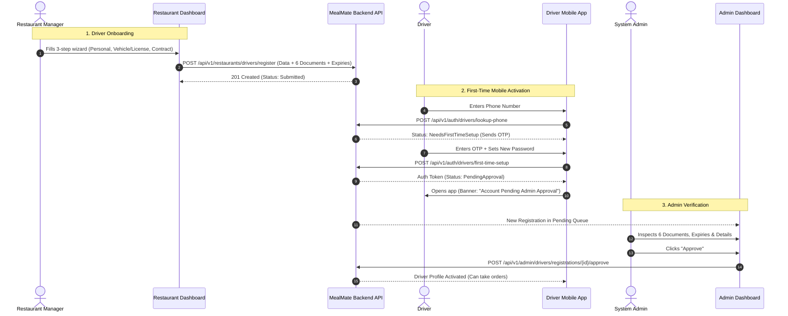

# Restaurant Driver Onboarding & Verification Specification

- **Date**: 2026-09-05
- **Status**: Draft - In Review
- **Target Workspaces**:
  - Backend (`f:\MealMate\backend`)
  - Admin Dashboard (`f:\MealMate\frontend\admin-dashboard`)
  - Restaurant Dashboard (`f:\MealMate\frontend\restaurant-dashboard`)
  - Driver Mobile Contract (`docs/mobile`)

---

## 1. Executive Summary & Problem Statement

Currently, restaurants need a dedicated, streamlined way to onboard their delivery drivers directly from the restaurant dashboard. Furthermore:
1. The driver registration requires 8 specific data points and documents:
   - National ID / Civil ID (الرقم الوطني)
   - Mobile phone number (رقم الموبايل)
   - ID Number, Expiry Date, and ID Photos (Front & Back - صورة وش وضهر وتاريخ الانتهاء)
   - Vehicle Information: Plate number, Model (e.g., Year / Model Name), and Vehicle Type (Car, Motorcycle/Scooter, Van, etc.)
   - Driver License: License Number, Expiry Date, and Photos (Front & Back - صورة وش وضهر وتاريخ الانتهاء)
   - Vehicle Registration (License / استمارة): Expiry Date and Photo (صورة وتاريخ الانتهاء)
   - Restaurant Employment Contract: Expiry Date and Document/Photo (صورة وتاريخ الانتهاء)
2. When the onboarded driver uses the mobile driver app for the first time:
   - Driver enters **mobile phone number only**.
   - System verifies the status: sends an OTP code.
   - Driver enters OTP code and sets their password for the first time.
   - Driver can immediately log into the app, but remains in **Pending Approval** status until the Admin approves the application.
3. System notifies the Admin Dashboard for inspection:
   - Admin inspects the restaurant link, driver profile, vehicle info, all 6 documents, and their expiration dates.
   - Admin approves, rejects, or requests changes.

---

## 2. Architecture & Data Flow



---

## 3. Data Model & Schema Details

### 3.1 Domain Enums (`MealMate.Domain.Enums.DocumentType`)
Add missing front/back document types to `DocumentType`:
- `NationalIdFront = 10` (Existing)
- `NationalIdBack = 11` (Existing)
- `EmploymentContract = 12` (Existing)
- `VehicleRegistration = 5` (Existing)
- `DrivingLicenseFront = 19` (New)
- `DrivingLicenseBack = 20` (New)

### 3.2 `DriverRegistration` & `DriverProfile` Entities
Ensure the following fields exist on `DriverRegistration` and `DriverProfile`:
- `VehicleModel` (string, max 100): E.g. "Toyota Corolla 2022" or "Honda Wave 2023"
- `VehicleType` (string, max 50): E.g. "Car", "Motorcycle", "Van"
- `VehiclePlate` (string, max 30)
- `NationalId` (string, max 50)
- `NationalIdExpiryUtc` (DateTime?)
- `LicenseNumber` (string, max 50)
- `LicenseExpiryUtc` (DateTime?)
- `VehicleRegistrationExpiryUtc` (DateTime?)
- `ContractExpiryUtc` (DateTime?)

### 3.3 `Document` Entity
Each uploaded file is stored in `Document`:
- `OwnerType = DocumentOwnerType.Registration`
- `OwnerId = DriverRegistration.Id`
- `DocumentType = DocumentType`
- `ExpiresAtUtc = DateTime?`
- `StoragePath = string`

---

## 4. API Specification

### 4.1 Restaurant Driver Registration API
**`POST /api/v1/restaurants/drivers/register`**
- **Authorization**: `[Authorize]` (Restaurant Manager or Delivery Manager permission).
- **Request Body**:
  ```json
  {
    "fullNameAr": "أحمد محمود",
    "fullNameEn": "Ahmed Mahmoud",
    "phone": "+966501234567",
    "nationalId": "1023456789",
    "nationalIdExpiry": "2028-12-31",
    "vehiclePlate": "أ ب ج 1234",
    "vehicleModel": "Toyota Corolla 2022",
    "vehicleType": "Car",
    "licenseNumber": "DL998877",
    "licenseExpiry": "2027-06-30",
    "vehicleLicenseExpiry": "2026-11-30",
    "contractExpiry": "2027-01-01",
    "nationalIdFrontKey": "uploads/drivers/.../nid-front.jpg",
    "nationalIdBackKey": "uploads/drivers/.../nid-back.jpg",
    "drivingLicenseFrontKey": "uploads/drivers/.../license-front.jpg",
    "drivingLicenseBackKey": "uploads/drivers/.../license-back.jpg",
    "vehicleRegistrationKey": "uploads/drivers/.../veh-reg.jpg",
    "contractKey": "uploads/drivers/.../contract.pdf"
  }
  ```
- **Validation Rules**:
  - `phone` must be unique across all active/registered users.
  - `nationalId` must be unique across driver profiles and active registrations.
  - All expiry dates must be in the future (`> UtcNow.Date`).
  - All 6 document storage keys are mandatory.
- **Action**:
  - Creates user in `Registered` state with `MustSetPassword = true`.
  - Creates `DriverRegistration` with status `Submitted`.
  - Links to restaurant with `RestaurantId`.
  - Creates 6 `Document` records with their respective `ExpiresAtUtc`.

---

### 4.2 Driver Mobile Authentication API

#### 1. Phone Lookup & OTP Trigger
**`POST /api/v1/auth/drivers/lookup-phone`**
- **Authorization**: `[AllowAnonymous]`
- **Request Body**:
  ```json
  {
    "phone": "+966501234567"
  }
  ```
- **Response**:
  ```json
  {
    "exists": true,
    "isFirstTimeSetup": true,
    "otpSent": true,
    "restaurantName": "مطعم النخيل"
  }
  ```
- If `isFirstTimeSetup == false` and driver already has a password: returns `isFirstTimeSetup: false`, prompting driver to enter their existing password.

#### 2. First-Time Setup & Password Creation
**`POST /api/v1/auth/drivers/first-time-setup`**
- **Authorization**: `[AllowAnonymous]`
- **Request Body**:
  ```json
  {
    "phone": "+966501234567",
    "otpCode": "123456",
    "password": "SecurePassword123!"
  }
  ```
- **Response**:
  ```json
  {
    "token": "eyJhbGciOi...",
    "refreshToken": "...",
    "status": "PendingApproval",
    "driver": {
      "fullName": "أحمد محمود",
      "phone": "+966501234567",
      "status": "PendingApproval"
    }
  }
  ```

---

### 4.3 Admin Review & Verification API

**`GET /api/v1/admin/drivers/registrations/{id}/documents`**
- Returns all 6 documents with `documentType`, `fileName`, `expiresAtUtc`, and download URL.

**`POST /api/v1/admin/drivers/registrations/{id}/approve`**
- Activates driver account (`AccountStatus.Active`).
- Creates `DriverProfile` linked to restaurant.
- Logs admin audit record.

---

## 5. Frontend Interfaces

### 5.1 Restaurant Dashboard (`frontend/restaurant-dashboard`)
1. In `/restaurant/delivery/drivers`:
   - Add primary action button: **+ إضافة سائق جديد** (Add New Driver).
2. Step Wizard Modal (`AddDriverWizardModalComponent`):
   - **Step 1: البيانات الشخصية (Personal Info)**:
     - Name (Arabic & English), Phone Number, National ID, National ID Expiry Date.
     - Upload: National ID Front & Back with instant image previews.
   - **Step 2: بيانات المركبة والرخصة (Vehicle & Driving License)**:
     - Vehicle Type (Car, Motorcycle, Van, Bicycle), Vehicle Model, Plate Number.
     - Driving License Number & Expiry Date, Upload: Driving License Front & Back.
     - Vehicle Registration (استمارة) Expiry Date, Upload: Vehicle Registration document/photo.
   - **Step 3: عقد المطعم والتأكيد (Contract & Confirmation)**:
     - Contract Expiry Date, Upload: Restaurant Employment Contract.
     - Review summary card with all entered details and documents.
     - "إرسال الطلب للاعتماد" (Submit for Approval) button.

### 5.2 Admin Dashboard (`frontend/admin-dashboard`)
1. Enhance `pending-driver-detail-page`:
   - Display driver vehicle model & plate clearly alongside restaurant name.
   - Display a grid of the 6 documents categorized:
     - الهوية الوطنية (وجه أمامي + وجه خلفي) مع تاريخ الانتهاء.
     - رخصة القيادة (وجه أمامي + وجه خلفي) مع تاريخ الانتهاء.
     - رخصة المركبة مع تاريخ الانتهاء.
     - عقد العمل مع المطعم مع تاريخ الانتهاء.
   - Expiration badge indicator (Green: Valid > 60 days, Amber: Expiring within 60 days, Red: Expired).
   - Direct Approve / Reject / Request Changes actions.

---

## 6. Verification & Testing Strategy

1. **Automated Backend Tests**:
   - Validation test: Attempting to register driver with duplicate phone or duplicate National ID returns validation error.
   - Expiry date test: Past dates rejected with descriptive error.
   - Lookup test: Unregistered phone vs newly added driver vs existing driver.
   - First-time setup test: Invalid OTP fails; valid OTP sets password and returns JWT token.
   - Admin approval test: Approval transitions registration to approved and creates active `DriverProfile`.
2. **Frontend Verification**:
   - Verify Angular build passes on both `restaurant-dashboard` and `admin-dashboard`.
   - Verify step-wizard validation in restaurant dashboard.
   - Verify admin pending driver detail page displays all 6 documents and expiry dates properly.
