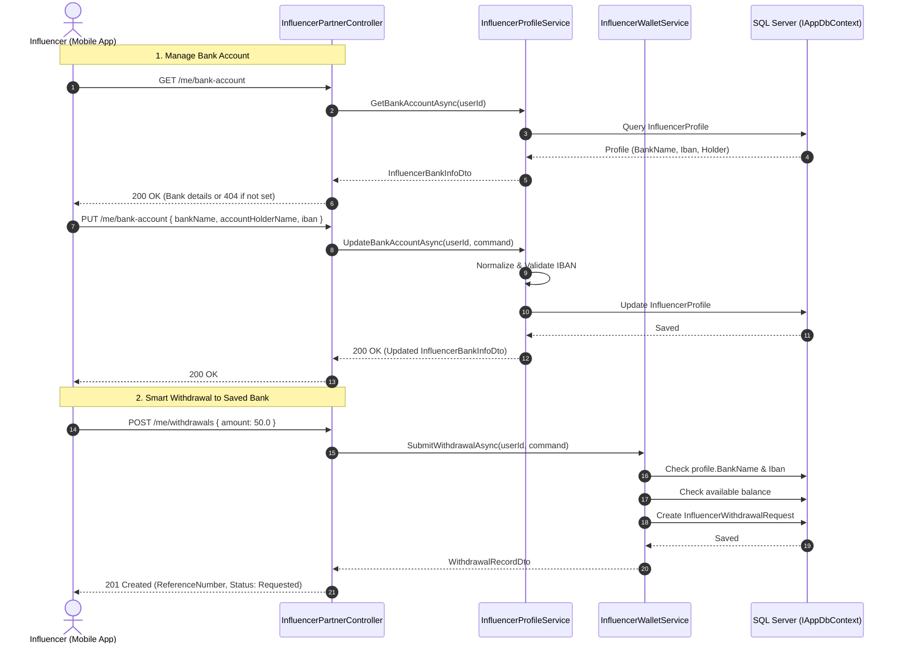

# Influencer Mobile Bank Account & Payouts Design Specification

## 1. Context & Business Goals
Influencers in MealMate need to manage their receiving bank accounts directly from the mobile app (Customer/Partner Mobile App) and request payouts seamlessly.
Currently, bank details can only be edited by admins or entered during a withdrawal request. 
This specification introduces:
1. Dedicated mobile-friendly endpoints for influencers to add, update, view, and delete their bank account.
2. Smart withdrawal flow allowing payouts directly to the saved bank account without retyping banking info each time.
3. Strict IBAN normalization and validation rules.
4. Complete Flutter/Dart integration files (Models, Dio API Service, and Mobile Guide) in `docs/mobile/`.

---

## 2. API Endpoints Contract

### Base Route: `/api/v1/influencer-partner`
All endpoints require `[Authorize]` with a valid customer/influencer JWT token.



### Endpoints Detail:

#### 1. `GET /api/v1/influencer-partner/me/bank-account`
- **Purpose**: Get current saved bank account for the authenticated influencer.
- **Success (200 OK)**:
  ```json
  {
    "bankName": "National Bank of Kuwait (NBK)",
    "accountHolderName": "Ahmad Al-Mansour",
    "iban": "KW82NBOK0000000000001234567890",
    "maskedIban": "KW82 •••• •••• 7890",
    "isConfigured": true
  }
  ```
- **If Not Configured (200 OK)**:
  ```json
  {
    "bankName": null,
    "accountHolderName": null,
    "iban": null,
    "maskedIban": null,
    "isConfigured": false
  }
  ```

#### 2. `PUT /api/v1/influencer-partner/me/bank-account`
- **Purpose**: Add or update the receiving bank account.
- **Request Body**:
  ```json
  {
    "bankName": "Al Rajhi Bank",
    "accountHolderName": "Ahmad Al-Mansour",
    "iban": "SA0380000000608010167519"
  }
  ```
- **Validation**:
  - `bankName`: Required, trimmed, max 200 characters.
  - `accountHolderName`: Required, trimmed, max 200 characters.
  - `iban`: Required, stripped of whitespace/hyphens, uppercase, 15 to 34 alphanumeric characters, valid country code prefix.
- **Success (200 OK)**: Returns updated `InfluencerBankInfoDto`.

#### 3. `DELETE /api/v1/influencer-partner/me/bank-account`
- **Purpose**: Remove saved bank account.
- **Success (200 OK)**:
  ```json
  {
    "success": true
  }
  ```

#### 4. `POST /api/v1/influencer-partner/me/withdrawals` (Enhanced)
- **Request Body**:
  ```json
  {
    "amount": 50.0,
    "withdrawalMethod": "BankTransfer",
    "bankName": null,
    "accountHolderName": null,
    "iban": null
  }
  ```
- **Behavior**:
  - If `bankName`, `accountHolderName`, and `iban` are omitted/null, the system automatically pulls them from the saved bank account in `profile`.
  - If no bank account is saved on `profile` and none is provided in the request, returns `400 Bad Request` with error code `influencers.bank_account_required`.
  - If custom bank details are provided in the request, they override the saved profile for this specific withdrawal, and if `saveAsDefaultBank == true`, the profile is updated.

---

## 3. Backend Architecture & Components

1. **`InfluencerProfileContracts.cs`**:
   - `InfluencerBankInfoDto`: Enhanced with `MaskedIban` and `IsConfigured`.
   - `GetInfluencerBankAccountQuery` & `UpdateInfluencerBankAccountCommand`.
   - `DeleteInfluencerBankAccountCommand`.
   - `UpdateInfluencerBankAccountCommandValidator`.

2. **`IInfluencerProfileService.cs` & `InfluencerProfileService.cs`**:
   - `GetBankAccountAsync(Guid userId, CancellationToken ct)`
   - `UpdateBankAccountAsync(Guid userId, UpdateInfluencerBankAccountCommand command, CancellationToken ct)`
   - `DeleteBankAccountAsync(Guid userId, CancellationToken ct)`

3. **`InfluencerWalletService.cs`**:
   - Update `SubmitWithdrawalAsync` to resolve bank details from profile when request fields are null/empty.

4. **`InfluencerPartnerController.cs`**:
   - Expose `GET /me/bank-account`, `PUT /me/bank-account`, `DELETE /me/bank-account`.
   - Make bank fields in `SubmitWithdrawalApiRequest` optional.

---

## 4. Mobile & Flutter Deliverables (`docs/mobile/`)

1. **`docs/mobile/influencer-bank-account-api.md`**:
   - Complete markdown guide with endpoints, request/response JSONs, and HTTP status codes.
2. **`docs/mobile/influencer_bank_account_models.dart`**:
   - Dart DTOs for `InfluencerBankAccountDto`, `InfluencerPartnerProfileDto`, `WithdrawalRequestDto`, `InfluencerWalletDto`.
3. **`docs/mobile/influencer_api_service.dart`**:
   - Production-ready Dio HTTP client implementation in Dart with interceptors, token handling, error handling, and method signatures.
4. **`docs/mobile/influencer_mobile_integration_guide.md`**:
   - UI/UX screen flows (Wallet screen, Bank Account Form modal/screen, Confirmation modal).
   - Form validation rules (IBAN regex, bank name, character lengths).

---

## 5. Acceptance Criteria & Automated Tests

- **Unit Tests (`MealMate.UnitTests/Influencer/`)**:
  1. `GetBankAccountAsync` returns configured bank account with correct masked IBAN.
  2. `UpdateBankAccountAsync` strips spaces, normalizes to uppercase, and saves bank details.
  3. `UpdateBankAccountAsync_WithInvalidIban` fails validation.
  4. `DeleteBankAccountAsync` clears `Iban`, `BankName`, and `AccountHolderName`.
  5. `SubmitWithdrawalAsync_UsesSavedBankAccount` successfully creates withdrawal when request fields are null.
  6. `SubmitWithdrawalAsync_WithoutSavedBank_FailsValidation` returns `influencers.bank_account_required`.
