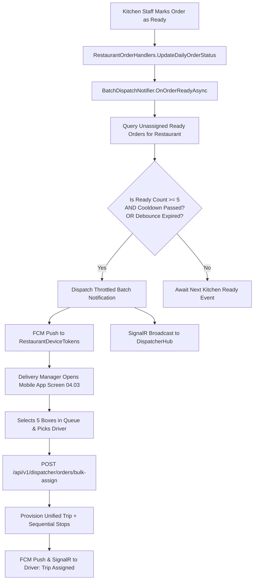

# Dispatcher Batch Ready Notification & Bulk Assignment Architecture Specification

> **Date:** 2026-09-24  
> **Status:** Approved  
> **Goal:** Prevent notification fatigue for the Delivery Manager by throttling kitchen ready notifications into batches (e.g., 5 orders ready), delivering FCM Push alerts, and enabling one-click bulk assignment of multiple boxes to a driver.

---

## 1. Problem Statement & Operational Rationale

In high-volume kitchen prep shifts (e.g., morning and noon subscription runs), restaurants prepare dozens or hundreds of meal boxes. Currently:
1. **Notification Spam / Fatigue:** When kitchen staff mark orders as `ready`, the system dispatches individual SignalR alerts per meal. If 20 meals are marked ready in 3 minutes, the dispatcher's device would be inundated with 20 separate alerts.
2. **Missing Background FCM Push:** Current kitchen ready notifications rely exclusively on SignalR WebSockets (`SignalRRestaurantOrderNotifier`). If the Delivery Manager's mobile app is backgrounded or terminated, no FCM push notification is received.
3. **Single-Box Assignment Bottleneck:** The Dispatcher API only provides `POST /api/v1/dispatcher/orders/{boxId}/assign` (one box at a time). When 5 or 10 boxes are ready, the delivery manager has to manually assign each one individually.

---

## 2. Core Architecture & Workflow



---

## 3. Detailed Specifications

### 3.1 Batch Throttling Policy (`IBatchDispatchNotifier`)

- **Threshold (`BatchThreshold = 5`):**
  - When an unassigned order is marked `ready` or `ready-for-pickup`:
    - Calculate current unassigned ready count for the restaurant:
      `ReadyUnassignedCount = Count(SubscriptionDays where RestaurantId == id AND Status == ReadyForPickup AND !Assigned)`
    - If `ReadyUnassignedCount % 5 == 0` (or `>= 5` and no notification has been sent for this batch):
      - Dispatch batch notification.
- **Cooldown Window (`CooldownMinutes = 3`):**
  - Minimum gap between two push notifications for the same restaurant to prevent bursts.
- **Debounce / Idle Window (`DebounceMinutes = 10`):**
  - If between 1 and 4 orders remain ready and unassigned for more than 10 minutes since the last notification, dispatch a summary notification ("يوجد {N} طلبات جاهزة للتوزيع") so orders are not delayed.

### 3.2 Notification Content & Payload

- **FCM Push Notification:**
  - **Recipients:** All active tokens in `RestaurantDeviceTokens` where `RestaurantId == targetRestaurantId`.
  - **Title (Ar):** `📦 دفعة طلبات جاهزة للتوزيع`
  - **Title (En):** `Ready Orders Batch Available`
  - **Body (Ar):** `يتوفر الآن {count} طلبات جاهزة بالمطبخ بانتظار الإسناد للسائقين.`
  - **Body (En):** `{count} orders are now packed and ready for driver dispatch.`
  - **Data Payload:**
    ```json
    {
      "eventKey": "dispatcher.batch.ready",
      "restaurantId": "898259c1-4064-434e-ad20-be885987d8cb",
      "readyCount": "5",
      "action": "/dispatcher/orders/queue"
    }
    ```

### 3.3 Bulk Assignment Command (`BulkAssignBoxesCommand`)

- **Request Body:**
  ```json
  {
    "boxIds": [
      "guid-box-1",
      "guid-box-2",
      "guid-box-3",
      "guid-box-4",
      "guid-box-5"
    ],
    "driverId": "guid-driver",
    "notes": "Morning Shift Batch #1"
  }
  ```
- **Validation:**
  - `boxIds` must contain between 1 and 25 items.
  - `driverId` must be valid, active, and belong to or be linked to the restaurant (or MealMate platform fleet).
  - All `boxIds` must be unassigned and belong to the calling dispatcher's restaurant.
- **Execution:**
  - Atomically creates or appends to a `Trip`.
  - Adds a `TripStop` for each box with sequential `StopNumber` (1, 2, 3, 4, 5).
  - Generates meal barcodes/prep documents if not already generated.
  - Updates linked `SubscriptionDays` and `RestaurantDailyOrders`.
  - Emits SignalR event `box-assigned` for each box and notifies the assigned driver via FCM Push (`NotifyTripAssignedAsync`).
- **Response:**
  ```json
  {
    "tripId": "guid-trip",
    "tripCode": "TRP-2026-0924-01",
    "assignedCount": 5,
    "driverId": "guid-driver",
    "driverName": "أحمد الشمري",
    "assignedBoxIds": ["guid-box-1", "..."],
    "assignedAtUtc": "2026-09-24T14:50:00Z"
  }
  ```

---

## 4. Test Strategy

1. **Unit Tests for Throttling Policy:**
   - 1 to 4 ready orders do not trigger push notifications.
   - The 5th ready order triggers FCM push with count = 5.
   - Cooldown window prevents immediate duplicate notifications.
   - Debounce window triggers for hanging orders (1-4 orders).
2. **Unit Tests for Bulk Assignment:**
   - Validates batch size constraints and driver linkage.
   - Verifies all 5 boxes transition to assigned and join the same Trip.
   - Confirms driver push notification is dispatched.
3. **Zero-Regression Verification:**
   - Entire existing test suite (1,152 tests) passes.
