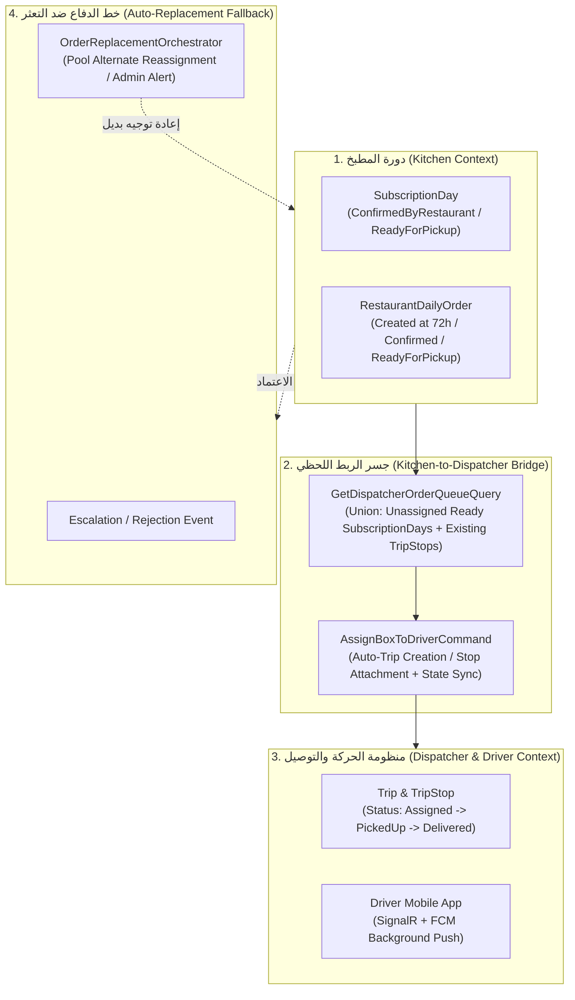

# 🏗️ المواصفات الفنية والمعمارية لإصلاح منظومة التوصيل والربط بين المطبخ ومسؤول التوصيل
## Technical Specification: Kitchen-to-Dispatcher Lifecycle Integration & Notification System

---

## 1. ملخص المعمارية والأهداف (Executive Architecture Summary)

تهدف هذه المواصفة إلى سد الفجوة التشغيلية والبرمجية القائمة بين انتهاء تجهيز وجبات المطبخ (`Kitchen Confirmed / Prep`) وبين استلامها وإسنادها في تطبيق مسؤول التوصيل (`Dispatcher Box Queue`)، وتأمين وصول إشعارات التنبيه اللحظية (SignalR) والإشعارات السحابية الميدانية (FCM Push) لجميع الأطراف المعنية (العميل، المطبخ، مسؤول التوصيل، السائق).

---

## 2. تفاصيل المكونات والإصلاحات المعمارية (Component Specifications)

### 2.1 مزامنة دورة الحياة وإنشاء السجلات المسبقة (Lifecycle & State Synchronization)
* **المشكلة الحالية:**
  1. عند قفل الـ 72 ساعة في `SubscriptionDayDispatchService`، يتم تعديل `SubscriptionDay` فقط دون إنشاء صف في `RestaurantDailyOrder`.
  2. `SubscriptionDayStatus` لا تحتوي على حالة `ReadyForPickup` صريحة (تقفز من `Preparing` إلى `OutForDelivery`)، بينما `OrderStatus` تحتوي عليها.
* **الحل المعماري:**
  1. تحديث `SubscriptionDayDispatchService.LockAndSendToRestaurantAsync` لينشئ سجل `RestaurantDailyOrder` بحالة `OrderStatus.AwaitingRestaurantConfirmation` فور قفل الـ 72 ساعة، مما يضمن اتساق استعلامات المطبخ بنسبة 100%.
  2. دعم وسم الوجبة كـ `ReadyForPickup`:
     - عند استدعاء `UpdateDailyOrderPrepStatusAsync` بقيمة `"ready"` أو `"ready-for-pickup"`، يتم تحديث `RestaurantDailyOrder.Status = OrderStatus.ReadyForPickup`، وتحديث `SubscriptionDay.Status = SubscriptionDayStatus.Preparing` (مع وسم جاهزية الباركود)، وتوليد إشعار فوري لمسؤول التوصيل عبر SignalR:
       - الحدث: `kitchen-batch-ready` على مجموعة `restaurant:{restaurantId}:dispatcher`.

---

### 2.2 جسر طابور مسؤول التوصيل الديناميكي (Unified Dispatcher Queue Bridge)
* **المشكلة الحالية:**
  - `GetDispatcherOrderQueueQuery` يقرأ فقط من جدول `Trips` و `TripStops`. الوجبات المؤكدة والجاهزة بالمطبخ لا تظهر نهائياً إلا إذا تم تجميع رحلة يدوياً بالمطبخ.
* **الحل المعماري في `GetDispatcherOrderQueueQuery`:**
  1. استعلام الوجبات المؤكدة/الجاهزة في المطعم لليوم المحدد (`ConfirmedByRestaurant` أو `Preparing`) التي **لم يتم ربطها بعد بأي `TripStop` نشط**.
  2. دمج هذه الوجبات مع المحطات القائمة في الـ `Trips` السابقة ليحصل مسؤول التوصيل على رؤية كاملة لكل البوكسات المطلوب إسنادها.
  3. توليد كود البوكس الموحد `#BX-{OrderCode/Number}` وتحديد المنطقة الجغرافية واسم العميل المقنع وعدد الوجبات وترشيح السائق الأقرب عبر خوارزمية `IDispatchRecommendationEngine`.

---

### 2.3 محرك الإسناد الذكي والتحويل التلقائي (`AssignBoxToDriverCommand`)
* **المشكلة الحالية:**
  - `AssignBoxToDriverCommand` يفترض أن الـ `BoxId` هو دائماً `TripStop.Id`.
* **الحل المعماري:**
  1. يستقبل `BoxId` كمعرّف مرن:
     - إذا كان `BoxId` يطابق `TripStop.Id` -> يتم تحديث السائق وتفعيل `DriverAssignment` كما هو معمول به.
     - إذا كان `BoxId` يطابق `SubscriptionDay.Id` (بوكس غير ملحق برحلة بعد) ->
       - يبحث النظام عن رحلة نشطة مفتوحة لنفس السائق في نفس الوردية/التاريخ، أو ينشئ `Trip` جديدة فوراً.
       - يُنشئ `TripStop` جديد مربوط بـ `SubscriptionDayId` و `DailyOrderId` وينقله لحالة `TripStopStatus.Pending`.
       - ينشئ سجل `DriverAssignment` نشط للسائق.
       - يحدث حالة `RestaurantDailyOrder.Status = OrderStatus.AssignedToDriver`.
  2. بث الحدث اللحظي عبر `DispatcherHub`: `box-assigned`.
  3. بث الحدث اللحظي عبر `DriverHub`: `box-assigned` لمجموعة السائق.
  4. إرسال إشعار سحابي ميداني (FCM Push) لجهاز السائق المحمول لإيقاظ الهاتف حتى لو كان التطبيق مغلقاً.

---

### 2.4 خدمة الإشعارات السحابية للسائقين (`IDriverPushNotifier`)
* **المشكلة الحالية:**
  - السائق يتلقى إشعار `box-assigned` عبر SignalR فقط؛ إذا كان هاتفه مغلقاً أو التطبيق في الخلفية، لا يرن الهاتف ولا يعلم بالإسناد.
  - كود `DriverRegistrationNotificationService` يستعلم خطأ من جدول `CustomerDeviceTokens` بدلاً من `DriverDeviceTokens`.
* **الحل المعماري:**
  1. إنشاء واجهة وخدمة مخصصة:
     `MealMate.Application.Common.Abstractions.IDriverPushNotifier`
     تنفيذها في البنية التحتية:
     `MealMate.Infrastructure.Push.FirebaseDriverPushNotifier`
  2. تقرأ التوكنات النشطة حصرياً من جدول `DriverDeviceTokens` للـ `UserId` أو `DriverProfileId`.
  3. توفر الطرق التالية:
     - `NotifyBoxAssignedAsync(Guid driverUserId, string boxCode, string zoneName, ...)`
     - `NotifyTripAssignedAsync(Guid driverUserId, string tripCode, int boxesCount, ...)`
     - `NotifyKitchenReadyForPickupAsync(Guid driverUserId, string tripCode, ...)`

---

### 2.5 خطة معالجة التعثر والرفض الآلي (`Auto-Replacement Fallback Orchestration`)
* **المشكلة الحالية:**
  - عند رفض المطعم للطلب أو انتهاء مهلة الـ 24 ساعة، تتحول الحالة إلى `ReplacementRequired` وتتوقف الوجبة في طريق مسدود دون بديل.
* **الحل المعماري في `SubscriptionJobs.cs` و `RestaurantOrderEscalationJob.cs`:**
  1. إنشاء خدمة منسق الاستبدال: `IOrderReplacementOrchestrator`:
     - عند تصعيد اليوم إلى `ReplacementRequired`:
       - فحص باقة العميل وجلب المطاعم المتاحة في مصفوفة الاشتراك المجمدة (`SubscriptionRestaurantSnapshots`).
       - استبعاد المطعم المتعثر/الرافض.
       - اختيار المطعم البديل الأعلى تصنيفاً والمغطي لمنطقة العميل والأقل استخداماً في كوتة العميل.
       - إعادة تعيين `day.RestaurantId = alternativeRestaurantId` وتحديث الحالة إلى `SubscriptionDayStatus.SentToRestaurant` بنافذة تأكيد سريعة (12 ساعة).
       - إشعار المطعم البديل وإشعار العميل بتوجيه الوجبة لمطعم بديل مميز.
     - إذا لم يتوفر أي مطعم بديل يغطي المنطقة:
       - إشعار العميل فورياً لاختيار مطعم بنفسه أو تجميد اليوم (Freeze).
       - تسجيل بلاغ عاجل في `AuditLogs` ولوحة تحكم الإدارة `Admin Dashboard` للتدخل الفوري.

---

## 3. مصفوفة العقود البرمجية والتغييرات (Contract & File Matrix)

| الملف المتأثر | الطبقة المعمارية | التعديل المستهدف |
|---|---|---|
| [`SubscriptionDayDispatchService.cs`](file:///f:/MealMate/backend/src/MealMate.Application/Features/CustomerCalendar/SubscriptionDayDispatchService.cs) | Application (Calendar) | إنشاء `RestaurantDailyOrder` فوراً عند القفل 72h. |
| [`RestaurantOrderHandlers.cs`](file:///f:/MealMate/backend/src/MealMate.Application/Features/RestaurantOrders/RestaurantOrderHandlers.cs) | Application (Orders) | بث إشعار `kitchen-batch-ready` عند تحويل حالة التجهيز إلى `Ready`. |
| [`GetDispatcherOrderQueueQuery.cs`](file:///f:/MealMate/backend/src/MealMate.Application/Features/DriverDelivery/Dispatcher/GetDispatcherOrderQueueQuery.cs) | Application (Dispatcher) | دمج الوجبات المؤكدة والجاهزة غير المسندة مع محطات الرحلات القائمة. |
| [`AssignBoxToDriverCommand.cs`](file:///f:/MealMate/backend/src/MealMate.Application/Features/DriverDelivery/Dispatcher/AssignBoxToDriverCommand.cs) | Application (Dispatcher) | دعم قبول `SubscriptionDayId` وإنشاء الرحلة والمحطة تلقائياً مع تفعيل FCM Push. |
| `IDriverPushNotifier.cs` & `FirebaseDriverPushNotifier.cs` | Application & Infrastructure | إشعارات Push حقيقية للسائق عبر `DriverDeviceTokens`. |
| `RestaurantOrderEscalationJob.cs` & `OrderReplacementOrchestrator.cs` | Application (Jobs) | تفعيل إعادة الإسناد الآلي للمطعم البديل بدلاً من التوقف في مسار معلق. |

---

## 4. خطة التحقق والضمان (Verification & Quality Gates)

1. **اختبارات الوحدة (Unit Tests):**
   - اختبار إنشاء `RestaurantDailyOrder` عند قفل الـ 72h.
   - اختبار استعلام طابور مسؤول التوصيل لدمج الوجبات غير المسندة والمسندة.
   - اختبار إسناد بوكس غير مربوط برحلة سابقة والتأكد من توليد `Trip` و `TripStop` وسجل `DriverAssignment`.
   - اختبار تصعيد `ReplacementRequired` وإعادة الإسناد لمطعم بديل من حوض الباقة.
2. **اختبارات البناء والتكامل (Build & Diagnostics):**
   - تشغيل `dotnet build MealMate.sln` والتأكد من انعدام أخطاء الـ Compilation.
   - التحقق من عمل قنوات البث SignalR وتوافق العقود مع شاشات الموبايل 04.03 و 04.04.
