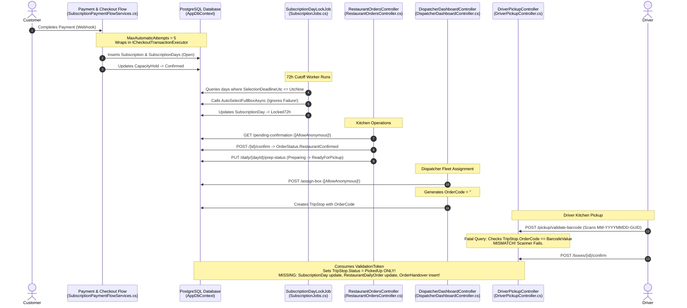
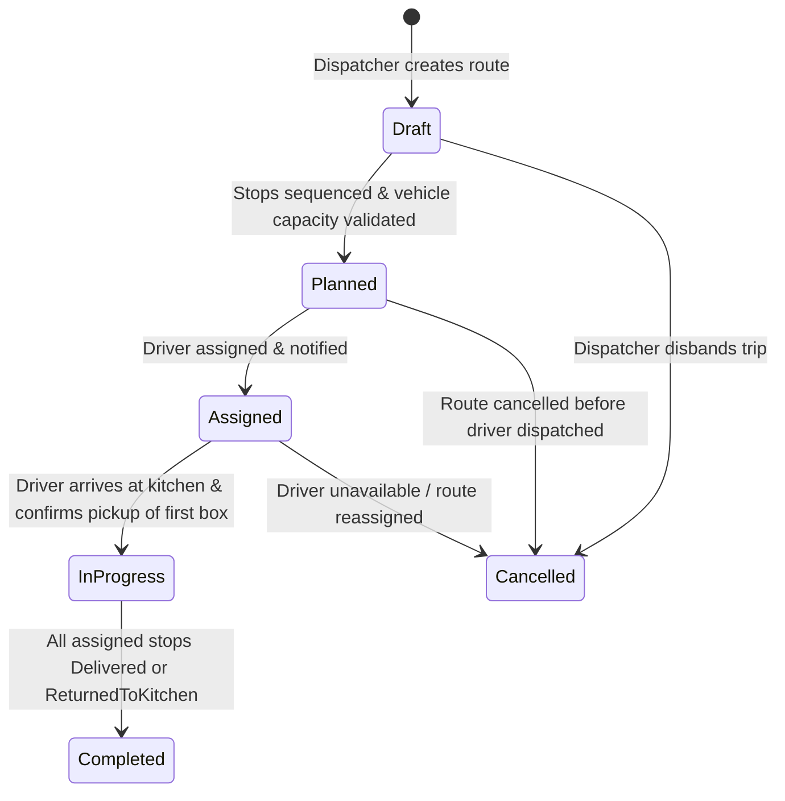

# MealMate Order Lifecycle & Custody Handover — Architecture Design Specification

**Specification Identifier:** `SPEC-2026-09-28-ORDER-LIFECYCLE-HANDOVER`  
**Document Version:** `1.0.0-PROD-SPEC`  
**Date:** `2026-09-28`  
**Author:** Principal Software Engineer & Architecture Reviewer  
**Status:** Under Review (Implementation Pending Business Alignment)  
**Target Codebases:**
- Backend: `F:\MealMate\backend`
- Admin Dashboard: `F:\MealMate\frontend\admin-dashboard`
- Restaurant Dashboard: `F:\MealMate\frontend\restaurant-dashboard`

---

## 1. Scope & Non-Goals

### 1.1 In-Scope (End-to-End Lifecycle)
This specification governs the mission-critical path of MealMate from the instant a customer executes payment through physical delivery custody handover:
1. **Customer Checkout & Payment Ingestion:** Webhook authorization, idempotency, signature validation, and subscription activation.
2. **Subscription & Calendar Generation:** Initial batch creation of `SubscriptionDay` entities, day indexing, and capacity hold confirmation.
3. **Customer Restaurant & Meal Selection:** Multi-member calendar meal selection, restaurant change, and atomic capacity release/reservation across restaurant changes.
4. **72-Hour Cutoff & Lock Automation:** Scheduled background cutoff, allergy-safe auto-selection, and transition to `Locked72h`.
5. **Kitchen Transmission & Confirmation:** Dispatching daily orders to restaurants (`RestaurantDailyOrder`), SLA timers, confirmation, and explicit rejection handling.
6. **Preparation & Packing:** Kitchen kitchen preparation status transitions (`Preparing`), box assembly, and generation of printable kitchen prep documents (box labels with barcodes and meal stickers).
7. **Readiness Verification (`ReadyForPickup`):** Individual box readiness vs. composite trip readiness.
8. **Trip Planning & Driver Assignment:** Dispatcher clustering, multi-box assignment, vehicle capacity checks, and route binding.
9. **Driver Physical Pickup & Barcode Scanning:** Cryptographic pre-validation token, camera scan validation, box condition photo capture, and atomic handover execution.
10. **Custody Transfer & Proof of Handover:** Atomic persistence of `OrderHandover`, operational state advancement across aggregates, audit logging, and transactional outbox event publishing.

### 1.2 Out-of-Scope (Non-Goals)
- Customer front-facing mobile app UI rebuild (Flutter UI layouts remain unchanged; API contracts must be backward-compatible).
- Payment Gateway integration replacements (Moyasar / HyperPay contracts remain intact; only verification logic and transaction orchestration are audited).
- Last-mile driver navigation turn-by-turn routing algorithms (Google Routing API integration is utilized as-is without rewriting waypoint optimization).
- Customer post-delivery refund accounting and customer complaint arbitration workflows (handled in dedicated dispute modules).

---

## 2. Current-State Flow (Documented from Code)

The current implementation across the repository was audited end-to-end. Below is the exact step-by-step reality of how an order moves through the system today:



---

## 3. Audited Codebase Gaps & Root Cause Analysis

Every finding below has been verified directly against active code with exact file and line references:

| # | Gap Title | Severity | Exact File & Line Reference | Impact & Root Cause Analysis |
|---|---|---|---|---|
| **GAP-01** | **Fatal Barcode Lookup Mismatch** | **CRITICAL** | [PrepDocumentsGenerator.cs:L352-356](file:///F:/MealMate/backend/src/MealMate.Application/Features/PrepDocuments/PrepDocumentsGenerator.cs#L352-L356)<br/>[ValidatePickupBarcodeCommand.cs:L86-90](file:///F:/MealMate/backend/src/MealMate.Application/Features/DriverDelivery/DriverApp/ValidatePickupBarcodeCommand.cs#L86-L90)<br/>[AssignBoxToDriverCommand.cs:L236](file:///F:/MealMate/backend/src/MealMate.Application/Features/DriverDelivery/Dispatcher/AssignBoxToDriverCommand.cs#L236) | The document generator prints barcodes formatted as `MM-{ServiceDate:yyyyMMdd}-{SubscriptionDayId:N}` and persists them in `MealBarcode.BarcodeValue`. However, `AssignBoxToDriverCommand` sets `TripStop.OrderCode` to `#BX-{Math.Abs(day.Id.GetHashCode()) % 9000 + 1000}`. `ValidatePickupBarcodeCommand` queries `_db.TripStops.FirstOrDefaultAsync(s => s.OrderCode == request.BarcodeValue)`. The physical scanner reads the printed string, queries `OrderCode`, fails to match, and returns `BARCODE_NOT_FOUND` on 100% of physical scans. |
| **GAP-02** | **Broken Custody Handover Persistence** | **CRITICAL** | [ConfirmPickupBoxCommand.cs:L154-173](file:///F:/MealMate/backend/src/MealMate.Application/Features/DriverDelivery/DriverApp/ConfirmPickupBoxCommand.cs#L154-L173)<br/>[DriverDeliveryOrderCommands.cs:L247-275](file:///F:/MealMate/backend/src/MealMate.Application/Features/DriverDelivery/DriverApp/DriverDeliveryOrderCommands.cs#L247-L275) | The production controller endpoint `POST /api/v1/driver/pickup/boxes/{boxId}/confirm` executes `ConfirmPickupBoxCommand`, which updates `TripStop.Status = TripStopStatus.PickedUp` and records `PickupScan`, but **completely fails** to update `SubscriptionDay.Status` (stays `Preparing`), does not update `RestaurantDailyOrder.Status` (stays `ReadyForPickup`), does not insert `OrderHandover`, and emits no Outbox event. Meanwhile, an orphaned `PickupBoxCommand` in `DriverDeliveryOrderCommands.cs` has correct mutations but is connected to zero controllers! |
| **GAP-03** | **Unauthenticated Restaurant API & IDOR** | **CRITICAL** | [RestaurantOrdersController.cs:L12](file:///F:/MealMate/backend/src/MealMate.Api/Controllers/V1/RestaurantOrdersController.cs#L12)<br/>[RestaurantOrderHandlers.cs:L49-71](file:///F:/MealMate/backend/src/MealMate.Application/Features/RestaurantOrders/RestaurantOrderHandlers.cs#L49-L71) | `RestaurantOrdersController` is marked with `[AllowAnonymous]`. Inside `RestaurantOrderHandlers.cs`, `ResolveRestaurantIdAsync` inspects an unverified `overrideId` parameter. If absent and user is unauthenticated, it executes `await _db.RestaurantProfiles.Select(r => r.Id).FirstOrDefaultAsync()`, blindly operating on arbitrary restaurants without authentication! |
| **GAP-04** | **Unauthenticated Dispatcher API** | **CRITICAL** | [DispatcherDashboardController.cs:L14](file:///F:/MealMate/backend/src/MealMate.Api/Controllers/V1/DispatcherDashboardController.cs#L14) | `DispatcherDashboardController` has explicit `[AllowAnonymous]`. Any unauthenticated user can assign trips, reassign boxes, view full driver queues, customer locations, and phone numbers. |
| **GAP-05** | **Silent Capacity Overbooking on Restaurant Change** | **HIGH** | [CustomerCalendarEngine.cs:L262-274](file:///F:/MealMate/backend/src/MealMate.Application/Features/CustomerCalendar/CustomerCalendarEngine.cs#L262-L274) | When a customer selects a different restaurant for a subscription day, `day.RestaurantId` is modified and meal selections are wiped. However, zero capacity checks are performed for the new restaurant, no capacity hold is created at the new restaurant, and the previous restaurant's capacity hold is never released. |
| **GAP-06** | **Allergy Violation / Random Meal Fallback** | **HIGH** | [RestaurantOrderHandlers.cs:L1298-1311](file:///F:/MealMate/backend/src/MealMate.Application/Features/RestaurantOrders/RestaurantOrderHandlers.cs#L1298-L1311) | In `DispatchDailyOrdersHandler`, if auto-selection fails due to allergy conflicts or missing dishes, a `catch` block executes `await _db.Meals.FirstOrDefaultAsync(m => m.RestaurantId == targetRestaurantId)` and inserts the first meal found in the database. This violates the Strict Zero Mock Data policy and risks customer allergy poisoning. |
| **GAP-07** | **Silent 72h Failure Loop** | **HIGH** | [SubscriptionJobs.cs:L80-83](file:///F:/MealMate/backend/src/MealMate.Application/Features/CustomerCheckout/BackgroundJobs/SubscriptionJobs.cs#L80-L83) | `SubscriptionDayLockJob` iterates through due days and calls `engine.AutoSelectFullBoxAsync(..., lockAfter: true)`. It discards the return `Result`. If auto-selection returns a failure (e.g. `NO_SAFE_MEALS_FOUND`), the failure is ignored. Days remain in `ReplacementRequired` or `Open` indefinitely without admin escalation. |
| **GAP-08** | **Missing Admin Orders Backend Controller** | **HIGH** | [admin-api-endpoints.ts:L4-8](file:///F:/MealMate/frontend/admin-dashboard/src/app/core/api/admin-api-endpoints.ts#L4-L8) | Admin dashboard defines endpoints for `/api/v1/admin/orders/confirmation-overdue`, `/open-replacement-window`, and `/manual-reassign`. No corresponding controller or mediator handlers exist in the backend, yielding `404 Not Found` in the admin portal. |
| **GAP-09** | **Lack of Transaction Abstraction in Application Layer** | **MEDIUM** | [IAppDbContext.cs:L1-210](file:///F:/MealMate/backend/src/MealMate.Application/Common/Abstractions/IAppDbContext.cs#L1-L210)<br/>[PostgresCheckoutTransactionExecutor.cs:L6-22](file:///F:/MealMate/backend/src/MealMate.Persistence/CustomerCheckout/PostgresCheckoutTransactionExecutor.cs#L6-L22) | `IAppDbContext` does not expose `BeginTransactionAsync`. The only transaction wrapper is `ICheckoutTransactionExecutor`, which is siloed in `CustomerCheckout`. Handlers in `DriverDelivery` and `RestaurantOrders` currently rely on non-transactional standalone `SaveChangesAsync`, risking partial state writes during pickup confirmations. |
| **GAP-10** | **Non-Auditable OrderHandover Entity** | **MEDIUM** | [OrderHandover.cs:L5-18](file:///F:/MealMate/backend/src/MealMate.Domain/RestaurantOperations/OrderHandover.cs#L5-L18) | `OrderHandover` entity stores `Status` as an unindexed string (`"Completed"`). It lacks `AttemptNumber`, `SupersedesHandoverId`, `RevokedAtUtc`, `RevokedBy`, and `MealBarcodeId`. In redelivery or handover dispute scenarios, the entity cannot represent retries or revocations without mutating an immutable audit trail. |
| **GAP-11** | **Outbox Architecture Siloed in Collaborative Campaigns** | **MEDIUM** | [OutboxMessage.cs:L3-19](file:///F:/MealMate/backend/src/MealMate.Domain/Common/OutboxMessage.cs#L3-L19)<br/>[OutboxDispatcherService.cs:L36-70](file:///F:/MealMate/backend/src/MealMate.Application/Features/CollaborativeCampaigns/Services/OutboxDispatcherService.cs#L36-L70) | `OutboxMessage` lacks `AggregateType`, `AggregateId`, `CorrelationId`, and `DeduplicationKey`. Furthermore, the background dispatcher worker `OutboxDispatcherService` is coupled to `CollaborativeCampaigns`, preventing lifecycle domain events (`OrderHandedOverDomainEvent`, `OrderConfirmedDomainEvent`) from leveraging resilient transactional dispatch. |
| **GAP-12** | **Enum Lifecycle Discrepancy** | **MEDIUM** | [Enums.cs:L128-163](file:///F:/MealMate/backend/src/MealMate.Domain/Enums/Enums.cs#L128-L163) | `SubscriptionDayStatus` does not possess a `ReadyForPickup` status (it moves from `Preparing` to `OutForDelivery`). Conversely, `OrderStatus` includes `ReadyForPickup` and `OnTheWay`. Previous docs incorrectly claimed both enums were synchronous mirrors. |
| **GAP-13** | **Unverified Driver Capacity Allocation** | **LOW** | [AssignBoxToDriverCommand.cs:L180-210](file:///F:/MealMate/backend/src/MealMate.Application/Features/DriverDelivery/Dispatcher/AssignBoxToDriverCommand.cs#L180-L210) | Box assignment calculates driver vehicle load based solely on stop count (`stops.Count`) rather than the sum of `TripStop.BoxCount`. Multi-box family stops (e.g. 3 boxes per stop) overload delivery drivers. |
| **GAP-14** | **Unsafe Fake Unit Tests Masking Production Bugs** | **LOW** | [EndToEndSubscriptionToDeliveryFlowTests.cs:L144](file:///F:/MealMate/backend/tests/MealMate.UnitTests/DriverDelivery/EndToEndSubscriptionToDeliveryFlowTests.cs#L144) | Unit tests invoke the orphaned `PickupBoxCommand` directly using hardcoded strings `"BX-458722"` rather than testing `ConfirmPickupBoxCommand` with `MealBarcode.BarcodeValue`, falsely asserting green test suites. |

---

## 4. Architectural Decisions, Alternatives & Trade-Offs

### ADR-01: Canonical Source of Truth for Barcodes
- **Context:** Barcodes are generated during prep document creation (`PrepDocumentsGenerator`), printed on physical box stickers, and scanned by drivers using camera viewfinders (`ValidatePickupBarcodeCommand`).
- **Decision:** `MealBarcode.BarcodeValue` is the **sole canonical source of truth** for physical barcodes.
  1. Add `MealBarcodeId` foreign key to `TripStop`.
  2. Deprecate `TripStop.OrderCode` as a lookup key for physical scanning (it remains a human-readable label `#BX-XXXX` for kitchen bins and driver display only).
  3. `ValidatePickupBarcodeCommand` will query `MealBarcode` by `BarcodeValue` first, retrieve the associated `SubscriptionDayId`, and verify that the day is assigned to an active `TripStop` in the driver's current trip.
- **Alternatives Considered:**
  - *Alternative A: Copy `BarcodeValue` string to `TripStop`.* Rejected because re-issuing a damaged barcode sticker would require updating multiple denormalized tables.
  - *Alternative B: Generate barcode from `TripStop.OrderCode`.* Rejected because prep documents and kitchen cooking batches are printed before dispatchers plan trips and allocate drivers.

### ADR-02: Unified Application Transaction Abstraction
- **Context:** `IAppDbContext` does not provide `BeginTransactionAsync`. The only transaction wrapper is `ICheckoutTransactionExecutor` in `Features.CustomerCheckout`.
- **Decision:** Introduce `IApplicationTransactionExecutor` in `MealMate.Application.Common.Abstractions`:
  ```csharp
  namespace MealMate.Application.Common.Abstractions;
  public interface IApplicationTransactionExecutor
  {
      Task<T> ExecuteAsync<T>(Func<CancellationToken, Task<T>> operation, CancellationToken cancellationToken = default);
      Task ExecuteAsync(Func<CancellationToken, Task> operation, CancellationToken cancellationToken = default);
  }
  ```
  Implement `PostgresApplicationTransactionExecutor` in `MealMate.Persistence.Common` using EF Core `IExecutionStrategy` and `BeginTransactionAsync(IsolationLevel.ReadCommitted)`. Deprecate `ICheckoutTransactionExecutor` by making it inherit or alias `IApplicationTransactionExecutor`.

### ADR-03: Fulfillment Retry Policy
- **Context:** Existing checkout fulfillment relies on `private const int MaxAutomaticAttempts = 5;` in `SubscriptionPaymentFlowServices.cs:L724`.
- **Decision:** Retain `MaxAutomaticAttempts = 5` as the hard default for production safety, but externalize it into `IOptions<FulfillmentOptions>`:
  ```json
  "Fulfillment": {
    "MaxAutomaticAttempts": 5,
    "BackoffInitialDelaySeconds": 2,
    "BackoffMultiplier": 2.0
  }
  ```
  Days failing after 5 attempts are automatically transitioned to `SubscriptionDayStatus.Failed` and emit an alert to the Operations channel.

### ADR-04: Aggregate Ownership & Domain Status Mappings
- **Context:** Multiple entities track order lifecycle: `SubscriptionDay`, `RestaurantDailyOrder`, `TripStop`, and `Trip`.
- **Decision:** Strict Aggregate Responsibility:
  - **`Subscription`:** Billing, validity period, and customer tier eligibility.
  - **`SubscriptionDay`:** Customer calendar scheduling and delivery day state.
  - **`RestaurantDailyOrder`:** Restaurant kitchen production, prep documents, and packing.
  - **`Trip` & `TripStop`:** Logistics routing, driver assignment, and transport custody.
  - **`OrderHandover`:** Immutable legal audit proof of physical custody transfer.

---

## 5. Aggregate Ownership & Domain Status Mappings

Because each aggregate models a distinct bounded context, their statuses do not advance simultaneously or identically. The following mapping matrix defines the authoritative state progression:

```
[Customer Checkout] ──> SubscriptionDay: Open
                             │
[72h Cutoff Reached] ──> SubscriptionDay: Locked72h
                             │
[Orders Dispatched] ──> SubscriptionDay: SentToRestaurant
                             │ └──> RestaurantDailyOrder: AwaitingRestaurantConfirmation
                             │
[Kitchen Confirms] ───> SubscriptionDay: ConfirmedByRestaurant
                             │ └──> RestaurantDailyOrder: RestaurantConfirmed
                             │
[Kitchen Preps] ──────> SubscriptionDay: Preparing
                             │ └──> RestaurantDailyOrder: Preparing
                             │
[Kitchen Ready] ──────> SubscriptionDay: Preparing (Unchanged!)
                             │ └──> RestaurantDailyOrder: ReadyForPickup
                             │
[Dispatcher Assigns] ─> Trip: Assigned
                             │ └──> TripStop: Pending
                             │ └──> RestaurantDailyOrder: AssignedToDriver
                             │
[Driver Confirms Scan]> SubscriptionDay: OutForDelivery
                             │ └──> RestaurantDailyOrder: OnTheWay
                             │ └──> TripStop: PickedUp
                             │ └──> OrderHandover: Created (Attempt 1, Completed)
                             │
[Driver Delivers] ────> SubscriptionDay: Delivered
                               └──> RestaurantDailyOrder: Delivered
                               └──> TripStop: Delivered
```

### Authoritative Status Mapping Matrix

| Operational Phase | `SubscriptionDayStatus` | `OrderStatus` (Restaurant) | `TripStopStatus` | `TripStatus` | Custody Party |
|---|---|---|---|---|---|
| **Selection Open** | `Open` / `CustomerSelected` / `AutoSelected` | *(None)* | *(None)* | *(None)* | Customer |
| **72h Locked** | `Locked72h` | *(None)* | *(None)* | *(None)* | MealMate Platform |
| **Sent to Kitchen** | `SentToRestaurant` | `AwaitingRestaurantConfirmation` | *(None)* | *(None)* | MealMate Platform |
| **Kitchen Confirmed** | `ConfirmedByRestaurant` | `RestaurantConfirmed` | *(None)* | *(None)* | Restaurant |
| **Cooking & Packing** | `Preparing` | `Preparing` | *(None)* | *(None)* | Restaurant |
| **Ready on Shelf** | `Preparing` *(Preserved)* | `ReadyForPickup` | *(None)* | *(None)* | Restaurant |
| **Assigned to Route** | `Preparing` | `AssignedToDriver` | `Pending` | `Assigned` | Restaurant (Driver En Route) |
| **Physical Handover** | `OutForDelivery` | `OnTheWay` | `PickedUp` | `InProgress` | **Driver** (`OrderHandover` Active) |
| **Delivered to Door** | `Delivered` | `Delivered` | `Delivered` | `InProgress` / `Completed` | Customer |
| **Delivery Failure** | `OutForDelivery` / `Failed` | `DeliveryFailed` / `Hold` | `Failed` | `InProgress` | Driver / Platform |
| **Returned to Kitchen**| `Cancelled` / `ReplacementRequired`| `ReturnedToKitchen` (New) | `ReturnedToKitchen` | `Completed` | Restaurant |

---

## 6. Complete State Machine Specifications

For every entity governing the lifecycle, a formal transition table is specified below. No transition outside these matrices is permitted.

### 6.1 `SubscriptionDay` State Machine

| From | To | Actor | Preconditions | Authorization Scope | Atomic Side Effects | Emitted Outbox Event | Concurrency Protection | Error Code on Failure |
|---|---|---|---|---|---|---|---|---|
| `Open` | `CustomerSelected` | Customer | Within 72h window; valid meals selected matching package slots. | `SubscriptionOwner` | Replaces `DailyMealSelections`; sets `IsAutoSelected=false`. | `DayMealSelectionUpdated` | `RowVersion` optimistic lock | `SELECTION_DEADLINE_PASSED` |
| `Open` | `AutoSelected` | System / Cron | Within 72h window; engine finds allergy-safe meals. | `SystemCron` | Inserts auto `DailyMealSelections`; sets `IsAutoSelected=true`. | `DayAutoSelected` | Advisory lock on Subscription | `AUTO_SELECTION_FAILED` |
| `Open` / `AutoSelected` / `CustomerSelected` | `Locked72h` | System / Cron | `SelectionDeadlineUtc <= UtcNow`; valid meals present. | `SystemCron` | Sets `LockAtUtc = UtcNow`. | `SubscriptionDayLocked` | `xmin` check | `CANNOT_LOCK_WITHOUT_MEALS` |
| `Locked72h` | `SentToRestaurant` | System / Dispatcher | Daily order generation window reached. | `DispatcherOrAdmin` | Creates `RestaurantDailyOrder` in `AwaitingRestaurantConfirmation`. | `DailyOrderSentToKitchen` | DB Transaction | `ORDER_ALREADY_DISPATCHED` |
| `SentToRestaurant` | `ConfirmedByRestaurant` | Kitchen Staff | Within kitchen confirmation SLA (30 min). | `RestaurantStaff(RestaurantId)` | Updates `RestaurantDailyOrder.Status = RestaurantConfirmed`. | `KitchenOrderConfirmed` | Optimistic lock | `CONFIRMATION_EXPIRED` |
| `SentToRestaurant` | `ReplacementRequired` | Kitchen Staff / System | Kitchen rejected or confirmation timed out. | `RestaurantStaff` or `SystemTimeout` | Sets `RejectionReason`; flags replacement window. | `KitchenOrderRejected` | DB Transaction | `REJECTION_INVALID_STATE` |
| `ConfirmedByRestaurant` | `Preparing` | Kitchen Staff | Cooking initiated. | `RestaurantStaff(RestaurantId)` | Updates `RestaurantDailyOrder.Status = Preparing`. | `KitchenCookingStarted` | DB Transaction | `INVALID_PREP_TRANSITION` |
| `Preparing` | `OutForDelivery` | Driver (via Atomic Handover) | Valid barcode scanned; condition photo approved; token consumed. | `ApprovedDriver(AssignedTrip)` | Creates `OrderHandover`; updates `TripStop.Status = PickedUp`. | `OrderHandoverCompleted` | `pg_advisory_xact_lock(BoxId)` | `HANDOVER_PRECONDITION_FAILED` |
| `OutForDelivery` | `Delivered` | Driver | Driver at customer GPS waypoint; proof of delivery recorded. | `ApprovedDriver(AssignedTrip)` | Sets `DeliveredAtUtc = UtcNow`; updates `TripStop.Status = Delivered`. | `OrderDeliveredToCustomer` | DB Transaction | `DELIVERY_ALREADY_COMPLETED` |
| `OutForDelivery` | `Failed` | Driver / Dispatcher | Undeliverable address / customer unreachable after 3 attempts. | `ApprovedDriver` or `Dispatcher` | Records `FailureReason`; flags for redelivery or kitchen return. | `OrderDeliveryFailed` | DB Transaction | `INVALID_FAILURE_TRANSITION` |
| `*` | `Frozen` | Customer / Admin | Days advance freeze requested before 72h cutoff. | `SubscriptionOwner` or `Admin` | Preserves subscription credits; frees kitchen capacity. | `SubscriptionDayFrozen` | Advisory lock on Subscription | `CANNOT_FREEZE_WITHIN_72H` |

### 6.2 `RestaurantDailyOrder` State Machine

| From | To | Actor | Preconditions | Authorization Scope | Atomic Side Effects | Emitted Outbox Event | Concurrency Protection | Error Code on Failure |
|---|---|---|---|---|---|---|---|---|
| `Created` | `AwaitingRestaurantConfirmation` | System | Dispatched from locked subscription day. | `System` | Links to `SubscriptionDayId`. | `RestaurantOrderCreated` | DB Transaction | `CREATION_FAILED` |
| `AwaitingRestaurantConfirmation` | `RestaurantConfirmed` | Kitchen Supervisor | Kitchen capacity verified; accepted before deadline. | `RestaurantStaff(Order.RestaurantId)` | Records `ConfirmedAtUtc` and `ConfirmedByUserId`. | `RestaurantOrderConfirmed` | Row-version | `ALREADY_PROCESSED` |
| `AwaitingRestaurantConfirmation` | `RestaurantRejected` | Kitchen Supervisor | Rejection reason specified from approved list. | `RestaurantStaff(Order.RestaurantId)` | Triggers auto-reassignment to secondary kitchen. | `RestaurantOrderRejected` | Row-version | `REJECTION_FORBIDDEN` |
| `RestaurantConfirmed` | `Preparing` | Kitchen Staff | Kitchen starts assembly; barcode labels printed. | `RestaurantStaff(Order.RestaurantId)` | Generates/activates `MealBarcode`. | `KitchenPrepStarted` | DB Transaction | `PREP_ALREADY_STARTED` |
| `Preparing` | `ReadyForPickup` | Kitchen Staff | All meal containers packed into box; box sealed. | `RestaurantStaff(Order.RestaurantId)` | Sets `ReadyForPickupAtUtc = UtcNow`. | `BoxReadyForPickup` | DB Transaction | `BOX_NOT_SEALED` |
| `ReadyForPickup` | `AssignedToDriver` | Dispatcher | Trip planned; driver vehicle assigned. | `DispatcherOrAdmin` | Links to `TripStopId`. | `BoxAssignedToDriver` | Row-version | `DRIVER_UNAVAILABLE` |
| `AssignedToDriver` | `OnTheWay` | Driver (Atomic Pickup) | Barcode validated; condition photo uploaded. | `Driver(AssignedTrip)` | Marks physical custody handover. | `BoxInTransit` | Advisory lock on BoxId | `BOX_NOT_VALIDATED` |
| `OnTheWay` | `Delivered` | Driver | Delivery confirmed at doorstep. | `Driver(AssignedTrip)` | Finalizes kitchen fulfillment accounting. | `BoxDelivered` | DB Transaction | `STOP_NOT_DELIVERED` |

### 6.3 `Trip` & `TripStop` State Machines

#### `Trip` Lifecycle


#### `TripStop` Lifecycle
- `Pending` $\rightarrow$ `PickedUp` $\rightarrow$ `Delivered`
- `Pending` $\rightarrow$ `PickedUp` $\rightarrow$ `Failed` $\rightarrow$ `ReturnedToKitchen`

| From | To | Actor | Preconditions | Authorization Scope | Atomic Side Effects | Concurrency | Error Code |
|---|---|---|---|---|---|---|---|
| `Pending` | `PickedUp` | Driver | Valid `PickupValidationToken`; photo storage confirmed. | `AssignedDriver` | Records `PickupScan`; creates `OrderHandover`. | `RowVersion` | `STOP_ALREADY_PICKED_UP` |
| `PickedUp` | `Delivered` | Driver | Within geofence radius; customer signature or dropoff photo. | `AssignedDriver` | Updates `DeliveredAtUtc = UtcNow`. | Optimistic | `INVALID_STOP_STATUS` |
| `PickedUp` | `Failed` | Driver | Customer unresponsive; dispatcher authorized return. | `AssignedDriver` | Sets `FailureReason`. | Optimistic | `CANNOT_FAIL_UNPICKED_STOP` |
| `Failed` | `ReturnedToKitchen` | Driver & Kitchen Staff | Driver returns box to kitchen supervisor; return scan verified. | `RestaurantStaff` & `Driver` | Records `ReturnedAtUtc`; marks box disposition. | DB Transaction | `RETURN_ALREADY_RECORDED` |

### 6.4 `PickupValidation` State Machine
- `Active` $\rightarrow$ `PhotoUploaded` $\rightarrow$ `Consumed` (Terminal)
- `Active` $\rightarrow$ `Expired` (After 5 minutes without confirmation)
- `Active` / `PhotoUploaded` $\rightarrow$ `Revoked` (Driver unassigned or new scan triggered)

### 6.5 `MealBarcode` State Machine
- `Generated` (Created when prep documents rendered) $\rightarrow$ `Printed` (Kitchen prints physical stickers) $\rightarrow$ `Scanned` (Driver validates box) $\rightarrow$ `Archived` (Post-delivery)
- `Generated` / `Printed` $\rightarrow$ `Revoked` (Replaced due to damage or kitchen reprint) $\rightarrow$ `Superseded` (Points to `NewBarcodeId`)

### 6.6 `OrderHandover` State Machine
- `Created` (Immutable audit record inserted with `Status = "Completed"`, `AttemptNumber = 1`)
- If delivery fails and box is returned to kitchen for re-delivery:
  - Original handover remains immutable.
  - On second delivery handover, a new `OrderHandover` is inserted with `AttemptNumber = 2`, `SupersedesHandoverId = Handover1.Id`.
  - If a handover is disputed or invalidated: `RevokedAtUtc`, `RevokedBy`, and `RevocationReason` are stamped via an authorized administrative action.

---

## 7. Transaction Boundaries & Atomic Pickup Execution

### 7.1 The Atomic Handover Boundary (`ConfirmPickup`)
Pickup confirmation represents the legal, physical, and financial boundary where liability for the meal box passes from the Restaurant to the Logistics Fleet. It **must execute in a single atomic database transaction** with read-committed isolation and row-level locking.

```csharp
// Exact Application Execution Strategy
await _transactionExecutor.ExecuteAsync(async cancellationToken =>
{
    // Step 1: Pessimistic Lock on Box / SubscriptionDay to prevent concurrent driver pickup races
    await _db.ExecuteSqlInterpolatedAsync(
        $"SELECT id FROM \"SubscriptionDays\" WHERE \"Id\" = {boxId} FOR UPDATE", 
        cancellationToken);

    // Step 2: Acquire and validate active PickupValidation token
    var validation = await _db.PickupValidations
        .FirstOrDefaultAsync(v => v.BoxId == boxId && v.DriverProfileId == driverId, cancellationToken);
    
    if (validation == null || validation.ConsumedAtUtc != null || validation.ExpiresAtUtc < _clock.UtcNow)
        throw new DomainException("INVALID_OR_EXPIRED_VALIDATION_TOKEN");

    // Step 3: Verify and lock active TripStop
    var tripStop = await _db.TripStops
        .FirstOrDefaultAsync(s => s.TripId == validation.TripId && s.SubscriptionDayId == boxId, cancellationToken);
    
    if (tripStop == null || tripStop.Status != TripStopStatus.Pending)
        throw new DomainException("TRIP_STOP_NOT_ELIGIBLE_FOR_PICKUP");

    // Step 4: Consume token and confirm condition photo
    var nowUtc = _clock.UtcNow;
    validation.ConsumedAtUtc = nowUtc;
    photo.ConfirmedAtUtc = nowUtc;

    // Step 5: Mutate TripStop
    tripStop.Status = TripStopStatus.PickedUp;
    tripStop.ModifiedAtUtc = nowUtc;

    // Step 6: Mutate SubscriptionDay
    var day = await _db.SubscriptionDays.FirstAsync(d => d.Id == boxId, cancellationToken);
    day.Status = SubscriptionDayStatus.OutForDelivery;
    day.ModifiedAtUtc = nowUtc;

    // Step 7: Mutate RestaurantDailyOrder
    var dailyOrder = await _db.RestaurantDailyOrders
        .FirstOrDefaultAsync(o => o.SubscriptionDayId == boxId, cancellationToken);
    if (dailyOrder != null)
    {
        dailyOrder.Status = OrderStatus.OnTheWay;
        dailyOrder.ModifiedAtUtc = nowUtc;
    }

    // Step 8: Insert Immutable OrderHandover
    var handover = new OrderHandover
    {
        DailyOrderId = dailyOrder?.Id ?? Guid.Empty,
        TripId = validation.TripId,
        TripStopId = tripStop.Id,
        MealBarcodeId = barcode.Id,
        DriverProfileId = driverId,
        HandedOverAtUtc = nowUtc,
        AttemptNumber = 1,
        Status = "Completed"
    };
    _db.OrderHandovers.Add(handover);

    // Step 9: Insert PickupScan Audit Entity
    var scan = new PickupScan
    {
        TripId = validation.TripId,
        SubscriptionDayId = boxId,
        OrderId = dailyOrder?.Id,
        DriverProfileId = driverId,
        BarcodeValue = validation.BarcodeValue,
        PhotoPath = photo.StorageKey,
        ScannedAtUtc = nowUtc,
        Latitude = request.Latitude,
        Longitude = request.Longitude,
        IsManualEntry = validation.IsManualEntry
    };
    _db.PickupScans.Add(scan);

    // Step 10: Enqueue Outbox Events
    _db.OutboxMessages.Add(new OutboxMessage
    {
        EventType = "OrderHandoverCompleted",
        AggregateType = "OrderHandover",
        AggregateId = handover.Id.ToString(),
        PayloadJson = JsonSerializer.Serialize(new OrderHandoverCompletedEvent(boxId, driverId, validation.TripId, nowUtc)),
        CreatedAtUtc = nowUtc
    });

    // Single Commit
    await _db.SaveChangesAsync(cancellationToken);
});
```

### 7.2 Failure-Injection Test Matrix (Rollback Verification)
To guarantee zero partial writes, tests will simulate crashes at each discrete step:
1. Crash after Step 4 (Token consumption) $\rightarrow$ Rollback verifies token remains unconsumed, photo remains unconfirmed, `TripStop` remains `Pending`.
2. Crash after Step 6 (`SubscriptionDay` update) $\rightarrow$ Rollback verifies `SubscriptionDay` remains `Preparing`.
3. Crash after Step 8 (`OrderHandover` insert) $\rightarrow$ Rollback verifies `OrderHandover` is not inserted.
4. Database timeout on Commit $\rightarrow$ Verify zero records modified.

---

## 8. Authorization & Multi-Tenant Isolation

### 8.1 Tenant Scopes by Actor

| Actor Role | Validated Identity / Claims | Permitted Data Scope | IDOR Defense Mechanism |
|---|---|---|---|
| **Restaurant Staff** | `sub`, `restaurant_id`, `branch_id`, role `RestaurantStaff` | Can only view and mutate orders belonging strictly to their assigned `RestaurantId` and `BranchId`. | All queries enforced with `.Where(o => o.RestaurantId == currentUser.RestaurantId)`. Route-provided `overrideId` is rejected. |
| **Kitchen Supervisor** | `sub`, `restaurant_id`, role `KitchenSupervisor` | Can approve/reject orders and update prep status for their kitchen only. | Enforced via `RestaurantOwnershipAttribute` and entity verification in command handlers. |
| **Dispatcher / Delivery Manager**| `sub`, role `Dispatcher` or `DeliveryManager`, `fleet_region` | Can view and assign trips within their authorized geographic region / fleet. | Cannot view payment tokens or customer financial records; queries scoped by `ServiceRegionId`. |
| **Driver** | `sub`, `driver_profile_id`, role `Driver` | Can only access trips explicitly assigned to their `DriverProfileId` with status `Assigned` or `InProgress`. | Every driver endpoint verifies `trip.DriverProfileId == currentUser.DriverProfileId`. Cannot access other drivers' manifests. |
| **Admin** | `sub`, role `Admin`, MFA claim | Global access across all restaurants, orders, and fleets. | Every admin mutation writes an immutable entry into `AuditLogs` with actor identity and payload diff. |

### 8.2 Remediation of Insecure Controllers
1. **Remove `[AllowAnonymous]`** from:
   - `RestaurantOrdersController.cs:L12` $\rightarrow$ Apply `[Authorize(Policy = "RestaurantStaffPolicy")]`.
   - `DispatcherDashboardController.cs:L14` $\rightarrow$ Apply `[Authorize(Policy = "DispatcherPolicy")]`.
2. **Eliminate Arbitrary Restaurant Fallback:**
   - Remove `_db.RestaurantProfiles.FirstOrDefaultAsync()` fallback from `RestaurantOrderHandlers.cs:L63-71`. If `currentUser.RestaurantId` is absent or unverified, throw `UnauthorizedAccessException`.

---

## 9. API Contracts & Route Consolidation

### 9.1 Unified Policy Hierarchy

```csharp
builder.Services.AddAuthorization(options =>
{
    // Driver Policy
    options.AddPolicy("DriverPolicy", policy =>
        policy.RequireRole("Driver", "DriverPartner")
              .RequireClaim("driver_profile_id"));

    // Restaurant Staff Policy
    options.AddPolicy("RestaurantStaffPolicy", policy =>
        policy.RequireRole("RestaurantStaff", "KitchenSupervisor", "RestaurantOwner")
              .RequireClaim("restaurant_id"));

    // Dispatcher Policy
    options.AddPolicy("DispatcherPolicy", policy =>
        policy.RequireRole("Dispatcher", "DeliveryManager", "Admin"));

    // Admin Policy
    options.AddPolicy("AdminPolicy", policy =>
        policy.RequireRole("Admin"));
});
```

### 9.2 Endpoint Contract Specifications

#### A. Barcode Pre-Validation (`POST /api/v1/driver/pickup/validate-barcode`)
- **Route:** `POST /api/v1/driver/pickup/validate-barcode`
- **Policy:** `DriverPolicy`
- **Request DTO:**
  ```json
  {
    "barcodeValue": "MM-20260928-8f12c9b4e5a74d2cb3941865a7f90123",
    "isManualEntry": false
  }
  ```
- **Response DTO (`200 OK`):**
  ```json
  {
    "boxId": "8f12c9b4-e5a7-4d2c-b394-1865a7f90123",
    "orderCode": "#BX-4587",
    "tripId": "7c11a2b3-99d8-4f1e-88a1-234567890abc",
    "customerMaskedName": "A*** M***",
    "zoneNameAr": "حي الصحافة",
    "validationToken": "pv_tok_9f8a3c2e1b4d5e6f7a8b9c0d1e2f3a4b",
    "expiresAtUtc": "2026-09-28T14:35:00Z"
  }
  ```
- **Error Responses:**
  - `404 Not Found`: `{ "code": "BARCODE_NOT_FOUND", "message": "The scanned barcode is not recognized." }`
  - `409 Conflict`: `{ "code": "BOX_NOT_ASSIGNED_TO_YOUR_TRIP", "message": "This box belongs to another trip." }`
  - `409 Conflict`: `{ "code": "BOX_ALREADY_PICKED_UP", "message": "This box was already picked up." }`

#### B. Pickup Confirmation (`POST /api/v1/driver/pickup/boxes/{boxId}/confirm`)
- **Route:** `POST /api/v1/driver/pickup/boxes/{boxId:guid}/confirm`
- **Policy:** `DriverPolicy`
- **Headers:** `Idempotency-Key: <UUIDv4>` (Mandatory)
- **Request DTO:**
  ```json
  {
    "validationToken": "pv_tok_9f8a3c2e1b4d5e6f7a8b9c0d1e2f3a4b",
    "conditionPhotoStorageKey": "pickup-photos/2026/09/28/box-8f12c9b4.jpg",
    "latitude": 24.774265,
    "longitude": 46.738586
  }
  ```
- **Response DTO (`200 OK`):**
  ```json
  {
    "boxId": "8f12c9b4-e5a7-4d2c-b394-1865a7f90123",
    "orderCode": "#BX-4587",
    "status": "PickedUp",
    "handoverId": "3b7c2a1e-8d9f-4b5c-a1e2-987654321def",
    "handedOverAtUtc": "2026-09-28T14:31:00Z",
    "assignedBoxesCount": 12,
    "receivedBoxesCount": 7,
    "remainingBoxesCount": 5,
    "allBoxesReceived": false
  }
  ```

#### C. Admin Orders Overdue Monitoring (`GET /api/v1/admin/orders/confirmation-overdue`)
- **Route:** `GET /api/v1/admin/orders/confirmation-overdue` (New endpoint fulfilling admin dashboard contract)
- **Policy:** `AdminPolicy`
- **Query Params:** `page`, `pageSize`, `restaurantId` (Optional)
- **Response DTO (`200 OK`):**
  ```json
  {
    "items": [
      {
        "orderId": "11223344-5566-7788-99aa-bbccddeeff00",
        "subscriptionDayId": "8f12c9b4-e5a7-4d2c-b394-1865a7f90123",
        "restaurantId": "550e8400-e29b-41d4-a716-446655440000",
        "restaurantNameAr": "مطبخ الرشاقة الصحي",
        "serviceDate": "2026-09-29",
        "dispatchedAtUtc": "2026-09-28T12:00:00Z",
        "elapsedMinutes": 45,
        "slaMinutes": 30,
        "status": "AwaitingRestaurantConfirmation"
      }
    ],
    "totalCount": 1
  }
  ```

---

## 10. Barcode Lifecycle & Data Migration Strategy

### 10.1 The Barcode Entity Evolution
To establish `MealBarcode` as the canonical audit entity, the table schema will be expanded:

```sql
-- Expansion Migration: Add audit and lifecycle columns to MealBarcodes
ALTER TABLE "MealBarcodes" 
    ADD COLUMN "Status" VARCHAR(32) NOT NULL DEFAULT 'Generated',
    ADD COLUMN "TripStopId" UUID NULL,
    ADD COLUMN "PrintedAtUtc" TIMESTAMP WITH TIME ZONE NULL,
    ADD COLUMN "ScannedAtUtc" TIMESTAMP WITH TIME ZONE NULL,
    ADD COLUMN "IsRevoked" BOOLEAN NOT NULL DEFAULT FALSE,
    ADD COLUMN "RevokedAtUtc" TIMESTAMP WITH TIME ZONE NULL,
    ADD COLUMN "RevocationReason" VARCHAR(256) NULL,
    ADD COLUMN "ReissuedBarcodeId" UUID NULL;

CREATE UNIQUE INDEX "IX_MealBarcodes_BarcodeValue" ON "MealBarcodes" ("BarcodeValue");
CREATE INDEX "IX_MealBarcodes_SubscriptionDayId_Status" ON "MealBarcodes" ("SubscriptionDayId", "Status");
```

### 10.2 Legacy Barcode Classification
Existing database records are partitioned into three distinct migration categories:
1. **`HistoricalOnly` (Completed / Delivered Days):**
   - Days where `DeliveredAtUtc IS NOT NULL` or `ServiceDate < CURRENT_DATE`.
   - Action: Retain existing `MealBarcode` records as-is for auditing. No re-issuance required.
2. **`RequiresReissue` (Active / Future Days with Inconsistent Barcodes):**
   - Days where `ServiceDate >= CURRENT_DATE` and `BarcodeValue` does not adhere to the standard `MM-yyyyMMdd-GUID` format.
   - Action: Flagged by migration script; background worker regenerates standard canonical barcode and kitchen PDF stickers are re-rendered.
3. **`Migratable` (Active Days with Correct Barcodes):**
   - Days where `MealBarcode.BarcodeValue` already conforms to `MM-yyyyMMdd-GUID`.
   - Action: Backfill `TripStop.MealBarcodeId = MealBarcode.Id` by matching `TripStop.SubscriptionDayId == MealBarcode.SubscriptionDayId`.

---

## 11. Capacity Lifecycle & Concurrency Protection

### 11.1 Problem Statement
The unique database constraint `IX_SubscriptionDays_SubscriptionId_ServiceDate` guarantees that a customer has at most one record per date. **It does not prevent restaurant overbooking.** Multiple concurrent customers selecting the same restaurant for the same date can exceed the kitchen's daily capacity (`MaxDailyBoxes`).

### 11.2 Atomic Capacity Reservation & Restaurant Switching
When a customer changes their restaurant on a calendar day:
1. **Deadlock-Free Ordered Locking:**
   To transfer capacity between Restaurant A (Old) and Restaurant B (New), the system must acquire advisory locks on both restaurant-date pairs in strictly deterministic order:
   ```csharp
   var firstLockKey = ComputeCapacityLockKey(Math.Min(oldRestaurantId.GetHashCode(), newRestaurantId.GetHashCode()), serviceDate);
   var secondLockKey = ComputeCapacityLockKey(Math.Max(oldRestaurantId.GetHashCode(), newRestaurantId.GetHashCode()), serviceDate);

   await _db.ExecuteSqlInterpolatedAsync($"SELECT pg_advisory_xact_lock({firstLockKey})", cancellationToken);
   await _db.ExecuteSqlInterpolatedAsync($"SELECT pg_advisory_xact_lock({secondLockKey})", cancellationToken);
   ```
2. **Capacity Validation:**
   Query current allocated capacity at New Restaurant:
   ```sql
   SELECT COUNT(1) FROM "DailyRestaurantSelections" ds
   JOIN "SubscriptionDays" sd ON ds."SubscriptionDayId" = sd."Id"
   WHERE ds."RestaurantId" = @NewRestaurantId 
     AND sd."ServiceDate" = @ServiceDate
     AND sd."Status" NOT IN ('Cancelled', 'Frozen');
   ```
   If `AllocatedCount + 1 > MaxDailyCapacity`, abort transaction with `RESTAURANT_CAPACITY_FULL`.
3. **Atomic Swap:**
   - Delete old `DailyRestaurantSelection`.
   - Insert new `DailyRestaurantSelection`.
   - Update `SubscriptionDay.RestaurantId = newRestaurantId`.
   - Delete previous meal selections (meals from Restaurant A cannot be prepared by Restaurant B).

---

## 12. Dispatcher Assignment, Trip Assembly & Handover

### 12.1 Box Readiness vs. Trip Readiness
- **Box Readiness:** Documented per box on `RestaurantDailyOrder.Status == OrderStatus.ReadyForPickup` and `ReadyForPickupAtUtc`.
- **Trip Readiness:** A composite operational state:
  ```csharp
  public bool IsTripReadyForPickup(Trip trip)
  {
      // A trip is ready only when 100% of assigned non-cancelled stops have their boxes marked ReadyForPickup
      return trip.Stops
          .Where(s => s.Status != TripStopStatus.ReturnedToKitchen)
          .All(s => s.DailyOrder?.Status == OrderStatus.ReadyForPickup);
  }
  ```
  A driver should not be prompted to travel to the kitchen until `IsTripReadyForPickup` evaluates to `true` (or when dispatcher overrides with partial pickup authorization).

### 12.2 Handover Entity Audit Schema
To prevent mutable updates to completed handovers while fully supporting re-delivery attempts:

```sql
CREATE TABLE "OrderHandovers" (
    "Id" UUID PRIMARY KEY,
    "DailyOrderId" UUID NOT NULL REFERENCES "RestaurantDailyOrders"("Id"),
    "TripId" UUID NOT NULL REFERENCES "Trips"("Id"),
    "TripStopId" UUID NOT NULL REFERENCES "TripStops"("Id"),
    "MealBarcodeId" UUID NOT NULL REFERENCES "MealBarcodes"("Id"),
    "DriverProfileId" UUID NOT NULL REFERENCES "DriverProfiles"("Id"),
    "AttemptNumber" INT NOT NULL DEFAULT 1,
    "SupersedesHandoverId" UUID NULL REFERENCES "OrderHandovers"("Id"),
    "HandedOverAtUtc" TIMESTAMP WITH TIME ZONE NOT NULL,
    "Status" VARCHAR(32) NOT NULL, -- 'Completed', 'Revoked'
    "RevokedAtUtc" TIMESTAMP WITH TIME ZONE NULL,
    "RevokedBy" VARCHAR(128) NULL,
    "RevocationReason" VARCHAR(512) NULL,
    "CreatedAtUtc" TIMESTAMP WITH TIME ZONE NOT NULL,
    "ModifiedAtUtc" TIMESTAMP WITH TIME ZONE NULL
);

-- Unique index ensuring at most one active completed handover per box attempt
CREATE UNIQUE INDEX "UX_OrderHandovers_DailyOrder_Attempt" 
ON "OrderHandovers" ("DailyOrderId", "AttemptNumber") 
WHERE "RevokedAtUtc" IS NULL;
```

---

## 13. Idempotency Strategy

1. **Header Requirement:** All state-mutating endpoints (`/confirm`, `/reject`, `/boxes/{boxId}/confirm`) require `Idempotency-Key` (UUIDv4).
2. **Payload Hash Verification:**
   - The handler computes `SHA256(request_payload)`.
   - If an idempotency record exists with the same key and same hash: return the cached response immediately (`200 OK`).
   - If an idempotency record exists with the same key but a *different* hash: return `409 Conflict` (`IDEMPOTENCY_KEY_PAYLOAD_MISMATCH`).
3. **In-Flight Lock:**
   A distributed memory cache lock (`SET NX EX 30`) prevents concurrent duplicate requests with the same key from executing parallel database writes.

---

## 14. Concurrency Strategy

1. **Optimistic Locking:**
   All root aggregates (`SubscriptionDay`, `RestaurantDailyOrder`, `Trip`, `TripStop`) utilize PostgreSQL `xmin` hidden system column mapped to `uint RowVersion` in EF Core.
2. **Pessimistic Locking on High-Contention Operations:**
   - Driver pickup confirmation uses `SELECT FOR UPDATE` on `SubscriptionDay`.
   - Capacity changes use `pg_advisory_xact_lock(key)` on the restaurant/date combination.
3. **Double-Scan Race Guard:**
   If two drivers scan the same box simultaneously, the first driver's transaction commits `validation.ConsumedAtUtc = nowUtc` and `tripStop.Status = PickedUp`. The second driver's transaction encounters a locked row, reads the updated `ConsumedAtUtc IS NOT NULL`, and immediately terminates with `409 Conflict` (`BOX_ALREADY_PICKED_UP`).

---

## 15. Transactional Outbox & Event Pipeline

### 15.1 Unified Outbox Entity Schema

```sql
CREATE TABLE "OutboxMessages" (
    "Id" UUID PRIMARY KEY,
    "EventType" VARCHAR(128) NOT NULL,
    "AggregateType" VARCHAR(64) NOT NULL,
    "AggregateId" VARCHAR(128) NOT NULL,
    "CorrelationId" VARCHAR(128) NOT NULL,
    "DeduplicationKey" VARCHAR(256) NOT NULL,
    "Version" INT NOT NULL DEFAULT 1,
    "PayloadJson" JSONB NOT NULL,
    "CreatedAtUtc" TIMESTAMP WITH TIME ZONE NOT NULL,
    "ProcessedAtUtc" TIMESTAMP WITH TIME ZONE NULL,
    "RetryCount" INT NOT NULL DEFAULT 0,
    "LastAttemptedAtUtc" TIMESTAMP WITH TIME ZONE NULL,
    "LastError" TEXT NULL
);

CREATE INDEX "IX_OutboxMessages_Unprocessed" 
ON "OutboxMessages" ("ProcessedAtUtc", "CreatedAtUtc") 
WHERE "ProcessedAtUtc" IS NULL;

CREATE UNIQUE INDEX "UX_OutboxMessages_Deduplication" 
ON "OutboxMessages" ("DeduplicationKey");
```

### 15.2 Background Dispatcher & Poison Message Quarantine
1. **Worker:** `OutboxProcessingBackgroundJob` runs every 2 seconds, polling batches of 50 unprocessed messages.
2. **Execution:** Dispatches messages via MediatR `INotificationPublisher`.
3. **Exponential Backoff:** Retries 1s, 5s, 15s, 60s, 300s.
4. **Poison Quarantine:** After 5 failed attempts, message is marked `RetryCount = 5` and flagged as poisoned; a high-severity alert is dispatched to Sentry/Slack.
5. **Real-time SignalR Integration:** Handover events trigger `IHubContext<DispatcherHub>.Clients.Group(region).SendAsync("box-picked-up", payload)` for live dashboard map updates.

---

## 16. Database Schema & Migration Sequencing

Migration strategy follows the zero-downtime **Expand $\rightarrow$ Backfill $\rightarrow$ Verify $\rightarrow$ Enforce $\rightarrow$ Contract** lifecycle:

```
[Phase 1: Expand]
  ├── Add nullable columns: TripStops.MealBarcodeId, OrderHandovers audit columns
  └── Create OutboxMessages & PickupScans tables if absent

[Phase 2: Backfill]
  ├── Script backfills MealBarcodeId into TripStops for active days
  └── Sync legacy barcode formats to MM-yyyyMMdd-GUID

[Phase 3: Verify]
  ├── Run automated integrity queries (0 orphan records)
  └── Smoke test scanner in staging

[Phase 4: Enforce]
  ├── Add Foreign Key constraints and NOT NULL where applicable
  └── Apply partial unique indexes

[Phase 5: Contract] (After 14 days in production)
  └── Drop unused legacy columns (e.g. redundant temporary tracking flags)
```

---

## 17. Backfill & Verification Queries

### Pre-Migration Audit Query
```sql
-- Find active stops missing canonical barcodes
SELECT s."Id" AS StopId, s."TripId", s."SubscriptionDayId", s."OrderCode"
FROM "TripStops" s
LEFT JOIN "MealBarcodes" b ON s."SubscriptionDayId" = b."SubscriptionDayId"
WHERE s."Status" = 1 -- Pending
  AND b."Id" IS NULL;
```

### Verification Query (Post-Backfill)
```sql
-- Assert that 100% of pending trip stops have a valid linked MealBarcode
SELECT COUNT(1) AS UnlinkedStopsCount
FROM "TripStops" s
WHERE s."Status" = 1
  AND s."MealBarcodeId" IS NULL;
-- Expected Result: 0
```

---

## 18. Frontend Contracts

### 18.1 Admin Dashboard
- **Endpoint:** `GET /api/v1/admin/orders/confirmation-overdue`
  - Visual badge with pulsating counter for orders awaiting confirmation > 30 minutes.
  - Action button: `Open Replacement Window` $\rightarrow$ calls `POST /api/v1/admin/orders/{id}/open-replacement-window`.
  - Action button: `Reassign Kitchen` $\rightarrow$ calls `POST /api/v1/admin/orders/{id}/manual-reassign`.
- **Zero Mock Rule:** Admin tables display zero dummy rows. If no overdue orders exist, render empty state: *"جميع المطابخ أكدت الطلبات في الوقت المحدد"*.

### 18.2 Restaurant Dashboard
- **Endpoint:** `GET /api/v1/restaurants/orders/pending-confirmation`
  - Scoped strictly to authenticated restaurant branch.
  - Buttons: `تأكيد الطلب (Confirm)` and `طلب اعتذار / رفض (Reject)`.
  - Real-time countdown timer tracking confirmation SLA (30 minutes).

### 18.3 Driver App Viewfinder Contract
- **Endpoint:** `POST /api/v1/driver/pickup/validate-barcode`
  - Viewfinder extracts raw text from barcode standard Code 128 / QR.
  - Transmits exact scanned string `MM-YYYYMMDD-GUID` directly without client-side slicing.

---

## 19. Observability & Configurable Thresholds

The following configuration section governs operational metrics and alert thresholds:

```json
{
  "Operations": {
    "KitchenConfirmationSlaMinutes": 30,
    "ConfirmationOverdueAlertThresholdMinutes": 35,
    "DriverPickupWindowMinutes": 45,
    "PickupValidationTokenTtlMinutes": 5,
    "MaxAutomaticFulfillmentAttempts": 5,
    "CapacityOverbookingThresholdPercent": 100
  }
}
```

### Promoted Metrics (Prometheus / Grafana)
- `mealmate_order_lifecycle_stage_duration_seconds{stage="KitchenConfirmation"}`
- `mealmate_order_lifecycle_stage_duration_seconds{stage="KitchenPreparation"}`
- `mealmate_driver_pickup_validation_failures_total{reason="BarcodeNotFound"}`
- `mealmate_driver_handover_success_total`
- `mealmate_outbox_unprocessed_backlog_count`

---

## 20. Security & Audit Requirements

1. **Non-Repudiation of Handover:**
   Every physical handover records:
   - Driver User ID and Driver Profile ID.
   - Exact GPS coordinates at the instant of scan.
   - S3/MinIO bucket storage key of the condition photo.
   - Exact SHA256 of the validated barcode value.
2. **Audit Trail Persistence:**
   Any administrative state override (e.g. manual trip reassignment or emergency order cancellation) writes directly to `AuditLogs` with:
   - `AdminUserId`, `Action`, `TargetEntity`, `TargetId`, `OldValueJson`, `NewValueJson`, `IpAddress`, `UserAgent`.

---

## 21. Rollout & Rollback Strategy

1. **Feature Flags:**
   - `EnableStrictBarcodeValidation` (Default: `false` during expand, `true` after verification).
   - `EnableAtomicPickupHandover` (Toggles the atomic transaction pipeline).
2. **Rollback Safety:**
   All database schema changes are backward-compatible:
   - New columns are initially `NULL` or contain defaults.
   - Old columns remain readable until Phase 5 (Contract).
   - If backend rollback is required, previous application version functions without errors against the expanded schema.

---

## 22. BLOCKING BUSINESS DECISIONS

The following 4 business decisions have profound financial, operational, and UX implications and **must be explicitly approved by stakeholders before executing code changes**:

1. **72h vs. 96h Cutoff for Restaurant Changes:**
   - *Current Code:* Hardcoded at 72 hours (`LockAtUtc <= UtcNow.AddHours(72)`).
   - *Operational Dilemma:* Restaurants procuring fresh produce request a 96-hour cutoff to plan supply chains, while customers demand greater flexibility.
   - *Decision Required:* Confirm whether the cutoff remains 72 hours, increases to 96 hours, or becomes configurable per restaurant partner tier.

2. **Kitchen Rejection Authority & Penalties:**
   - *Current Code:* Any kitchen staff can reject an order via `POST /reject-confirmation`.
   - *Operational Dilemma:* Uncontrolled rejections cause emergency customer reassignments and platform losses.
   - *Decision Required:* Should rejection require supervisor-level authorization and impose an automatic SLA financial penalty on the restaurant, or remain accessible to all kitchen operators?

3. **Customer Fallback When Chosen Restaurant Hits 100% Capacity:**
   - *Current Code:* Silent failure / loop in `SubscriptionJobs.cs`.
   - *Operational Dilemma:* If customer did not select meals and their default restaurant is full.
   - *Decision Required:* Should the platform (A) automatically assign the nearest equivalent partner restaurant within the same culinary tier, or (B) pause the day and send an urgent push notification giving the customer a 6-hour emergency re-selection window?

4. **Multi-Box Delivery Pricing vs. Single Box Compensation:**
   - *Current Code:* `AssignBoxToDriverCommand` counts stops, not boxes.
   - *Operational Dilemma:* Family subscriptions contain 2 to 4 boxes per stop. Drivers receive standard per-stop compensation regardless of weight/volume.
   - *Decision Required:* Confirm whether driver capacity and payouts calculate by `TotalBoxCount` or `StopCount`.

---

## 23. Measurable Definition of Done (DoD)

1. **Zero Barcode Failures:** 100% of printed test barcodes (`MM-yyyyMMdd-GUID`) validate successfully through `ValidatePickupBarcodeCommand`.
2. **Atomic Handover Completeness:** Executing `ConfirmPickupBoxCommand` atomically updates `TripStop.Status = PickedUp`, `SubscriptionDay.Status = OutForDelivery`, `RestaurantDailyOrder.Status = OnTheWay`, and inserts an immutable `OrderHandover`.
3. **No Unauthenticated Routes:** Zero public access to `RestaurantOrdersController` or `DispatcherDashboardController`; all requests require valid JWT claims.
4. **Zero Mock Data in Production:** All queries execute against authentic PostgreSQL persistence; zero fallbacks to `FirstOrDefault()` on missing meals or dummy names.
5. **Passing E2E Test Suite:** Full suite of unit, integration, and failure-injection tests passes with 100% green status.
