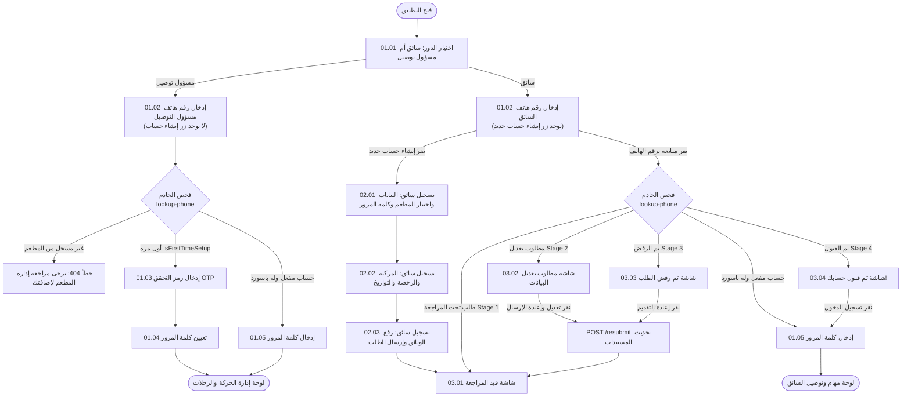

# MealMate Mobile App - Staff Screens Specification (توثيق شاشات الموبايل)

مرحباً بك في الدليل المرجعي الكامل لشاشات تطبيق الهاتف الخاص بطاقم العمل (**السائق ومسؤول التوصيل**). تم تصميم وهيكلة هذه الملفات لتكون دليلاً تقنياً شاملاً لمطوري واجهات وتطبيقات الموبايل (Flutter / React Native).

---

## 📌 القواعد الهامة والمبادئ الأساسية

1. **مسؤول التوصيل (Delivery Manager)**:
   - **لا يقوم بإنشاء حساب من التطبيق مطلقاً**. يتم إنشاء حسابه وإضافته حصرياً من قِبل المطعم عبر لوحة تحكم المطعم (`Restaurant Dashboard`).
   - دوره في التطبيق ينحصر في تسجيل الدخول فقط (إدخال الهاتف -> تفعيل الحساب برمز OTP أول مرة وتعيين كلمة المرور -> الدخول اليومي بكلمة المرور).
   - لا يظهر له زر "إنشاء حساب جديد" في أي شاشة.

2. **السائق (Driver)**:
   - يتاح له خيار إنشاء حساب جديد مباشرة من التطبيق (`02.01` إلى `02.03`).
   - يختار المطعم التابع له من قائمة مطاعم النظام النشطة المعتمدة.
   - **البريد الإلكتروني اختياري** للسائق.
   - إدخال تواريخ انتهاء الهوية والرخصة واستمارة المركبة إلزامي.
   - يخضع لـ **دورة الموافقة المزدوجة (Dual Approval)**:
     1. يراجع طلب السائق ويعتمده المطعم التابع له أولاً.
     2. تعتمد الإدارة العامة (Admin) الطلب نهائياً.
   - يتابع السائق حالة طلبه من خلال الشاشات (`03.01` إلى `03.04`).

3. **الترجمة واللغات**:
   - لا توجد أي نصوص ثابتة (Zero Hardcoded Strings). كل الشاشات تدعم اللغتين العربية (`ar`) والإنجليزية (`en`) بالتكامل مع الباك إند عبر ترويسة `Accept-Language: ar` أو `Accept-Language: en`.

---

## 🗺️ خريطة الشاشات (Screen Map)

### 1. مرحلة المصادقة والدخول (Authentication Flow)
- [01.01 - اختيار الدور (Role Selection)](screen-01.01-role-selection.md)
- [01.02 - إدخال رقم الهاتف وفحص الحساب (Phone Lookup)](screen-01.02-enter-phone.md)
- [01.03 - التحقق من رمز OTP لأول مرة (Verify First-Time OTP)](screen-01.03-verify-otp.md)
- [01.04 - تعيين كلمة المرور لأول مرة (Set Password)](screen-01.04-set-password.md)
- [01.05 - تسجيل الدخول بكلمة المرور (Login with Password)](screen-01.05-login-password.md)
- [01.06 - نسيت كلمة المرور - إدخال الهاتف (Forgot Password - Phone)](screen-01.06-forgot-password-phone.md)
- [01.07 - إعادة تعيين كلمة المرور برمز OTP (Reset Password)](screen-01.07-reset-password.md)

### 2. مرحلة تسجيل سائق جديد (Driver Registration - للسائق فقط)
- [02.01 - تسجيل سائق جديد: البيانات الشخصية واختيار المطعم (Step 1)](screen-02.01-driver-registration-step1.md)
- [02.02 - تسجيل سائق جديد: بيانات المركبة والرخصة والتواريخ (Step 2)](screen-02.02-driver-registration-step2.md)
- [02.03 - تسجيل سائق جديد: رفع المستندات والوثائق (Step 3)](screen-02.03-driver-registration-step3.md)

### 3. مرحلة متابعة حالة الطلب (Application Status - للسائق)
- [03.01 - حالة الطلب: قيد المراجعة من المطعم والإدارة (Under Review)](screen-03.01-status-under-review.md)
- [03.02 - حالة الطلب: مطلوب تعديل البيانات (More Information Needed)](screen-03.02-status-needs-changes.md)
- [03.03 - حالة الطلب: تم رفض الطلب (Application Rejected)](screen-03.03-status-rejected.md)
- [03.04 - حالة الطلب: تم قبول حسابك! (Account Approved)](screen-03.04-status-approved.md)

### 4. لوحة تحكم وتوجيه عمليات التوصيل (Dispatcher Operations - لمسؤول التوصيل)
- [04.01 - لوحة تحكم مسؤول التوصيل / المرسل (Dispatcher Dashboard)](screen-04.01-dispatcher-dashboard.md)
- [04.02 - خريطة السائقين الموسعة والتتبع الحي في الوقت الفعلي (Dispatcher Live Map)](screen-04.02-dispatcher-live-map.md)
- [04.03 - إدارة الطلبات وطابور البوكسات في انتظار الإسناد (Dispatcher Order Queue)](screen-04.03-dispatcher-order-queue.md)
- [04.04 - تفاصيل البوكس واختيار السائق للإسناد (Box Details & Assignment)](screen-04.04-box-details-assignment.md)
- [04.05 - تصفح أسطول السائقين واختيار السائق حسب المحافظة (Driver Roster & Area Selection)](screen-04.05-driver-roster-assignment.md)
- [04.06 - متابعة السائقين والمراقبة الحية على الخريطة (Driver Map & Live Monitoring)](screen-04.06-driver-map-live-monitoring.md)
- [04.07 - تفاصيل السائق ومتابعة رحلته المباشرة (Driver Details & Active Boxes)](screen-04.07-driver-details.md)
- [04.08 - تتبع البوكس المباشر ومراحل التوصيل (Box Tracking & Delivery Lifecycle)](screen-04.08-box-tracking.md)
- [04.09 - أداء السائقين ومقارنة الكفاءة (Driver Performance & Comparison)](screen-04.09-driver-performance.md)
- [04.10 - سجل العمليات وحالات التوصيل والإسناد (Operations Log)](screen-04.10-operations-log.md)
- [04.11 - مركز الدعم وإدارة المشكلات التشغيلية (Support & Issues Management)](screen-04.11-support-issues.md)
- [04.12 - تفاصيل المشكلة والبلاغ الميداني (Problem Details & Resolution)](screen-04.12-problem-details.md)
- [04.13 - تعيين سائق بديل للمهمة المتعثرة (Assign Replacement Driver)](screen-04.13-assign-replacement-driver.md)

### 5. مرحلة مهام السائق والوردية اليومية (Driver Work Session Flow)
- [05.01 - بدء العمل والدخول للحالة التشغيلية (Start Work / Shift Launch)](screen-05.01-start-work.md)
- [05.02 - الرئيسية للسائق وتوصيل الطلب النشط (Driver Home / Current Delivery)](screen-05.02-driver-home-delivery.md)
- [05.03 - انتهاء العمل وملخص اليوم (End Work Summary)](screen-05.03-end-work-summary.md)
- [05.04 - تفاصيل التوصيل وخريطة المسار وسلايدر المحطات (03.01 Delivery Details & Stops Map)](screen-05.04-driver-delivery-details-map.md)

### 6. مسار الاستلام من المطبخ وفحص الباركود والكاميرا (Pickup & QR Flow - 06.01 to 06.17)
- [06.01 - توجه السائق إلى المطبخ (En Route to Kitchen)](screen-06.01-en-route-to-kitchen.md)
- [06.02 - قائمة البوكسات المسندة للاستلام (Assigned Boxes List)](screen-06.02-assigned-boxes-list.md)
- [06.03 - ماسح الباركود والـ QR لفاتورة البوكس (QR & Barcode Scanner)](screen-06.03-qr-barcode-scanner.md)
- [06.04 - كاميرا توثيق حالة كل بوكس على حدة (Camera Box Condition Verification)](screen-06.04-camera-box-condition.md)
- [06.05 - ملخص استلام البوكسات وتأكيد الشحنة (Boxes Received Summary)](screen-06.05-boxes-received-summary.md)
- [06.06 - البوكسات المسندة أثناء الرحلة والتوصيل (Assigned Boxes In Transit)](screen-06.06-assigned-boxes-in-transit.md)
- [06.10 - حالة خطأ: رفض إذن الكاميرا (Camera Permission Denied)](screen-06.10-camera-permission-denied.md)
- [06.11 - حالة خطأ: انتهاء مهلة المسح أو عدم القراءة (QR Scan Timeout)](screen-06.11-qr-scan-timeout.md)
- [06.12 - حالة خطأ: باركود غير صالح أو غير معروف (Invalid QR Code)](screen-06.12-invalid-qr-code.md)
- [06.13 - تنبيه أمني: البوكس مخصص لسائق آخر (Box Assigned to Another Driver)](screen-06.13-box-not-assigned-to-driver.md)
- [06.14 - حالة خطأ: انقطاع الاتصال بالإنترنت (No Internet Connection)](screen-06.14-no-internet-connection.md)
- [06.15 - تفاصيل بوكس مستلم وتأكيد بياناته (Single Box Received Detail)](screen-06.15-single-box-received-detail.md)
- [06.16 - تنبيه: لا توجد بوكسات مسندة حالياً (No Assigned Boxes)](screen-06.16-no-assigned-boxes.md)
- [06.17 - حالة خطأ: فشل تحديث حالة البوكس بالخادم (Order Update Error)](screen-06.17-order-update-error.md)

### 7. مسار التوصيل النشط والوصول للعميل (Active Delivery & Customer Arrival - 07.00 to 07.06)
- [07.00 - جاهز لبدأ مسار التوصيل؟ (Start Delivery)](screen-07.00-start-delivery.md)
- [07.01 - متابعة التوصيل أثناء الطريق (Active Delivery / In Transit)](screen-07.01-delivery-in-transit.md)
- [07.02 - تم الوصول إلى موقع العميل وتأكيد التسليم (Customer Arrival & Delivery Confirmation)](screen-07.02-delivery-arrival-confirmation.md)
- [07.03 - تأخير في التوصيل (Delivery Delayed)](screen-07.03-delivery-delayed.md)
- [07.04 - تعذر التسليم وبلاغ المشرف (Failed Delivery)](screen-07.04-failed-delivery.md)
- [07.05 - إيداع البوكس المرتجع للمطبخ (Return Box to Kitchen)](screen-07.05-return-box.md)
- [07.06 - تم تسليم الطلب بنجاح (Delivery Success)](screen-07.06-delivery-success.md)

### 8. إدارة مشكلات التوصيل وإعادة الإسناد والاتصال (Delivery Issues, Reassignment & Recovery - 08.01 to 08.08)
- [08.01 - إبلاغ عن مشكلة أثناء التوصيل (Report Delivery Issue)](screen-08.01-report-issue.md)
- [08.02 - طلب إعادة إسناد الطلب لسائق آخر (Request Reassignment)](screen-08.02-request-reassignment.md)
- [08.03 - تم إرسال طلب إعادة الإسناد (Reassignment Request Sent)](screen-08.03-reassignment-sent.md)
- [08.04 - تم إرسال البلاغ بنجاح (Issue Report Sent)](screen-08.04-issue-report-sent.md)
- [08.05 - إجراءات معالجة التأخير في التوصيل (Delivery Delayed Actions)](screen-08.05-delivery-delayed-action.md)
- [08.06 - شيت الاتصال بالعميل المباشر (Direct Customer Call Sheet)](screen-08.06-call-customer-direct.md)
- [08.07 - الاتصال بالعميل برقم مقنع لحماية الخصوصية (Masked Customer Call)](screen-08.07-call-customer-masked.md)
- [08.08 - خيارات التواصل البديلة مع العميل (Customer Contact Options)](screen-08.08-call-customer-options.md)

### 9. الأداء والمحفظة والإشعارات والإعدادات للسائق (Performance, Profile, Earnings & Settings - 09.01 to 09.05)
- [09.01 - ملخص أداء السائق والتقييمات (Driver Performance & Rating Summary)](screen-09.01-driver-performance-summary.md)
- [09.02 - الملف الشخصي وبيانات المركبة والوثائق (Driver Profile & Vehicle Management)](screen-09.02-driver-profile-vehicle.md)
- [09.03 - مركز الإشعارات والتنبيهات التشغيلية (Driver Notifications Center)](screen-09.03-driver-notifications-center.md)
- [09.04 - الأرباح والمحفظة المالية والتحويلات (Driver Earnings & Payouts)](screen-09.04-driver-earnings-payouts.md)
### 10. أدلة المطورين والتكامل الميداني (Integration Guides & Test Data)
- [📱 دليل تكامل إشعارات FCM والـ Device Tokens لتطبيق الموبايل](fcm-token-integration-guide.md)
- [🧪 الدليل الشامل والبيانات التجريبية لتسجيل ودورة حياة السائق](test-driver-registration-data.md)
- [📄 نموذج JSON لتسجيل السائق](driver-registration-sample.json)

---

## 📊 مخطط تدفق تجربة المستخدم والتكامل (User Flow Diagram)



---

## ⚙️ معايير الاتصال بالخادم (Backend Base Configuration)
- **Base URL التطوير المحلي**: `http://localhost:5073`
- **Base URL السيرفر التجريبي**: `http://157.173.104.121:5073` (أو النطاق المعتمد)
- **الترويسات العامة الإلزامية**:
  ```http
  Content-Type: application/json
  Accept-Language: ar  # أو en حسب لغة التطبيق الحالية
  ```
