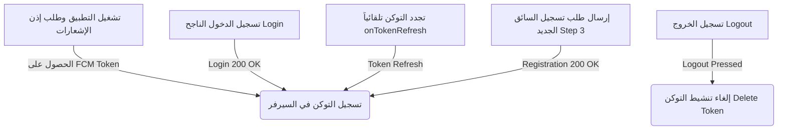

# 📱 دليل تكامل إشعارات Firebase Cloud Messaging (FCM) والـ Device Tokens لتطبيق الموبايل

> **الجمهور المستهدف**: مطوري تطبيقات الموبايل (Flutter / React Native / iOS / Android) لتطبيقي **السائق (Driver App)** و **مسؤول التوصيل (Delivery Manager App)**.

---

## 🎯 مقدمة ونظرة عامة

يعتمد نظام MealMate على إشعارات **FCM Push Notifications** فائقة السرعة والأولوية لإيقاظ وتنبيه السائقين ومسؤولي التوصيل حتى في حال كان التطبيق مغلقاً بالكامل (Terminated / Background).

لضمان وصول كل إشعار إلى الشخص الصحيح دون أي تداخل، يوفر الباك إند مسارين منفصلين تماماً لتسجيل توكنات الأجهزة:
1. **مسار السائق (Driver)**: يُسجل التوكن ويُربط بملف السائق في جدول `DriverDeviceTokens`.
2. **مسار مسؤول التوصيل / المطعم (Delivery Manager)**: يُسجل التوكن ويُربط بالمطعم التابع له في جدول `RestaurantDeviceTokens`.

---

## 🔌 1. واجهات تسجيل الـ FCM Token في الباك إند (API Endpoints)

### أ. مسار السائق (Driver App) 🚗

يستخدم تطبيق السائق هذا الرابط لحفظ أو تحديث التوكن في أي وقت (أثناء مرحلة مراجعة الطلب أو أثناء ورديات العمل النشطة):

- **الرابط (Endpoint)**: `POST /api/v1/driver/device-token`
- **الترويسات (Headers)**:
  ```http
  Content-Type: application/json
  Authorization: Bearer <ACCESS_TOKEN>  // اختياري إذا كان بعد تسجيل الدخول
  ```
- **المعاملات (Query Params)**:
  - `driverId`: معرف السائق (GUID) - اختياري.
- **جسم الطلب (Request Body - JSON)**:
  ```json
  {
    "token": "eX_sample_fcm_token_long_string_from_firebase...",
    "platform": "Android", // أو "iOS"
    "deviceId": "c2a8f8b0-4b2a-4f51-b8d4-539b98b2c123" // المعرف الفريد للجهاز (Hardware UUID)
  }
  ```
- **استجابة النجاح (200 OK)**:
  ```json
  {
    "isSuccess": true
  }
  ```

---

### ب. مسار مسؤول التوصيل / طاقم المطعم (Delivery Manager App) 🏬

يستخدم تطبيق مسؤول التوصيل هذا الرابط لحفظ التوكن وربطه بمطعم المسؤول:

- **الرابط (Endpoint)**: `PUT /api/v1/restaurants/device-tokens`
  *(أو `PUT /api/v1/restaurants/me/device-tokens`)*
- **الترويسات (Headers)**:
  ```http
  Content-Type: application/json
  Authorization: Bearer <ACCESS_TOKEN> // إلزامي بعد تسجيل الدخول كـ DeliveryManager
  ```
- **جسم الطلب (Request Body - JSON)**:
  ```json
  {
    "token": "eX_sample_fcm_token_long_string_from_firebase...",
    "platform": "Android", // أو "iOS" أو "Web"
    "deviceId": "c2a8f8b0-4b2a-4f51-b8d4-539b98b2c123"
  }
  ```
- **استجابة النجاح (200 OK)**:
  ```json
  {
    "isSuccess": true
  }
  ```

---

### ج. إلغاء تسجيل التوكن عند تسجيل الخروج (Logout / Deactivate)

لضمان عدم وصول إشعارات المستخدم السابق لأي مستخدم آخر يسجل دخوله من نفس الجهاز:

- **الرابط (Endpoint)**: `DELETE /api/v1/restaurants/device-tokens`
- **الترويسات (Headers)**: `Authorization: Bearer <ACCESS_TOKEN>`
- **جسم الطلب (JSON)**:
  ```json
  {
    "token": "eX_sample_fcm_token_to_remove..."
  }
  ```

---

## ⏱️ 2. متى يجب على تطبيق الموبايل إرسال الـ FCM Token؟ (Lifecycle Triggers)

يجب على الموبايل استدعاء API التسجيل في **4 حالات أساسية**:



1. **فور الحصول على الإذن وبدء تشغيل التطبيق (App Startup)**.
2. **فور نجاح تسجيل الدخول (After Login)**: بعد استلام التوكن `accessToken` من `POST /api/v1/auth/staff/login` يتم إرسال الـ FCM Token ليرتبط فوراً بـ `UserId` السائق أو مسؤول التوصيل.
3. **عند تجدد التوكن (Token Refresh Listener)**: يستمع التطبيق لـ `FirebaseMessaging.instance.onTokenRefresh` ويرسله تلقائياً للسيرفر.
4. **بعد إرسال طلب تسجيل السائق الجديد (Driver Registration)**: ليتمكن السائق من استلام إشعارات حالة الطلب ("تم قبول حسابك", "مطلوب تعديل بيانات", "تم الرفض") وهو بانتظار الاعتماد.

---

## 💻 3. نموذج كود Flutter / Dart جاهز للاستخدام الفوري

قم بنسخ هذا الـ Service في مشروع الموبايل لديك:

```dart
import 'dart:io';
import 'package:firebase_messaging/firebase_messaging.dart';
import 'package:device_info_plus/device_info_plus.dart';
import 'package:http/http.dart' as http;
import 'dart:convert';

class PushNotificationService {
  final FirebaseMessaging _fcm = FirebaseMessaging.instance;
  final String _baseUrl = 'http://maelmate.runasp.net'; // أو رابط السيرفر الخاص بكم

  /// 1. تهيئة الإشعارات وطلب الصلاحيات
  Future<void> initialize({required String userRole, String? authToken}) async {
    // طلب الصلاحيات لنظام iOS و Android 13+
    NotificationSettings settings = await _fcm.requestPermission(
      alert: true,
      badge: true,
      sound: true,
      provisional: false,
    );

    if (settings.authorizationStatus == AuthorizationStatus.authorized) {
      print('✅ Notification permission granted.');

      // جلب التوكن الأولي
      String? token = await _fcm.getToken();
      if (token != null) {
        await syncTokenWithBackend(
          fcmToken: token,
          userRole: userRole,
          authToken: authToken,
        );
      }

      // الاستماع لتجدد التوكن تلقائياً
      _fcm.onTokenRefresh.listen((newToken) async {
        print('🔄 FCM Token Refreshed: $newToken');
        await syncTokenWithBackend(
          fcmToken: newToken,
          userRole: userRole,
          authToken: authToken,
        );
      });

      // التعامل مع الإشعارات أثناء فتح التطبيق (Foreground)
      FirebaseMessaging.onMessage.listen((RemoteMessage message) {
        print('📩 Foreground Notification: ${message.notification?.title}');
        handleNotificationRouting(message.data);
      });

      // التعامل مع النقر على الإشعار وفتح التطبيق (Background / Terminated)
      FirebaseMessaging.onMessageOpenedApp.listen((RemoteMessage message) {
        print('🚀 App opened from notification: ${message.data}');
        handleNotificationRouting(message.data);
      });
    }
  }

  /// 2. إرسال التوكن للباك إند حسب دور المستخدم (Driver أو DeliveryManager)
  Future<void> syncTokenWithBackend({
    required String fcmToken,
    required String userRole, // 'Driver' أو 'DeliveryManager'
    String? authToken,
  }) async {
    try {
      final deviceId = await _getUniqueDeviceId();
      final platform = Platform.isIOS ? 'iOS' : 'Android';

      Uri uri;
      String method;

      if (userRole.toLowerCase() == 'driver') {
        uri = Uri.parse('$_baseUrl/api/v1/driver/device-token');
        method = 'POST';
      } else {
        uri = Uri.parse('$_baseUrl/api/v1/restaurants/device-tokens');
        method = 'PUT';
      }

      final headers = {
        'Content-Type': 'application/json',
        if (authToken != null && authToken.isNotEmpty)
          'Authorization': 'Bearer $authToken',
      };

      final body = jsonEncode({
        'token': fcmToken,
        'platform': platform,
        'deviceId': deviceId,
      });

      final response = method == 'POST'
          ? await http.post(uri, headers: headers, body: body)
          : await http.put(uri, headers: headers, body: body);

      if (response.statusCode == 200) {
        print('✅ FCM Token successfully synced for role: $userRole');
      } else {
        print('⚠️ Failed to sync FCM Token: ${response.statusCode} - ${response.body}');
      }
    } catch (e) {
      print('❌ Error syncing FCM Token: $e');
    }
  }

  /// 3. استخراج المعرف الفريد للجهاز
  Future<String> _getUniqueDeviceId() async {
    final deviceInfo = DeviceInfoPlugin();
    if (Platform.isAndroid) {
      final androidInfo = await deviceInfo.androidInfo;
      return androidInfo.id;
    } else if (Platform.isIOS) {
      final iosInfo = await deviceInfo.iosInfo;
      return iosInfo.identifierForVendor ?? 'ios-unknown-uuid';
    }
    return 'unknown-device-uuid';
  }

  /// 4. توجيه المستخدم للشاشة المناسبة عند النقر على الإشعار (Deep Linking)
  void handleNotificationRouting(Map<String, dynamic> data) {
    final eventKey = data['eventKey'] ?? data['type'];

    switch (eventKey) {
      // إشعارات حالة طلب السائق
      case 'driver.registration.restaurant_approved':
      case 'driver.registration.submitted':
        // فتح شاشة 03.01 (قيد المراجعة)
        break;

      case 'driver.registration.needs_changes':
        // فتح شاشة 03.02 (مطلوب تعديل البيانات)
        break;

      case 'driver.registration.admin_approved':
        // فتح شاشة 03.04 (تم قبول حسابك!) أو شاشة تسجيل الدخول 01.05
        break;

      case 'driver.registration.admin_rejected':
        // فتح شاشة 03.03 (تم الرفض)
        break;

      // إشعارات ورديات التوصيل
      case 'kitchen-ready':
        // المطبخ جهز الوجبات -> فتح شاشة استلام البوكس 06.01
        break;

      case 'box-assigned':
        // تم إسناد طلب جديد -> فتح شاشة تفاصيل التوصيل 05.04
        break;

      case 'dispatcher.batch.ready':
        // دفعة طلبات جاهزة للإسناد بالمطبخ -> فتح شاشة طابور البوكسات والإسناد 04.03
        break;

      default:
        print('ℹ️ Notification received with no custom route: $eventKey');
    }
  }
}
```

---

## 📦 4. هيكل البيانات المستلمة في الإشعار (Payload Schema)

عندما يرسل الباك إند إشعاراً لجهاز السائق أو مسؤول التوصيل، يستلم التطبيق البيانات في حقل `data`:

### أ. مثال إشعار قبول حساب السائق (Screen 03.04):
```json
{
  "notification": {
    "title": "تهانينا! تم قبول حسابك كقائد توصيل 🎉",
    "body": "تمت مراجعة واعتماد بياناتك من الإدارة. يمكنك الآن تسجيل الدخول مباشرة بكلمة سرك والبدء في استلام الرحلات."
  },
  "data": {
    "eventKey": "driver.registration.admin_approved",
    "stage": "4",
    "status": "Approved",
    "registrationId": "409286c5-c30f-4f95-b505-38054f0f1285",
    "action": "screen-03.04"
  }
}
```

### ب. مثال إشعار طلب تعديل بيانات من السائق (Screen 03.02):
```json
{
  "notification": {
    "title": "مطلوب تعديل بيانات في طلب الالتحاق ⚠️",
    "body": "يرجى تعديل المستندات المطلوبة وإعادة إرسال الطلب."
  },
  "data": {
    "eventKey": "driver.registration.needs_changes",
    "stage": "2",
    "status": "NeedsChanges",
    "requestedByRole": "Admin",
    "reason": "صورة رخصة القيادة غير واضحة",
    "registrationId": "409286c5-c30f-4f95-b505-38054f0f1285",
    "action": "screen-03.02"
  }
}
```

### ج. مثال إشعار جاهزية الشحنة بالمطبخ للسائق (Screen 06.01):
```json
{
  "notification": {
    "title": "الشحنة جاهزة للاستلام بالمطبخ 🍳",
    "body": "أنهى المطبخ تجهيز وجبات الرحلة TRP-9021. يمكنك التوجه للاستلام ومسح الباركود الآن."
  },
  "data": {
    "type": "kitchen-ready",
    "tripCode": "TRP-9021",
    "action": "/driver/pickup/manifest"
  }
}
```

### د. مثال إشعار دفعة طلبات جاهزة لمسؤول التوصيل (Screen 04.03):
> يتم إرسال هذا الإشعار لمسؤول التوصيل تلقائياً عند اكتمال تجهيز كل 5 طلبات جاهزة للإسناد (أو بعد 10 دقائق للطلبات المتبقية) لمنع الإزعاج:
```json
{
  "notification": {
    "title": "📦 دفعة طلبات جاهزة للتوزيع",
    "body": "يتوفر الآن 5 طلبات جاهزة بالمطبخ بانتظار الإسناد للسائقين."
  },
  "data": {
    "eventKey": "dispatcher.batch.ready",
    "restaurantId": "0a40e4ff-72c7-4754-94e3-50b5f505b730",
    "readyCount": "5",
    "action": "/dispatcher/orders/queue"
  }
}
```

---

## 🛠️ 5. أوامر cURL جاهزة للاختبار من الـ Terminal أو Postman

### 1. تجربة تسجيل توكن السائق:
```bash
curl -X POST "http://maelmate.runasp.net/api/v1/driver/device-token" \
  -H "Content-Type: application/json" \
  -H "Authorization: Bearer <DRIVER_JWT_TOKEN>" \
  -d '{
    "token": "cK2X_SAMPLE_FCM_TOKEN_DRIVER_DEVICE...",
    "platform": "Android",
    "deviceId": "samsung-sm-g998b-uuid"
  }'
```

### 2. تجربة تسجيل توكن مسؤول التوصيل بالمطعم:
```bash
curl -X PUT "http://maelmate.runasp.net/api/v1/restaurants/device-tokens" \
  -H "Content-Type: application/json" \
  -H "Authorization: Bearer <DELIVERY_MANAGER_JWT_TOKEN>" \
  -d '{
    "token": "cK2X_SAMPLE_FCM_TOKEN_DELIVERY_MANAGER...",
    "platform": "Android",
    "deviceId": "pixel-7-pro-uuid"
  }'
```

### 3. إرسال فحص تجريبي (Test Push) لمطعم:
```bash
curl -X POST "http://maelmate.runasp.net/api/v1/restaurants/device-tokens/test" \
  -H "Content-Type: application/json" \
  -d '{
    "token": "cK2X_SAMPLE_FCM_TOKEN_TO_TEST..."
  }'
```
