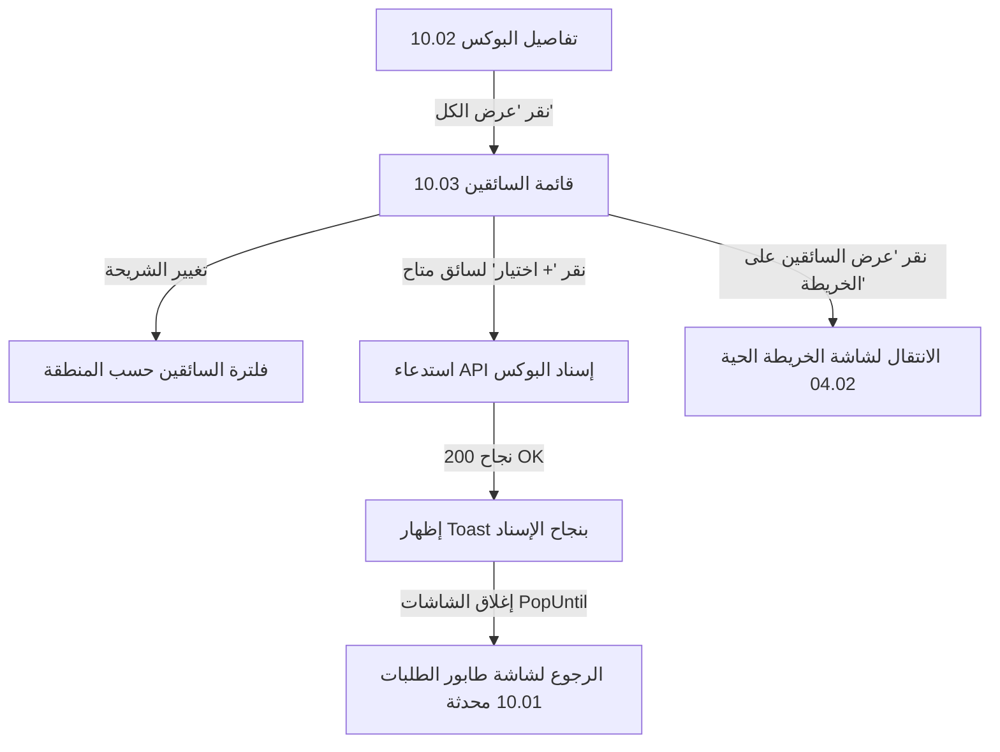

# Screen 04.05: تصفح أسطول السائقين واختيار السائق حسب المحافظة (Screen 10.03 - Driver Roster & Area Selection)

## 🎯 الغرض من الشاشة ونظرة عامة (Overview & Purpose)
تُمثل هذه الشاشة الواجهة الموسعة لتصفح كامل أسطول السائقين التابع للمطعم، ويتم الوصول إليها عبر:
1. النقر على رابط **`عرض الكل ⊞`** في شاشة إسناد البوكس السابقة (`Screen 10.02 / 04.04`) لاختيار سائق بديل عن المرشحين الـ 5 المقترحين.
2. التصفح المباشر لأسطول السائقين والتحقق من التوزيع الجغرافي والضغط التشغيلي لكل سائق.

تُتيح الشاشة لمسؤول التوصيل (`Dispatcher`):
- تصفية السائقين إما **بكامل الأسطول (`كل السائقين`)** أو **حسب المحافظة/المنطقة (`حسب المحافظة`)**.
- التنقل السريع بين المناطق عبر شريط الشرائح التفاعلي (السالمية، حولي، حطين، الفروانية، العاصمة).
- استعراض العدادات الحية للطاقة الاستيعابية: إجمالي السائقين (13)، المتاحين (8)، المشغولين (5).
- اختيار السائق المتاح بنقرة زر واحدة عبر زر **`+ اختيار`** لتنفيذ الإسناد، مع تعطيل الاختيار تلقائياً للسائقين المشغولين أو في استراحة بزر رمادي **`غير متاح 🚫`**.
- الانتقال الفوري لخريطة التتبع الحي عبر زر **`عرض السائقين على الخريطة 🗺️`**.

---

## 🎨 التحليل البصري والتخطيطي (UI/UX Breakdown & Components)

### 1. الهيدر وشريط العنوان (Top Navigation)
- شريط الحالة: الوقت `9:41`، مؤشرات الشبكة والبطارية.
- زر الرجوع `<`: للعودة للشاشة السابقة (`10.02` أو لوحة التحكم).
- زر التصفية المتقدمة `Y`: لفلترة السائقين بالتقييم أو نوع المركبة.
- العنوان الرئيسي: **قائمة السائقين**
- العنوان الفرعي: **اختر السائق المناسب لتوزيع الطلبات**

### 2. محول نمط العرض (View Mode Tabs)
حاوية بيضاء مستديرة تحتوي على زرين تبديل:
- `كل السائقين 👥`: لعرض الأسطول كاملاً دون تجزئة جغرافية.
- `حسب المحافظة 🏛️`: (النشط بلون بنفسجي مميز) لفرز السائقين حسب مناطق ومحافظات الكويت.

### 3. شريط المناطق الأفقي (Horizontal Area Chips)
شريط قابل للتمرير الأفقي يحتوي على شرائح المناطق:
- 🟣 `السالمية 📍` (شريحة بنفسجية نشطة).
- ⚪ `حولي 📍`
- ⚪ `حطين 📍`
- ⚪ `الفروانية 📍`
- ⚪ `العاصمة 📍`

### 4. شريط مؤشرات الحالة الحيوية (3 Stats Cards)
صف بثلاث بطاقات إحصائية ملونة:
- 🟣 **إجمالي السائقين**: `13` (أيقونة مجموعة سائقين).
- 🟢 **السائقين المتاحين**: `8` (أيقونة سائق بخلفية خضراء).
- 🟠 **مشغول الآن**: `5` (أيقونة سائق بخلفية برتقالية).

### 5. ترويسة القائمة وأداة الترتيب
- العنوان الديناميكي: **السائقين في السالمية (8)** (يعكس المنطقة وعدد السائقين المتواجدين فيها).
- زر الترتيب: `ترتيب ⇅` (للفرز حسب المسافة، التقييم، أو الأقل حمولة).

### 6. بطاقات السائقين (Driver Cards)
كل كارت سائق يحتوي على:
- **الصورة الشخصية ونقطة الحالة الملونة**:
  - نقطة خضراء 🟢: `متاح` (Available).
  - نقطة برتقالية 🟠: `في طريقه` (On the Way / Busy).
  - نقطة رمادية ⚪: `في استراحة` (On Break).
- **بيانات السائق**: الاسم الكامل (مثل `أحمد محمد`)، التقييم بالنجوم ⭐ `4.9`، وكود السائق المميز `ID:D-1025`.
- **شارة الحالة**: كبسولة ملونة توضح الحالة التشغيلية (`متاح`، `في طريقه`، `في استراحة`).
- **زر الإجراء السريع**:
  - للسائق المتاح: زر بنفسجي بارز **`+ اختيار`** بنص أبيض وأيقونة زائد.
  - للسائق غير المتاح: زر رمادي معطل **`غير متاح 🚫`**.
- **المقاييس الحيوية الثلاثة داخل كل كارت**:
  1. `الطلبات الحالية`: عدد البوكسات النشطة حالياً (مثل `1 📦` أو `0 📦`).
  2. `طلبات مكتملة اليوم`: إجمالي ما سلمه السائق اليوم (مثل `12 📦` أو `8 📦`).
  3. `المسافة منك`: المسافة التقديرية بين السائق والمطعم (مثل `9 Km 🚗`).

### 7. الزر السفلي العائم
- **عرض السائقين على الخريطة 🗺️**:
  زر أبيض عريض بإطار بنفسجي ناعم وأيقونة خريطة، ينقل المستخدم إلى الشاشة `Screen 04.02 (Live Map)` مع الحفاظ على فلتر المنطقة المختارة.

---

## 🔌 عقود تكامل الخادم (API Contracts)

### 1. جلب قائمة السائقين والعدادات والمناطق
- **الرابط**: `GET /api/v1/dispatcher/drivers/roster?view=ByArea&area=السالمية&boxId={boxId}`
- **الترويسات (Headers)**:
  ```http
  Accept-Language: ar  # أو en
  Authorization: Bearer <token>
  ```
- **استجابة الخادم الناجحة (200 OK)**:
```json
{
  "counts": {
    "totalCount": 13,
    "availableCount": 8,
    "busyCount": 5
  },
  "selectedView": "ByArea",
  "selectedArea": "السالمية",
  "sectionTitle": "السائقين في السالمية (8)",
  "areas": [
    {
      "areaKey": "salmiya",
      "name": "السالمية",
      "driverCount": 8,
      "isSelected": true
    },
    {
      "areaKey": "hawally",
      "name": "حولي",
      "driverCount": 2,
      "isSelected": false
    },
    {
      "areaKey": "hatteen",
      "name": "حطين",
      "driverCount": 1,
      "isSelected": false
    },
    {
      "areaKey": "farwaniya",
      "name": "الفروانية",
      "driverCount": 1,
      "isSelected": false
    },
    {
      "areaKey": "capital",
      "name": "العاصمة",
      "driverCount": 1,
      "isSelected": false
    }
  ],
  "drivers": [
    {
      "driverId": "11111111-1111-1111-1111-111111111111",
      "driverCode": "ID:D-1025",
      "fullName": "أحمد محمد",
      "avatarUrl": "https://cdn.mealmate.app/avatars/ahmed-m.jpg",
      "rating": 4.9,
      "status": "Available",
      "statusText": "متاح",
      "statusDotColor": "Green",
      "isAvailableForSelection": true,
      "activeOrdersCount": 1,
      "activeOrdersText": "1",
      "completedOrdersTodayCount": 12,
      "completedOrdersTodayText": "12",
      "distanceKm": 9.0,
      "distanceText": "9 Km",
      "currentZoneName": "السالمية"
    },
    {
      "driverId": "22222222-2222-2222-2222-222222222222",
      "driverCode": "ID:D-1044",
      "fullName": "محمد العتيبي",
      "avatarUrl": "https://cdn.mealmate.app/avatars/mohammed-o.jpg",
      "rating": 4.9,
      "status": "Available",
      "statusText": "متاح",
      "statusDotColor": "Green",
      "isAvailableForSelection": true,
      "activeOrdersCount": 0,
      "activeOrdersText": "0",
      "completedOrdersTodayCount": 8,
      "completedOrdersTodayText": "8",
      "distanceKm": 9.0,
      "distanceText": "9 Km",
      "currentZoneName": "السالمية"
    },
    {
      "driverId": "33333333-3333-3333-3333-333333333333",
      "driverCode": "ID:D-1044",
      "fullName": "محمد علي",
      "avatarUrl": "https://cdn.mealmate.app/avatars/mohammed-a.jpg",
      "rating": 4.9,
      "status": "OnTheWay",
      "statusText": "في طريقه",
      "statusDotColor": "Orange",
      "isAvailableForSelection": false,
      "activeOrdersCount": 0,
      "activeOrdersText": "0",
      "completedOrdersTodayCount": 8,
      "completedOrdersTodayText": "8",
      "distanceKm": 9.0,
      "distanceText": "9 Km",
      "currentZoneName": "السالمية"
    },
    {
      "driverId": "55555555-5555-5555-5555-555555555555",
      "driverCode": "ID:D-1044",
      "fullName": "فهد العنزي",
      "avatarUrl": "https://cdn.mealmate.app/avatars/fahad-a.jpg",
      "rating": 4.9,
      "status": "OnBreak",
      "statusText": "في استراحة",
      "statusDotColor": "Slate",
      "isAvailableForSelection": false,
      "activeOrdersCount": 0,
      "activeOrdersText": "0",
      "completedOrdersTodayCount": 8,
      "completedOrdersTodayText": "8",
      "distanceKm": 9.0,
      "distanceText": "9 Km",
      "currentZoneName": "السالمية"
    }
  ]
}
```

---

### 2. تنفيذ إسناد البوكس عند النقر على `+ اختيار`
- **الرابط**: `POST /api/v1/dispatcher/orders/{boxId}/assign`
- **جسم الطلب**:
```json
{
  "driverId": "11111111-1111-1111-1111-111111111111",
  "notes": "إسناد مباشر من قائمة السائقين"
}
```
- **استجابة الخادم الناجحة (200 OK)**:
```json
{
  "boxId": "a1111111-1111-1111-1111-111111111111",
  "boxCode": "#BX-1256",
  "driverId": "11111111-1111-1111-1111-111111111111",
  "driverName": "أحمد محمد",
  "assignedAtUtc": "2026-09-22T04:00:00Z",
  "message": "تم إسناد البوكس للسائق بنجاح"
}
```

---

## ⚡ دورة التنقل وتجربة المستخدم (Navigation Lifecycle)


