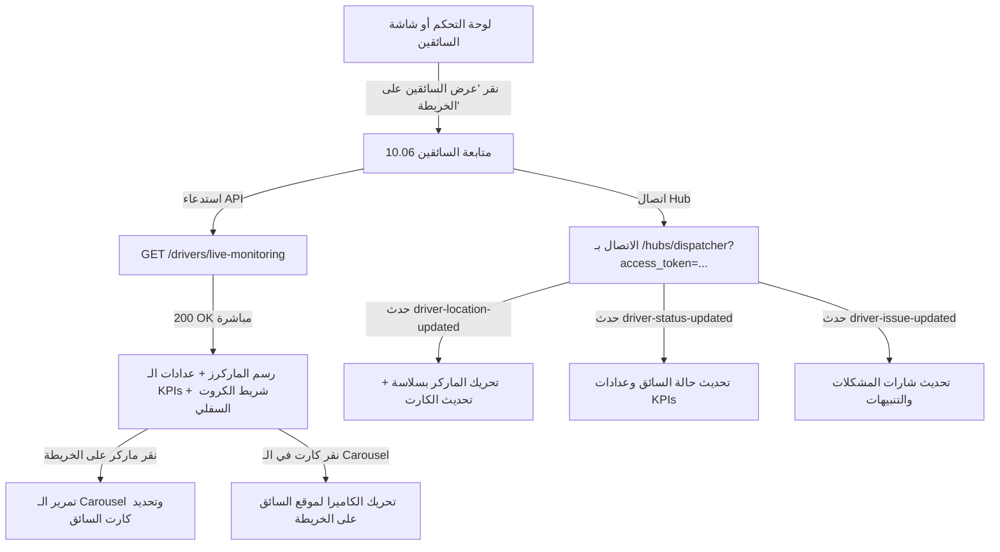

# Screen 04.06: متابعة السائقين والمراقبة الحية على الخريطة (Screen 10.06 - Driver Map & Live Monitoring)

## 🎯 الغرض من الشاشة ونظرة عامة (Overview & Purpose)
تُمثّل هذه الشاشة مركز القيادة الجغرافي اللحظي (`Real-Time Fleet Command Center`) لمسؤول التوصيل (`Dispatcher`)، وتتيح:
1. مراقبة حركة كافة سائقي الأسطول لحظياً على الخريطة التفاعلية مع سرعاتهم وزوايا حركتهم وحالاتهم التشغيلية.
2. متابعة المؤشرات الحيوية الأربعة للأسطول بأعلى الشاشة (نشط، في التوصيل، متوقف مؤقتاً، مشاكل تتطلب انتباه).
3. التزامن الفوري والتفاعلي الثنائي بين علامات الخريطة (`Map Markers`) وقائمة البطاقات السفلية (`Bottom Cards Carousel`) بنقرة زر واحدة (`Pan & Zoom`).
4. استقبال تحديثات إحداثيات السائقين اللحظية عبر **SignalR** بدقة وبدون الحاجة لعمل Polling متكرر.
5. خلو تام من أي بيانات وهمية (Zero Mock Data)؛ كافة الإحداثيات والطلبات والمسافات مستمدة من قاعدة البيانات الحقيقية.

---

## 🎨 التحليل البصري والتخطيطي (UI/UX Breakdown & Components)

```
┌────────────────────────────────────────────────────────┐
│  [🔔]                 متابعة السائقين              [☰] │
│                 مراقبة السائقين في الوقت الفعلي         │
├────────────────────────────────────────────────────────┤
│  [🟢 32]       [🟣 18]         [🔵 7]         [🔴 3]   │
│  سائق نشط     في التوصيل     متوقف مؤقتاً   مشكلة تتطلب │
├────────────────────────────────────────────────────────┤
│                                                        │
│                    🗺️ خريطة حية تفاعلية                 │
│         - علامات السائقين (Avatar + كود البوكس + الحالة) │
│         - أدوات التحكم (بوصلة التمركز 🎯، تكبير +، تصغير -) │
│                                                        │
├────────────────────────────────────────────────────────┤
│  [بطاقة 1: الفروانية] [بطاقة 2: اليرموك] [بطاقة 3: الشعب]  │
│  (شريط أفقي تفاعلي متزامن مع علامات الخريطة Pan & Select)│
├────────────────────────────────────────────────────────┤
│  [الرئيسية]   [الطلبات]   [📍 الخريطة]   [الدعم]   [الحساب] │
└────────────────────────────────────────────────────────┘
```

### 1. الهيدر العلوي (Header Bar)
- **أيقونة التنبيهات [🔔]**: في أعلى اليمين (أو اليسار حسب اتجاه العرض) مع نقطة إشعار حمراء تنبه لوجود مشاكل تشغيلية.
- **العنوان الرئيسي**: **متابعة السائقين**
- **العنوان الفرعي**: **مراقبة السائقين في الوقت الفعلي**
- **زر القائمة الجانبية [☰]**: لفتح القائمة السريعة للتحكم.

### 2. شريط مؤشرات الأداء الحيوية الأربعة (4 KPI Metric Badges)
صف أفقي من 4 كروت إحصائية ملونة:
1. 🟢 **سائق نشط (`32`)**: إجمالي السائقين المتاحين أو العاملين بالمطعم اليوم.
2. 🟣 **في التوصيل (`18`)**: السائقون الذين يقومون حالياً بتوصيل رحلة نشطة (`InDelivery`).
3. 🔵 **متوقف مؤقتاً (`7`)**: سائقون متوقفون بدون حركة أو في استراحة (`Paused / Idle`).
4. 🔴 **مشكلة تتطلب انتباه (`3`)**: سائقون لديهم تأخير غير معتاد، أو فقدوا إشارة الـ GPS، أو واجهوا مشكلة في تسليم طلب.

### 3. الخريطة الحية التفاعلية (Interactive Map Canvas)
- خريطة تفاعلية (Google Maps / Mapbox) تغطي مناطق الكويت.
- **أدوات التحكم العائمة**:
  - 🎯 **زر إعادة التمركز (`Fit Bounds`)**: لإعادة ضبط إطار الخريطة ليشمل كافة السائقين.
  - `+` و `-`: أزرار التحكم في التكبير والتصغير.
- **العلامات المخصصة على الخريطة (`Custom Animated Markers`)**:
  - صورة السائق دائرية مع إطار ملون.
  - شارة الأيقونة الصغيرة بجانب الصورة:
    - 🟢 شاحنة خضراء: في التوصيل.
    - 🟠 شاحنة برتقالية: في الطريق للتحميل.
    - ⚪ شاحنة رمادية: متوقف.
  - كبسولة معلقة أسفل الماركر:
    - كود البوكس النشط: مثل `BX-458622`.
    - شريط الحالة: `في التوصيل` أو `في الطريق للتحميل` أو `متوقف`.

### 4. شريط البطاقات السفلي المتزامن (Bottom Drivers Carousel)
شريط كروت أفقي قابل للتمرير:
- **التفاعل الثنائي**:
  - النقر على كارت السائق يقوم بتحريك الكاميرا (`Animate Camera`) للتركيز على موقعه في الخريطة وتحديده.
  - النقر على أي ماركر على الخريطة يقوم بتمرير الـ Carousel وتحديد الكارت المقابل له (يظهر بإطار بنفسجي محدد).
- **تشريح الكارت**:
  - نقطة الحالة العلوية بالزاوية: 🔴 (مشكلة)، 🟢 (توصيل عادي)، ⚪ (متوقف).
  - صورة السائق واسمه (مثل: `أحمد فيصل`).
  - كود البوكس باللون البنفسجي: `BX-452311`.
  - كبسولة الحالة: `في التوصيل ●`، `في الطريق للتحميل`، `متوقف ●`.
  - حقل الموقع: `الموقع` ⬅️ `اليرموك` / `الفروانية` / `الشعب`.
  - حقل المسافة المتبقية: `المسافة المتبقية` ⬅️ `1.8 كم 📍` (أو `—` في حال التوقف).

### 5. شريط التنقل السفلي (Bottom Navigation Bar)
- 5 عناصر مع تفعيل تبويب **`الخريطة 📍`** بخلفية بنفسجية دائرية مميزة.

---

## 🔌 عقود تكامل الخادم (API Contracts)

### 1. جلب المؤشرات الحيوية وبيانات الخريطة والبطاقات السفلية
- **الرابط**: `GET /api/v1/dispatcher/drivers/live-monitoring`
- **المعاملات (Query Parameters)**:
  - `restaurantId` (اختياري، يتم جلبه تلقائياً من توكن المستخدم).
  - `status` (اختياري للفلترة: `InDelivery`, `Loading`, `Paused`, `AttentionRequired`).
- **الترويسات (Headers)**:
  ```http
  Accept-Language: ar  # أو en
  Authorization: Bearer <token>
  ```
- **استجابة الخادم الناجحة (200 OK)**:
```json
{
  "kpis": {
    "activeDriversCount": 32,
    "inDeliveryCount": 18,
    "pausedCount": 7,
    "attentionRequiredCount": 3
  },
  "drivers": [
    {
      "driverId": "11111111-1111-1111-1111-111111111111",
      "driverCode": "ID:D-1025",
      "driverName": "أحمد فيصل",
      "phone": "+96551234001",
      "plateNumber": "DX-439612",
      "avatarUrl": "https://cdn.mealmate.app/avatars/ahmed-f.jpg",
      "boxCode": "BX-452311",
      "latitude": 29.3245,
      "longitude": 47.9621,
      "heading": 85.0,
      "speedKmh": 28.5,
      "statusCategory": "InDelivery",
      "statusText": "في التوصيل",
      "statusColor": "Green",
      "topIndicatorColor": "Green",
      "locationZone": "اليرموك",
      "remainingDistanceKm": 1.8,
      "remainingDistanceText": "1.8 كم",
      "hasIssue": false,
      "issueDescription": null,
      "updatedAtUtc": "2026-09-22T04:54:00Z"
    },
    {
      "driverId": "22222222-2222-2222-2222-222222222222",
      "driverCode": "ID:D-1026",
      "driverName": "أحمد فيصل",
      "phone": "+96551234002",
      "plateNumber": "DX-A58932",
      "avatarUrl": "https://cdn.mealmate.app/avatars/ahmed-f2.jpg",
      "boxCode": "BX-452311",
      "latitude": 29.2789,
      "longitude": 47.9532,
      "heading": 120.0,
      "speedKmh": 0.0,
      "statusCategory": "AttentionRequired",
      "statusText": "مشكلة تتطلب انتباه",
      "statusColor": "Red",
      "topIndicatorColor": "Red",
      "locationZone": "الفروانية",
      "remainingDistanceKm": 1.8,
      "remainingDistanceText": "1.8 كم",
      "hasIssue": true,
      "issueDescription": "تأخر في التحميل عن الموعد المحدد",
      "updatedAtUtc": "2026-09-22T04:50:00Z"
    },
    {
      "driverId": "33333333-3333-3333-3333-333333333333",
      "driverCode": "ID:D-1027",
      "driverName": "سعد خالد",
      "phone": "+96551234003",
      "plateNumber": "DX-438922",
      "avatarUrl": "https://cdn.mealmate.app/avatars/saad-k.jpg",
      "boxCode": "BX-452311",
      "latitude": 29.3512,
      "longitude": 48.0123,
      "heading": 0.0,
      "speedKmh": 0.0,
      "statusCategory": "Paused",
      "statusText": "متوقف",
      "statusColor": "Grey",
      "topIndicatorColor": "Grey",
      "locationZone": "الشعب",
      "remainingDistanceKm": null,
      "remainingDistanceText": "—",
      "hasIssue": false,
      "issueDescription": null,
      "updatedAtUtc": "2026-09-22T04:42:00Z"
    }
  ]
}
```

---

## ⚡ البث اللحظي عبر SignalR (Real-time Live GPS & Dispatcher Hub)

### 1. الاتصال بـ Hub المرسل (Dispatcher Hub)
- **عناوين الاتصال المدعومة**: 
  - `wss://api.mealmate.app/hubs/dispatcher` (المسار الموصى به)
  - `wss://api.mealmate.app/hubs/dispatcher-hub`
- **التوثيق عبر WebSocket**: يتم تمرير التوكن كـ Query Parameter صريح في عنوان الاتصال:
  `wss://api.mealmate.app/hubs/dispatcher?access_token=<JWT_TOKEN>`
- **الانضمام التلقائي للمجموعة**:
  - بمجرد نجاح المصادقة، يقرأ السيرفر `restaurant_id` من الـ Token ويضم الاتصال تلقائياً إلى المجموعة:
    `restaurant:{restaurantId}:dispatcher`
  - يمكن أيضاً استدعاء الـ Method يدوياً إذا لزم الأمر: `hubConnection.invoke("JoinRestaurantDispatcherGroup", restaurantId)`.

### 2. قائمة الأحداث اللحظية المبثوثة (Emitted Real-time Events)

#### أ. تحديث حركة وموقع السائق (`driver-location-updated`)
يبث الموقع والسرعة وزاوية الاتجاه لحظياً:
```json
{
  "driverId": "3fa85f64-5717-4562-b3fc-2c963f66afa6",
  "tripId": "1a2b3c4d-5717-4562-b3fc-2c963f66afa6",
  "latitude": 29.3255,
  "longitude": 47.9635,
  "heading": 88.0,
  "speedKmh": 32.0,
  "updatedAtUtc": "2026-09-22T08:55:12Z"
}
```

#### ب. الحدث الموحد للمراقبة (`driver-monitoring-updated`)
يبث نفس حمولة الموقع والسرعة لأي شاشة تستمع للمراقبة الموحدة.

#### جـ. تغير حالة السائق التشغيلية (`driver-status-updated`)
يبث عند تغير حالة السائق الميدانية (مثل التعيين على مهمة، أو تحوله إلى متوقف):
```json
{
  "driverId": "3fa85f64-5717-4562-b3fc-2c963f66afa6",
  "statusCategory": "InDelivery",
  "timestampUtc": "2026-09-22T08:55:12Z"
}
```

#### د. تحديث البلاغات والمشكلات (`driver-issue-updated`)
يبث فور تسجيل مشكلة أو حلها أو إعادة تعيين سائق بديل:
```json
{
  "issueId": "3fa85f64-5717-4562-b3fc-2c963f66afa6",
  "resolved": true,
  "status": "Resolved",
  "timestampUtc": "2026-09-22T08:55:12Z"
}
```

#### هـ. إسناد بوكس جديد (`box-assigned`)
يبث فور إسناد بوكس لسائق:
```json
{
  "boxId": "3fa85f64-5717-4562-b3fc-2c963f66afa6",
  "boxCode": "BX-10256",
  "driverId": "1a2b3c4d-5717-4562-b3fc-2c963f66afa6",
  "driverName": "أحمد السعيد",
  "assignedAtUtc": "2026-09-22T08:55:12Z"
}
```

---

### 3. استراتيجية إعادة الاتصال وتزامن الحالة (Reconnection & State Reconciliation)
نظراً لأن أحداث SignalR عابرة (`Transient Ephemeral Stream`) ولا تحتفظ بالرسائل أثناء انقطاع الإنترنت:
- **القاعدة الإلزامية في تطبيق الموبايل**: عند إعادة الاتصال بالخادم (`onreconnected`)، يجب استدعاء الـ REST API فوراً لجلب الحالة الكاملة كـ Source of Truth:
```typescript
hubConnection.onreconnected(async (connectionId) => {
    // جلب أحدث البيانات الرسمية فور عودة الاتصال
    await fetchLiveMonitoringApi();
});
```

---

### 4. قواعد تحديد الحالات والانتباه (Status & Attention Rules)
- **القيم النصية لحقل `statusCategory`**:
  1. `InDelivery` (أخضر): السائق في الطريق للتوصيل الفعلي للمحطة.
  2. `Loading` (برتقالي): السائق في الطريق للمطعم للتحميل.
  3. `Paused` (رمادي): السائق متاح أو متوقف مؤقتاً بدون رحلة نشطة.
  4. `AttentionRequired` (أحمر): حالة طارئة تتطلب تدخل مسؤول التوصيل فوراً.
- **معايير تحول السائق إلى `AttentionRequired`**:
  - انقطاع إشارة التتبع GPS لأكثر من **25 دقيقة**.
  - تأخر بدء الرحلة والتحميل لأكثر من **35 دقيقة** عن الموعد المحدد.
  - وجود شكوى أو عطل مركبة مفتوح غير محلول.

---

### 5. إعدادات خرائط Google Maps في تطبيق الموبايل (Mobile Setup)

#### أ. إعدادات أندرويد (`android/app/src/main/AndroidManifest.xml`)
```xml
<manifest ...>
    <uses-permission android:name="android.permission.ACCESS_FINE_LOCATION" />
    <uses-permission android:name="android.permission.ACCESS_COARSE_LOCATION" />

    <application ...>
        <meta-data
            android:name="com.google.android.geo.API_KEY"
            android:value="YOUR_GOOGLE_MAPS_ANDROID_API_KEY" />
    </application>
</manifest>
```

#### ب. إعدادات آيفون (`ios/Runner/AppDelegate.swift` و `Info.plist`)
1. في `AppDelegate.swift`:
```swift
import UIKit
import Flutter
import GoogleMaps

@UIApplicationMain
@objc class AppDelegate: FlutterAppDelegate {
  override func application(
    _ application: UIApplication,
    didFinishLaunchingWithOptions launchOptions: [UIApplication.LaunchOptionsKey: Any]?
  ) -> Bool {
    GMSServices.provideAPIKey("YOUR_GOOGLE_MAPS_IOS_API_KEY")
    GeneratedPluginRegistrant.register(with: self)
    return super.application(application, didFinishLaunchingWithOptions: launchOptions)
  }
}
```
2. في `Info.plist`:
```xml
<key>NSLocationWhenInUseUsageDescription</key>
<string>يحتاج التطبيق لصلاحية الموقع لعرض مسارات السائقين والتتبع المباشر للأسطول.</string>
```

---

## 🔄 مسار تدفق المستخدم والتنقل (User Flow Diagram)


